<p align="center">
  
</p>

<p align="center" style="font-size: 16pt; line-height: 1.5;">
  Universidad Peruana de Ciencias Aplicadas<br>
  Carrera de Ingeniería de Software
</p>

<br><br>

<p align="center" style="font-size: 14pt; margin-bottom: 5px;">
  <strong>1ASI0732</strong>
</p>

<p align="center" style="font-size: 14pt; margin-bottom: 5px;">
  <strong>Diseño de Experimentos de Ingeniería de Software</strong>
</p>

<p align="center" style="font-size: 12pt; margin-bottom: 5px;">
  NRC
</p>

<p align="center" style="font-size: 14pt;">
  <strong>9095</strong>
</p>

<p align="center" style="font-size: 16pt;">
  <strong>Informe del Trabajo Final</strong>
</p>

<p align="center" style="font-size: 12pt; margin-bottom: 5px;">
  Docente
</p>

<p align="center" style="font-size: 14pt;">
  <strong>Noriega Melendez, Julio Manuel</strong>
</p>

<br>

<p align="center" style="font-size: 12pt; margin-bottom: 5px;">
  Equipo
</p>

<p align="center" style="font-size: 14pt;">
  <strong>Ccarita Tech</strong>
</p>

<br>

<p align="center" style="font-size: 12pt; margin-bottom: 5px;">
  Proyecto
</p>

<p align="center" style="font-size: 14pt;">
  <strong>IoBuild</strong>
</p>

<br><br>

<p align="center" style="font-size: 12pt;">
  <strong>Integrantes</strong>
</p>

<div style="text-align: center;">
  <div style="
    display: inline-block;
    text-align: left;
    white-space: pre;
    font-size: 11pt;
    font-family: inherit;
    line-height: 2;
  ">
<span style="font-size:12pt;"><strong>Código</strong>  <strong>Apellidos y Nombres</strong></span>
u20231d978      Argomedo Camacho, Jhosep Jamil
U20221C218      Ccarita Cruz, Brayan Roberto
U202215004      Loechle Arias, Mateo Italo
U202216827      Ordóñez Ricaldi, Axel Randall
U20231A810      Panta Castro, Fabrizio Martín
  </div>
</div>

<br>

<p align="center" style="font-size: 12pt;">
  <strong>Período 202620</strong>
</p>

<br>

<p align="center" style="font-size: 12pt;">
  Octubre del 2026
</p>

<div style="page-break-after: always;"></div>

# Registro de Versiones del Informe

| Version | Fecha      | Autor  | Descripcion de Modificacion |
|---------|------------|--------|-----------------------------|
| 0.1     | 10/04/2026 | Axel Ordoñez Ricaldi| Se agregó la información base del informe, incluyendo la portada institucional, datos del curso, nombre de la startup, producto IoBuild e integrantes del equipo. También se incorporaron las primeras imágenes de presentación y la descripción general del perfil de la startup, dejando preparada la estructura inicial del documento para el desarrollo de los capítulos posteriores. |
| 0.2     | 12/04/2026 | Axel Ordoñez Ricaldi| Se realizó el primer avance del Capítulo I, desarrollando los antecedentes, la problemática y el contexto del proyecto. Además, se avanzó con el enfoque Lean UX mediante la elaboración del Problem Statement, el registro de supuestos principales, la formulación de Hypothesis Statements y la construcción inicial del Lean UX Canvas para orientar la propuesta de solución. |
| 0.3     | 14/04/2026 | Brayan Ccarita Cruz| Se revisó y editó el Capítulo I para mejorar la coherencia de la redacción, la conexión entre la problemática y la solución propuesta, y la presentación del Lean UX Process. Asimismo, se integraron los aportes realizados por los integrantes en esta primera etapa y se organizó el contenido para mantener una estructura clara dentro del informe. |
| 0.4     | 16/04/2026 | Brayan Ccarita Cruz| Se avanzó en el Capítulo II con el análisis competitivo, identificando soluciones similares, sus características, fortalezas y debilidades. También se incorporó el diseño de entrevistas, el registro de entrevistas realizadas y el análisis inicial de los hallazgos obtenidos. Finalmente, se documentó el progreso del needfinding como base para comprender mejor a los usuarios objetivo. |
| 0.5     | 18/04/2026 | Iker Barturen Panez| Se continuó el desarrollo del Capítulo II mediante la finalización del needfinding, incluyendo User Personas, User Task Matrix, User Journey Mapping y Empathy Mapping. Además, se trabajó el Big Picture EventStorming para identificar eventos relevantes del dominio y se inició la definición del Ubiquitous Language, permitiendo alinear la terminología del equipo con el contexto del producto. |
| 0.6     | 20/04/2026 | Iker Barturen Panez| Se complementó el Capítulo II con la identificación de épicas, user stories y technical stories. También se registraron criterios de aceptación, prioridades y dependencias entre historias, además de incorporar el Impact Mapping para relacionar objetivos del negocio, actores principales, impactos esperados y funcionalidades necesarias para IoBuild. |
| 0.7     | 22/04/2026 | Mateo Loechle Arias| Se integró el avance del Product Backlog en el Capítulo II, organizando las historias de usuario según su prioridad, estimación y relación con los objetivos del producto. Asimismo, se documentó el trabajo realizado en Trello junto con el equipo, dejando evidencia de la planificación colaborativa y de la gestión inicial de tareas para los siguientes sprints. |
| 0.8     | 24/04/2026 | Fabrizio Panta Castro| Se avanzó en el diseño del producto dentro del Capítulo II, incorporando lineamientos visuales iniciales, arquitectura de información y propuestas UI/UX preliminares. Se documentaron guías de estilo, organización de contenido, primeras ideas de wireframes, mock-ups y flujos de interacción, buscando asegurar consistencia, usabilidad y coherencia con la propuesta de valor de IoBuild. |
| 0.9     | 26/04/2026 | Fabrizio Panta Castro| Se consolidó el Capítulo II con artefactos de diseño y arquitectura, incluyendo prototipos, diagramas orientados a objetos, diseño de base de datos y elementos de arquitectura de software. Esta actualización permitió conectar los requisitos levantados con una propuesta técnica más estructurada, preparando la base para la implementación y documentación posterior del producto. |
| 1.0     | 28/04/2026 | Mateo Loechle Arias| Se culminó el Capítulo II mediante la revisión final de requisitos, diseño y arquitectura. También se añadió información sobre la configuración del entorno de desarrollo, la gestión del código fuente y la preparación del despliegue de la solución tecnológica. Finalmente, se integraron las evidencias de avance y se ordenó el contenido para mantener continuidad con los capítulos III y IV. |
| 1.1     | 30/04/2026 | Axel Ordoñez Ricaldi| Se desarrolló la primera parte del Capítulo III, correspondiente al diseño UX/UI del producto. Se documentaron los Style Guidelines, incluyendo lineamientos generales de diseño, criterios visuales, paleta de colores, tipografías, componentes de interfaz y reglas de consistencia. También se trabajó la Information Architecture, detallando sistemas de organización, etiquetado, búsqueda y navegación para la landing page y la aplicación móvil. |
| 1.2     | 02/05/2026 | Fabrizio Panta Castro| Se complementó el Capítulo III con los apartados de Landing Page UI Design y Mobile Applications UX/UI Design. Se documentaron los wireframes y mock-ups de la landing page, así como los wireframes, wireflow diagrams, mock-ups, user flow diagrams y prototipos de la aplicación móvil. Además, se revisó la coherencia entre los flujos, pantallas y objetivos funcionales definidos en los capítulos anteriores. |
| 1.3     | 04/05/2026 | Axel Ordoñez Ricaldi y Fabrizio Panta Castro | Se realizó la integración completa del Capítulo III, unificando los entregables de diseño trabajados por ambos integrantes. Se verificó que los lineamientos visuales, la arquitectura de información, los wireframes, los mock-ups, los flujos de usuario y el prototipado mantuvieran una misma identidad visual y respondieran adecuadamente a las necesidades de los segmentos objetivo de IoBuild. |
| 1.4     | 06/05/2026 | Mateo Loechle Arias| Se desarrolló la primera parte del Capítulo IV, enfocada en Software Configuration Management. Se documentó la configuración del entorno de desarrollo, las herramientas utilizadas, los repositorios del proyecto, la estrategia de ramas, el uso de GitHub, las convenciones de código y los criterios de organización para la landing page, el backend y la aplicación móvil. |
| 1.5     | 08/05/2026 | Iker Barturen Panez| Se complementó el Capítulo IV con la documentación de Product Implementation & Validation. Se incorporó el Sprint Planning 1, el Sprint Backlog 1, las tareas realizadas, las user stories completadas, las evidencias de desarrollo y la descripción de las funcionalidades implementadas en la landing page y en el backend. También se ordenaron las capturas, repositorios y resultados del sprint. |
| 1.6     | 10/05/2026 | Mateo Loechle Arias e Iker Barturen Panez | Se integraron las secciones de testing, ejecución y servicios del Capítulo IV. Se documentaron las pruebas unitarias, pruebas BDD, criterios Given-When-Then, evidencias de ejecución, endpoints REST, bounded contexts, recursos DTO, operaciones HTTP y documentación Swagger/OpenAPI. Además, se revisó la redacción técnica para que las evidencias de implementación y validación quedaran alineadas con el Sprint 1. |
| 1.7     | 12/05/2026 | Brayan Ccarita Cruz| Se desarrolló la aplicación móvil en Kotlin, incorporando la estructura inicial del proyecto móvil, pantallas base, navegación y conexión con las funcionalidades principales planificadas para IoBuild. También se realizaron aportes al backend, apoyando la implementación de servicios, controladores y lógica necesaria para conectar la aplicación con los recursos de la plataforma. |
| 1.8     | 12/05/2026 | Brayan Ccarita Cruz| Se realizaron los despliegues de la landing page y del backend. La landing page fue publicada en un entorno accesible públicamente y el backend fue desplegado junto con su documentación Swagger/OpenAPI. Además, se configuraron las variables necesarias para el funcionamiento de los servicios, se validaron las URLs públicas y se incorporaron las evidencias de despliegue dentro del Capítulo IV. |
| 1.9     | 13/05/2026 | Equipo CcaritaTech | Se integraron los avances colaborativos de la landing page y del backend desarrollados por todos los integrantes. El equipo participó en la implementación de secciones visuales, estilos, assets, interactividad, bounded contexts, endpoints, documentación técnica y evidencias de desarrollo. Finalmente, se revisó el informe completo para asegurar coherencia entre capítulos, entregables, capturas, repositorios y despliegues de la solución IoBuild. |
| 2.0 | 16/06/2026 | Axel Ordoñez Ricaldi | Se inició el desarrollo de la segunda iteración de la aplicación móvil correspondiente al Sprint 2. Se diseñaron las primeras pantallas en Flutter, definiendo la estructura visual y la navegación inicial de la aplicación. |
| 2.1 | 17/06/2026 | Axel Ordoñez Ricaldi | Se continuó con el diseño de la aplicación móvil, refinando la interfaz de usuario y organizando las pantallas necesarias para cubrir las funcionalidades planificadas durante el Sprint 2. |
| 2.2 | 18/06/2026 | Brayan Ccarita Cruz | Se inició la implementación de las funcionalidades de la aplicación móvil en Flutter, desarrollando la navegación entre pantallas y la lógica necesaria para la interacción del usuario. |
| 2.3 | 19/06/2026 | Brayan Ccarita Cruz | Se completó la programación de las funcionalidades planificadas para el Sprint 2, integrando las pantallas desarrolladas y realizando pruebas de funcionamiento de la aplicación móvil. |
| 2.4 | 20/06/2026 | Mateo Loechle Arias | Se inició la documentación del Sprint 2 en el Capítulo IV del informe, incorporando el Sprint Planning 2, Sprint Backlog 2 y la descripción de las actividades desarrolladas durante la iteración. |
| 2.5 | 21/06/2026 | Iker Barturen Panez | Se complementó la documentación del Sprint 2 con las evidencias de desarrollo, pruebas, ejecución, documentación de servicios, despliegue y colaboración del equipo, manteniendo la estructura del informe. |
| 2.6 | 22/06/2026 | Mateo Loechle Arias e Iker Barturen Panez | Se revisó y organizó la documentación del Sprint 2, verificando la coherencia entre las evidencias, capturas, tablas y descripción de los entregables implementados durante esta iteración. |
| 2.7 | 23/06/2026 | Fabrizio Panta Castro | Se inició la revisión del informe con base en la retroalimentación brindada por el docente durante la entrega anterior, identificando los apartados que requerían correcciones y mejoras. |
| 2.8 | 24/06/2026 | Fabrizio Panta Castro | Se aplicaron las correcciones al informe, mejorando la redacción, la organización del contenido y la consistencia entre capítulos, de acuerdo con las observaciones realizadas por el docente. |
| 2.9 | 25/06/2026 | Todos | Se realizaron los últimos ajustes al diseño y programación de la aplicación móvil en Flutter, verificando el correcto funcionamiento de las pantallas implementadas y la integración de las funcionalidades desarrolladas durante el Sprint 2. |
| 3.0 | 26/06/2026 | Equipo CcaritaTech | Se integraron todos los avances correspondientes al Sprint 2. El equipo consolidó la aplicación móvil desarrollada en Flutter, la documentación de la iteración y las correcciones realizadas al informe, verificando la coherencia entre los entregables funcionales, las evidencias técnicas y la documentación final antes de la entrega. |
| 3.1 | 01/07/2026 | Axel Ordoñez Ricaldi | Se iniciaron los ajustes finales de la aplicación móvil en Flutter, refinando la interfaz de usuario y optimizando la navegación entre pantallas para mejorar la experiencia del usuario antes de la entrega final. |
| 3.2 | 01/07/2026 | Axel Ordoñez Ricaldi | Se realizaron las correcciones finales del diseño de la aplicación móvil, verificando la consistencia visual, la organización de las pantallas y el correcto funcionamiento de los flujos implementados durante el Sprint 3. |
| 3.3 | 04/07/2026 | Brayan Ccarita Cruz | Se completaron los ajustes finales de la programación de la aplicación móvil en Flutter, corrigiendo incidencias detectadas durante las pruebas e integrando las mejoras necesarias para garantizar la estabilidad de las funcionalidades implementadas. |
| 3.4 | 04/07/2026 | Brayan Ccarita Cruz | Se realizaron las validaciones finales de la aplicación móvil, verificando el correcto funcionamiento de las funcionalidades desarrolladas y preparando la versión definitiva para la entrega del proyecto. |
| 3.5 | 04/07/2026 | Mateo Loechle Arias | Se inició la actualización de la documentación correspondiente al Sprint 3, incorporando las evidencias finales de implementación, validación y ejecución de las funcionalidades desarrolladas durante esta iteración. |
| 3.6 | 05/07/2026 | Iker Barturen Panez | Se complementó la documentación del Sprint 3 con las evidencias de pruebas, documentación de servicios, despliegue y colaboración del equipo, manteniendo la coherencia con la estructura general del informe. |
| 3.7 | 05/07/2026 | Iker Barturen Panez | Se revisó y consolidó toda la documentación del Sprint 3, verificando la coherencia entre capturas, tablas, evidencias, repositorios y entregables implementados para la versión final del proyecto. |
| 3.8 | 05/07/2026 | Fabrizio Panta Castro | Se inició la revisión final del informe, aplicando las observaciones realizadas por el docente y corrigiendo aspectos de redacción, formato y organización del contenido para la entrega definitiva. |
| 3.9 | 06/07/2026 | Fabrizio Panta Castro | Se completaron las correcciones finales del informe, verificando la consistencia entre capítulos, referencias, figuras, tablas y anexos, asegurando la calidad del documento antes de su presentación. |
| 4.0 | 06/07/2026 | Equipo CcaritaTech | Se integraron todos los avances correspondientes al Sprint 3. El equipo consolidó la versión final de la aplicación móvil en Flutter, las correcciones del informe y la documentación del proyecto, verificando la coherencia entre los entregables funcionales, las evidencias técnicas y la documentación académica para la entrega final del Trabajo Final. |

<div style="page-break-before: always;"></div>

# Project Report Collaboration Insights

Enlace del repositorio: https://github.com/CcaritaTech/Report


<div style="page-break-before: always;"></div>

# Project Landing Page Collaboration Insights

Enlace del repositorio: https://github.com/CcaritaTech/IoBuild-LandingPage


<div style="page-break-before: always;"></div>

# Project Backend Collaboration Insights

Enlace del repositorio: https://github.com/CcaritaTech/IoBuild-Backend


<div style="page-break-before: always;"></div>

El desarrollo del informe fue producto de un trabajo colaborativo planificado y dividido en etapas progresivas. Para esta entrega, el equipo organizó las responsabilidades por capítulos y componentes técnicos, manteniendo una participación equilibrada en la documentación, la landing page y el backend de la plataforma IoBuild.

Barturen Panez, Iker Gabriel trabajó junto con Mateo Loechle en el desarrollo del Capítulo IV, enfocado en la implementación y validación del producto. Su participación se centró en documentar la configuración del entorno de desarrollo, la gestión del código fuente, las convenciones de estilo, las evidencias del Sprint 1, la documentación de servicios y la colaboración técnica del equipo. Además, colaboró en la implementación de la landing page y del backend, aportando a la consolidación de las evidencias técnicas del proyecto.

Ccarita Cruz, Brayan Roberto se encargó principalmente del desarrollo de la aplicación móvil en Kotlin, incorporando las funcionalidades iniciales necesarias para la experiencia móvil de IoBuild. También participó en el desarrollo del backend junto con el equipo, aportando a la construcción de servicios y funcionalidades de soporte. Asimismo, fue responsable de realizar los despliegues de la landing page y del backend, dejando disponibles las URLs públicas, la documentación Swagger y las evidencias de despliegue requeridas para la validación del producto.

Loechle Arias, Mateo Italo trabajó junto con Iker Barturen en el Capítulo IV, organizando la documentación de implementación, validación y evidencias del sprint. Su aporte incluyó la estructuración de la información relacionada con la configuración del software, repositorios, ramas, criterios de desarrollo, pruebas, ejecución de funcionalidades y documentación de servicios. También participó en el desarrollo colaborativo del backend y la landing page, asegurando que los avances técnicos quedaran correctamente reflejados en el informe.

Ordoñez Ricaldi, Axel Randall desarrolló junto con Fabrizio Panta los puntos del Capítulo III, correspondientes al diseño UX/UI de la solución. Su trabajo incluyó la elaboración y documentación de lineamientos visuales, arquitectura de información, wireframes, wireflows, mock-ups, user flows y prototipos de la aplicación móvil. Además, colaboró en la landing page y en el backend, contribuyendo a que la propuesta visual y funcional mantuviera coherencia con los objetivos de IoBuild.

Panta Castro, Fabrizio Martin trabajó junto con Axel Ordoñez en el desarrollo completo del Capítulo III, enfocándose en la organización de los entregables de diseño del producto. Participó en la definición de la experiencia de usuario, la documentación de la landing page, la consistencia visual de los mock-ups y la presentación de los flujos de interacción de la aplicación móvil. De igual manera, colaboró con el equipo en el desarrollo de la landing page y del backend, apoyando la integración final de los entregables.

<div style="page-break-before: always;"></div>

# Contenido
[Registro de Versiones del Informe](#registro-de-versiones-del-informe)

[Project Report Collaboration Insights](#project-report-collaboration-insights)

[Student Outcome](#student-outcome)

[Capítulo I: Introducción](#capítulo-i-introducción)
[1.1. Startup Profile](#11-startup-profile)<br>
[1.1.1. Descripción de la Startup](#111-descripción-de-la-startup)<br>
[1.1.2. Perfiles de integrantes del equipo](#112-perfiles-de-integrantes-del-equipo)<br>
[1.2. Solution Profile](#12-solution-profile)<br>
[1.2.1. Antecedentes y problemática](#121-antecedentes-y-problemática)<br>
[1.2.2. Lean UX Process](#122-lean-ux-process)<br>
[1.2.2.1. Lean UX Problem Statements](#1221-lean-ux-problem-statements)<br>
[1.2.2.2. Lean UX Assumptions](#1222-lean-ux-assumptions)<br>
[1.2.2.3. Lean UX Hypothesis Statements](#1223-lean-ux-hypothesis-statements)<br>
[1.2.2.4. Lean UX Canvas](#1224-lean-ux-canvas)<br>
[1.3. Segmentos objetivo](#13-segmentos-objetivo)<br>

[Capítulo II: Requirements Elicitation & Analysis](#capítulo-ii-requirements-elicitation--analysis)<br>
[2.1. Competidores](#21-competidores)<br>
[2.1.1. Análisis competitivo](#211-análisis-competitivo)<br>
[2.1.2. Estrategias y tácticas frente a competidores](#212-estrategias-y-tácticas-frente-a-competidores)<br>
[2.2. Entrevistas](#22-entrevistas)<br>
[2.2.1. Diseño de entrevistas](#221-diseño-de-entrevistas)<br>
[2.2.2. Registro de entrevistas](#222-registro-de-entrevistas)<br>
[2.2.3. Análisis de entrevistas](#223-análisis-de-entrevistas)<br>
[2.3. Needfinding](#23-needfinding)<br>
[2.3.1. User Personas](#231-user-personas)<br>
[2.3.2. User Task Matrix](#232-user-task-matrix)<br>
[2.3.3. User Journey Mapping](#233-user-journey-mapping)<br>
[2.3.4. Empathy Mapping](#234-empathy-mapping)<br>
[2.3.5. As-is Scenario Mapping](#235-as-is-scenario-mapping)<br>
[2.4. Ubiquitous Language](#24-ubiquitous-language)<br>

[Capítulo III: Requirements Specification](#capítulo-iii-requirements-specification)<br>
[3.1. To-Be Scenario Mapping](#31-to-be-scenario-mapping)<br>
[3.2. User Stories](#32-user-stories)<br>
[3.3. Product Backlog](#33-product-backlog)<br>
[3.4. Impact Mapping](#34-impact-mapping)<br>

[Capítulo IV: Product Design](#capítulo-iv-product-design)<br>
[4.1. Style Guidelines](#41-style-guideline)<br>
[4.1.1. General Style Guidelines](#411-general-style-guidelines)<br>
[4.1.3.2. Android Mobile Style Guidelines]()<br>
[4.2. Information Architecture](#42-information-architecture)<br>
[4.2.1. Organization Systems](#421-organization-systems)<br>
[4.2.2. Labeling Systems](#422-labelling-systems)<br>
[4.2.3. SEO Tags and Meta Tags](#423-seo-tags-and-meta-tags)<br>
[4.2.4. Searching Systems](#424-searching-systems)<br>
[4.2.5. Navigation Systems](#425-navigation-systems)<br>
[4.3. Landing Page UI Design](#43-landing-page-ui-design)<br>
[4.3.1. Landing Page Wireframe](#431-landing-page-wireframe)<br>
[4.3.2. Landing Page Mock-up](#432-landing-page-mock-up)<br>
[4.4. Mobile Applications UX/UI Design](#44-mobile-applications-uxui-design)<br>
[4.4.1. Mobile Applications Wireframes](#441-mobile-applications-wireframes)<br>
[4.4.2. Mobile Applications Wireflow Diagrams](#442-mobile-applications-wireflow-diagrams)<br>
[4.4.3. Mobile Applications Mock-ups](#443-mobile-applications-mock-ups)<br>
[4.4.4. Mobile Applications User Flow Diagrams](#444-mobile-applications-user-flow-diagrams)<br>
[4.5. Mobile Applications Prototyping](#45-mobile-applications-prototyping)<br>
[4.6. Web Applications UX/UI Design](#46-web-applications-uxui-design)<br>
[4.6.1. Web Applications Wireframes](#461-web-applications-wireframes)<br>
[4.6.2. Web Applications Wireflow Diagrams](#462-web-applications-wireflow-diagrams)<br>
[4.6.3. Web Applications Mock-ups](#463-web-applications-mock-ups)<br>
[4.6.4. Web Applications User Flow Diagrams](#464-web-applications-user-flow-diagrams)<br>
[4.7. Web Applications Prototyping](#47-web-applications-prototyping)<br>
[4.8. Domain-Driven Software Architecture](#48-domain-driven-software-architecture)<br>
[4.8.1. Software Architecture Context Diagram](#481-software-architecture-context-diagram)<br>
[4.8.2. Software Architecture Container Diagrams](#482-software-architecture-container-diagrams)<br>
[4.8.3. Software Architecture Components Diagrams](#483-software-architecture-components-diagrams)<br>
[4.9. Software Object-Oriented Design](#49-software-object-oriented-design)<br>
[4.9.1. Class Diagrams](#491-class-diagrams)<br>
[4.10. Database Design](#410-database-design)<br>
[4.10.1. Relational/Non-Relational Database Diagram](#4101-database-diagram)<br>

[Capítulo V: Product Implementation](#capítulo-v-product-implementation)
[5.1. Software Configuration Management](#51-software-configuration-management)<br>
[5.1.1. Software Development Environment Configuration](#511-software-development-environment-configuration)<br>
[5.1.2. Source Code Management](#512-source-code-management)<br>
[5.1.3. Source Code Style Guide & Conventions](#513-source-code-style-guide--conventions)<br>
[5.1.4. Software Deployment Configuration](#514-software-deployment-configuration)<br>
[5.2. Product Implementation & Deployment](#52-product-implementation--deployment)<br>
[5.2.1. Sprint Backlogs](#521-sprint-backlogs)<br>
[5.2.2. Implemented Landing Page Evidence](#522-implemented-landing-page-evidence)<br>
[5.2.3. Implemented Frontend-Web Application Evidence](#523-implemented-frontend-web-application-evidence)<br>
[5.2.4. Acuerdo de Servicio - SaaS](#524-acuerdo-de-servicio---saas)<br>
[5.2.5. Implemented Native-Mobile Application Evidence](#525-implemented-native-mobile-application-evidence)<br>
[5.2.6. Implemented RESTful API and/or Serverless Backend Evidence](#526-implemented-restful-api-andor-serverless-backend-evidence)<br>
[5.2.7. RESTful API documentation](#527-restful-api-documentation)<br>

[Capítulo VI: Product Verification & Validation](#capítulo-vi-product-verification--validation)<br>
[6.1. Testing Suites & Validation](#61-testing-suites--validation)<br>
[6.1.1. Core Entities Unit Tests](#611-core-entities-unit-tests)<br>
[6.1.2. Core Integration Tests](#612-core-integration-tests)<br>
[6.1.3. Core Behavior-Driven Development](#613-core-behavior-driven-development)<br>
[6.1.4. Core System Tests](#614-core-system-tests)<br>
[6.2. Static Testing & Verification](#62-static-testing--verification)<br>
[6.2.1. Static Code Analysis](#621-static-code-analysis)<br>
[6.2.1.1. Coding Standards & Code Conventions](#6211-coding-standards--code-conventions)<br>
[6.2.1.2. Code Quality & Code Security](#6212-code-quality--code-security)<br>
[6.2.2. Reviews](#622-reviews)<br>
[6.3. Validation Interviews](#63-validation-interviews)<br>
[6.3.1. Diseño de Entrevistas](#631-diseño-de-entrevistas)<br>
[6.3.2. Registro de Entrevistas](#632-registro-de-entrevistas)<br>
[6.3.3. Evaluaciones según heurísticas](#633-evaluaciones-según-heurísticas)<br>

[Capítulo VII: DevOps Practices](#capítulo-vii-devops-practices)<br>
[7.1. Continuous Integration](#71-continuous-integration)<br>
[7.1.1. Tools and Practices](#711-tools-and-practices)<br>
[7.1.2. Build & Test Suite Pipeline Components](#712-build--test-suite-pipeline-components)<br>
[7.2. Continuous Delivery](#72-continuous-delivery)<br>
[7.2.1. Tools and Practices](#721-tools-and-practices)<br>
[7.2.2. Stages Deployment Pipeline Components](#722-stages-deployment-pipeline-components)<br>
[7.3. Continuous deployment](#73-continuous-deployment)<br>
[7.3.1. Tools and Practices](#731-tools-and-practices)<br>
[7.3.2. Production Deployment Pipeline Components](#732-production-deployment-pipeline-components)<br>

<div style="page-break-before: always;"></div>

# Student Outcome
| Criterio Especifico | Acciones Realizadas | Conclusiones |
| --- | --- | --- |
| **Actualiza conceptos y conocimientos necesarios para su desarrollo profesional y, en especial, para su proyecto en soluciones de software.** | **Jhosep Argomedo Camacho** <br> **AV1** <br> Investigación y actualización de métricas de calidad web para la optimización de la landing page corporativa. <br><br> **TP1** <br> Investigación y actualización de conceptos relacionados con **Continuous Integration, Continuous Delivery y Continuous Deployment**, aplicándolos a la documentación y definición de los procesos de integración, entrega y despliegue del software. <br><br> **Brayan Ccarita Cruz** <br> **AV1** <br> Actualización de conceptos de desarrollo mobile nativo/híbrido para la resolución de errores en la aplicación móvil. <br><br> **TP1** <br> Actualización de conocimientos relacionados con **testing de aplicaciones web**, aplicando técnicas de validación para identificar y corregir errores presentes en la aplicación. <br><br> **Mateo Loechle Arias** <br> **AV1** <br> Revisión teórica de los estándares del proyecto para la validación y corrección de la consistencia técnica del informe. <br><br> **TP1** <br> Revisión y aplicación de conceptos relacionados con los modelos **AS-IS, TO-BE y Testing Suites & Validation**, permitiendo representar la situación actual y futura del proyecto y validar la solución desarrollada. <br><br> **Axel Ordoñez Ricaldi** <br> **AV1** <br> Estudio de patrones arquitectónicos modernos para la reestructuración de la app móvil y actualización de diagramas. <br><br> **TP1** <br> Actualización de conocimientos relacionados con **testing de aplicaciones móviles**, aplicando procesos de validación y corrección para identificar errores y mejorar el funcionamiento de la aplicación. <br><br> **Fabrizio Panta Castro** <br> **AV1** <br> Actualización en metodologías ágiles y criterios de aceptación INVEST para la redefinición de historias de usuario. <br><br> **TP1** <br> Investigación y aplicación de conceptos relacionados con los modelos **AS-IS, TO-BE y Testing Suites & Validation**, orientados al análisis del estado actual, definición del estado objetivo y validación de la solución. | En base a las actividades desarrolladas en la **AV1 y TP1**, el equipo logró mantener un proceso continuo de actualización de conocimientos relacionados con arquitectura, metodologías ágiles, estándares de documentación, testing, validación y prácticas de integración y despliegue de software. Mientras que en la **AV1** se fortalecieron conocimientos vinculados con la calidad, arquitectura, documentación y gestión de requerimientos, en la **TP1** estos conocimientos se complementaron con prácticas de testing, validación y procesos de entrega de software. Esta evolución permitió al equipo aplicar conocimientos técnicos de manera progresiva y alinearlos con las necesidades profesionales actuales de la ingeniería de software. |
| **Reconoce la necesidad del aprendizaje permanente para el desempeño profesional y el desarrollo de proyectos en soluciones de software.** | **Jhosep Argomedo Camacho** <br> **AV1** <br> Corrección transversal del informe final, identificando vacíos de información y auto-educándose en la redacción técnica de ingeniería. <br><br> **TP1** <br> Investigación autónoma sobre **Continuous Integration, Continuous Delivery y Continuous Deployment**, reconociendo la necesidad de mantenerse actualizado en prácticas de automatización, integración y entrega continua de software. <br><br> **Brayan Ccarita Cruz** <br> **AV1** <br> Redacción de la sección de auditoría, requiriendo el autoaprendizaje de normativas de seguridad y cumplimiento de software. <br><br> **TP1** <br> Ejecución de pruebas y correcciones sobre la aplicación web, identificando errores durante el proceso y recurriendo al aprendizaje autónomo para determinar sus causas y aplicar soluciones. <br><br> **Mateo Loechle Arias** <br> **AV1** <br> Corrección de secciones críticas del informe, detectando de forma autónoma oportunidades de mejora en la documentación del proyecto. <br><br> **TP1** <br> Elaboración y revisión de los modelos **AS-IS, TO-BE y Testing Suites & Validation**, fortaleciendo de manera autónoma sus conocimientos para representar y validar adecuadamente la evolución de la solución. <br><br> **Axel Ordoñez Ricaldi** <br> **AV1** <br> Modelado autónomo de diagramas de arquitectura de software para plasmar de forma precisa la nueva estructura de la app móvil. <br><br> **TP1** <br> Realización de pruebas y correcciones de la aplicación móvil, investigando de manera autónoma las causas de los errores encontrados y aplicando los conocimientos adquiridos para mejorar su funcionamiento. <br><br> **Fabrizio Panta Castro** <br> **AV1** <br> Refactorización integral del Product Backlog, reconociendo de manera autodidacta la importancia de mantener requerimientos dinámicos y adaptables. <br><br> **TP1** <br> Desarrollo y revisión de los modelos **AS-IS, TO-BE y Testing Suites & Validation**, identificando la necesidad de profundizar continuamente en técnicas de análisis y validación de software para mejorar el proyecto. | El desarrollo de la **AV1 y TP1** demostró que la ingeniería de software exige un aprendizaje autónomo y constante. En la **AV1**, cada integrante identificó limitaciones del proyecto y recurrió a la investigación independiente para mejorar aspectos de arquitectura, documentación, auditoría, metodologías y requerimientos. Posteriormente, en la **TP1**, este aprendizaje se extendió hacia prácticas de testing, validación, análisis de procesos e integración y entrega continua. De esta manera, el equipo evidenció una evolución progresiva de sus competencias, comprendiendo que la actualización permanente es fundamental para resolver nuevos problemas y garantizar la calidad y evolución del proyecto. |

<div style="page-break-before: always;"></div>

# Capítulo I: Introducción
## 1.1. Startup Profile
### 1.1.1. Descripción de la Startup

IoBuild nace con un propósito claro: transformar los edificios y espacios inmobiliarios en entornos inteligentes, accesibles y altamente personalizables. Creemos que los espacios donde vivimos y trabajamos no deben ser estáticos, sino dinámicos, adaptándose a las necesidades de quienes los habitan y a la visión de quienes los construyen.

Nuestra plataforma digital ofrece herramientas intuitivas que permiten a empresas constructoras, ingenieros y arquitectos integrar fácilmente funcionalidades inteligentes en sus proyectos, como el control de iluminación, la automatización de ventanas, la programación de riego en áreas verdes o la gestión de energía en tiempo real. Al mismo tiempo, los propietarios pueden personalizar la experiencia de su hogar o edificio con ajustes simples y sin necesidad de conocimientos técnicos avanzados.

IoBuild se dirige a dos segmentos clave:

Empresas constructoras, arquitectos e ingenieros, que buscan diferenciar sus proyectos con propuestas de valor innovadoras y adaptadas a las nuevas tendencias de espacios inteligentes.

Propietarios e inquilinos, que desean disfrutar de mayor confort, eficiencia y personalización en sus viviendas o espacios de trabajo.

Nuestra propuesta de valor combina simplicidad, innovación y personalización. Queremos que la gestión de un espacio inteligente sea tan fácil como usar una aplicación móvil, eliminando barreras técnicas y potenciando tanto la habitabilidad como la eficiencia.

**Misión:** Democratizar el acceso a la tecnología para edificios inteligentes, brindando a constructoras y propietarios herramientas accesibles y prácticas que mejoren la experiencia de los espacios y optimicen su funcionamiento.

**Visión:** Construir una comunidad en la que cada espacio cuente con identidad propia, promoviendo ciudades más inteligentes, sostenibles y centradas en las personas.

Más que facilitar la automatización, en IoBuild buscamos que cada espacio cobre vida y refleje el estilo de quienes lo habitan. Queremos ser el puente entre la innovación tecnológica y el confort humano, impulsando una nueva era en el sector inmobiliario.


#### 1.1.2. Perfiles de integrantes del equipo

| Miembros del equipo    | Codigo Estudiante | Carrera       | Descripción |
|------------------------|-------------------|---------------|-------------|
|Jhosep Jamil Argomedo Camacho <br>  |U20231D978|Ingeniería de Software| Mi nombre es Jhosep Argomedo, actualmente curso el 8vo ciclo de Ingeniería de Software en la UPC. Me considero una persona con habilidades de liderazgo, buena comunicación y capacidad para trabajar en equipo. Mis principales conocimientos se centran en React, Vue, Python, C# y C++, además del uso de Git y GitHub, herramientas de testing, DevOps, bases de datos relacionales y no relacionales y contenedores. Asimismo, cuento con conocimientos en análisis de datos, métricas de software y evaluación de resultados, habilidades que considero útiles para el desarrollo de experimentos y proyectos de Ingeniería de Software. |
| Axel Randall Ordoñez Ricaldi <br>        | U202216827| Ingenieria de software  | Mi nombre es Axel, tengo 21 años, estoy cursando el 7mo ciclo de la carrera de Ingeniería de Software en la UPC. Me considero una persona con paciencia y buen trabajo en equipo, lo cual ayuda mucho cuando las tareas se acumulan. Tengo conocimientos bastante útiles para el desarrollo de este proyecto como tal, y espero llevarme bien con mi equipo y hacer un buen trabajo. Mis conocimientos y habilidades se centran en C# y Python principalmente, acompañado de diversos frameworks como React, Vue y Angular, de la misma forma me llevo de mejor forma con lo que son dbs, SQL y MongoDB, entre otros más. |
| Ccarita Cruz, Brayan Roberto  <br>       | U20221C218| Ingeniería de Software  | Mi nombre es Brayan, estoy cursando el 7mo ciclo de la carrera de Ingeniería de Software en la UPC. Me considero una persona perseverante y puntual, siempre tratando de cumplir con lo que me corresponde a tiempo. Tengo conocimientos bastante útiles para el desarrollo de este proyecto como tal, y espero llevarme bien con mi equipo y hacer un buen trabajo. Mis conocimientos y habilidades se centran en lenguajes como Golang y herramientas como Astro.js y Svelte, de la misma forma me llevo de mejor forma con metodologías de diseño como Design Sprint, entre otros más.   |
| Panta Castro, Fabrizio Martin  <br>  | U20231A810| Ingeniería de Software  | Mi nombre es Fabrizio, tengo 23 años, estoy cursando el 7mo ciclo de la carrera de Ingeniería de Software en la UPC. Me considero una persona con compañerismo y responsable con las entregas, enfocándome en que el equipo avance unido. Tengo conocimientos bastante útiles para el desarrollo de este proyecto como tal, y espero llevarme bien con mi equipo y hacer un buen trabajo. Mis conocimientos y habilidades se centran en C++ y Python principalmente, acompañado de frameworks para móviles como Flutter y Vue, de la misma forma me llevo de mejor forma con lo que son dbs como SQL, entre otros más.    |
| Loechle Arias, Mateo Italo <br>       | U202215004| Ingenieria de software  | Mi nombre es Mateo , tengo 21 años , estoy cursando el 7to ciclo de la carrera de Ingenieria de Software en la UPC. Me considero una persona responsable ocasionalmente , dependiendo de cuantas cosas tenga por hacer . Tengo conocimientos bastante utiles para el desarrollo de este proyecto como tal , y espero llevarme bien con mi equipo y hacer un buen trabajo. Mis conocimientos y habilidades se centran en Java principalmente acompañado de diversos frameworks como angular y react , de la misma forma me llevo de mejor forma con lo que son dbs , mongodb, sql , sqlite, entre otros mas.     |

## 1.2. Solution Profile
### 1.2.1 Antecedentes y problemática

En los últimos años, el sector inmobiliario y de la construcción ha experimentado una transformación impulsada por la creciente demanda de espacios inteligentes, sostenibles y personalizables. Las tendencias globales en domótica, IoT (Internet of Things) y eficiencia energética han comenzado a redefinir la forma en que las personas interactúan con sus viviendas y lugares de trabajo. Sin embargo, en gran parte de Latinoamérica y específicamente en el Perú, la adopción de estas tecnologías sigue siendo limitada debido a altos costos de implementación, falta de estandarización y ausencia de soluciones accesibles para el usuario final.

Actualmente, la mayoría de proyectos inmobiliarios no incorpora de manera nativa funcionalidades inteligentes como control automatizado de iluminación, climatización, seguridad o gestión energética en tiempo real. Cuando estas soluciones se incluyen, suelen estar restringidas a segmentos de alto poder adquisitivo, generando una brecha de accesibilidad entre quienes pueden disfrutar de la tecnología y quienes no.

Por otro lado, los propietarios e inquilinos enfrentan problemas al intentar personalizar sus espacios: las opciones suelen ser costosas, requieren conocimientos técnicos avanzados o dependen de la contratación de múltiples proveedores sin integración entre sistemas. Esto genera experiencias fragmentadas y reduce el valor percibido de la inversión.

En el caso de las constructoras, arquitectos e ingenieros, la problemática se centra en la necesidad de diferenciar sus proyectos en un mercado altamente competitivo. Si bien existe interés en ofrecer soluciones innovadoras, los equipos de construcción se enfrentan a falta de plataformas unificadas que simplifiquen la integración de tecnología inteligente en sus edificaciones, lo que dificulta la planificación y eleva los costos de implementación.

La problemática puede resumirse en los siguientes puntos:
- **Accesibilidad limitada:** la mayoría de soluciones de automatización están dirigidas a mercados premium, dejando de lado a gran parte de la población.

- **Falta de estandarización:** los sistemas actuales suelen ser propietarios y poco compatibles, lo que genera barreras técnicas.

- **Costos elevados:** implementar tecnologías inteligentes requiere inversiones iniciales altas, lo que desalienta a constructoras y propietarios.

- **Complejidad técnica:** los usuarios finales carecen de herramientas intuitivas para personalizar y gestionar sus espacios de manera autónoma.

- **Baja diferenciación en proyectos inmobiliarios:** las constructoras tienen dificultades para ofrecer un valor agregado innovador frente a la competencia.

En este contexto, IoBuild surge como respuesta a la necesidad de democratizar el acceso a los espacios inteligentes, ofreciendo una plataforma que facilita la integración tecnológica desde la etapa de construcción hasta la personalización por parte del usuario final.<br><br>

<div style="page-break-before: always;"></div>

**1. What (¿Qué?)**

La mayoría de proyectos inmobiliarios no incorporan de manera integral soluciones inteligentes desde su diseño, lo que provoca que los espacios continúen siendo rígidos y poco adaptables a las necesidades de los usuarios. Las opciones que existen en el mercado suelen estar enfocadas en segmentos de alto costo, como consecuencia, los usuarios finales terminan recurriendo a dispositivos aislados, como focos inteligentes o asistentes de voz, que no siempre son compatibles entre sí.

**2. Why (¿Por qué?)**

Porque las tecnologías de domótica e IoT han sido diseñadas de forma fragmentada, con estándares poco unificados que dificultan la integración entre sistemas. Además, el costo de implementación es elevado, ya que no solo implica la adquisición de hardware, sino también licencias y soporte especializado. A ello se suma la complejidad tecnológica, pues la configuración y mantenimiento de estos sistemas requieren conocimientos avanzados que no todos los usuarios poseen.

**3. Who (¿Quién?)**

Impacta principalmente en empresas constructoras, arquitectos e ingenieros que buscan diferenciar sus proyectos, pero no encuentran soluciones accesibles que les permitan añadir valor con espacios inteligentes. También, afecta a los propietarios e inquilinos, quienes experimentan frustración al no poder personalizar fácilmente sus viviendas u oficinas y ven reducido su nivel de confort.

**4. Where (¿Dónde?)**

Se manifiesta tanto en proyectos de construcción urbana como en remodelaciones de viviendas y oficinas. En el primer caso, los edificios se levantan bajo modelos tradicionales, con muy poca o nula integración de sistemas inteligentes, lo que limita el atractivo de las propuestas inmobiliarias. En el segundo, los propietarios interesados en modernizar sus espacios encuentran barreras técnicas y económicas que dificultan la incorporación de funcionalidades de automatización.

**5. When (¿Cuándo?)**

Se presenta en la actualidad, en un momento en que la digitalización y la sostenibilidad se han convertido en factores clave de competitividad. La demanda de espacios inteligentes es cada vez más alta, especialmente entre nuevas generaciones que valoran la tecnología como parte de su estilo de vida.

**6. How (¿Cómo?)**

Se refleja en la dificultad de las constructoras y arquitectos para ofrecer proyectos innovadores sin depender de sistemas costosos y difíciles de implementar. Para los propietarios e inquilinos, se traduce en experiencias limitadas, ya que deben conformarse con dispositivos sueltos que no logran integrarse en un ecosistema coherente.

**7. How much (¿Cuánto?)**

El costo de implementar tecnologías inteligentes en espacios inmobiliarios tradicionales suele ser elevado, no solo por el precio de los dispositivos, sino también por la necesidad de contratar integradores especializados y adquirir licencias propietarias. Para una empresa constructora, la integración de soluciones de automatización puede representar entre un 10 % y un 20 % adicional sobre el presupuesto inicial de un proyecto, lo que limita su adopción en desarrollos de bajo o mediano costo. Para un propietario, la inversión inicial en sistemas fragmentados puede superar varios miles de dólares, sin garantizar una experiencia unificada ni la posibilidad de escalar a nuevas funcionalidades.

### 1.2.2 Lean UX Process.
#### 1.2.2.1. Lean UX Problem Statements.

Actualmente, el uso de tecnologías inteligentes en viviendas y edificios residenciales ha ido aumentando debido al interés de las personas por mejorar la comodidad, la seguridad y la eficiencia energética de los espacios que habitan. Cada vez es más común encontrar dispositivos como cámaras inteligentes, sistemas de iluminación automatizada, sensores de acceso y asistentes de voz. Sin embargo, la implementación de estas tecnologías aún presenta desafíos relacionados con la compatibilidad entre dispositivos, la facilidad de uso y la gestión centralizada de los distintos servicios disponibles.

El punto crítico identificado es la falta de integración entre las distintas tecnologías utilizadas en los edificios inteligentes. Las constructoras suelen enfrentar dificultades al implementar soluciones de diferentes proveedores, mientras que los propietarios deben adaptarse al uso de múltiples aplicaciones para gestionar funciones como iluminación, seguridad o climatización. Esta fragmentación genera una experiencia poco práctica para los usuarios, dificulta la adopción de la tecnología y reduce los beneficios que podrían obtenerse mediante una gestión centralizada y eficiente de los dispositivos inteligentes.

¿Cómo podríamos simplificar el despliegue y la operación diaria de dispositivos IoT en proyectos residenciales, logrando que tanto constructoras como residentes adopten una única solución que incremente el control, la eficiencia y la satisfacción en todos los espacios habitados?

#### 1.2.2.2. Lean UX Assumptions.

En la fase inicial de desarrollo de la plataforma IoBuild, hemos identificado y articulado una serie de supuestos fundamentales siguiendo los principios de la metodología Lean UX. Estos supuestos son nuestras hipótesis iniciales sobre quiénes son nuestros usuarios, qué beneficios esperan, cómo operará el negocio, el impacto que anticipamos generar y las características clave que necesitamos para lograrlo. Formalizar estas creencias nos permite enfocar el desarrollo del producto en la validación temprana, la minimización de riesgos y la toma de decisiones estratégicas basada en datos.

Los supuestos se han clasificado en cinco categorías principales para una estructuración clara:

- **User Assumptions**: Nuestras creencias sobre las necesidades, comportamientos y motivaciones de las empresas constructoras, arquitectos y propietarios.
- **User Outcome Assumptions**: Los resultados positivos y las ganancias de eficiencia que esperamos que nuestros usuarios experimenten al interactuar con IoBuild.
- **Business Assumptions**: Hipótesis sobre la viabilidad de nuestro modelo de negocio y el contexto del mercado inmobiliario.
- **Business Outcome Assumptions**: Los impactos mensurables que esperamos que la plataforma genere en la empresa, como crecimiento de ingresos y reducción de costos.
- **Feature Assumptions**: Nuestras creencias sobre cómo funcionalidades específicas resolverán los problemas de los usuarios y validarán los supuestos de negocio.

Estos supuestos formarán la estructura de nuestra estrategia de diseño y proporcionarán un marco para la validación continua.

- **User Assumptions** 
   - **Creemos que el 65 % de las empresas constructoras y arquitectos buscan soluciones de automatización de edificios que no requieran una integración compleja y costosa**, ya que las barreras tecnológicas y económicas actuales limitan la adopción de la domótica en sus proyectos.

   - **Creemos que el 90 % de los propietarios y arrendatarios valoran una interfaz de control unificada para sus hogares inteligentes**, porque la fragmentación de aplicaciones y dispositivos genera una experiencia frustrante e ineficiente.

   - **Creemos que el 80 % de los propietarios desea personalizar su entorno doméstico (iluminación, temperatura, seguridad) sin necesidad de conocimientos técnicos**, debido a que la personalización es un factor clave en la satisfacción residencial moderna.

   - **Creemos que el 75 % de los ingenieros y técnicos de la construcción desean herramientas que les permitan configurar y desplegar sistemas inteligentes de forma remota y sin interrupciones**, porque la gestión de proyectos a gran escala demanda flexibilidad y control en tiempo real.

   - **Creemos que el 55 % de los promotores inmobiliarios priorizarán la integración de tecnologías inteligentes si estas les permiten ofrecer un valor distintivo en el mercado**, ya que la innovación tecnológica se está convirtiendo en un factor decisivo de compra y arrendamiento.
<br>

- **User Outcome Assumptions**
   - **Creemos que si las constructoras pueden integrar nuestra solución con un proceso simplificado y modular, entonces reducirán el tiempo de implementación de tecnologías inteligentes en al menos un 40 %**, lo que les permitirá finalizar proyectos más rápido y de manera más competitiva.

    - **Creemos que si los propietarios tienen una herramienta accesible para controlar sus espacios, entonces su calificación de satisfacción con la experiencia de habitar será un 25 % superior** en encuestas de salida o de satisfacción anual.

    - **Creemos que si nuestra plataforma permite la gestión centralizada de múltiples funciones (seguridad, energía, confort), entonces el 60 % de los usuarios reportará una reducción significativa de la frustración** asociada al uso de múltiples aplicaciones dispares.

    - **Creemos que si los arquitectos y diseñadores pueden visualizar y simular la integración de nuestros sistemas en sus modelos BIM, entonces acelerarán su fase de diseño conceptual en un 30 %,** mejorando la eficiencia de sus flujos de trabajo.
<br>

- **Business Assumptions**
   - **Creemos que el 70 % de nuestros ingresos provendrá de la venta de licencias de proyecto (B2B)** a constructoras y arquitectos, y el 30 % restante de suscripciones y servicios de gestión para propietarios finales (B2C), ya que el sector de la construcción se digitaliza a un ritmo acelerado.

    - **Creemos que el 15 % de los proyectos registrados en la plataforma en el primer año superará los 100 usuarios activos**, lo que nos permitirá generar ingresos adicionales por el escalado de licencias.

    - **Creemos que mantendremos un margen bruto del 60 %**, ya que nuestro modelo de negocio de software y la producción bajo demanda evitan los costos de inventario.

    - **Creemos que cerraremos al menos 10 alianzas estratégicas con fabricantes de hardware y domótica**, lo que solidificará nuestra propuesta de valor y atraerá a un 20 % de clientes que prefieren ecosistemas de productos definidos.

    - **Creemos que al ofrecer una prueba de concepto gratuita para proyectos pequeños, lograremos convertir al 25 % de esos usuarios en clientes de pago en los primeros seis meses**, validando así la efectividad de nuestro embudo de ventas.

    - **Creemos que el 50 % de nuestras nuevas adquisiciones de clientes provendrá de marketing de contenido y alianzas con influenciadores de la industria inmobiliaria**, porque la confianza y las referencias son cruciales en este sector.
<br>

- **Business Outcome Assumptions**
    - **Creemos que si los propietarios adoptan y utilizan la plataforma con regularidad, entonces lograremos una tasa de retención de licencias B2C del 75 % en el primer año**, lo que generará un flujo de ingresos recurrente.
    - **Creemos que si la plataforma ofrece una experiencia de usuario fluida y sin complicaciones, entonces reduciremos los costos de soporte y atención al cliente en un 30 %** durante los primeros seis meses, mejorando la rentabilidad operativa.
    - **Creemos que si los ingenieros pueden configurar los sistemas de forma remota, entonces se reducirá en un 40 %** el tiempo y los costos de implementación en sitio, permitiéndonos escalar nuestra operación a más proyectos simultáneamente.
    - **Creemos que si fortalecemos las alianzas estratégicas, entonces conseguiremos una reducción del 15 % en los costos de adquisición de clientes (CAC)**, ya que las recomendaciones de nuestros socios nos proporcionarán nuevos clientes de forma más eficiente.
    - **Creemos que si las empresas constructoras pueden integrar nuestra plataforma fácilmente, entonces incrementaremos la tasa de conversión de proyectos de prueba a clientes de pago en un 25 %** durante el primer semestre, aumentando los ingresos directos.
<br>

- **Feature Assumptions**
    - **Creemos que la funcionalidad de un constructor de espacios inteligentes permitirá a los arquitectos e ingenieros diseñar layouts arrastrando y soltando dispositivos IoT**, de modo que el 60 % de ellos lo utilice para planificar sus proyectos en la plataforma.
    - **Creemos que el simulador en tiempo real de flujos de automatización permitirá a las constructoras validar la lógica de sus sistemas antes de la instalación**, de forma que el 90 % lo utilice para testear sus configuraciones.
    - **Creemos que el panel de control unificado permitirá a los propietarios gestionar su espacio desde una sola interfaz**, consiguiendo que el 80 % lo use como su herramienta principal de control diario.
    - **Creemos que la integración con marcas de hardware permitirá a los usuarios conectar sus dispositivos existentes a la plataforma**, logrando que el 70 % de los clientes B2C lo use en su primera semana de activación.
    - **Creemos que las notificaciones y alertas personalizables permitirán a los usuarios estar al tanto de la seguridad y el consumo de energía en sus propiedades**, de forma que el 50 % de ellos configure al menos 3 alertas en los primeros 30 días.
    - **Creemos que la funcionalidad de acceso remoto permitirá a los ingenieros y propietarios gestionar sus espacios desde cualquier lugar**, alcanzando que el 75 % de las gestiones fuera de la oficina se realicen en dispositivos móviles.
    - **Creemos que el sistema de reportes de consumo de energía permitirá a los usuarios tomar decisiones para optimizar sus gastos**, logrando una disminución del 20 % en el consumo energético reportado en el primer año.
    - **Creemos que la funcionalidad de creación de "escenas" o ambientes (ej. "Modo cine") simplificará la vida de los propietarios**, con el 60 % de ellos creando al menos una escena en el primer mes de uso.
    - **Creemos que la integración con asistentes de voz (ej. Alexa, Google Home) mejorará la experiencia del usuario**, consiguiendo que el 40 % de los usuarios de hogares inteligentes conecte su cuenta en los primeros tres meses.
    - **Creemos que un sistema de permisos y roles permitirá a los administradores de proyectos controlar quién puede acceder a qué funciones**, logrando una reducción del 95 % en los problemas de seguridad o acceso no autorizado reportados.
<br>

#### 1.2.2.3. Lean UX Hypothesis Statements.

- Creemos que centralizaremos el control en una única plataforma accesible
para propietarios que sufren por el uso de múltiples aplicaciones de domótica,
lograremos eliminar la fragmentación tecnológica y simplificar la gestión del hogar.
Sabremos que tuvimos éxito cuando veamos una tasa de retención de licencias B2C del 75% en el primer año.

- Creemos que implementaremos una interfaz de autogestión intuitiva y un centro de ayuda integrado
para residentes que dependen constantemente del soporte técnico,
lograremos reducir el volumen de consultas operativas y aumentar la autonomía del usuario.
Sabremos que tuvimos éxito cuando veamos que las solicitudes de soporte técnico disminuyen en un 30%.

- Creemos que permitiremos la creación de "escenas" y rutinas personalizadas sin código
para usuarios finales que desean un hogar inteligente adaptado a su estilo de vida,
lograremos mejorar la percepción de valor y confort del sistema loBuild.
Sabremos que tuvimos éxito cuando veamos que la satisfacción del usuario aumenta un 25% en las encuestas de NPS.

- Creemos que entregaremos reportes analíticos de consumo en tiempo real
para usuarios preocupados por el gasto excesivo de recursos,
lograremos una reducción tangible en el desperdicio de energía y agua en los hogares.
Sabremos que tuvimos éxito cuando veamos una disminución promedio del 20% en el consumo energético reportado por los usuarios.

- Creemos que ofreceremos configuraciones modulares y escalables de bajo costo
para personas que consideran que la domótica es un lujo inalcanzable,
lograremos democratizar el acceso a la tecnología Smart Home en sectores de ingresos medios.
Sabremos que tuvimos éxito cuando veamos un incremento del 40% en nuevas suscripciones del segmento residencial.

**Segmento: Ingenieros y Técnicos (Operaciones)<br>**
- Creemos que habilitaremos herramientas de configuración y despliegue remoto
para los ingenieros de preventa y técnicos de instalación,
lograremos reducir drásticamente los tiempos de configuración y los traslados innecesarios a la obra.
Sabremos que tuvimos éxito cuando veamos una reducción del 40% en los costos operativos de instalación.

- Creemos que optimizaremos el sistema de monitoreo masivo de dispositivos
para ingenieros responsables de la infraestructura de grandes edificios,
lograremos una gestión eficiente de miles de nodos IoT desde una sola estación de trabajo.
Sabremos que tuvimos éxito cuando veamos que un solo técnico puede gestionar un 50% más de proyectos simultáneamente.

- Creemos que integraremos un simulador de flujos compatible con modelos BIM (Building Information Modeling)
para diseñadores y arquitectos técnicos,
lograremos eliminar errores de compatibilidad de hardware antes de la construcción física.
Sabremos que tuvimos éxito cuando veamos una reducción del 30% en los cambios de diseño durante la fase de ejecución.

**Segmento: Constructoras e Inmobiliarias (B2B)**<br>
- Creemos que estableceremos alianzas de compatibilidad con los principales fabricantes de hardware IoT
para constructoras que buscan evitar el "vendor lock-in",
lograremos reducir el costo de adquisición de clientes mediante un ecosistema abierto.
Sabremos que tuvimos éxito cuando veamos una disminución del 15% en el CAC (Costo de Adquisición de Clientes).

- Creemos que ofreceremos una "Prueba de Concepto" (PoC) digital y simulada
para tomadores de decisiones en empresas inmobiliarias,
lograremos reducir el riesgo percibido y acelerar la aprobación de presupuestos.
Sabremos que tuvimos éxito cuando veamos que el 25% de los proyectos piloto se convierten en contratos anuales.

- Creemos que integraremos nuestra plataforma modular como un valor agregado desde los planos
para constructoras que necesitan diferenciar su oferta inmobiliaria,
lograremos aumentar el valor comercial de las propiedades vendidas.
Sabremos que tuvimos éxito cuando veamos un incremento del 25% en los ingresos por licencias B2B semestrales.

- Creemos que implementaremos un constructor visual de espacios inteligentes
para inmobiliarias en fase de preventa,
lograremos que los compradores finales visualicen y personalicen la tecnología de su futuro hogar.
Sabremos que tuvimos éxito cuando veamos que el ciclo de venta de los departamentos se reduce en un 15%.

- Creemos que simplificaremos el proceso de instalación modular de kits IoT
para empresas constructoras con cronogramas ajustados,
lograremos que la entrega de proyectos tecnológicos sea hasta un 40% más rápida.
Sabremos que tuvimos éxito cuando veamos el cumplimiento del 100% de los hitos técnicos en los cronogramas de obra.

- Creemos que proporcionaremos un sistema de post-venta digital y predictivo
para constructoras que desean reducir sus costos de garantía,
lograremos identificar fallos en dispositivos antes de que el residente reporte una queja.
Sabremos que tuvimos éxito cuando veamos una reducción del 60% en los reclamos por garantías técnicas.

#### 1.2.2.4. Lean UX Canvas.


## 1.3. Segmentos objetivo.

| | Segmento 1 | Segmento 2 |
| - | - | - |
| **Variables** | **Arquitectos e Ingenieros Civiles** | **Dueños de apartamentos (usuarios finales)** |
| **Geográfica** | Principalmente en áreas urbanas de **alto crecimiento inmobiliario** en Latinoamérica, como ciudades capitales (Bogotá, Lima, Ciudad de México), donde la demanda de proyectos de construcción, como torres de apartamentos, es intensiva. | Residentes en zonas urbanas densamente pobladas, como **distritos centrales o suburbanos** de grandes ciudades. Priorizan la accesibilidad a servicios y transporte en regiones con un mercado inmobiliario activo. |
| **Demográfica** | **Edad:** 30-55 años; **Género:** Predominantemente masculino, pero con creciente participación femenina; **Educación:** Título universitario en arquitectura, ingeniería civil o afines; **Ingresos:** Medio-alto (profesionales independientes o empleados en firmas); **Estado civil:** Mayoría casados o en unión libre, con o sin hijos. | **Edad:** 25-45 años; **Género:** Mixto; **Educación:** Nivel universitario o técnico; **Ingresos:** Medio a medio-alto; **Estado civil:** Solteros, parejas jóvenes o familias pequeñas; **Ocupación:** Profesionales urbanos, empleados o emprendedores. |
| **Psicológica** | Orientados a la **innovación y sostenibilidad**, valoran la eficiencia, la **funcionalidad estructural** y la diferenciación competitiva. Personalidad meticulosa y colaborativa, motivados por el impacto en el mercado y la adopción de tendencias tecnológicas para mejorar diseños y la viabilidad del proyecto. | Buscadores de **comodidad y seguridad**. Tienen una actitud práctica hacia la tecnología (desde entusiastas a cautelosos). Valoran la conveniencia diaria y la privacidad. Su estilo de vida es urbano y dinámico, con énfasis en el equilibrio entre trabajo y vida personal, así como el ahorro de tiempo. |
| **Función de comportamiento** | Alta frecuencia en la integración de tendencias tecnológicas en diseños y estructuras. Lealtad a herramientas y marcas que faciliten la **colaboración entre diseño y cálculo estructural** (software BIM, CAD, etc.). Buscan soluciones que optimicen costos, mantenimiento y la **seguridad de la construcción**. Se frustran por barreras regulatorias o la falta de compatibilidad tecnológica. Su objetivo es diferenciar proyectos y asegurar la **viabilidad técnica y estructural**. | Uso ocasional a diario de apps para el hogar. La adopción se basa en la **facilidad de uso y la seguridad**. Son leales a marcas intuitivas. Se frustran por la complejidad técnica o problemas de privacidad. Sus objetivos son automatizar rutinas, mejorar la seguridad y la eficiencia energética en su apartamento. |

<div style="page-break-before: always;"></div>

# Capítulo II: Requirements Elicitation & Analysis
## 2.1. Competidores.
### 2.1.1. Análisis competitivo.
| Competitive Analysis Landscape      |   |
| ------------------------------------------------------- | - |
| ¿Por qué llevar a cabo este análisis?| El objetivo es identificar oportunidades de mejora y diferenciación frente a los principales competidores en el ecosistema de soluciones orientadas al monitoreo y optimización del consumo energético en el hogar, considerando tecnologías de hardware inteligente, plataformas digitales y servicios de automatización. |

|  |  | IoBuild (Nosotros)   | MWF Solutions  | Orvibo Perú  | Domotec Perú  |
| - | - | - | - | - | - |
| PERFIL | Overview | Startup que transforma edificios y espacios en entornos inteligentes, accesibles y personalizables. Ofrece una plataforma digital sencilla para constructoras, arquitectos y propietarios, facilitando la integración de soluciones smart. | Empresa líder en soluciones multitécnicas. Especialistas en diseño, ejecución y mantenimiento de proyectos de ingeniería. | Empresa dedicada a soluciones de domótica y automatización de hogares. | Especialistas en convertir hogares y edificios en Smart Home, ofreciendo control desde dispositivos móviles y asistentes de voz. |
|  | Ventaja competitiva ¿Qué valor ofrece a los clientes? | Enfoque low-barrier: integración simplificada, costos accesibles y experiencia de usuario unificada. Prioriza la personalización, escalabilidad y eficiencia energética. | Equipo de ingenieros altamente capacitados. Experiencia comprobada en proyectos exitosos. Alta calidad, eficiencia energética y estándares internacionales. Partner estratégico en todas las fases del proyecto (diseño, ejecución, mantenimiento). | Ofrecen soluciones completas de domótica personalizadas para hogares y empresas. Control y monitoreo fácil desde app, voz y diversos equipos smart. | Soluciones profesionales, completas y fáciles de usar. Integración con asistentes de voz (Apple, Alexa, Google). Garantizan la ciberseguridad y control centralizado de todos los dispositivos. |
| Perfil de marketing | Mercado Objetivo | Constructoras que buscan diferenciarse con proyectos inteligentes sin complejidad tecnológica. Propietarios que desean personalizar y gestionar sus hogares de manera práctica y accesible. | Empresas constructoras de oficinas, edificaciones industriales, comerciales y residenciales que necesiten ingeniería multitécnica. | Oficinas y hogares interesados en automatización y domótica. | Hogares, edificios, hoteles y oficinas interesados en automatización y modernización smart. |
|  | Estrategia de Marketing | Redes sociales (Facebook, Instagram, Youtube, Linkedin). Marketing de contenidos (demos). | Activos en Facebook, Linkedin, Instagram y Youtube. Promoción de servicios, casos de éxito, y artículos de ingeniería. | Redes sociales (Facebook, Instagram, Youtube). Promocionan productos y nuevas tecnologías en publicaciones. | Redes sociales (Facebook, Instagram, Linkedin). Enfocados en la experiencia de usuario y difusión de soluciones smart. |
| Perfil del producto | Productos y servicios | Control unificado de iluminación, clima, seguridad, riego y energía. Funcionalidades avanzadas: escenas personalizadas, reportes de consumo, permisos multiusuario, integración con Alexa/Google Home. | Aire acondicionado, ventilación, clima, seguridad electrónica, domótica, automatización, energía, instalación eléctrica, sistemas contra incendio, refrigeración, mantenimiento. | Smart film, cortinas inteligentes, gestión y ahorro de energía, seguridad smart, equipos Sonoff, luces smart, audio y jardín smart. | Cerraduras inteligentes, cortinas inteligentes, iluminación inteligente, seguridad, redes unificadas, interfaces y soluciones de automatización personalizadas. |
|  | Precios y costos | B2B: licencias por proyecto + servicios de integración. Instalación inicial con costo fijo ajustado al proyecto. B2C: suscripción mensual/anual según tamaño del espacio. | Cotización personalizada, generalmente modelo de proyecto a medida (no disponible en línea). | Servicios personalizados. Contacto para cotización (no disponible en línea), según la selección del cliente. | Servicios personalizados. Contacto para cotización. Ventas por proyecto, cada solución es a medida. |
|  | Canales de distribución (Web y/o Móvil) | Plataforma web y aplicación móvil. Contacto directo vía sitio web, WhatsApp, correo y redes sociales. | Web, contacto vía sitio, redes sociales, WhatsApp, correo y móvil para atención y soporte. | Web, contacto por teléfono, correo, WhatsApp y redes sociales. | Web, WhatsApp, contacto por teléfono y atención presencial. |

### 2.1.2. Estrategias y tácticas frente a competidores.
| Competidores |  | Nosotros | MWF Solutions | Orvibo Perú | Domotec Perú |
| - | - | - | - | - | - |
| Análisis SWOT | Fortalezas | Modelo de negocio por suscripción (ingresos recurrentes). Alianza directa con constructoras. Servicio integral que incluye instalación, soporte de cableado y plataforma centralizada. Doble interfaz para administradores y residentes. | Experiencia multisectorial y enfoque integral en proyectos. Alta capacidad técnica y cumplimiento de estándares. Amplio portafolio de ingeniería multitécnica. | Propuesta innovadora con soluciones llave en mano para hogares inteligentes. Fácil integración y foco en simplificar la tecnología para el usuario doméstico. | Especialistas en experiencia de cliente smart y conectividad centralizada. Trabajan múltiples verticales (hogares, hoteles, edificios). Alto nivel de integración. |
|  | Debilidades | Alta dependencia del sector construcción e inmobiliario. Ciclo de ventas potencialmente largo con constructoras. Requiere inversión inicial fuerte en tecnología y personal técnico especializado. | Dependencia de proyectos grandes y relaciones comerciales de largo plazo. Escalabilidad condicionada por la naturaleza personalizada de los servicios. | Menor penetración en segmento corporativo. Posible dependencia de marcas externas/globales para domótica. Segmentación principalmente residencial. | Foco avanzado puede limitar llegada a usuarios menos familiarizados. Requiere asesoría y soporte muy personalizado para escalar. |
|  | Oportunidades | Auge de edificios inteligentes como estándar en nuevos proyectos inmobiliarios. Potencial para servicios de valor añadido (mantenimiento predictivo, analítica de datos). Expansión a otros mercados verticales. | Crecimiento de la demanda en modernización de infraestructura y eficiencia energética. Oportunidad de fortalecer soluciones propias de gestión y control. | Tendencia de adopción masiva de IoT y hogares inteligentes en Latinoamérica. Posibilidad de alianzas con desarrolladoras inmobiliarias. Ampliación de servicios postventa y soporte. | Hoteles y edificios buscan modernización. Auge de viviendas premium smart. Potencial de expansión internacional y alianzas con marcas globales. |
|  | Amenazas | Resistencia de constructoras a adoptar modelo por suscripción. Ciberseguridad como riesgo crítico al centralizar el control del edificio. Evolución rápida de estándares/protocolos IoT que exige actualización constante. | Competencia de multinacionales e integradores globales. Cambios regulatorios del sector técnico. Riesgo de obsolescencia rápida de equipos o sistemas. | Entrada de nuevas startups globales con soluciones más económicas o DIY. Cambio rápido de estándares (protocolos, compatibilidad). Piratería tecnológica. | Vulnerabilidad a cambios en protocolos de asistentes de voz o plataformas smart. Volatilidad del mercado inmobiliario. Ciberseguridad como preocupación creciente. |

## 2.2. Entrevistas.

Para comprender a fondo las necesidades, expectativas y frustraciones de nuestros segmentos clave ingenieros y arquitectos de constructoras y propietarios de viviendas o espacios inmobiliarios realizamos entrevistas estructuradas con formularios diseñados específicamente para cada grupo. Las preguntas abiertas permitieron explorar su experiencia en el uso de tecnologías inteligentes, sus prioridades al diseñar o habitar un espacio, y sus percepciones sobre personalización, accesibilidad y eficiencia.

Las entrevistas fueron registradas, resumidas y posteriormente analizadas para identificar patrones de comportamiento y criterios de decisión. Los resultados sirvieron de base para elaborar User Personas, Empathy Maps y User Task Matrices, herramientas que nos permitieron captar con mayor claridad los puntos clave de cada segmento.

Las entrevistas realizadas aportaron información clave para definir los requisitos y guiar el diseño de IoBuild, asegurando que la plataforma responda a las expectativas de constructores y propietarios en la gestión de espacios inteligentes.

### 2.2.1. Diseño de entrevistas.

En esta sección se define la información a recolectar de los segmentos objetivos.

   **Entrevistas Arquitectos/Ingenieros segmento 1**
1. ¿Puede contarme un poco sobre su background profesional, como cuántos años lleva en la arquitectura/ingeniería y qué tipos de proyectos ha liderado?
2. ¿Cuál es su ocupación principal actual y qué habilidades clave utiliza en su rol (por ejemplo, software de diseño como AutoCAD o Revit)?
3. ¿Cuáles son sus objetivos profesionales a corto y largo plazo en el campo de la arquitectura residencial?
4. ¿Cuáles son las mayores frustraciones que enfrenta en su rol actual, y cómo las maneja?
5. ¿Con qué frecuencia incorpora nuevas tendencias tecnológicas en sus diseños arquitectónicos para proyectos residenciales?
6. ¿Cuáles son los factores principales que considera al diseñar torres de apartamentos para satisfacer las demandas actuales del mercado inmobiliario?
7. ¿Cómo equilibra las expectativas de los clientes con los desafíos técnicos y presupuestarios en la planificación de un proyecto residencial?
8. ¿Ha trabajado en proyectos donde los compradores finales hayan solicitado características específicas relacionadas con la automatización del hogar?
9. ¿Qué papel juega la sostenibilidad o la eficiencia energética en sus decisiones de diseño para torres de apartamentos, y cómo priorizar estas características frente a otros elementos?
10. ¿Ha incorporado dispositivos inteligentes en el diseño de torres de apartamentos en los últimos 5 años?
11. ¿Cuáles son los principales desafíos que enfrenta al integrar tecnologías inteligentes en la fase de planificación y diseño de construcciones residenciales?
12. En una escala del 1 al 10, ¿cuánto valor cree que agregaría una integración de tecnologías inteligentes al atractivo general de un proyecto de torre de apartamentos?
13. ¿Cómo imagina que una app web para el control de dispositivos inteligentes podría influir en el proceso de diseño inicial y en la colaboración con otros equipos de la constructora?
14. ¿Consideraría esencial incluir compatibilidad con tecnologías inteligentes en los planos arquitectónicos futuros para diferenciarse de la competencia?
15. ¿Qué consideraciones regulatorias o normativas le preocupan más al planear la incorporación de tecnologías inteligentes en torres de apartamentos?
16. ¿Ha enfrentado problemas de compatibilidad entre sistemas inteligentes y la infraestructura existente en proyectos anteriores?
17. ¿De qué manera cree que una suscripción a una app web para tecnologías inteligentes podría optimizar el mantenimiento post-construcción y la entrega de proyectos a los clientes?
18. En una escala del 1 al 10, ¿cuán factible ve la integración de tecnologías inteligentes en el diseño sin aumentar significativamente los costos de construcción?
19. ¿Qué características específicas de diseño recomendaría para facilitar la adopción de tecnologías inteligentes en torres de apartamentos modernas?

**Entrevistas Propietarios segmento 2**
1. ¿Puede compartir un poco sobre su background, como cuánto tiempo lleva viviendo en apartamentos y qué le motivó a elegir su hogar actual?
2. ¿Cuáles son sus objetivos principales al vivir en un apartamento?
3. ¿Cuáles son las mayores frustraciones con su hogar actual, y cómo las resuelve?
4. ¿Cómo describiría su rutina diaria en su apartamento y qué aspectos de su vida en el hogar le gustaría hacer más fáciles o cómodos?
5. ¿Utiliza actualmente algún dispositivo en su apartamento que se controle desde su teléfono, como luces inteligentes, termostatos o cámaras de seguridad?
6. ¿Ha tenido problemas en el pasado con dispositivos o aplicaciones tecnológicas en su hogar, como dificultades para configurarlos o usarlos?
7. Si pudiera controlar cosas en su apartamento desde una app en su teléfono, ¿qué le gustaría poder hacer y por qué cree que eso mejoraría su día a día?
8. Si su apartamento incluyera una app para controlar dispositivos como luces o seguridad sin costo adicional, ¿la usaría?
9. En una escala del 1 al 10, ¿cuánto influiría la posibilidad de controlar cosas como luces, temperatura o seguridad desde su teléfono en su decisión de comprar un apartamento nuevo?
10. ¿En qué momentos de su día a día le sería más útil controlar cosas de su apartamento desde su teléfono, y por qué?
11. ¿Qué características o funciones le gustaría que tuviera una app para controlar cosas en su apartamento, como alertas, facilidad de uso o conexión con otros servicios?
12. ¿Qué preocupaciones tendría al usar una app para controlar dispositivos en su apartamento, como la privacidad de sus datos, la seguridad o la facilidad para usarla?
13. Si los dispositivos inteligentes ya están instalados en su apartamento, ¿estaría dispuesto a pagar una suscripción mensual por funciones avanzadas en la app, como alertas personalizadas o reportes de energía?

### 2.2.2. Registro de entrevistas.

En este apartado se debe documentar detalladamente cada entrevista realizada a los distintos segmentos
objetivo. Se debe incluir información relevante como el perfil del entrevistado, sus respuestas y los principales
hallazgos obtenidos.

URL de las entrevistas:

**Segmento 1: Arquitectos e Ingenieros Civiles**

| Segmento objetivo #1: Arquitectos/Ingenieros||
|----|---------------------------------------|
| **Entrevista 1:** Javier Maximo Ordoñez Cordova       ||
| **Enlace de la entrevista:**       https://youtu.be/l9eikn4YOmw ||
| **Sexo:** Masculino     | **Edad**: 59      |
| **Instante en el que inicia:**    0 minutos y 0 segundos| **Duración:** 5 minutos y 7 segundos  |
| **Imagen del entrevistado:**<br>   ||
| **Resumen de la entrevista:**<br>Javier Ordóñez Córdoba es arquitecto con 30 años de experiencia en el sector. A lo largo de su trayectoria ha ejercido como docente en construcción civil, perito judicial en obras públicas, funcionario en municipalidades en áreas de desarrollo urbano y obras, además de supervisor y residente de proyectos arquitectónicos. Su trabajo está centrado en el diseño de viviendas, departamentos y otras edificaciones, siempre buscando garantizar buenas condiciones de ventilación, iluminación natural y distribución de espacios que favorezcan el bienestar de los usuarios.<br>Considera esencial mantenerse actualizado en el uso de software y herramientas tecnológicas como Revit, que simplifican procesos constructivos y permiten una mejor colaboración. Está abierto a la integración de tecnologías inteligentes en viviendas, como sistemas de iluminación automatizada, accesos inteligentes y control inalámbrico de dispositivos, aunque reconoce que esto incrementa ligeramente los costos de construcción. En cuanto a sostenibilidad, enfatiza la necesidad de priorizar energías renovables, como la solar y la eólica, para reducir la dependencia de fuentes contaminantes y costosas.<br>Entre sus frustraciones destaca la falta de apoyo gubernamental al desarrollo de la arquitectura y los bajos sueldos en comparación con el aporte profesional que se brinda. Pese a ello, se mantiene enfocado en incorporar innovaciones que satisfagan a los usuarios y en fomentar edificaciones modernas, sostenibles y adaptadas a las tendencias actuales del mercado inmobiliario.<br><br>**Datos adicionales del entrevistado:**<br>**Navegador preferido:** Google Chrome<br>**Sistema operativo de preferencia:** Windows <br>**Dispositivo usado con mas frecuencia:** Computadora estacionaria, Laptop, Smartphone<br>**Dispositivo movil prefereido:** Android<br>**Principal medio de contacto:** Apps de colaboración<br>**Herramientas utilizadas:** Revit y software de diseño arquitectónico.<br>**Enfoque de diseño:** Distribución eficiente de espacios, ventilación e iluminación natural.<br>**Tecnologías inteligentes incorporadas:** Iluminación automatizada, accesos inteligentes, control inalámbrico de agua, desagüe y comunicación.<br>**Factores clave en diseño residencial:** Necesidades del usuario, satisfacción del cliente final y adaptación a tendencias tecnológicas.<br>**Motivaciones:** Crear edificaciones sostenibles y modernas, incorporar tecnologías inteligentes, mejorar procesos constructivos con software especializado.<br>**Frustraciones:** Falta de apoyo gubernamental, bajos sueldos en el sector, limitaciones presupuestarias de los clientes.||
|     ||
| **Entrevista 2:** Arturo Velazco  ||
| **Enlace de la entrevista:** https://youtu.be/zBm7PVg4cjI       ||
| **Sexo:** Masculino     | **Edad:** 57      |
| **Instante en el que inicia:** 11 minutos y 6 segundos| **Duración:** 4 minutos y 59 segundos |
| **Imagen del entrevistado:**<br>   ||
| **Resumen de la entrevista:**<br>Arturo Velasco es ingeniero civil colegiado desde 1994, con más de 30 años de experiencia en el sector construcción, especialmente en proyectos inmobiliarios y multifamiliares. Ha participado en obras de gran envergadura, como la ciudad de Nueva Cuerabamba, una central termoeléctrica y diversos edificios residenciales. Actualmente se desempeña como jefe de producción en una empresa inmobiliaria, donde prioriza la eficiencia en la gestión de obra, la coordinación de planos y tableros eléctricos, así como la integración de sistemas de automatización. En su labor enfatiza la comodidad del cliente, la eficiencia en las instalaciones y la coordinación entre especialidades. Sus objetivos incluyen escalar a puestos de mayor responsabilidad, fundar su propia constructora y aplicar su experiencia en proyectos modernos y altamente competitivos.<br>Entre los principales retos que identifica se encuentran la incompatibilidad de planos, las limitaciones técnicas de contratistas y el incremento de costos al integrar nuevas tecnologías. Reconoce que la automatización de luminarias, audio, cortinas, tomas eléctricas y electrodomésticos aporta un valor agregado de 7 a 8 en el mercado, aunque su adopción en el Perú aún es limitada. Considera viable una implementación progresiva con factibilidad de 6 sobre 10, siempre que no incremente significativamente los costos, y resalta que la clave está en alinear a clientes, constructores y autoridades. Además, señala como factores clave en el diseño residencial la adaptación a las necesidades del cliente, la integración tecnológica, la sostenibilidad y la eficiencia energética, recomendando que toda innovación se implemente de forma práctica y enfocada en la confianza y la eficiencia para los usuarios finales. <br><br>**Datos adicionales del entrevistado:**<br>**Navegador preferido:** Google Chrome<br>**Sistema operativo de preferencia:** Windows  <br>**Dispositivo usado con mas frecuencia:** Laptop  <br>**Dispositivo movil prefereido:** IOS<br>**Principal medio de contacto:** Linkedin <br>**Herramientas utilizadas:** Revit.<br>**Enfoque de diseño:** Optimiza procesos, unifica sistemas y prioriza la eficiencia y satisfacción del cliente. <br>**Tecnologías inteligentes incorporadas:** Uso de BIM (Revit) y automatización en puertas y semáforos, con visión de integración futura. <br>**Factores clave en diseño residencial:** Demanda del mercado, eficiencia energética, seguimiento postventa e innovación progresiva. <br>**Motivaciones:** Centralizar herramientas, mantener competitividad y modernizar la gestión con nuevas tecnologías. <br>**Frustraciones:** Resistencia tecnológica, burocracia estatal, tecnologías inestables y falta de apoyo institucional. ||
|     ||
| **Entrevista 3:** Miguel Díaz     ||
| **Enlace de la entrevista:**https://youtu.be/M1nDEEuHymI||
| **Sexo:** Masculino     | **Edad:** 31      |
| **Instante en el que inicia:** 16 minutos y 5 segundos| **Duración:** 6 minutos y 18 segundos |
| **Imagen del entrevistado:**<br>   ||
| **Resumen de la entrevista:**<br>Miguel es ingeniero civil con aproximadamente 10 años de experiencia profesional, 3 de ellos en Venezuela y 7 en Perú. Actualmente se desempeña como ingeniero residente en Nexo Ingeniería, empresa enfocada en la construcción de edificios multifamiliares. A lo largo de su trayectoria ha participado en proyectos de remodelaciones residenciales, habilitaciones urbanas, viviendas unifamiliares y plantas industriales. Su labor está centrada en el control de obra, asegurando que los proyectos se ejecuten conforme a los planos aprobados y a los presupuestos establecidos.<br>Considera esencial regirse por el Reglamento Nacional de Edificaciones, que constituye la base normativa para cualquier proyecto, y trabajar en conjunto con arquitectos y desarrolladores inmobiliarios para alinear las tendencias del mercado con las necesidades de los usuarios. Está abierto a la integración de tecnologías inteligentes en departamentos, como sistemas de control de iluminación o seguridad, a los que asigna un alto valor en términos de atractivo comercial. Sin embargo, reconoce que su implementación incrementa inevitablemente los costos, por lo que estima su viabilidad en un nivel medio. Recomienda que los planos que integren estas tecnologías sigan la claridad de los planos eléctricos, de modo que sean comprensibles para diferentes especialistas en obra.<br>Entre las principales dificultades de su rol actual, destaca los procesos burocráticos que surgen cuando se presentan modificaciones en los proyectos, ya que implican nuevos trámites y aprobaciones municipales. A pesar de ello, sostiene que una buena planificación y programación de obra reduce los contratiempos y permite ejecutar proyectos con eficiencia.<br><br>**Datos adicionales:**<br>**Navegador preferido:** Google Chrome<br>**Sistema operativo de preferencia:** Windows <br>**Dispositivo usado con mas frecuencia:** Laptop<br>**Dispositivo movil prefereido:** Android<br>**Principal medio de contacto:** Email <br>**Herramientas utilizadas:** AutoCAD, Excel, Project, Mathcad.<br>**Ocupación actual:** Ingeniero residente en Nexo Ingeniería.<br>**Enfoque de diseño:** Cumplimiento del Reglamento Nacional de Edificaciones, alineación con tendencias del mercado y satisfacción del cliente final.<br>**Tecnologías inteligentes incorporadas:** Control de iluminación y seguridad.<br>**Motivaciones:** Garantizar calidad y rentabilidad en los proyectos, mantenerse abierto a la innovación tecnológica, mejorar procesos constructivos.<br>**Frustraciones:** Burocracia en modificaciones de obra y lentitud en aprobaciones municipales.||
|     ||
| **Entrevista 4:** Jorge Gomez     ||
| **Enlace de la entrevista:**     https://www.youtube.com/watch?v=3jIZBLw9X-8||
| **Sexo:** Masculino     | **Error:** 31     |
| **Instante en el que inicia:** 16 minutos y 5 segundos| **Duración:** 6 minutos y 18 segundos |
| **Imagen del entrevistado:**<br>   ||
| **Resumen de la entrevista:**<br>Jorge Gómez es arquitecto con 4 años de experiencia en proyectos residenciales. Actualmente apoya en el desarrollo, coordinación y revisión de diseños en una constructora. Su labor se centra en asegurar que los planos sean funcionales y ejecutables.<br>Considera vital el equilibrio entre estética, funcionalidad y presupuesto. Valora altamente la integración de domótica (iluminación, cerraduras, seguridad) por la modernidad que aportan, pero estima su viabilidad en un nivel medio (5/10) por altos costos y falta de especialistas. Recomienda dejar preparadas las bases de conectividad desde la fase inicial.<br>Entre sus principales frustraciones están los cambios de último momento y la información poco clara, además de la incompatibilidad entre sistemas domóticos. Afronta esto con orden y coordinación constante.<br><br>**Datos adicionales:**<br>**Navegador preferido:** No especificado<br>**Sistema operativo de preferencia:** No especificado<br>**Dispositivo usado con mas frecuencia:** No especificado<br>**Dispositivo movil prefereido:** No especificado<br>**Principal medio de contacto:** No especificado<br>**Herramientas utilizadas:** AutoCAD, Revit, SketchUp.<br>**Ocupación actual:** Arquitecto de apoyo en constructora.<br>**Enfoque de diseño:** Funcionalidad, estética moderna y viabilidad presupuestaria.<br>**Tecnologías inteligentes incorporadas:** Cerraduras, iluminación y seguridad básicas.<br>**Motivaciones:** Ganar experiencia para liderar proyectos multifamiliares a futuro.<br>**Frustraciones:** Cambios de diseño tardíos e incompatibilidad técnica entre sistemas.||

**Segmento 2: Dueños de apartamentos**

| Campo | Registro |
|-------|----------|
| **Entrevista 1:**Andres Torres Lavandera       ||
| **Enlce de la entrevista:**||
| **Sexo:**Masculino||
| **Edad:**  19 años||
| **Ocupación:**       Estudiante Universitario ||
| **Imagen de entrevista:** <br>       ||
| **Resumen de la entrevista** <br> Andres es un estudiante de la UPC de la carrera de Ingenieria de Software, el nos comento que se hace poco a un departamento para poder tener un poco mas de independencia y por motivos de estudio, tambien le gustaria automatizar ciertos dispositivos que usa en su dia a dia para mayor facilidad, a el le gustaria controlar las luces de su casa, verificar si dejo algun dispositivo encendido y saber el consumo energetico que produce. Tambien le gustaria una app que facilite su dia a dia ya que facilitaria muchos aspectos de su rutina y la automatizacion de los dispositivos que usa le ayudaria a estar mas organizado.   ||
|       ||
| **Entrevista 2:** Angela Alvara1do Ordóñez    ||
| **Enlace de la entrevista:**https://youtu.be/z5K2cowIBxg ||
| **Sexo:** Femenino| **Edad:** 35       |
| **Instante en el que inicia:** 27 minutos y 19 segundos | **Duración:** 5 minutos y 18 segundos  |
| **Imagen del entrevistado**:<br>     ||
| **Resumen de la entrevista:**<br>Ángela Alvarado Ordóñez es abogada de 35 años y reside desde el 2022 en un departamento en Jesús María, adquirido en 2021 por su ubicación céntrica y el precio accesible. Sus principales objetivos al vivir en un departamento son la comodidad, la seguridad y el acceso a una vivienda que se ajuste a su presupuesto. Su rutina diaria transcurre principalmente fuera de casa debido a su trabajo, por lo que utiliza el departamento sobre todo para descansar, aunque dedica tiempo a actividades como correr por las mañanas. Entre sus frustraciones actuales menciona la falta de consideración de algunos vecinos en la limpieza y uso de áreas comunes, el olor a cigarro en pasillos, la saturación de ascensores en horas pico y la percepción de un control insuficiente por parte del personal de seguridad.<br>Aunque no utiliza dispositivos inteligentes en su hogar, muestra interés en soluciones de domótica orientadas a la seguridad, como cerraduras electrónicas y cámaras en pasillos, así como en el control remoto de luces y electrodomésticos para evitar olvidos. Considera que una aplicación que integre estas funciones sería de gran utilidad, especialmente en las noches y al salir de casa, y asegura que la disponibilidad de esta tecnología influiría significativamente en su decisión de compra de un nuevo departamento. No obstante, expresa preocupaciones en torno a la privacidad, el manejo de datos y los posibles sobrecostos en electricidad, aunque estaría dispuesta a pagar una suscripción mensual si incluye funciones avanzadas como reportes de energía y alertas personalizadas, siempre que su costo guarde relación con la utilidad percibida.<br><br>**Datos adicionales:**<br>**Navegador preferido:** Brave <br>**Sistema operativo de preferencia:** Windows <br>**Dispositivo usado con mas frecuencia:** Laptop <br>**Dispositivo movil prefereido:** Android<br>**Principal medio de contacto:** Email<br>**Personalidad tecnológica:** Cautelosa, interesada en tecnología práctica y segura.<br>**Objetivos principales:** Comodidad, seguridad y precio accesible.<br>**Tecnologías inteligentes de interés:** Cerraduras inteligentes, cámaras en pasillos, control remotode luces y electrodomésticos.<br>**Motivaciones:** Garantizar seguridad, comodidad y evitar preocupaciones por olvidos o accesos nocontrolados.<br>**Frustraciones:** Vecinos poco considerados, olor a cigarro, saturación de ascensores, falta decontrol en seguridad y desorden en áreas comunes.<br>**Preocupaciones:** Privacidad de datos, control de imágenes y posibles sobrecostos de electricidad.<br>**Disposición de pago:** Sí, por suscripción mensual si aporta funciones útiles como reportes de energía y alertas.   ||
|       ||
| **Entrevista 3:** Christy Karen Callata Alvarez||
| **Enlace de la entrevista:**https://youtu.be/aDa8HZ03PWQ  ||
| **Sexo:** Femenino| **Edad:** 24       |
| **Instante en el que inicia:**  32 minutos y 37 segundos| **Duración:**  4 minutos y 56 segundos |
| **Imagen del entrevistado:**<br>     ||
| **Resumen de la entrevista:**<br>Cristi Karen Callata Álvarez vive desde hace menos de un año en un departamento, elegido por el espacio y la cantidad de habitaciones necesarias para compartir. Valora principalmente la tranquilidad de la zona, lo que le permite descansar, aunque reconoce como principal frustración la distancia hacia su centro laboral, que le implica viajes de hasta una hora y veinte minutos. Su rutina diaria transcurre mayormente fuera de casa, por lo que busca que ciertas tareas domésticas se realicen de forma más automática y práctica, como el encendido y apagado de luces. Actualmente no cuenta con dispositivos inteligentes, pero muestra interés en incorporarlos para simplificar su día a día y mejorar la seguridad.<br>Callata considera útil una aplicación que permita controlar luces, cámaras y accesos de manera remota, ya que mejoraría su comodidad y seguridad dentro del hogar. Valora especialmente que la app sea fácil de usar, intuitiva y accesible. Puntúa con un 6 o 7 sobre 10 la influencia de estas funcionalidades en la decisión de adquirir un nuevo apartamento. Reconoce que la principal preocupación sería la seguridad de sus datos personales al usar una aplicación de este tipo. Además, estaría dispuesta a pagar una suscripción mensual por funciones avanzadas, siempre que estas ofrezcan mayores facilidades y control en su vivienda.<br><br>**Datos adicionales:**<br>**Navegador preferido:** Google Chrome<br>**Sistema operativo de preferencia:** Windows <br>**Dispositivo usado con mas frecuencia:** Laptop<br>**Dispositivo movil prefereido:** Android<br>**Principal medio de contacto:** Apps de colaboración <br>**Personalidad tecnológica:** Interesada, pero aún sin adopción.<br>**Objetivos principales:** Tranquilidad, comodidad y seguridad en el hogar.<br>**Tecnologías inteligentes de interés:** Automatización de luces, cámaras de seguridad conectadas al celular, control de accesos.<br>**Motivaciones:** Ahorrar tiempo, simplificar tareas y reforzar seguridad.<br>**Frustraciones:** Larga distancia al trabajo y tiempo de traslado.<br>**Preocupaciones:** Seguridad y privacidad de datos personales.<br>**Disposición de pago:** Sí, suscripción mensual por funciones avanzadas. ||

### 2.2.3. Análisis de entrevistas.

|Segemento|Caracteristicas|Objetivos comunes|Caracteristicas subjetivas comunes|
|-|-|-|-|
|Segmento #1: Ingenieros/Arquitectos|**Sexo:** Masculino<br>**Edad:** 29-59 años<br>**Dispositivos:** Laptop/PC con software especializado<br>**Programas:** Revit, AutoCAD, software de diseño arquitectónico, coordinación de planos eléctricos<br>**Canales de información:** Actualización constante en tendencias tecnológicas, uso de correo de forma empresarial<br>**Canales de trabajo:** Colaboración con equipos multidisciplinarios, comunicación y liderazgo|Garantizar eficiencia y calidad en el diseño y ejecución de proyectos residenciales<br><br>Incorporar tecnologías inteligentes y sostenibles en sus proyectos<br><br> Adaptarse a las tendencias del mercado y necesidades del usuario final<br><br>Mejorar procesos constructivos mediante software especializado<br><br>Escalar profesionalmente y/o fundar su propia empresa<br><br> Superar retos técnicos y de coordinación entre especialidades|**Motivación:** Usar tecnología para optimizar proyectos, mostrarlos a más público, personalizar funciones y recibir retroalimentación.<br>**Frustración:** Falta de plataformas flexibles, baja exposición de diseños y trabas técnicas que dificultan la integración tecnológica.|
|Segmento #2: Propietarios de apartamentos|**Sexo:** Mixto <br>**Edad:** 24-63 años <br>**Dispositivos:** Laptop, smartphone, televisores, computadoras<br>**Programas:** Apps de noticias, organización y movilidad , no uso de software profesional<br>**Canales de información:** Redes sociales, aplicaciones móviles, medios digitales<br>**Marcas preferidas:** Samsung, HP, Lenovo, Android, Apple|Priorizar comodidad y seguridad en el hogar<br><br>Optimizar el uso de tecnología para facilitar la vida diaria<br><br>Garantizar privacidad y control de datos personales<br><br>Disposición a pagar por suscripción si aporta valor <br><br>Mejorar la eficiencia y el control de dispositivos en el hogar|**Motivación:** Mejorar la experiencia en el hogar con tecnología interactiva, gestionar dispositivos de forma personalizada, optimizar comodidad y seguridad, y recibir retroalimentación por el uso eficiente.<br>**Frustración:** Carencia de plataformas atractivas y flexibles, limitaciones en dispositivos inteligentes, dificultad de adaptación a cada hogar y barreras técnicas que complican su integración.|

<div style="page-break-before: always;"></div>

## 2.3. Needfinding.

El Needfinding, como proceso de investigación, se enfocó en descubrir las necesidades y frustraciones subyacentes de dos segmentos de usuario clave: arquitectos e ingenieros civiles, representados por Miguel Veramendi; y dueños de apartamentos, representados por Carla Flores. A través de entrevistas cualitativas, se identificaron patrones comunes y específicos que revelaron la necesidad de herramientas tecnológicas para optimizar la colaboración y la gestión de proyectos en el sector de la construcción, así como la demanda de control intuitivo y centralizado en el hogar, priorizando la seguridad y la funcionalidad para el usuario final. Este entendimiento profundo de los deseos y expectativas de los usuarios fue fundamental para sentar las bases de una solución que responda genuinamente a sus requerimientos.

### 2.3.1. User Personas.

En esta sección se elaboraron perfiles representativos, denominados "User Personas", que compilan los rasgos esenciales de los usuarios a partir del estudio cualitativo de entrevistas. Este recurso permite transformar los datos de los individuos en arquetipos comprensibles que guían la estrategia de diseño, facilitando decisiones clave sobre funcionalidades y experiencia de usuario. Se crearon dos perfiles principales para el proyecto: uno correspondiente a arquitectos e ingenieros civiles, y otro vinculado a los dueños de apartamentos.

**Segmento 1: Arquitectos e Ingenieros Civiles**  


**Segmento 2: Dueños de apartamentos**


<div style="page-break-before: always;"></div>

### 2.3.2. User Task Matrix.

A continuación se presenta el User Task Matrix, elaborado a partir del análisis de las entrevistas realizadas a los dos segmentos clave para el proyecto. Este artefacto permite visualizar las actividades principales que realiza cada tipo de usuario, así como entender la frecuencia con la que las llevan a cabo y el valor que les otorgan. La información obtenida en este análisis resulta fundamental para priorizar las funcionalidades en el desarrollo de la solución digital, garantizando que el diseño responda a las necesidades genuinas de quienes la utilizarán.

| N° | Tarea (Task) | Segmento 1 | Miguel Veramendi | Segmento 2 | Carla Flores |
| --- | ------ | ----------- | ------------ | ----------- | ------------ |
| | Titulo | Importancia | Frecuencia | Importancia | Frecuencia |
| U01 | Revisar el consumo eléctrico en recibos mensuales | Alta | Mensual | Alta | Mensual |
| U02 | Estimar el gasto de dispositivos y equipos utilizados | Alta | Semanal | Media | Ocasionalmente |
| U03 | Coordinar con proveedores o servicios de mantenimiento | Alta | Mensual | Media | Mensual |
| U04 | Supervisar el uso responsable de equipos y recursos | Alta | Semanal | Media | Semanal |
| U05 | Identificar picos de consumo y momentos de mayor gasto | Alta | Semanal | Alta | Semanal |
| U06 | Buscar alternativas de sostenibilidad y eficiencia | Alta | Semanal | Alta | Semanal |
| U07 | Establecer metas de ahorro | Alta | A veces | Alta | Siempre |
| U08 | Comparar consumo entre periodos | Alta | A veces | Media | A veces |
| U09 | Revisar gastos generales del hogar o del proyecto | Alta | Mensual | Alta | Mensual |
| U10 | Asistir a capacitaciones o talleres de actualización | Media | Trimestral | Media | Trimestral |

### 2.3.3. User Journey Mapping.
Con el propósito de obtener una comprensión integral de las necesidades, comportamientos, emociones y principales dificultades de nuestros segmentos de usuario, elaboramos un User Journey Map empleando la herramienta especializada UXPressia. Este ejercicio facilitó la representación clara y empática del recorrido que cada perfil de usuario experimenta, desde la detección de una necesidad inicial hasta la interacción final con el producto o servicio, permitiéndonos identificar oportunidades de mejora y optimización en su experiencia.

La actividad se centró en dos segmentos clave:

1. **Miguel Veramendi:** Arquitecto e ingeniero civil que busca garantizar la viabilidad técnica de los proyectos mediante la integración de tecnologías para lograr diseños más innovadores.
2. **Carla Flores:** Dueña de apartamento que busca soluciones que le permitan automatizar sus rutinas y tener un control sencillo y centralizado sobre sus dispositivos.

Para ambos perfiles se diseñó un mapa que incluye:

- Las fases del proceso.
- Los objetivos del usuario en cada etapa.
- El detalle de acciones realizadas, canales utilizados y emociones experimentadas.
- Los problemas identificados y las oportunidades de mejora a lo largo del recorrido.

Mediante el uso de UXPressia se obtuvo una representación visual clara y dinámica que favorece la toma de decisiones con un enfoque centrado en el usuario. Este proceso no solo profundiza en la comprensión de sus motivaciones y retos, sino que también orienta el diseño de soluciones más pertinentes, empáticas y funcionales para cada perfil identificado.


**Segmento Objetivo #1: Arquitectos e Ingenieros Civiles**  
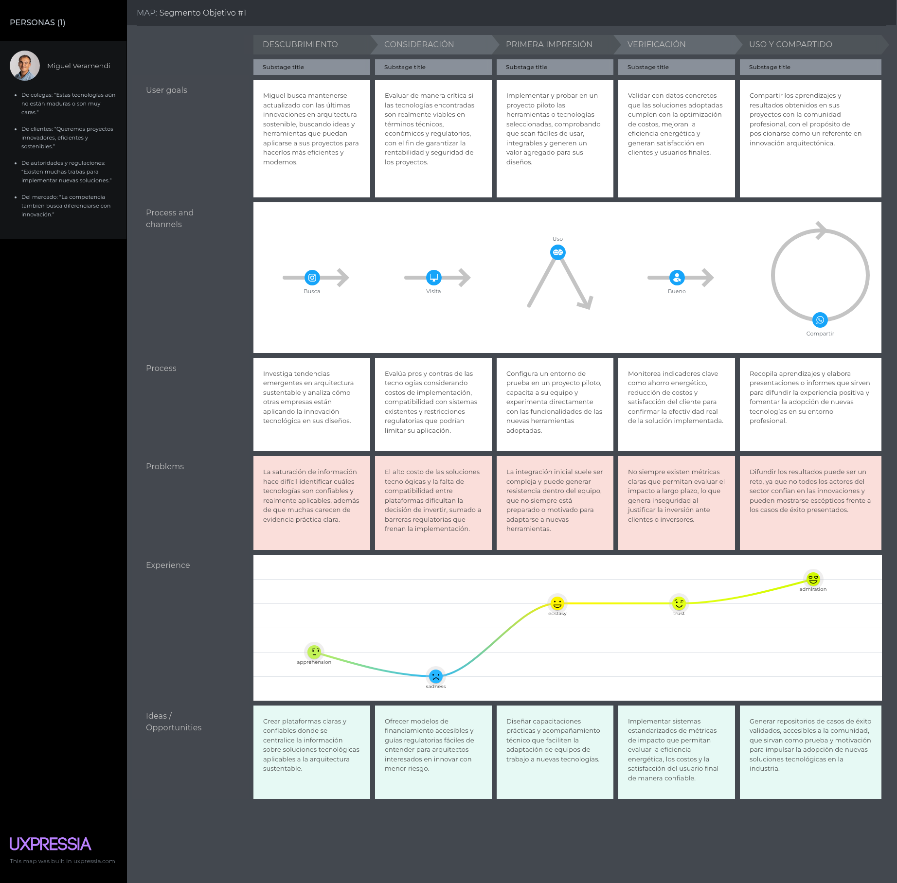

**Segmento Objetivo #2: Dueños de apartamentos**  
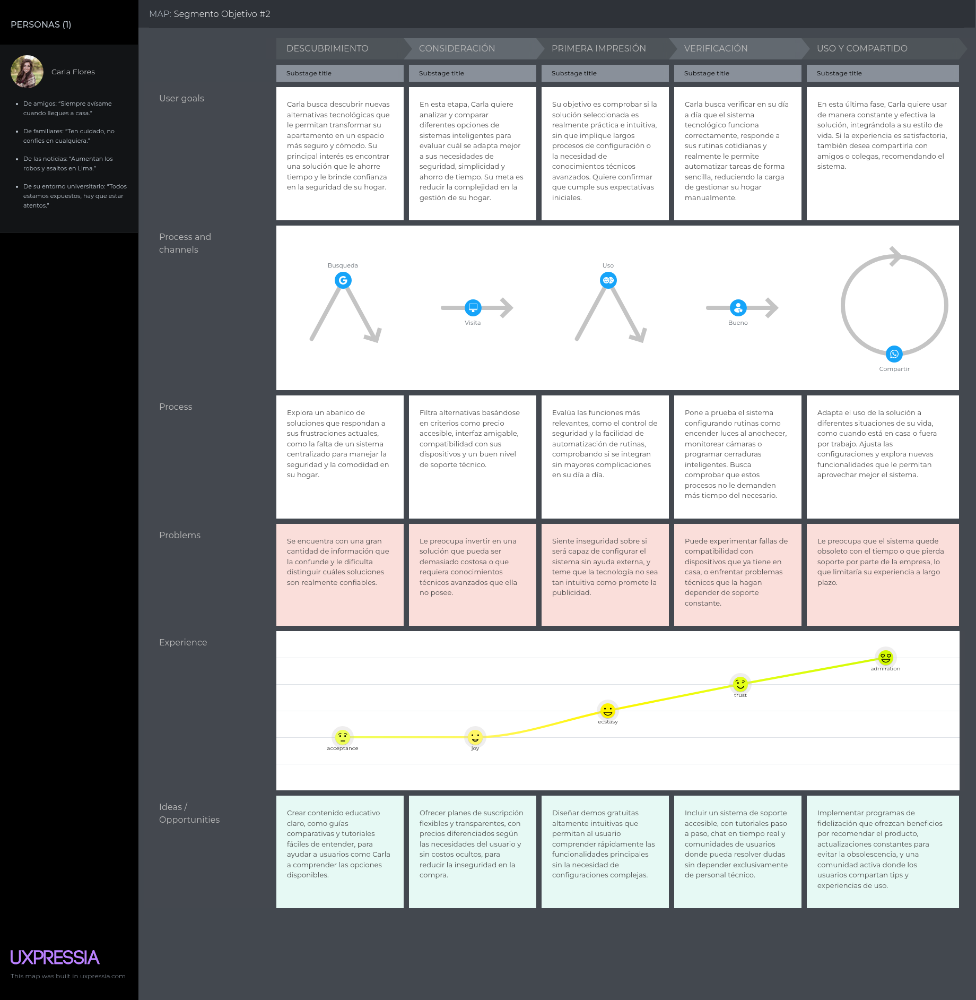

### 2.3.4. Empathy Mapping.

Como parte del enfoque de diseño centrado en el usuario, se desarrollaron mapas de empatía (Empathy Maps) para los dos segmentos principales identificados: Propietarios y Constructoras. Esta técnica, introducida por Dave Gray, permite plasmar de manera visual lo que los usuarios piensan, sienten, expresan y hacen en relación con el producto o servicio, facilitando una comprensión más profunda de su experiencia tanto emocional como cognitiva.

Objetivo del Empathy Mapping
El mapa de empatía tiene como finalidad ampliar la visión sobre el usuario más allá de sus conductas observables, explorando sus motivaciones, temores, frustraciones y aspiraciones implícitas. Se trata de una herramienta clave para identificar oportunidades de mejora desde un enfoque cualitativo, complementando los hallazgos obtenidos a través de entrevistas, observaciones y análisis de comportamientos.

<div style="page-break-before: always;"></div>

**Segmento 1:**

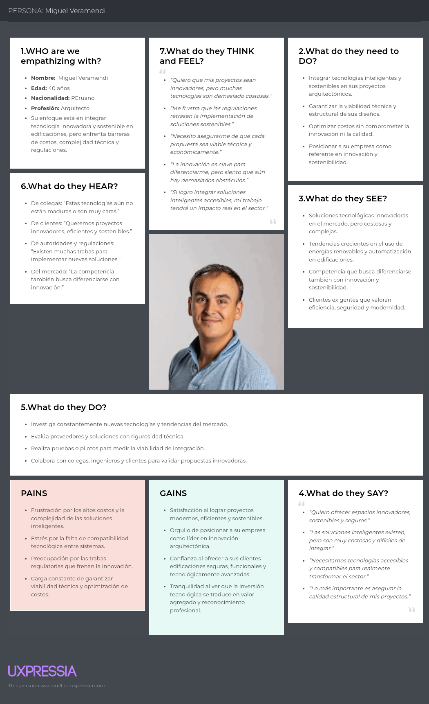

Desglose del Empathy Map 1

Piensa: “Quiero que mis proyectos sean innovadores, pero muchas tecnologías son demasiado costosas.”

Siente: “Me frustra que las regulaciones retrasen la implementación de soluciones sostenibles.”

Dice: “Quiero ofrecer espacios innovadores, sostenibles y seguros.”

Hace: Investiga constantemente nuevas tecnologías y tendencias del mercado.

<div style="page-break-before: always;"></div>

**Segmento 2:**

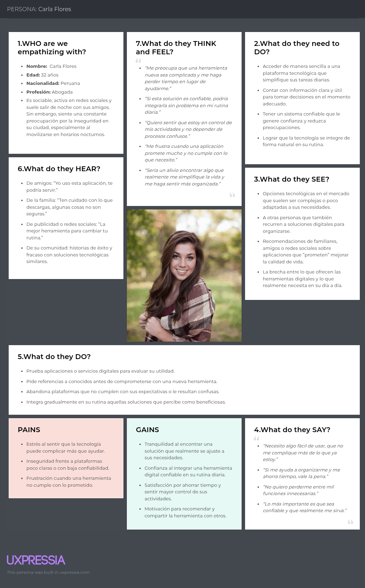

Desglose del Empathy Map 2

Piensa: “Si esta solución es confiable, podría integrarla sin problema en mi rutina diaria.”

Siente: “Me frustra cuando una aplicación promete mucho y no cumple con lo que necesito.”

Dice: “Necesito algo fácil de usar, que no me complique más de lo que ya estoy.”

Hace: Prueba aplicaciones o servicios digitales para evaluar su utilidad.

<div style="page-break-before: always;"></div>

### 2.3.5. As-Is Scenario Mapping

**Segmento 1: Arquitectos e Ingenieros Civiles**


<br>

**Segmento 2: Dueños de apartamentos**


<div style="page-break-before: always;"></div>

### 2.4. Ubiquitous Language.


| Ubiquitous Term | Definición del Dominio Funcional |
| -------- | --------- |
| Client | Empresa constructora o inmobiliaria que contrata la suscripción SaaS para gestionar propiedades y dispositivos. |
| Property Manager | Usuario con rol de administrador de una o varias edificaciones, responsable de la configuración general y supervisión. |
| Resident | Usuario final (dueño o inquilino) que interactúa y controla los dispositivos IoT asignados a su unidad o cuarto específico. |
| Platform Administrator | Operador interno del SaaS, responsable del mantenimiento del sistema, gestión de clientes y configuraciones globales. |
| Property / Building | Edificación física (ej. edificio de apartamentos, condominio) que agrupa múltiples unidades y dispositivos gestionados. |
| Unit | Espacio individual dentro de una propiedad (ej. apartamento, oficina) al cual se le asignan dispositivos y residentes. |
| Device | Cualquier dispositivo físico IoT (termostato, cerradura, sensor) instalado en una unidad y conectado a la plataforma. |
| Device Profile | Plantilla de configuración predefinida para un tipo de dispositivo, que facilita su instalación y aprovisionamiento en masa. |
| Subscription | El plan de servicio contratado por el Cliente que define el acceso a funcionalidades, número de propiedades y dispositivos. |
| Provisioning | Proceso de registrar, configurar y activar un nuevo dispositivo en la plataforma para que sea operativo. |
| Alert | Notificación automática generada por un dispositivo ante un evento predefinido (ej. batería baja, puerta abierta, etc.). |
| Command | Instrucción enviada desde la plataforma a un dispositivo para ejecutar una acción específica (ej. "apagar luz", "ajustar T°"). |
| Telemetry | Flujo de datos y mediciones (ej. temperatura, consumo energético) enviado por un dispositivo hacia la plataforma. |
| Scene / Routine | Conjunto de comandos preconfigurados que se ejecutan sobre uno o varios dispositivos de forma simultánea o programada. |
| Dashboard | Interfaz visual principal que muestra el estado en tiempo real de los dispositivos, alertas y datos relevantes. |
| Device State | El estado operativo actual de un dispositivo, como 'En línea', 'Fuera de línea', 'Batería baja' o 'Error'. |
| Billing Cycle | Periodo recurrente en el que se factura al Cliente por el servicio de la suscripción. |

<div style="page-break-before: always;"></div>

# Capítulo III: Requirements Specification

## 3.1. To-Be Scenario Mapping.

**Segmento 1: Arquitectos e Ingenieros Civiles**


<br>

**Segmento 2: Dueños de apartamentos**


<div style="page-break-before: always;"></div>

## 3.2. User Stories.

### Epics

| Epic ID | Título | Descripción |
|---|---|---|
| EP01 | Landing page informativa | Como visitante del sitio, quiero tener acceso a una plataforma web, para conocer los servicios que brinda la aplicación. |
| EP02 | Gestión de cuentas y acceso | Como ingeniero quiero crear una cuenta para acceder a las funcionalidades de la aplicación |
| EP03 | Internacionalización de la plataforma | Como arquitecto, quiero que la aplicación esté disponible en más de un idioma para seleccionar el idioma de mi preferencia. |
| EP04 | Personalización de espacios inteligentes | Como propietario, quiero personalizar la configuración de mi vivienda y/o edificio, para adaptar el espacio a mis necesidades. |
| EP05 | Gestión de perfil de usuario | Como usuario propietario, quiero actualizar la información de mi perfil, para personalizar mi experiencia en la plataforma. |
| EP06 | Dashboard de personalización del espacio | Como propietario, quiero acceder a un dashboard, para supervisar los dispositivos de mi departamento. |
| EP07 | Gestión de clientes y entregables | Como ingeniero, quiero gestionar la información de mis clientes, para mantener un control organizado de los proyectos. |
| EP08 | Gestión de proyectos inteligentes | Como arquitecto, quiero gestionar proyectos de construcción en la plataforma, para integrar funcionalidades inteligentes desde la planificación. |
| EP09 | Gestión de dispositivos inteligentes | Como Desarrollador, quiero implementar un sistema de gestión de dispositivos inteligentes, para que permita registrar, modificar y asignar dispositivos disponibles dentro de un espacio. |
| EP10 | Gestión de energía en tiempo real | Como Desarrollador, quiero implementar un sistema de monitoreo energético, para que los usuarios puedan consultar el uso de energía en sus espacios. |
| EP11 | Gestión de usuarios | Como desarrollador, quiero gestionar a los usuarios de la plataforma, para asegurar un control adecuado de accesos, roles y permisos |

### 3.2.1. User Stories

<table>
    <tr><th>Story ID</th><th>User</th><th>Priority</th><th>Epic</th></tr>
    <tr><td>US01</td><td>ingeniero</td><td>Media</td><td>EP09</td></tr>
    <tr><th>Title</th><td colspan="3">Visualizar los dispositivos y su distribución por tipo</td></tr>
    <tr><th colspan="4">Description</th></tr>
    <tr><td colspan="4">Como ingeniero, quiero ver cuáles son los dispositivos y cómo están distribuidos por tipo, para realizar un análisis más detallado de los recursos disponibles.</td></tr>
    <tr><th colspan="4">Acceptance Criteria</th></tr>
    <tr><td colspan="4"><strong>Escenario 1: Consulta los dispositivos</strong><br>Dado que el ingeniero accede a la sección de dispositivos,<br>Cuando consulta los dispositivos,<br>Entonces verá una lista detallada de todos los dispositivos conectados, clasificados por tipo.<br><br><strong>Escenario 2: Selecciona un tipo específico</strong><br>Dado que los dispositivos están clasificados por tipo,<br>Cuando selecciona un tipo específico,<br>Entonces verá solo los dispositivos de ese tipo.<br><br><strong>Escenario 3: Se agrega o elimina un dispositivo</strong><br>Dado que el ingeniero puede ver la distribución de dispositivos,<br>Cuando se agrega o elimina un dispositivo,<br>Entonces la distribución se actualiza automáticamente.</td></tr>
</table>

---

<table>
    <tr><th>Story ID</th><th>User</th><th>Priority</th><th>Epic</th></tr>
    <tr><td>US02</td><td>usuario</td><td>Media</td><td>EP05</td></tr>
    <tr><th>Title</th><td colspan="3">Acceder al perfil del usuario</td></tr>
    <tr><th colspan="4">Description</th></tr>
    <tr><td colspan="4">Como usuario, quiero tener acceso a mi perfil, para ver datos como mi nombre, email, número de teléfono y mi dirección.</td></tr>
    <tr><th colspan="4">Acceptance Criteria</th></tr>
    <tr><td colspan="4"><strong>Escenario 1: Consulta su perfil</strong><br>Dado que el usuario accede a la aplicación,<br>Cuando consulta su perfil,<br>Entonces verá una página o sección con la siguiente información: nombre, email, número de teléfono y dirección.<br><br><strong>Escenario 2: La información de contacto está desactualizada</strong><br>Dado que el usuario está visualizando su perfil,<br>Cuando la información de contacto está desactualizada,<br>Entonces puede identificar qué datos están desactualizados (si es el caso).<br><br><strong>Escenario 3: Realiza un cambio en la información personal</strong><br>Dado que el usuario accede a su perfil,<br>Cuando realiza un cambio en la información personal,<br>Entonces la información se guarda correctamente y se actualiza en la base de datos.</td></tr>
</table>

---

<table>
    <tr><th>Story ID</th><th>User</th><th>Priority</th><th>Epic</th></tr>
    <tr><td>US03</td><td>usuario</td><td>Alta</td><td>EP05</td></tr>
    <tr><th>Title</th><td colspan="3">Edición de Información del Perfil</td></tr>
    <tr><th colspan="4">Description</th></tr>
    <tr><td colspan="4">Como usuario, quiero poder editar alguna parte de mi información, como mi email, número de teléfono o dirección, para mantener mis datos actualizados.</td></tr>
    <tr><th colspan="4">Acceptance Criteria</th></tr>
    <tr><td colspan="4"><strong>Escenario 1: Selecciona la opción para editar su información</strong><br>Dado que el usuario accede a su perfil,<br>Cuando selecciona la opción para editar su información,<br>Entonces podrá modificar los siguientes campos: email, número de teléfono y dirección.<br><br><strong>Escenario 2: Hace un cambio en uno de estos campos</strong><br>Dado que el usuario está editando su información,<br>Cuando hace un cambio en uno de estos campos,<br>Entonces la aplicación valida que el formato del email y número de teléfono sea correcto antes de guardar los cambios.<br><br><strong>Escenario 3: Guarda los cambios</strong><br>Dado que el usuario ha editado la información,<br>Cuando guarda los cambios,<br>Entonces recibirá una confirmación de que los datos fueron actualizados exitosamente.<br><br>**Escenario 4: Validación**<br>Dado que el usuario intenta editar un campo,<br>Cuando el campo es obligatorio (por ejemplo, dirección),<br>Entonces se mostrará un mensaje de error si el campo está vacío.</td></tr>
</table>

---

<table>
    <tr><th>Story ID</th><th>User</th><th>Priority</th><th>Epic</th></tr>
    <tr><td>US04</td><td>ingeniero</td><td>Alta</td><td>EP08</td></tr>
    <tr><th>Title</th><td colspan="3">Ver lista de proyectos</td></tr>
    <tr><th colspan="4">Description</th></tr>
    <tr><td colspan="4">Como ingeniero, quiero ver una lista de todos mis proyectos para poder conocer el estado y detalles de cada uno.</td></tr>
    <tr><th colspan="4">Acceptance Criteria</th></tr>
    <tr><td colspan="4"><strong>Escenario 1: El constructor accede a la vista de “Proyectos”</strong><br>Dado que existen proyectos registrados para el constructor,<br>Cuando el constructor accede a la vista de “Proyectos”,<br>Entonces el sistema muestra una lista con todos los proyectos incluyendo imagen, nombre, estado, tasa de ocupación y fecha de creación.<br><br><strong>Escenario 2: El constructor accede a la vista de “Proyectos”</strong><br>Dado que no existen proyectos registrados para el constructor,<br>Cuando el constructor accede a la vista de “Proyectos”,<br>Entonces el sistema muestra un mensaje indicando que no hay proyectos disponibles.</td></tr>
</table>

---

<table>
    <tr><th>Story ID</th><th>User</th><th>Priority</th><th>Epic</th></tr>
    <tr><td>US05</td><td>arquitecto</td><td>Alta</td><td>EP08</td></tr>
    <tr><th>Title</th><td colspan="3">Agregar un nuevo proyecto</td></tr>
    <tr><th colspan="4">Description</th></tr>
    <tr><td colspan="4">Como arquitecto, quiero agregar un nuevo proyecto para poder registrar nuevos desarrollos inmobiliarios.</td></tr>
    <tr><th colspan="4">Acceptance Criteria</th></tr>
    <tr><td colspan="4"><strong>Escenario 1: El constructor envía la solicitud para agregar el proyecto</strong><br>Dado que el constructor proporciona datos válidos (nombre, imagen, estado, unidades totales, fecha de creación, etc.),<br>Cuando el constructor envía la solicitud para agregar el proyecto,<br>Entonces el sistema crea el proyecto y lo muestra en la lista de proyectos.<br><br><strong>Escenario 2: El constructor envía la solicitud para agregar el proyecto</strong><br>Dado que el constructor proporciona datos inválidos (por ejemplo, nombre vacío o formato incorrecto),<br>Cuando el constructor envía la solicitud para agregar el proyecto,<br>Entonces el sistema rechaza la creación y muestra un mensaje de error.</td></tr>
</table>

---

<table>
    <tr><th>Story ID</th><th>User</th><th>Priority</th><th>Epic</th></tr>
    <tr><td>US06</td><td>arquitecto</td><td>Alta</td><td>EP08</td></tr>
    <tr><th>Title</th><td colspan="3">Ver detalles de un proyecto</td></tr>
    <tr><th colspan="4">Description</th></tr>
    <tr><td colspan="4">Como arquitecto, quiero ver los detalles de un proyecto específico para poder revisar su información completa.</td></tr>
    <tr><th colspan="4">Acceptance Criteria</th></tr>
    <tr><td colspan="4"><strong>Escenario 1: El constructor selecciona la opción “Ver Detalles” de ese proyecto</strong><br>Dado que el proyecto existe en el sistema,<br>Cuando el constructor selecciona la opción “Ver Detalles” de ese proyecto,<br>Entonces el sistema muestra la información completa del proyecto seleccionado.<br><br><strong>Escenario 2: El constructor intenta acceder a los detalles del proyecto</strong><br>Dado que el proyecto no existe en el sistema,<br>Cuando el constructor intenta acceder a los detalles del proyecto,<br>Entonces el sistema muestra un mensaje de error indicando que el proyecto no se encuentra disponible.</td></tr>
</table>

---

<table>
    <tr><th>Story ID</th><th>User</th><th>Priority</th><th>Epic</th></tr>
    <tr><td>US07</td><td>Arquitecto</td><td>Alta</td><td>EP07</td></tr>
    <tr><th>Title</th><td colspan="3">Ver Lista de Clientes</td></tr>
    <tr><th colspan="4">Description</th></tr>
    <tr><td colspan="4">Como Arquitecto, quiero ver una lista de todos los clientes para poder gestionar sus proyectos asociados y el estado de su cuenta.</td></tr>
    <tr><th colspan="4">Acceptance Criteria</th></tr>
    <tr><td colspan="4"><strong>Escenario 1: El Arquitecto solicita la lista de clientes</strong><br>Dado que hay clientes en el sistema,<br>Cuando el Arquitecto solicita la lista de clientes,<br>Entonces el sistema devuelve todos los clientes con su Nombre Completo, Proyecto Asociado y Estado de Cuenta,<br>Y el sistema muestra las Acciones disponibles (Ver Perfil e ícono de Configuración/Engranaje).<br><br><strong>Escenario 2: El Arquitecto solicita la lista de clientes</strong><br>Dado que no hay clientes en el sistema,<br>Cuando el Arquitecto solicita la lista de clientes,<br>Entonces el sistema devuelve una lista vacía (o un mensaje indicando "No se encontraron clientes").<br><br><strong>Escenario 3: El Arquitecto ve la lista</strong><br>Dado que hay más clientes que el límite de visualización (ej., 10),<br>Cuando el Arquitecto ve la lista,<br>Entonces el sistema muestra los controles de paginación (número de página, botones siguiente/anterior).</td></tr>
</table>

---

<table>
    <tr><th>Story ID</th><th>User</th><th>Priority</th><th>Epic</th></tr>
    <tr><td>US08</td><td>Arquitecto</td><td>Alta</td><td>EP07</td></tr>
    <tr><th>Title</th><td colspan="3">Agregar un Nuevo Cliente</td></tr>
    <tr><th colspan="4">Description</th></tr>
    <tr><td colspan="4">Como Arquitecto, quiero poder agregar un nuevo cliente para poder registrarlo en el sistema.</td></tr>
    <tr><th colspan="4">Acceptance Criteria</th></tr>
    <tr><td colspan="4"><strong>Escenario 1: El Arquitecto proporciona los datos válidos requeridos (ej., Nombre Completo)</strong><br>Dado que el Arquitecto hace clic en el botón + Add Client (Agregar Cliente),<br>Cuando el Arquitecto proporciona los datos válidos requeridos (ej., Nombre Completo),<br>Entonces el sistema crea el nuevo cliente y lo muestra en la lista.<br><br><strong>Escenario 2: El Arquitecto envía el formulario con datos obligatorios faltantes o inválidos</strong><br>Dado que el Arquitecto hace clic en el botón + Add Client (Agregar Cliente),<br>Cuando el Arquitecto envía el formulario con datos obligatorios faltantes o inválidos,<br>Entonces el sistema rechaza la creación y proporciona un mensaje de error.</td></tr>
</table>

---

<table>
    <tr><th>Story ID</th><th>User</th><th>Priority</th><th>Epic</th></tr>
    <tr><td>US09</td><td>ingeniero</td><td>Media</td><td>EP11</td></tr>
    <tr><th>Title</th><td colspan="3">Ver Plan de Suscripción Actual</td></tr>
    <tr><th colspan="4">Description</th></tr>
    <tr><td colspan="4">Como ingeniero, quiero ver mi plan de suscripción actual y su estado para confirmar los beneficios que tengo y el costo mensual.</td></tr>
    <tr><th colspan="4">Acceptance Criteria</th></tr>
    <tr><td colspan="4"><strong>Escenario 1: El sistema carga la vista</strong><br>Dado que el ingeniero accede a la sección de suscripción,<br>Cuando el sistema carga la vista,<br>Entonces el sistema muestra el nombre del plan actual (Enterprise), su costo total, el estado de la suscripción (Active) y una lista detallada de todos los beneficios incluidos.</td></tr>
</table>

---

<table>
    <tr><th>Story ID</th><th>User</th><th>Priority</th><th>Epic</th></tr>
    <tr><td>US10</td><td>Usuario</td><td>Alta</td><td>EP02</td></tr>
    <tr><th>Title</th><td colspan="3">Iniciar Sesión (Login)</td></tr>
    <tr><th colspan="4">Description</th></tr>
    <tr><td colspan="4">Como Usuario, quiero ingresar mis credenciales (correo y contraseña) para acceder a mi cuenta y utilizar las funciones protegidas.</td></tr>
    <tr><th colspan="4">Acceptance Criteria</th></tr>
    <tr><td colspan="4"><strong>Escenario 1: Hace clic en el botón "Ingresar"</strong><br>Dado que el usuario ingresa un correo y contraseña correctos.<br>Cuando hace clic en el botón "Ingresar".<br>Entonces el sistema valida las credenciales, le otorga acceso y lo redirige al Dashboard correspondiente a su rol.<br><br><strong>Escenario 2: Intenta iniciar sesión</strong><br>Dado que el usuario ingresa un correo no registrado o una contraseña errónea.<br>Cuando intenta iniciar sesión.<br>Entonces el sistema deniega el acceso y muestra un mensaje genérico de error ("Usuario o contraseña incorrectos").</td></tr>
</table>

### 3.1.2. Technical Stories

<table>
    <tr><th>Story ID</th><th>User</th><th>Priority</th><th>Epic</th></tr>
    <tr><td>TS01</td><td>desarrollador</td><td>Alta</td><td>EP08</td></tr>
    <tr><th>Title</th><td colspan="3">Listar proyectos por Constructor</td></tr>
    <tr><th colspan="4">Description</th></tr>
    <tr><td colspan="4">Como desarrollador, quiero solicitar a la API que liste todos los proyectos asociados a un constructor específico, para poder mostrar la vista principal de Proyectos.</td></tr>
    <tr><th colspan="4">Acceptance Criteria</th></tr>
    <tr><td colspan="4"><strong>Escenario 1: Flujo principal</strong><br>Dado que se recibe una solicitud para listar proyectos filtrados por el identificador del constructor (ej. *builderId*),<br>Cuando la API encuentra uno o más recursos de proyecto que coinciden,<br>Entonces la API responde con **200 OK** y devuelve un arreglo no vacío de recursos de proyecto, cada uno incluyendo los campos: *id, imagen, nombre, estado, tasaDeOcupacion y fechaDeCreacion.*<br><br><strong>Escenario 2: Flujo alterno</strong><br>Dado que se recibe una solicitud para listar proyectos de un constructor,<br>Cuando la API no encuentra recursos que coincidan,<br>Entonces la API responde con **200 OK** y devuelve un arreglo vacío.</td></tr>
</table>

---

<table>
    <tr><th>Story ID</th><th>User</th><th>Priority</th><th>Epic</th></tr>
    <tr><td>TS02</td><td>desarrollador</td><td>Alta</td><td>EP08</td></tr>
    <tr><th>Title</th><td colspan="3">Crear un Proyecto</td></tr>
    <tr><th colspan="4">Description</th></tr>
    <tr><td colspan="4">Como desarrollador, quiero añadir un nuevo proyecto a través de la API para poder implementar la funcionalidad de registro de nuevos desarrollos.</td></tr>
    <tr><th colspan="4">Acceptance Criteria</th></tr>
    <tr><td colspan="4"><strong>Escenario 1: Flujo principal</strong><br>Dado que se recibe una solicitud de creación que incluye todos los campos obligatorios y válidos (ej. *nombre, unidadesTotales, fechaDeCreacion*),<br>Cuando la API valida y persiste el nuevo recurso de proyecto exitosamente,<br>Entonces la API responde con **201 Created**, y devuelve la representación del recurso creado (incluyendo *id* y los datos proporcionados).<br><br><strong>Escenario 2: Flujo alterno</strong><br>Dado que se recibe una solicitud de creación con campos obligatorios faltantes o con valores inválidos (ej. un campo numérico incorrecto),<br>Cuando la validación de la API falla,<br>Entonces la API responde con **400 Bad Request** y un payload de error que describe los errores de validación específicos.</td></tr>
</table>

---

<table>
    <tr><th>Story ID</th><th>User</th><th>Priority</th><th>Epic</th></tr>
    <tr><td>TS03</td><td>desarrollador</td><td>Alta</td><td>EP07</td></tr>
    <tr><th>Title</th><td colspan="3">Listar clientes</td></tr>
    <tr><th colspan="4">Description</th></tr>
    <tr><td colspan="4">Como desarrollador, quiero solicitar a la API que liste los clientes, opcionalmente filtrados por estado o nombre, para poder mostrar la vista de la lista de clientes.</td></tr>
    <tr><th colspan="4">Acceptance Criteria</th></tr>
    <tr><td colspan="4"><strong>Escenario 1: Flujo principal</strong><br>Dado que se recibe una solicitud para listar clientes, potencialmente incluyendo parámetros de paginación (*límite*, *offset*) y ordenamiento,<br>Cuando la API encuentra uno o más clientes,<br>Entonces la API responde con **200 OK** y devuelve un arreglo de recursos de cliente, incluyendo *id*, *fullName*, *associatedProject* y *accountStatement*, junto con metadatos de paginación.<br><br><strong>Escenario 2: Flujo alterno</strong><br>Dado que se recibe una solicitud para listar clientes,<br>Cuando la API no encuentra recursos que coincidan,<br>Entonces la API responde con **200 OK** y devuelve un arreglo vacío.</td></tr>
</table>

---

<table>
    <tr><th>Story ID</th><th>User</th><th>Priority</th><th>Epic</th></tr>
    <tr><td>TS04</td><td>desarrollador</td><td>Alta</td><td>EP09</td></tr>
    <tr><th>Title</th><td colspan="3">Listar dispositivos</td></tr>
    <tr><th colspan="4">Description</th></tr>
    <tr><td colspan="4">Como desarrollador, quiero solicitar a la API que liste todos los dispositivos, filtrados por ubicación o estado, para poder mostrar la lista de Gestión de Dispositivos.</td></tr>
    <tr><th colspan="4">Acceptance Criteria</th></tr>
    <tr><td colspan="4"><strong>Escenario 1: Flujo principal</strong><br>Dado que se recibe una solicitud para listar dispositivos,<br>Cuando la API encuentra uno o más recursos de dispositivo,<br>Entonces la API responde con **200 OK** y devuelve un arreglo no vacío de recursos de dispositivo, cada uno incluyendo *id*, *name*, *type*, *location* y *realTimeStatus*.<br><br><strong>Escenario 2: Flujo alterno</strong><br>Dado que se recibe una solicitud para listar dispositivos,<br>Cuando la API no encuentra recursos que coincidan,<br>Entonces la API responde con **200 OK** y devuelve un arreglo vacío.<br><br><strong>Escenario 3: Variación</strong><br>Dado que se recibe una solicitud para listar dispositivos filtrados por un parámetro de *status* (ej. “Offline”),<br>Cuando la API filtra los recursos,<br>Entonces la API responde con **200 OK** y devuelve solo los dispositivos que coinciden con el estado solicitado.</td></tr>
</table>

---

<table>
    <tr><th>Story ID</th><th>User</th><th>Priority</th><th>Epic</th></tr>
    <tr><td>TS05</td><td>desarrollador</td><td>Alta</td><td>EP02</td></tr>
    <tr><th>Title</th><td colspan="3">Registrar nuevo usuario</td></tr>
    <tr><th colspan="4">Description</th></tr>
    <tr><td colspan="4">Como desarrollador, quiero enviar los datos de registro (nombre, email, password, rol) a la API, para crear una nueva identidad en el sistema y permitir el acceso futuro.</td></tr>
    <tr><th colspan="4">Acceptance Criteria</th></tr>
    <tr><td colspan="4"><strong>Escenario 1: Flujo principal</strong><br>Dado que se recibe una solicitud POST con payload válido (email único, password cumple requisitos).<br>Cuando la API persiste el nuevo usuario y encripta la contraseña.<br>Entonces la API responde con **201 Created** y devuelve los datos del usuario creado o un token de acceso inicial.<br><br><strong>Escenario 2: Flujo alterno</strong><br>Dado que se recibe un email que ya está registrado en la base de datos.<br>Cuando la API valida la unicidad del usuario.<br>Entonces la API responde con **409 Conflict** indicando que el recurso ya existe.</td></tr>
</table>

## 3.3. Product Backlog

A continuación, se presenta el Product Backlog, el cual reúne las historias de usuario y las tareas técnicas priorizadas para el desarrollo del proyecto. Cada elemento incluye su identificador, título, descripción y la estimación correspondiente en puntos de historia.

Para la gestión y organización del backlog se utilizó la herramienta Trello, la cual permitió estructurar y visualizar las tareas de forma clara, dinámica y colaborativa. Este backlog se organizó en columnas que representan las distintas etapas del proceso de desarrollo, lo que facilita el seguimiento del avance, la identificación de bloqueos y la adecuada priorización de actividades.

Link de colaboración en trello: https://shorturl.at/FrDjk


| #Orden | User Story ID | Titulo | Sprint | Story Points (1/2/3/5/8) |
|--------|---------------|--------|-------------|--------------------------|
| 1 | US01 | Visualizar los dispositivos y su distribución por tipo | 2 | 8 |
| 2 | US02 | Acceder al perfil del usuario | 3 | 3 |
| 3 | US03 | Editar la información del perfil | 3 | 3 |
| 4 | US04 | Ver lista de proyectos | 1 | 5 |
| 5 | US05 | Agregar un nuevo proyecto | 1 | 8 |
| 6 | US06 | Ver detalles de un proyecto | 1 | 5 |
| 7 | US07 | Ver Lista de Clientes | 2 | 5 |
| 8 | US08 | Agregar un Nuevo Cliente | 2 | 3 |
| 9 | US09 | Ver Plan de Suscripción Actual | 3 | 8 |
| 10 | US10 | Iniciar Sesión (Login) | 1 | 3 |
| 11 | TS01 | Listar proyectos por Constructor | 1 | 5 |
| 12 | TS02 | Crear un Proyecto | 1 | 2 |
| 13 | TS03 | Listar clientes | 2 | 5 |
| 14 | TS04 | Listar dispositivos | 2 | 5 |
| 15 | TS05 | Registrar nuevo usuario | 1 | 5 |

---

### 3.4. Impact Mapping.

El Impact Mapping es una metodología visual que permite alinear los objetivos estratégicos de un negocio con las acciones concretas de los usuarios y las funcionalidades de un producto digital. A través de una estructura jerárquica en forma de árbol, esta técnica evidencia cómo las metas empresariales se traducen en cambios de comportamiento esperados en los actores clave, así como en los entregables que hacen posible dichos cambios.

En el desarrollo de este proyecto, esta herramienta se empleó para organizar de manera clara la relación entre las metas SMART del modelo digital, los User Personas previamente definidos y las funcionalidades necesarias para alcanzar los objetivos. El trabajo consideró los siguientes elementos:

* Business Goals SMART: metas específicas, medibles y con plazos definidos, orientadas tanto a la adquisición de usuarios como a su retención a largo plazo.

* Actores principales: representados por Miguel Veramendi y Carla Flores, definidos a partir de sus motivaciones y del rol que desempeñan en el uso de la solución.

* Impactos esperados: formulados como comportamientos observables que cada actor debe adoptar para contribuir al logro de los objetivos (por ejemplo, integrar la solución en propuestas de diseño o personalizar espacios del hogar).

* Deliverables funcionales: características o componentes del producto diseñados para generar dichos impactos, como plantillas de propuestas, paneles de métricas o notificaciones guiadas.

El mapa se elaboró bajo un enfoque de diseño centrado en el usuario, apoyado en dinámicas visuales colaborativas que facilitan la alineación entre los objetivos de negocio y el desarrollo técnico de la solución.

"Anexo: Impact Mapping"

https://drive.google.com/drive/folders/1EJW8bNS65Z4DgjwuNBIIRwbDrMOgehws?usp=sharing

**Business Goal 1: Alcanzar 600 suscripciones activas al plan inicial en un periodo de 8 meses.**

Este objetivo constituye el primer hito estratégico para consolidar el modelo de negocio digital. Su enfoque principal está en la captación de usuarios iniciales que permitan validar la propuesta de valor y establecer un flujo de ingresos sostenible durante la fase temprana del proyecto. La meta de alcanzar 600 suscripciones en 8 meses no solo es concreta y medible, sino también viable según el análisis de mercado, y responde a la necesidad de lograr un punto de equilibrio en el corto plazo, asegurando una rápida tracción de la solución.

Además, este objetivo se encuentra alineado con el rol de los actores clave identificados, Miguel Veramendi y Carla Flores, quienes, mediante comportamientos estratégicos como integrar la solución en sus proyectos, utilizarla de manera constante y recomendarla activamente, impulsan el crecimiento de la base de usuarios. En este sentido, se busca evidenciar que el producto aporta valor desde sus primeras etapas, incentivando tanto a profesionales como a usuarios finales a convertirse en promotores orgánicos de la plataforma.

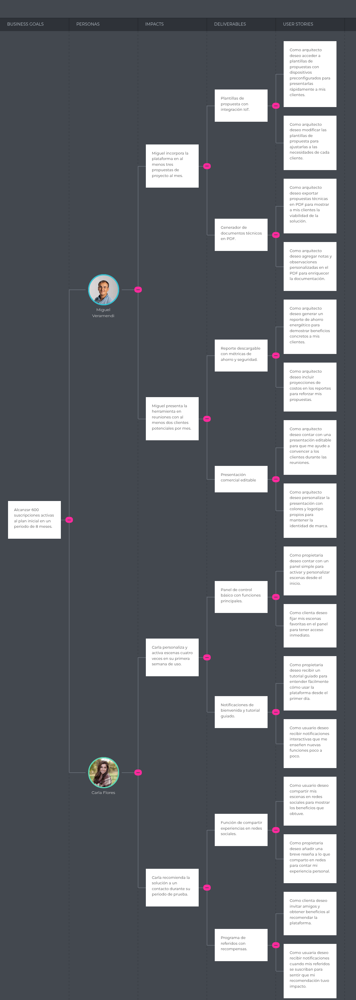

**Business Goal 2: Automatizar el 70 % de los procesos de personalización en un periodo de 6 meses y aumentar la retención de clientes recurrentes en un 25 % en 9 meses**

Este objetivo está orientado a fortalecer la eficiencia operativa y la sostenibilidad del negocio en el mediano plazo. Tras consolidar una base inicial de usuarios, el siguiente paso consiste en reducir la fricción en la interacción con la solución mediante la implementación de automatizaciones que hagan la experiencia más ágil, intuitiva y atractiva. Alcanzar un 70 % de automatización en los procesos de personalización en un periodo de 6 meses permitirá a los usuarios percibir mayor comodidad y ahorro de tiempo, incrementando así su satisfacción y confianza en la plataforma.

De forma complementaria, se plantea aumentar la retención de clientes recurrentes en un 25 % en 9 meses, con el objetivo de consolidar relaciones a largo plazo y disminuir la tasa de abandono. Este crecimiento en la retención se sustenta en la mejora continua de la experiencia del usuario, el acompañamiento constante y la entrega de valor tangible a lo largo del tiempo.

En conjunto, este objetivo no solo impulsa la optimización de los procesos internos, sino que también refuerza la viabilidad del modelo de negocio a largo plazo, promoviendo la fidelización de los clientes y su evolución hacia usuarios recurrentes.

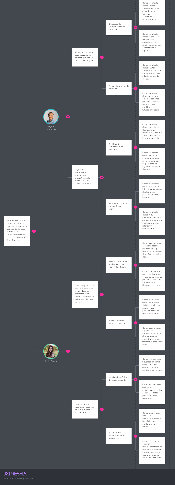

<div style="page-break-before: always;"></div>

# Capítulo IV: Product Design 
## 4.1. Style Guideline
### 4.1.1. General Style Guidelines
#### **Tipografía**
La tipografía seleccionada para los encabezados de nuestra marca es **Poppins**, debido a su estilo moderno. Su diseño elegante permite destacar títulos y secciones importantes, generando un impacto claro y atractivo para los usuarios. Esto la convierte en una elección ideal para comunicar innovación y profesionalismo dentro de la identidad visual.

Para el cuerpo de texto, se eligió **Roboto**, una tipografía ampliamente reconocida por su legibilidad en entornos digitales. Su diseño asegura una experiencia de lectura cómoda incluso en párrafos extensos. Al combinarse con Poppins, se logra un contraste armónico que refuerza la jerarquía tipográfica y facilita la comprensión del contenido.

Los tamaños tipográficos definidos, desde los **12px (0.75rem)** para detalles secundarios hasta los **36px (2.25rem)** para títulos principales, garantizan una estructura clara y ordenada. En conjunto, las elecciones tipográficas y de tamaños consolidan una comunicación visual coherente y funcional.

#### **Colores**
La elección de la paleta de colores en nuestro proyecto obedece a una estrategia visual cuidadosamente planificada, orientada a reflejar tecnología, confianza y sofisticación, valores fundamentales en la propuesta de CcaritaTech.

- **Landing Page** <br>
  

En la identidad visual, el color **verde menta primario (#10B981)** cumple el rol principal como color distintivo de la marca. Su tono fresco y vibrante transmite innovación y confianza, características que refuerzan la propuesta de valor de nuestro proyecto. Al mismo tiempo, este color genera una sensación positiva y cercana, lo que ayuda a establecer una conexión emocional con el usuario desde el primer contacto.

Para lograr versatilidad y equilibrio, se incorporan dos variaciones del color primario. El color **menta claro (#ECFDF5)** se utiliza en fondos y áreas de descanso visual, ofreciendo luminosidad y amplitud sin perder coherencia cromática. Por su parte, el color **menta oscuro (#059669)** se reserva para realizar el contraste en los botones ya que para estos se usa el color menta claro. Este color aporta estructura y profesionalismo, asegurando que la información crítica sea fácilmente distinguible.

En cuanto a la gama neutra, el **gris muy claro (#F9FAFB)** funciona como base para pantallas y secciones de contenido. Su neutralidad transmite orden y simplicidad, garantizando legibilidad y claridad al dar protagonismo a los elementos interactivos. En contraste, el **gris muy oscuro (#111827)** se emplea en títulos, encabezados y áreas que requieren solidez visual. Este color aporta estructura y profesionalismo, asegurando que la información crítica sea fácilmente distinguible.

Para complementar la lectura, el sistema tipográfico integra dos niveles de color en los textos. El **texto primario (#111827)**, de alto contraste sobre fondos claros, asegura una comprensión inmediata y sin esfuerzo. En paralelo, el **texto secundario (#6B7280)** se aplica en descripciones, anotaciones o contenidos de menor jerarquía. Este gris intermedio suaviza la presentación de la información y evita la saturación visual, manteniendo un estilo moderno y equilibrado.

En conjunto, esta paleta de verdes menta combinados con grises neutros y acentos bien definidos construye una interfaz clara, fresca y profesional. La coherencia cromática no solo mejora la experiencia de usuario, sino que también refuerza los valores de accesibilidad, confianza y modernidad que nuestra marca desea transmitir.

#### **Lenguaje**
En IoBuild, utilizaremos un lenguaje que refleje nuestra visión de transformar la construcción residencial mediante la integración inteligente de tecnología desde el diseño. Queremos conectar tanto con constructoras y desarrolladores como con los futuros propietarios, manteniendo siempre una comunicación clara, cercana y profesional. La combinación de tonos que emplearemos es la siguiente:

1. **Profesional pero accesible:** Nuestro objetivo es transmitir seriedad y conocimiento en la aplicación de soluciones tecnológicas a la construcción, sin dejar de ser comprensibles para todos los actores involucrados. Nuestro lenguaje estará planteado de manera clara y cercana, de modo que tanto expertos como clientes puedan comprender el valor de nuestra propuesta sin barreras.

2. **Formal pero cálido:** Si bien mantenemos un tono formal que exprese compromiso, seguridad y confiabilidad, también buscamos acercarnos a nuestros usuarios de una manera humana y auténtica. Queremos que desarrolladores y propietarios sientan que IoBuild no solo ofrece tecnología, sino también acompañamiento y confianza en cada etapa del proceso.

3. **Respetuoso y empático:** Reconocemos la diversidad de necesidades en el sector, desde constructoras que buscan eficiencia hasta propietarios que desean hogares adaptables y modernos. Nuestro lenguaje transmitirá respeto, promoviendo una relación colaborativa y de apoyo mutuo.

4. **Inspirador y optimista:** En IoBuild creemos que el futuro de la construcción es más sostenible, adaptable y tecnológico. Por ello, nos comunicaremos con entusiasmo y convicción, motivando a nuestros usuarios a visualizar y construir una nueva forma de habitar hogares inteligentes.

## 4.2 Information Architecture
### 4.2.1. Organization Systems

En esta sección se define cómo se organiza la información dentro de la Landing Page de IoBuild, considerando la estructura visual del contenido y su distribución dentro de la plataforma. Estas decisiones buscan facilitar la comprensión y navegación de los usuarios, permitiendo que encuentren de manera sencilla la propuesta de valor y los recursos más importantes, reduciendo la carga mental y dirigiendo la atención hacia los elementos esenciales.

#### Organización visual del contenido

La organización visual en IoBuild se basa principalmente en los enfoques jerárquico y temático, aplicados de acuerdo con la prioridad y naturaleza de la información presentada en la Landing Page.

**a) Organización jerárquica (Visual Hierarchy)**

La organización jerárquica constituye la base de la estructura de la Landing Page. La información se presenta siguiendo una lógica de prioridad, comenzando por los elementos principales de la propuesta de valor y continuando con información complementaria.

En IoBuild, esta jerarquía se organiza de la siguiente manera:

Hero section: presenta un mensaje directo sobre la propuesta de valor y un llamado a la acción destacado: “Explora IoBuild”.
Beneficios de la plataforma: presentan información dirigida a arquitectos, ingenieros y propietarios de viviendas.
Presentación del equipo: incorpora información complementaria sobre las personas detrás del proyecto.
Objetivos del proyecto: permiten conocer los propósitos de IoBuild.
Canales de contacto: proporcionan los medios para establecer comunicación.
Esta jerarquía permite que los usuarios comprendan de manera inmediata qué es IoBuild, para quién está dirigido y cómo pueden empezar a interactuar con la solución.

**b) Organización temática**

La organización temática se aplica mediante la división de la Landing Page en diferentes bloques de contenido. Cada bloque aborda un aspecto específico de IoBuild, permitiendo presentar la información de manera ordenada.

Los principales bloques temáticos son:

Propuesta de valor
Beneficios de la plataforma
Presentación del equipo
Objetivos del proyecto
Canales de contacto
Esta distribución facilita la comprensión del contenido al presentar cada aspecto de la plataforma dentro de una sección específica.

**c) Organización responsiva**

La Landing Page implementa un diseño responsivo, permitiendo que la organización del contenido se adapte tanto a dispositivos móviles como de escritorio.

Esta característica busca asegurar una experiencia fluida y clara independientemente del dispositivo desde el cual el usuario acceda a IoBuild.

#### Sistemas de categorización de contenido

Complementando la organización visual, IoBuild agrupa su contenido de acuerdo con diferentes aspectos relacionados con la información presentada y los usuarios a los que está dirigida.

**a) Categorización por audiencia**

La información de la Landing Page se orienta hacia tres grupos principales de usuarios:

Arquitectos
Ingenieros
Propietarios de viviendas
Esta categorización permite presentar los beneficios de la plataforma considerando los diferentes perfiles a los que está dirigida la propuesta de IoBuild.

**b) Categorización por contenido**

El contenido se organiza en diferentes secciones según el tipo de información que se desea comunicar. Entre ellas se encuentran la propuesta de valor, los beneficios de la plataforma, la presentación del equipo, los objetivos del proyecto y los canales de contacto.

Esta organización permite que cada sección cumpla con una función específica dentro de la comunicación general de la Landing Page.

**c) Categorización por navegación**

La navegación de IoBuild se refuerza mediante el header y el footer, los cuales centralizan los diferentes accesos disponibles en la Landing Page.

El header contiene los accesos principales de navegación:

Inicio
Características
Contacto
Por su parte, el footer incorpora elementos secundarios, como redes sociales y enlaces informativos.

Esta disposición facilita el acceso a las diferentes secciones y recursos disponibles dentro de la Landing Page.

Finalmente, IoBuild aplica el principio de progressive disclosure, permitiendo presentar la información de manera progresiva y evitando mostrar todos los contenidos al mismo tiempo. De esta forma, la estructura de la Landing Page facilita que los usuarios comprendan qué es IoBuild, para quién está dirigido y cómo pueden empezar a interactuar con la solución.

### 4.2.2. Labelling Systems

En el marco del diseño de la arquitectura de información, los Labeling Systems cumplen la función de comunicar de forma clara, coherente y predecible los elementos de interacción presentes en la interfaz. En IoBuild, cada etiqueta textual utilizada en botones, menús, enlaces y secciones está orientada a guiar al usuario en su recorrido por la Landing Page, facilitando la comprensión del propósito del proyecto y motivando la interacción con los elementos principales.

La siguiente tabla resume las etiquetas implementadas, su ubicación y su función en la experiencia de usuario:

| Etiqueta | Ubicación/Componente | Función |
|----------|----------------------|---------|
| Inicio | Header | Enlace a la página principal. Término estándar y familiar para usuarios. |
| Sobre Nosotros | Header | Presentación del propósito y misión del proyecto. Genera cercanía y confianza. |
| Equipo | Header | Sección dedicada al grupo desarrollador, destacando transparencia y credibilidad. |
| Contacto | Header | Canal directo para comunicación con el equipo. Claro y orientado a la acción. |
| Explora IoBuild | Hero Section (CTA principal) | Llamada a la acción inmediata para iniciar interacción con la plataforma. Imperativo motiva al usuario. |
| Objetivos | Sección informativa | Describe las metas del proyecto. Etiqueta concisa y orientada al valor. |
| Proyecto | Sección informativa | Explica en detalle la propuesta tecnológica. Término claro y descriptivo. |
| Contáctanos | Footer | Refuerzo del canal de comunicación, mantiene consistencia semántica. |
| Síguenos | Footer / Redes sociales | Agrupa accesos a redes sociales. Etiqueta convencional y reconocida globalmente. |
| IoBuild | Marca | Nombre distintivo en mayúsculas. Actúa como ancla visual e identitaria del sitio. |

El sistema de etiquetado en la Landing Page de IoBuild refleja una aplicación consistente de principios de usabilidad y arquitectura de información. Las etiquetas emplean un lenguaje simple, reconocible y orientado a la acción, lo que facilita tanto la navegación como la comprensión inmediata de los contenidos. Asimismo, existe una coherencia semántica entre el header, el cuerpo de la página y el footer, acompañada de un uso de imperativos y sustantivos comunes que refuerzan la accesibilidad cognitiva. Este Labeling System contribuye a la claridad, consistencia y escalabilidad de la experiencia web, garantizando que tanto profesionales técnicos como usuarios finales puedan interactuar sin fricciones con la plataforma.

### 4.2.3. SEO Tags and Meta Tags

Los meta tags y etiquetas SEO son elementos esenciales dentro de la sección <head> de cualquier página web, ya que permiten definir cómo es interpretado, indexado y presentado el contenido de un sitio por parte de los motores de búsqueda (como Google) y las redes sociales (como Facebook, Twitter o LinkedIn). Aunque estos elementos no son visibles de forma directa para los usuarios, desempeñan un papel crucial en el posicionamiento orgánico, en la forma en que los enlaces se muestran al compartirse y en la claridad con la que se comunica la propuesta de valor del sitio.

En el caso de la Landing Page de IoBuild, se han incorporado meta etiquetas específicas con el objetivo de optimizar la indexación y visibilidad de la plataforma. La meta descripción resume de manera breve y clara la propuesta de IoBuild como una solución tecnológica orientada a la gestión y personalización de espacios inteligentes. Asimismo, se han definido meta keywords que incluyen términos relevantes como IoT, domótica, arquitectura inteligente, automatización de espacios y gestión de hogares inteligentes, lo que refuerza la capacidad del sitio para aparecer en búsquedas relacionadas.

#### 1. Index
La página principal de IoBuild incorpora un conjunto de etiquetas SEO que fortalecen su posicionamiento y presencia digital. Se incluyen una meta descripción clara sobre la propuesta de valor, palabras clave relacionadas con IoT y automatización residencial, así como etiquetas Open Graph y Twitter Card que aseguran una visualización atractiva y coherente al compartir el sitio en redes sociales. Estas configuraciones, junto con el ajuste de vista responsiva y la codificación adecuada, contribuyen a una experiencia accesible, profesional y optimizada para buscadores y usuarios.


#### 2. About Us
La página Sobre Nosotros de IoBuild incluye etiquetas SEO básicas que refuerzan su propósito informativo y de marca. Se define un título claro y directo, junto con una meta descripción que comunica la misión del proyecto y presenta al equipo como motor de la propuesta de innovación en la industria de la construcción mediante tecnología IoT. Además, se configuran los parámetros técnicos de codificación (UTF-8) y de vista responsiva, asegurando accesibilidad, correcta interpretación del contenido y una experiencia de navegación óptima en distintos dispositivos.


#### 3. FAQ
La página FAQ - Preguntas Frecuentes de IoBuild incorpora etiquetas SEO orientadas a brindar claridad y accesibilidad al usuario. Se define un título descriptivo y directo que comunica de inmediato el propósito de la sección, acompañado de una meta descripción que resume su función como espacio de resolución de dudas sobre la plataforma SaaS y sus aplicaciones en proyectos de construcción con IoT. Asimismo, se incluyen configuraciones técnicas esenciales como la codificación UTF-8 y la vista responsiva, garantizando una correcta interpretación del contenido y una experiencia de navegación fluida en diversos dispositivos.


### 4.2.4. Searching Systems

Al ingresar a la landing page de IoBuild, el usuario será recibido con una sección principal que introduce la propuesta de valor de la plataforma, acompañada de un botón destacado que invita a conocer más sobre sus funcionalidades. En la parte superior, la navegación se organiza mediante un menú claro y accesible que permite desplazarse hacia las secciones clave, como Sobre Nosotros, Preguntas Frecuentes y Contacto. Esta estructura busca brindar una experiencia fluida y ordenada, evitando confusiones y facilitando el acceso a la información más relevante.

La navegación está reforzada con etiquetas descriptivas, jerarquía visual y un diseño responsivo, de manera que el usuario siempre tenga claridad sobre en qué parte del sitio se encuentra y cómo puede avanzar o retroceder dentro del flujo. El enfoque de la interfaz prioriza la simplicidad y la claridad, asegurando que el visitante pueda comprender rápidamente la misión de IoBuild y decidir explorar más a fondo sus soluciones tecnológicas.

### 4.2.5. Navigation Systems

La navegación es un elemento central en la landing page de IoBuild, ya que estructura el recorrido del usuario y facilita el acceso a la información clave sobre la plataforma. Bajo principios de simplicidad, accesibilidad y jerarquía visual, el sistema de navegación ha sido diseñado para garantizar una experiencia clara e intuitiva, tanto en dispositivos de escritorio como en móviles.

IoBuild implementa un sistema de navegación global, persistente y horizontal, ubicado en la parte superior de la página. Este está compuesto por siete elementos principales:
- **Home:** vinculado al logotipo de IoBuild, que permite regresar a la página de inicio desde cualquier sección.
- **Beneficios:** apartado que resalta las ventajas concretas para constructoras y propietarios.
- **Características:** detalle funcional de la plataforma.
- **Planes:** presenta las opciones comerciales y niveles de servicio adecuados para distintos tamaños de proyecto.
- **Sobre Nosotros:** ofrece información acerca de la misión, visión y equipo detrás del proyecto.
- **FAQ:** presenta un apartado de preguntas frecuentes que resuelve las dudas más comunes de los usuarios.
- **Empezar ahora (CTA):** botón destacado que impulsa la conversión (registro o contacto para proyecto), visualmente diferenciado del resto de enlaces.

El diseño del header utiliza un fondo uniforme y elementos textuales de alto contraste, siguiendo un estilo minimalista que evita distracciones y centra la atención en las decisiones de navegación. La organización de los enlaces sigue una estructura en tres zonas: el logotipo alineado a la izquierda, las secciones principales al centro y las acciones de contacto alineadas a la derecha.

En cuanto a adaptabilidad, la barra de navegación está construida bajo un enfoque mobile-first, ajustándose dinámicamente a distintas resoluciones. En pantallas pequeñas, el menú horizontal se convierte en un menú tipo hamburguesa, asegurando que todas las secciones permanezcan accesibles sin comprometer la usabilidad.

Finalmente, la navegación en IoBuild cumple con principios fundamentales de usabilidad:
- **Claridad:** los enlaces son directos y fácilmente identificables.
- **Consistencia:** la barra se mantiene visible y uniforme en todo momento.
- **Jerarquía:** las secciones más consultadas están ubicadas estratégicamente en el centro de la navegación.
- **Retroalimentación visual:** se incluyen estados hover y focus que refuerzan la interacción del usuario.

## 4.3. Landing Page UI Design

La sección de Landing Page UI Design busca definir, estructurar y validar la interfaz visual de la página principal de IoBuild, garantizando una experiencia clara, accesible y centrada en los distintos perfiles de usuario interesados en soluciones IoT para la construcción. Para esta fase se diseñaron los primeros wireframes, los cuales permitieron organizar los contenidos clave como la propuesta de valor de la plataforma, los beneficios, características principales, planes de servicio, sección “Sobre Nosotros”, preguntas frecuentes y un footer con enlaces a contacto y redes sociales. Posteriormente, se elaboraron mockups de alta fidelidad aplicando un sistema de diseño minimalista y funcional, priorizando la jerarquía informativa, la coherencia visual y la consistencia entre dispositivos.


El sitio web de "lobuild" está construido como un viaje lógico y persuasivo, diseñado para guiar a un potencial cliente desde la primera impresión hasta la conversión final, construyendo valor y confianza en cada paso.

El recorrido comienza en la sección de inicio, que capta la atención de inmediato con un titular audaz: "Revoluciona Tus Proyectos Residenciales". Esta primera sección establece la propuesta de valor central, explicando que la plataforma beneficia tanto a los administradores (con gestión centralizada) como a los futuros propietarios (con control personalizado), posicionándose como una solución integral desde el principio.

A continuación, la sección "¿Por qué elegir ioBuild?" profundiza en esta promesa inicial, desglosándola en seis beneficios claros y tangibles. Aborda directamente las motivaciones del cliente, hablando de valor agregado para el proyecto, ahorro de energía, y una integración desde la construcción que evita costos futuros. Esta parte responde a la pregunta fundamental del cliente: "¿Qué gano yo con esto?".

Una vez que el cliente entiende los beneficios, el sitio pasa a demostrar su capacidad técnica en la sección de "Características Técnicas Avanzadas". Aquí se muestra cómo se cumplen las promesas, presentando el dashboard intuitivo, la compatibilidad con un amplio ecosistema de dispositivos y las herramientas especializadas para la gestión de áreas comunes. Esta sección es crucial para generar credibilidad y demostrar que la plataforma es robusta y bien diseñada.

Con el valor y la tecnología ya establecidos, el enfoque se desplaza hacia la construcción de confianza a un nivel más humano. La sección de "Testimonios de clientes" utiliza la prueba social, mostrando a líderes de otras empresas constructoras que validan el éxito, la fiabilidad y el retorno de inversión de la plataforma. Poco después, la página "Sobre Nosotros" complementa esto humanizando la marca, presentando la misión, los valores y, más importante, al equipo de expertos detrás del proyecto. Juntas, estas secciones le dicen al cliente: "Somos expertos en lo que hacemos y otras empresas como la tuya ya confían en nosotros".

Finalmente, el sitio se enfoca en eliminar las últimas barreras para la compra. La página de "Preguntas Frecuentes" se anticipa a cualquier duda restante sobre implementación, precios o soporte, ofreciendo respuestas claras y transparentes. Esto conduce de forma natural a la sección de "Planes de la aplicación", donde la decisión se vuelve tangible. Con una estructura de precios escalable y un plan "Más Popular" claramente destacado, se facilita al cliente la elección de la opción que mejor se adapte a su escala. Por último, el "Footer" o pie de página actúa como una red de seguridad: ofrece un último llamado a la acción y un mapa completo del sitio para quienes necesiten más información, asegurando que ninguna pregunta quede sin respuesta y que el camino para empezar sea siempre accesible.


### 4.3.1. Landing Page Wireframe

[Link ded Figma]<https://shorturl.at/ZkQuE>

#### 1. Home
- La interfaz sigue una estructura en Z con un header fijo con logo y menú principal, un hero section con título, subtítulo y un llamado a la acción destacado (“Empezar ahora”). En las secciones intermedias se presentan los beneficios en formato de tarjetas, seguidos de testimonios y planes de precios. El footer reúne enlaces organizados por categorías, accesos a redes sociales y aviso de copyright. El diseño es claro, escaneable y enfocado en la conversión, guiando al usuario de manera natural desde el primer contacto hasta la acción final.<br>


<br>

#### 2. About Us
- El wireframe de About se organiza en un esquema de columnas, a la izquierda se ubican el título y los párrafos descriptivos, mientras que a la derecha se reserva un espacio para la imagen. La página integra secciones jerarquizadas que construyen una narrativa clara sobre la identidad de la marca. En la parte inferior se disponen tarjetas con íconos y descripciones, seguidas de la presentación del equipo con un miembro destacado y cuatro integrantes adicionales. La composición se enmarca con una navegación principal en la parte superior y un footer completo al final, manteniendo coherencia visual y un flujo narrativo fluido.<br>


<br>

#### 3. FAQ
- La sección adopta un acordeón vertical, donde cada pregunta se despliega para mostrar respuestas detalladas. Los contenidos abarcan temas clave como precios, diseño, edición y alianzas. En la parte superior, filtros por categoría facilitan la exploración del material, mientras que en la parte inferior un CTA “Didn’t Find Your Answer?” dirige a la página de contacto. El diseño mantiene un estilo minimalista y ordenado, y una jerarquía visual clara, optimizada para la legibilidad y una experiencia sin distracciones.<br>


<br>

### 4.3.2. Landing Page Mock-up

#### 1. Home
- El mockup de la página principal presenta una estética moderna y minimalista, enfocada en la claridad y la atracción visual. En la parte superior, el header integra el logo junto con enlaces a Benefits, Features, Plans, About Us y FAQ, además de un botón de llamado a la acción “Get Started”. El hero section concentra la atención con un título llamativo y un botón CTA (“I want it!”) sobre un fondo verde claro. Más abajo, el contenido se organiza en bloques visuales con imágenes y una tipografía legible, destacando secciones como “Advanced Technical Features” y “Plans Designed for Your Scale”. Finalmente, el footer reúne enlaces estructurados (Home Page, Community, Legal, Company), íconos de redes sociales y un mensaje de marca que refuerza la identidad visual del sitio.


<br>

#### 2. About Us
- Esta sección presenta una introducción sobre la misión de CcaritaTech, destacando su enfoque en la innovación y el impacto social. Le siguen las secciones “Our Values” y “Our Team”, que reflejan los principios de la organización y presentan a su equipo. Cada apartado combina textos con imágenes representativas, creando una composición equilibrada. Predomina un estilo limpio y luminoso, con fondos claros, amplio espaciado y jerarquía tipográfica definida, lo que refuerza la coherencia visual y facilita una experiencia clara y atractiva para el usuario.


<br>

#### 3. FAQ
- El mockup de la sección FAQ utiliza una estructura de acordeón que organiza las preguntas frecuentes de forma clara y accesible. Al desplegar cada entrada, se muestra una respuesta concisa y comprensible, manteniendo la coherencia con el branding visual de la plataforma. Además, se incorpora una sección complementaria con canales de contacto para ofrecer soporte adicional. La interfaz destaca por su simplicidad, legibilidad y enfoque en la eficiencia, facilitando que el usuario encuentre rápidamente la información que necesita.


<br>

## 4.4. Mobile Applications UX/UI Design
La sección de Diseño UX/UI de Aplicaciones Móviles se enfoca en la creación de interfaces intuitivas y la definición de experiencias de usuario optimizadas para dispositivos móviles dentro de las soluciones de IoBuild. Este proceso comprende desde la conceptualización de pantallas funcionales hasta el diseño de flujos de interacción adaptados al entorno móvil, considerando las necesidades específicas de nuestros dos segmentos clave: Arquitectos/Ingenieros y Propietarios.

En esta etapa inicial, se desarrollaron mockups de alta fidelidad alineados con el sistema visual y la identidad de marca de IoBuild, asegurando una experiencia coherente y moderna en cada pantalla de la aplicación móvil. El diseño prioriza la simplicidad, la claridad visual y la facilidad de uso en contextos de movilidad.

Los componentes de la interfaz fueron organizados cuidadosamente siguiendo patrones de navegación mobile-first y flujos de usuario previamente validados, tomando como referencia los Empathy Map definidos en fases anteriores. Esto permite que cada interacción sea rápida, intuitiva y orientada a cumplir tareas específicas de manera eficiente desde dispositivos móviles.

La arquitectura de navegación fue diseñada para ofrecer una experiencia fluida e inclusiva, incorporando principios de accesibilidad (a11y) y soporte multilenguaje (i18n), garantizando así que la aplicación pueda ser utilizada por una amplia variedad de usuarios en distintos contextos y regiones.

Asimismo, la aplicación móvil integrará servicios RESTful para la comunicación con el backend y contará con prototipos interactivos que permitirán validar las funcionalidades críticas y la experiencia de usuario en escenarios reales. De esta manera, IoBuild busca ofrecer una solución móvil que combine eficiencia, usabilidad y una experiencia moderna alineada con las expectativas de sus usuarios.

### 4.4.1. Mobile Applications Wireframes

#### Vista del segmento #1: Arquitectos e Ingenieros Civiles
#### 1. Login
-Esta interfaz muestra un formulario de acceso para la plataforma "IoBuild", subtitulado como "Builder Panel Access". Presenta un campo para el correo electrónico con un ejemplo predeterminado y un campo para la contraseña que incluye un icono de candado, la opción de visualizar el texto y un enlace para recuperar la cuenta titulado "Forgot Password?". En la parte inferior, destaca un botón negro sólido con el texto "Sign In" para iniciar sesión. 


<br>

#### 2. Dashboard
- La pantalla muestra el "Builder Dashboard" para el monitoreo de instalaciones. Incluye cuatro tarjetas con indicadores sobre proyectos activos, dispositivos, unidades ocupadas y eficiencia energética. También presenta un gráfico circular de "Device Distribution" por categorías y una tarjeta inferior del proyecto "Torres del Pacífico" que detalla alertas, personal y actualizaciones, junto con un botón para "View Project Details".


<br>

#### 3. Profile
- La pantalla muestra el perfil de "Juan Pérez", incluyendo su foto y correo electrónico, con un botón destacado para "Edit Profile". Debajo, se presenta un menú de opciones que incluye Account, Notifications, Privacy y Help & Support, seguido de un botón de "Logout". En la parte inferior, se visualiza la versión de la aplicación y una barra de navegación con accesos a Home, Stats, Profile y Settings.


<br>

#### 4. Projects
- La pantalla muestra los "Project Details" del edificio "Torres del Pacífico". En la parte superior se observa un resumen del estado de los dispositivos (Total, Online y Offline), seguido de una "Device List" que detalla el estado en tiempo real de sensores de temperatura, medidores de energía, bombas de agua y sistemas de seguridad. Además, incluye un botón de "Filter" para organizar la lista y un botón flotante con el símbolo "+" para agregar nuevos dispositivos.


<br>

### 4.4.2. Mobile Applications Wireflow Diagrams
#### Segmento Objetivo #1: Arquitectos e Ingenieros Civiles
Los arquitectos e ingenieros civiles utilizan la plataforma IoBuild para gestionar sus proyectos residenciales, centralizar la información de clientes, monitorear dispositivos IoT implementados en los edificios y configurar opciones de administración de manera eficiente.

**Login / Create Account**

**1. Login:**
- El usuario de la constructora introduce su correo corporativo y contraseña.
-  Selecciona la opción “Login” para acceder a su cuenta empresarial.

**Create Account:**
- Si es un nuevo usuario, completa un formulario con datos de la empresa, representante y correo corporativo.
- Selecciona “Create” para registrar la cuenta en el sistema.

**Acción esperada:** Autenticarse exitosamente en la plataforma y acceder al Dashboard principal.<br><br>

**2. Dashboard**
-	Una vez autenticado, el usuario accede al panel principal, donde se visualiza un menú lateral con accesos a secciones clave:
    - Home
    - Profile
    - Projects
    - Client Management
    - Configuration
-	El Dashboard sirve como centro de navegación para todas las funciones de la plataforma.

**Acción esperada:** Orientarse rápidamente en la aplicación y seleccionar la sección que desea administrar.<br><br>

**3. Profile**
-	Visualiza y edita información del usuario administrador como el nombre, logo, contacto, etc.
-	Opciones para gestionar miembros del equipo y asignar roles.

**Acción esperada:** Actualizar datos corporativos, ver plan y administrar accesos del equipo.<br><br>


### 4.4.3. Mobile Applications Mock-ups

#### Vista del segmento #1: Arquitectos e Ingenieros Civiles
#### 1. Login
- La pantalla presenta una interfaz de inicio de sesión minimalista. El diseño incluye dos campos de entrada de texto: uno para el correo electrónico (Email) y otro para la contraseña (Password). Debajo de estos campos, destaca un botón principal de color verde con el texto "Sign In" para acceder al sistema, seguido de una opción de registro en la parte inferior que dice "Don’t have an account? Register".


<br>

#### 2. Dashboard
- El "Builder Dashboard" muestra métricas clave como proyectos activos, dispositivos conectados y ocupación. Incluye un gráfico circular de "Device Distribution" (temperatura, agua, energía y control de acceso), un gráfico de líneas sobre la tasa de ocupación mensual y una sección de "Project Overview" con detalles específicos del proyecto "Torres del Pacífico".


<br>

#### 3. Profile
- La pantalla muestra el perfil de usuario de "Juan Pérez", identificado con el cargo de "Builder". Incluye una sección con datos personales como nombre completo, nombre de usuario, teléfono, dirección en San Isidro, Lima, y edad. En la parte inferior, destaca un botón verde con la opción "Edit Profile".


<br>

- Esta interfaz corresponde a la edición del perfil de "Juan Pérez", bajo el rol de "Builder". Presenta cinco campos de texto editables con la información del usuario: nombre completo, nombre de usuario, teléfono, dirección y edad. En la parte inferior, se incluyen dos opciones principales: un botón verde para "Save Changes" (Guardar cambios) y un enlace de texto para "Cancel" (Cancelar).


<br>

#### 4. Projects
- La interfaz muestra una lista de proyectos de "IoBuild" organizados en tarjetas cuadrículas. Cada tarjeta presenta el nombre del edificio, como "Torres del Pacífico" o "Torre Ccarita", su ubicación o descripción breve, y una barra de progreso que indica el estado de las unidades ocupadas (por ejemplo, 68/80 o 90/90 unidades). Además, la pantalla incluye un botón flotante en la esquina inferior derecha con el símbolo "+" para añadir nuevos elementos.


<br>

### 4.4.4. Mobile Applications User Flow Diagrams
#### Segmento Objetivo #1: Arquitectos e Ingenieros Civiles

**1. Login**
**User Goal:** Como ingeniero, poder ingresar a mi cuenta de IoBuild.


**1. Profile**
**User Goal:** Como ingeniero, quiero ver y editar mi infomación.


## 4.6. Web Applications UX/UI Design
La sección de Diseño UX/UI de Aplicaciones Web se enfoca en la creación de interfaces y la definición de la experiencia de usuario para las soluciones web de IoBuild. Este proceso abarca desde la conceptualización de las vistas funcionales hasta la definición de flujos de interacción completos, diseñados específicamente para satisfacer las necesidades de nuestros dos segmentos clave: Arquitectos/Ingenieros y Propietarios.

En esta etapa inicial, se procedió al diseño de mockups de alta fidelidad, los cuales se alinearon con el sistema visual y la identidad de marca adoptados para la plataforma IoBuild. Este enfoque garantiza la consistencia, simplicidad y una clara orientación a la tarea en todas las interacciones.

Los componentes de la interfaz fueron meticulosamente organizados siguiendo flujos de usuario validados previamente, tomando como referencia los Empathy Map desarrollados en fases anteriores. Esto asegura que cada acción del usuario tenga un propósito claro y un recorrido intuitivo dentro de la experiencia de la plataforma.

La estructura de navegación ha sido concebida para ofrecer una experiencia inclusiva y eficiente, aplicando criterios de accesibilidad (a11y) para garantizar que la plataforma sea usable para todos, y soporte multilenguaje (i18n) para una adopción global.

Se integrarán servicios RESTful para la comunicación con el backend y se crearán prototipos navegables que permitan validar funcionalmente las interacciones más críticas del sistema con usuarios reales. Esto asegurará que la solución digital de IoBuild no solo sea atractiva visualmente, sino también robusta, intuitiva y alineada con las expectativas de sus usuarios.

### 4.6.1. Web Applications Wireframes

#### Vista del segmento #1: Arquitectos e Ingenieros Civiles
#### 1. Home
- El área principal está dedicada a la "Project Overview", que incluye varios gráficos informativos: un gráfico circular sobre el estado de los proyectos (diseño, planificación, implementación), gráficos de barras sobre el presupuesto y la asignación de dispositivos IoT, y un gráfico de líneas para el proceso general.

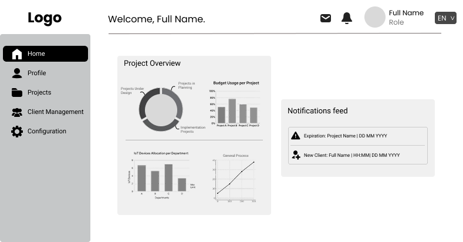
<br>

#### 2. Proflie
- El área principal de contenido está estructurada para mostrar primero un resumen del perfil del usuario ("Full Name", "Role") junto con un botón "Edit Profile". Debajo, se detallan los "Account Information", que incluyen campos para el nombre completo, correo electrónico y número de teléfono. Más abajo, se presentan opciones de configuración adicionales como el "Current Plan" con una opción para renovar, la "Time Zone"y el "App language".

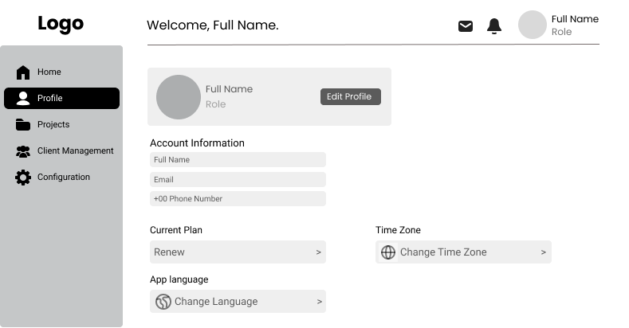
<br>

#### 3. Projects
- El área principal de contenido presenta un encabezado "My Projects" y un botón prominente "+ Add Project", sugiriendo la capacidad de crear nuevas iniciativas. Debajo, se visualizan tres tarjetas de proyecto idénticas en su estructura, cada una con un marcador de posición para una imagen, un título "Name Project", etiquetas indicando "In implementation" y la cantidad de dispositivos asociados, y una barra de progreso.

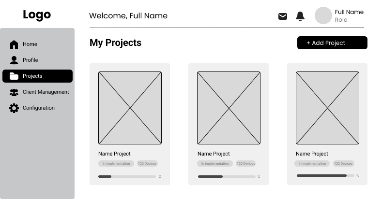
<br>

#### 4. Client Managment
- El área principal del contenido presenta el encabezado "My Clients" y un botón "+ Add Client" , lo que sugiere la capacidad de incorporar nuevos clientes al sistema. Debajo, se presenta una tabla organizada con columnas para "Full Name", "Associated Project", "Account Statement" y "Actions".

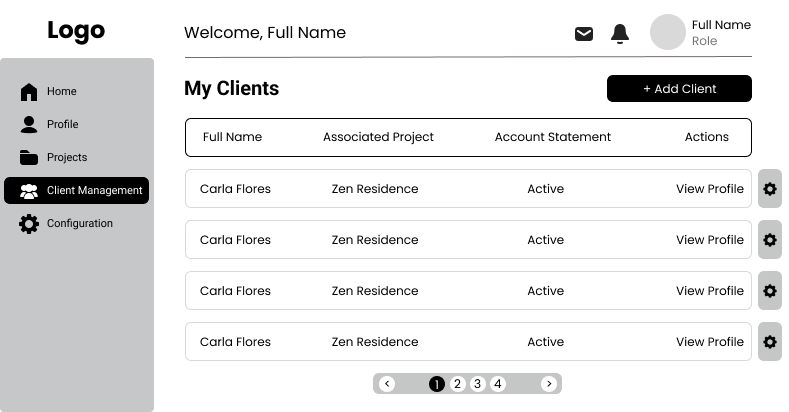
<br>

#### 5. Configuration
- El área principal del contenido se divide en tres secciones claras: "Notifications", "Security and Privacy", y "Support and Help". En la sección de Notificaciones, los usuarios pueden activar o desactivar alertas de expiración, actualizaciones del sistema y notificaciones de clientes mediante interruptores. La sección de Seguridad y Privacidad ofrece opciones para cambiar la contraseña, configurar la autenticación de dos factores y gestionar las sesiones activas, cada una con un icono de configuración para mayor detalle. Finalmente, la sección de Soporte y Ayuda proporciona enlaces a un Centro de ayuda y Contacto de Soporte.

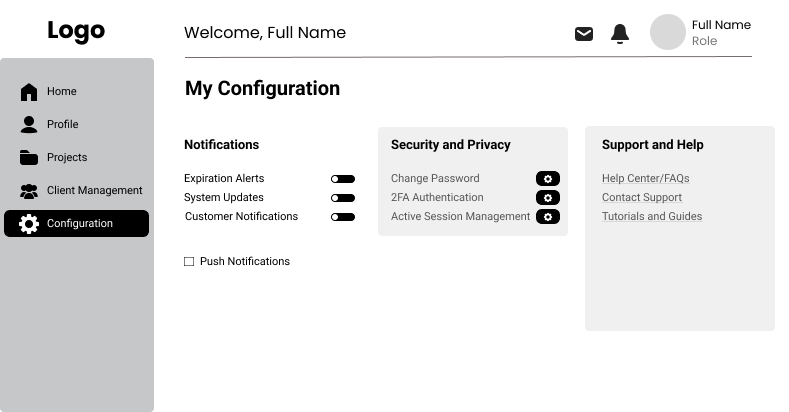
<br><br>

#### Vista del segmento #2: Propietarios de departamentos
#### 1. Home
- El área principal está dedicada a la "Project Overview", que incluye varios gráficos informativos: un gráfico circular sobre el estado de los proyectos (diseño, planificación, implementación), gráficos de barras sobre el presupuesto y la asignación de dispositivos IoT, y un gráfico de líneas para el proceso general.

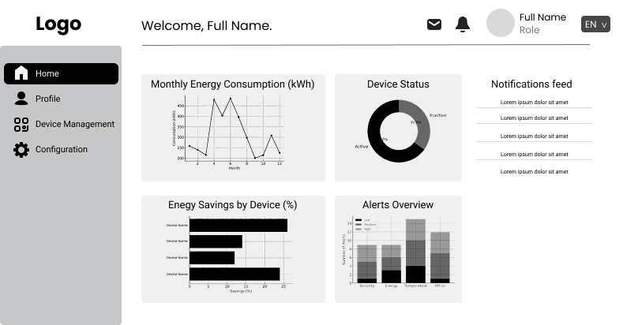
<br>

#### 2. Profile
- El área principal de contenido está estructurada para mostrar primero un resumen del perfil del usuario ("Full Name", "Role") junto con un botón "Edit Profile". Debajo, se detallan los "Account Information", que incluyen campos para el nombre completo, correo electrónico y número de teléfono. Además, se introduce una nueva sección titulada "Favorite Scene Configuration" (Configuración de Escena Favorita), que lista múltiples opciones de "Energy-Saving Mode" con botones "Use", indicando la capacidad de configurar escenarios o modos preestablecidos para dispositivos. Más abajo, se presentan opciones de configuración adicionales como el "Current Plan" con una opción para renovar, la "Time Zone"y el "App language".

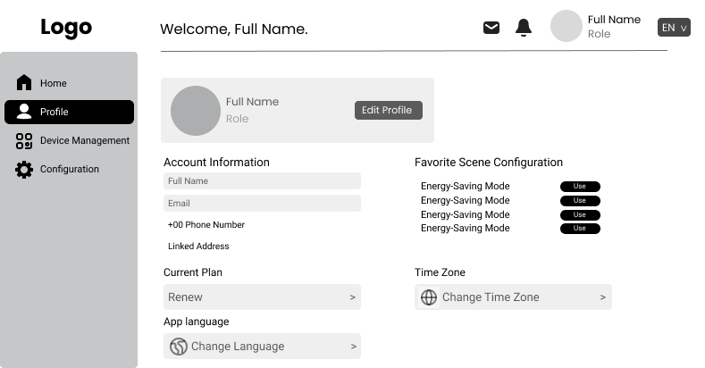
<br>

#### 3. Device Management
- El encabezado "My Devices" es prominente, acompañado de dos botones de acción principales: "+ Create Scene", que permite agrupar y automatizar múltiples dispositivos, y "+ Add Device", para incorporar nuevos equipos al sistema. La información de los dispositivos se presenta en una tabla con columnas para "Name", "Category", "Real-time status" y "Actions". La tabla lista dispositivos con estados alternos de "On" y "Off", y cada uno incluye un icono de configuración para acceder a ajustes específicos.

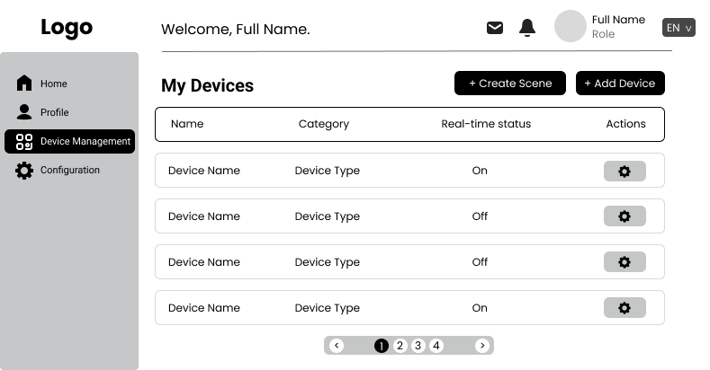
<br>

#### 4. Configuration
- El área principal del contenido se divide en tres secciones claras: "Notifications", "Security and Privacy", y "Support and Help". En la sección de Notificaciones, los usuarios pueden activar o desactivar alertas de expiración, actualizaciones del sistema y notificaciones de clientes mediante interruptores. La sección de Seguridad y Privacidad ofrece opciones para cambiar la contraseña, configurar la autenticación de dos factores y gestionar las sesiones activas, cada una con un icono de configuración para mayor detalle. Finalmente, la sección de Soporte y Ayuda proporciona enlaces a un Centro de ayuda y Contacto de Soporte. La sección "Advanced Device Management", que incluye opciones para "Automated Scenes" y "User Permissions".

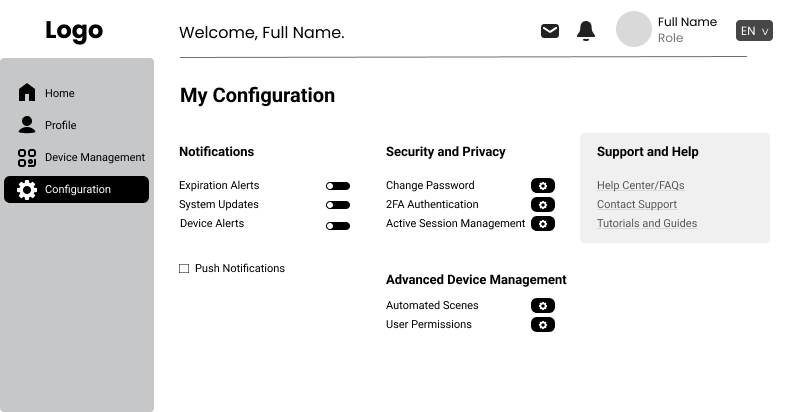
<br>

### 4.6.2. Web Applications Wireflow Diagrams.
#### Segmento Objetivo #1: Arquitectos e Ingenieros Civiles
Los arquitectos e ingenieros civiles utilizan la plataforma IoBuild para gestionar sus proyectos residenciales, centralizar la información de clientes, monitorear dispositivos IoT implementados en los edificios y configurar opciones de administración de manera eficiente.

**Login / Create Account**

**1. Login:**
- El usuario de la constructora introduce su correo corporativo y contraseña.
-  Selecciona la opción “Login” para acceder a su cuenta empresarial.

**Create Account:**
- Si es un nuevo usuario, completa un formulario con datos de la empresa, representante y correo corporativo.
- Selecciona “Create” para registrar la cuenta en el sistema.

**Acción esperada:** Autenticarse exitosamente en la plataforma y acceder al Dashboard principal.<br><br>

**2. Dashboard**
-	Una vez autenticado, el usuario accede al panel principal, donde se visualiza un menú lateral con accesos a secciones clave:
    - Home
    - Profile
    - Projects
    - Client Management
    - Configuration
-	El Dashboard sirve como centro de navegación para todas las funciones de la plataforma.

**Acción esperada:** Orientarse rápidamente en la aplicación y seleccionar la sección que desea administrar.<br><br>

**3. Profile**
-	Visualiza y edita información del usuario administrador como el nombre, logo, contacto, etc.
-	Opciones para gestionar miembros del equipo y asignar roles.

**Acción esperada:** Actualizar datos corporativos, ver plan y administrar accesos del equipo.<br><br>

**4. Project Management**
-	El usuario accede a la sección Projects, donde puede ver un listado de proyectos residenciales activos.
-	Cada proyecto incluye nombre, estado, fecha y acceso a detalles.
-	Puede pulsar “+ Add Project” para registrar un nuevo proyecto en la plataforma.

**Acción esperada:** Visualizar, gestionar o crear proyectos residenciales vinculados a la constructora.<br><br>

**5. Client Management**
-	En la sección Client Management, se despliega una tabla con los clientes asociados a cada proyecto.
-	Se muestran datos como nombre completo, proyecto asociado, estado y opciones de acción.
-	El usuario puede añadir nuevos clientes con el botón “+ Add Client”.

**Acción esperada:** Gestionar información de clientes vinculados a los proyectos residenciales.<br><br>


**6. Configuration**
-	En el apartado Configuration, la constructora puede administrar aspectos como notificaciones, seguridad, idioma de la aplicación y soporte técnico.
-	Incluye secciones de seguridad y privacidad (cambio de contraseña, autenticación en dos pasos), así como alertas del sistema.

**Acción esperada:** Personalizar la configuración de la plataforma para ajustarla a las necesidades de la empresa.<br><br>

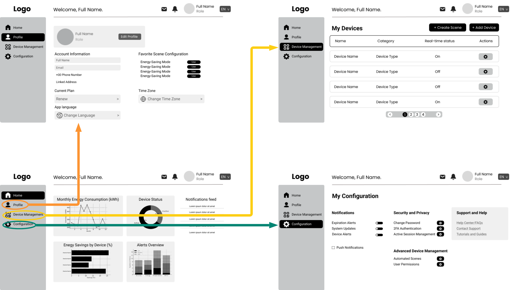


#### Segmento Objetivo #2: Dueños de apartamentos


**Login / Create Account**

**1. Login:**
- El usuario introduce su correo electrónico y contraseña.
- Pulsa “Login” para acceder a su cuenta personal.

**Create Account:**
- Si es nuevo, completa un formulario con nombre completo, correo, dirección (unidad), y contraseña.
- Pulsa “Create” para registrar la cuenta.

**Acción esperada:** Autenticarse correctamente y acceder al Dashboard personal.<br><br>

**2. Dashboard**
-	Una vez autenticado, el usuario accede al panel principal, donde se visualiza un menú lateral con accesos a secciones clave::
    - Home
    - Profile
    - Device Management
    - Configuration
-	Al ingresar, el dueño visualiza un Dashboard con widgets clave: consumo energético mensual (gráfico), estado general de dispositivos (rueda/donut), resumen de ahorros por dispositivo (gráfica) y un Notifications feed con alertas recientes.

**Acción esperada:** Obtener un panorama rápido del estado del apartamento y acceder en un clic a control de dispositivos o a la configuración.<br><br>

**3. Profile**
-	Vista para ver/editar datos personales y de la unidad: nombre, contacto, dirección vinculada, Current Plan, zona horaria e idioma.
-	Secciones: Edit Profile, Favorite Scene Configuration (botones Use para escenas guardadas), opciones para invitar a familiares o delegar accesos.

**Acción esperada:** Actualizar información del propietario, gestionar quién tiene acceso y elegir escenas favoritas para uso rápido.<br><br>

**4. Device Management**
-	Acciones principales: + Add Device y + Create Scene.
-	Dentro de cada dispositivo: estado en tiempo real, historial básico y acceso a ajustes

**Acción esperada:** Añadir, identificar y controlar dispositivos individuales de forma ágil.<br><br>

**5. Configuration**
-	Panel con secciones: Notifications, Security and Privacy (cambio de contraseña, 2FA, gestión de sesiones), Support and Help y Advanced Device Management
-	Opciones para activar/desactivar notificaciones críticas, administrar permisos de invitados y configurar preferencias globales de la unidad.

**Acción esperada:** Personalizar la experiencia y garantizar seguridad y soporte.<br>

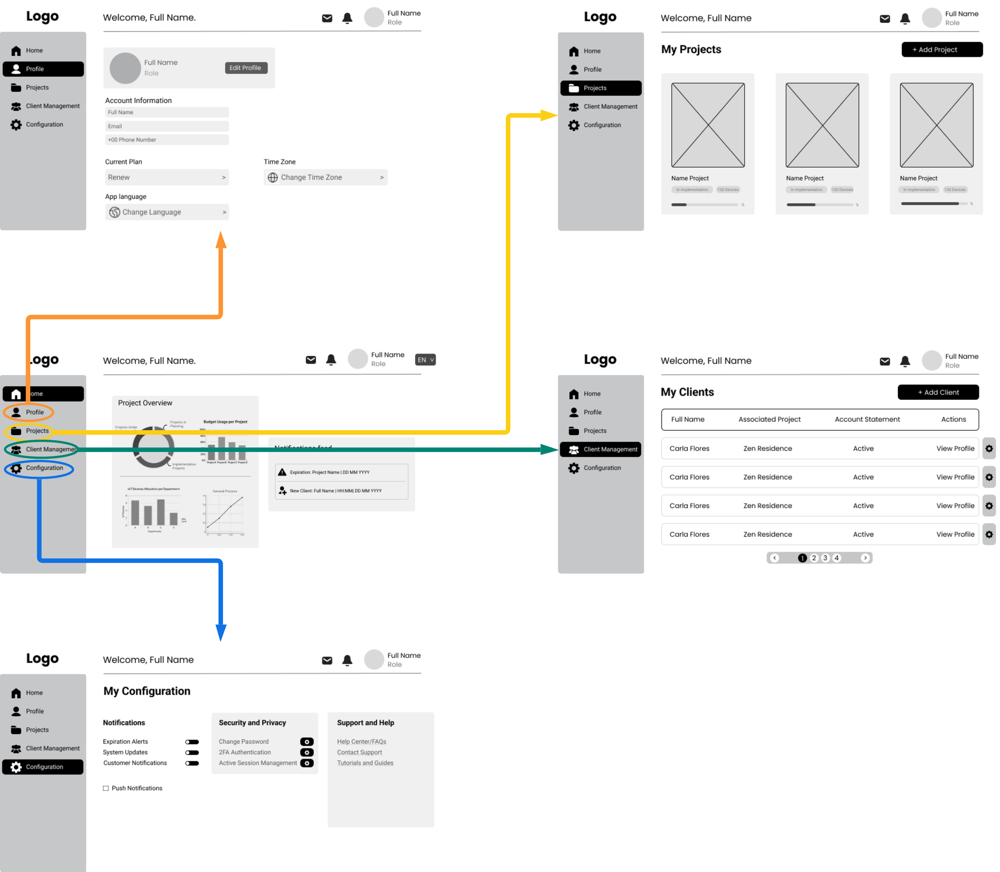

### 4.6.3. Web Applications Mock-ups.
#### Vista del segmento #1: Arquitectos e Ingenieros Civiles
#### 1. Home
- En el área principal del panel, hay una sección de "Project Overview" que incluye dos gráficos: uno de barras titulado "Budget Allocated" y uno de líneas llamado "Devices Implemented", que proporcionan una visión rápida del rendimiento. A la derecha, se encuentra un "Notification Feed" con mensajes sobre la expiración de un proyecto y la adición de un nuevo cliente.

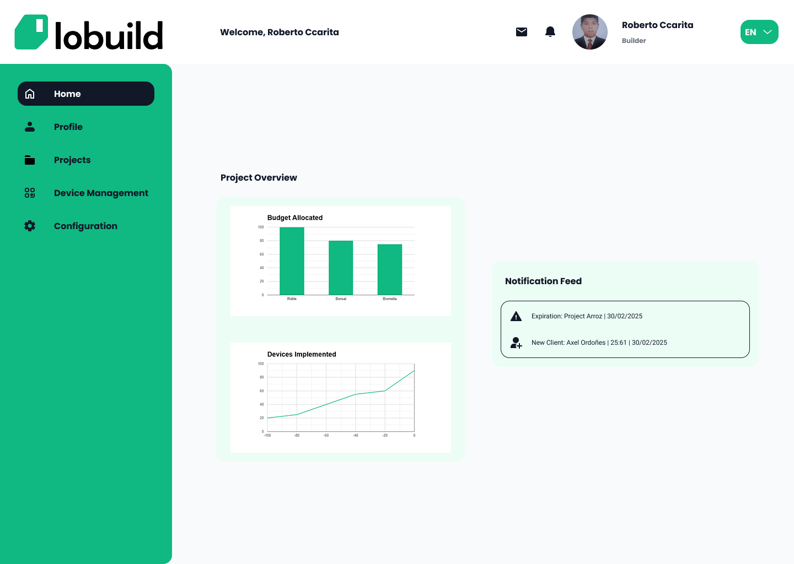
<br>

#### 2. Proflie
- En esta pantalla, se destacan los detalles del perfil del usuario, "Roberto Ccarita", con un botón prominente para "Edit Profile". La información se organiza en varias secciones claras: "Account Information", donde se muestran el nombre completo, el correo electrónico y el número de teléfono del usuario; "Time Zone", "Current Plan" y "App Language", establecido en "English".

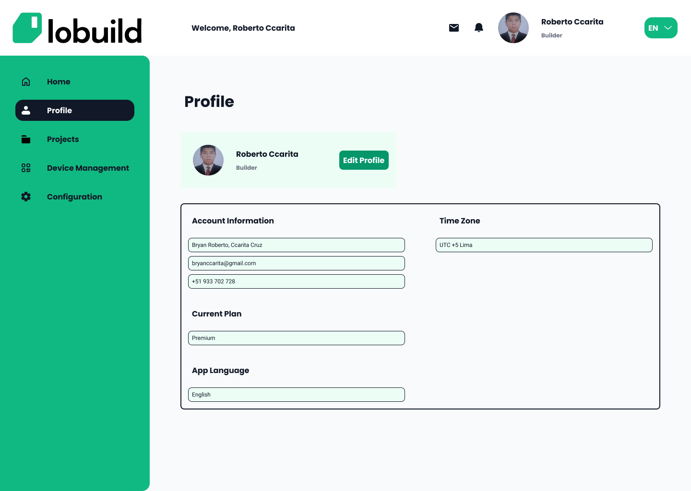
<br>

#### 3. Projects
- En esta pantalla, se presenta una galería de proyectos individuales, cada uno ilustrado con una imagen de un edificio moderno. Cada tarjeta de proyecto incluye el nombre del proyecto, su estado y la fecha de su última actualización. Un botón "More Details" para acceder a información más profunda sobre cada proyecto. Además, en la parte superior derecha, un botón "+ Add Project" indica la funcionalidad para crear nuevos proyectos dentro de la aplicación.

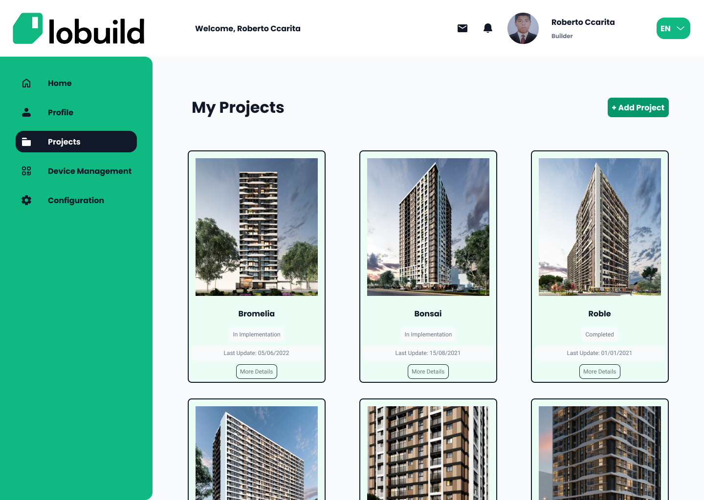
<br>

#### 4. Clients
- Esta vista presenta una tabla detallada con información de los clientes, incluyendo su "Full Name", "Associated Project", "Account Statement" y "Actions". El estado de la cuenta varía entre "Active", "Suspended" y "Stand by". Para cada cliente, se ofrecen opciones como "View Profile" y un icono de configuración, permitiendo al usuario gestionar los detalles del cliente. En la esquina superior derecha, un botón "+ Add Client" facilita la incorporación de nuevos clientes.

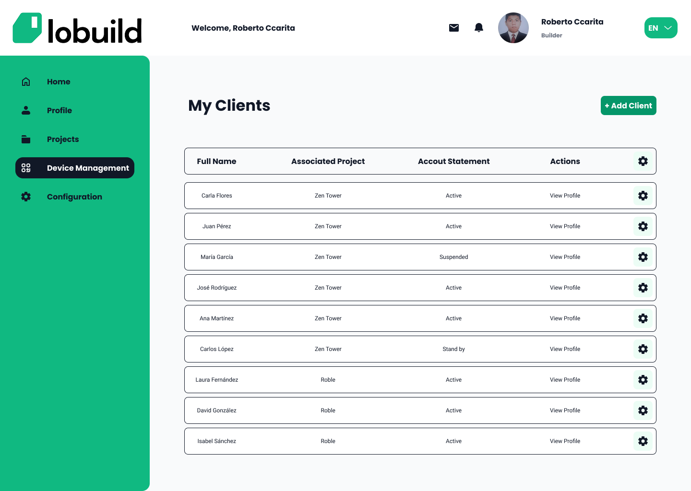
<br>

#### 5. Configuration
- Esta vista está organizada en tres áreas principales que permiten al usuario personalizar y gestionar su experiencia. La sección "Notifications" incluye toggles para activar o desactivar alertas de expiración, actualizaciones del sistema, notificaciones de clientes y notificaciones push. La sección "Security and Privacy" ofrece opciones para cambiar la contraseña, configurar la autenticación de dos factores, gestionar sesiones y añadir una dirección de correo electrónico alternativa, todas ellas con un icono de engranaje que sugiere configuraciones adicionales. Finalmente, la sección "Support and Help" proporciona enlaces a FAQs y contacto de soporte.

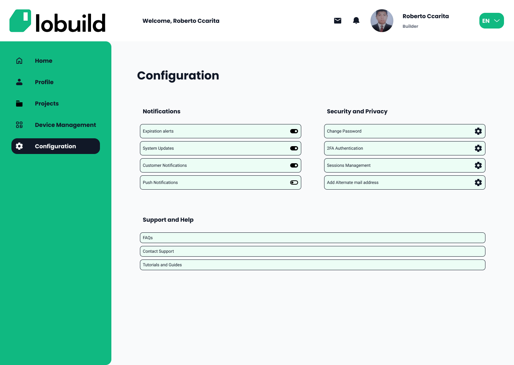
<br><br>

#### Vista del segmento #2: Propietarios de departamentos
#### 1. Home
- La sección principal, "Overview" (Resumen), incluye dos gráficos: uno de líneas que detalla el "Energy Consumption" (Consumo de Energía) a lo largo del tiempo, y un gráfico de barras que ilustra los "Energy Savings By Device (%)" (Ahorros de Energía por Dispositivo) para elementos como luces, termostatos, aire acondicionado y cámaras. A la derecha, el "Notification Feed" (Feed de Notificaciones) alerta sobre "High power consumption detected" (Se detectó un alto consumo de energía) y "Air conditioner may need maintenance" (El aire acondicionado puede necesitar mantenimiento). Esta pantalla ofrece al propietario una visión integral y en tiempo real del consumo energético y el estado de los dispositivos, facilitando la gestión eficiente de las propiedades.

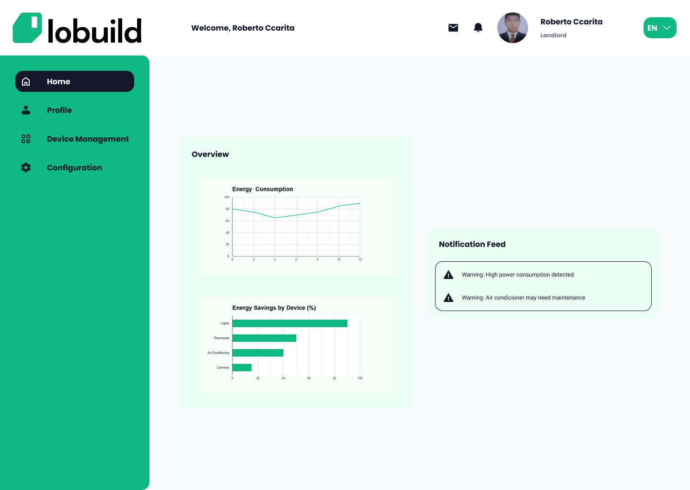
<br>

#### 2. Proflie
- En la sección "Account Information", se detallan los datos personales del usuario, incluyendo un campo adicional con una dirección. A la derecha, una sección llamada "Scenes", que presenta toggles para activar o desactivar modos como "Energy Saving Mode", "Movie" y varias opciones de "Push Notifications". La "Time Zone" (Zona Horaria) se mantiene como "UTC +5 Lima".

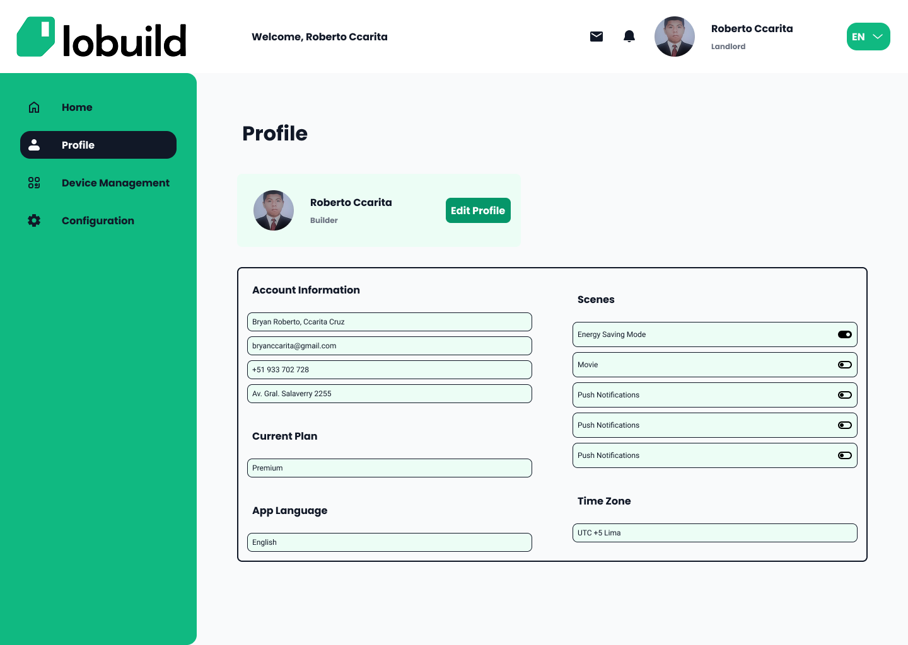
<br>

#### 3. Device Management
- Esta pantalla presenta una tabla que lista los dispositivos asociados al usuario, con columnas para "Name", "Category" y "Real Time Status". Los dispositivos mostrados incluyen termostatos, aire acondicionado, luces (exteriores e interiores), cerraduras inteligentes y cámaras de video, clasificados en categorías como "Climatization", "Zen Tower" y "Security". Los estados en tiempo real varían entre "Online", "Offline" y "Damaged", lo que proporciona una visión clara del funcionamiento de cada dispositivo. Para cada entrada, un icono de engranaje en la columna de configuración. En la parte superior derecha, un botón "+ Add Device" permite al usuario incorporar nuevos dispositivos a su sistema, lo que hace de esta sección una herramienta central para el control y monitoreo de la infraestructura inteligente.

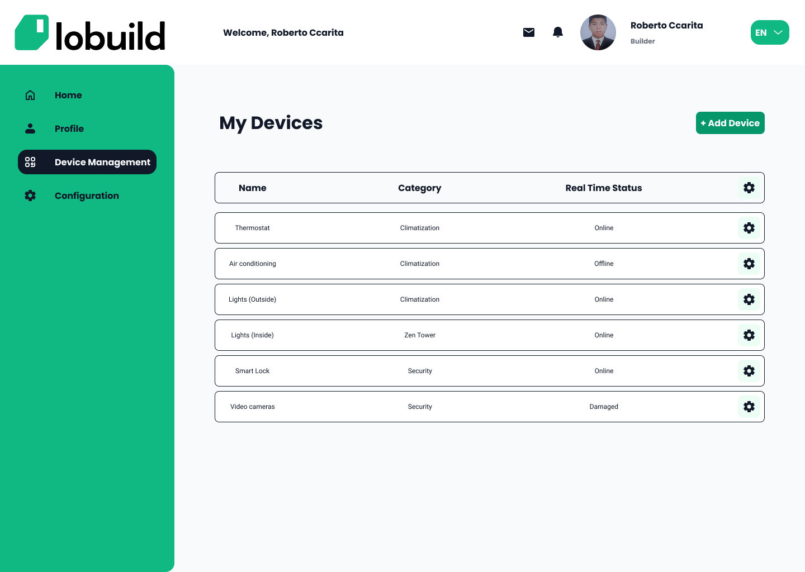
<br>

#### 4. Configuration
- Esta vista está organizada en tres áreas principales que permiten al usuario personalizar y gestionar su experiencia. La sección "Notifications" incluye toggles para activar o desactivar alertas de expiración, actualizaciones del sistema, notificaciones de clientes y notificaciones push. La sección "Security and Privacy" ofrece opciones para cambiar la contraseña, configurar la autenticación de dos factores, gestionar sesiones y añadir una dirección de correo electrónico alternativa, todas ellas con un icono de engranaje que sugiere configuraciones adicionales. Finalmente, la sección "Support and Help" proporciona enlaces a FAQs y contacto de soporte.

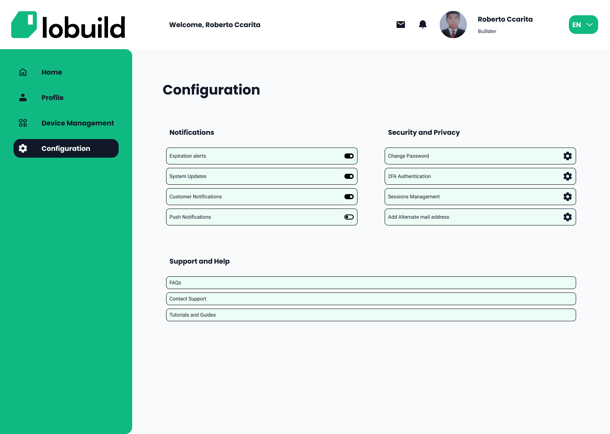
<br>

### 4.6.4. Web Applications User Flow Diagrams
#### Segmento Objetivo #1: Arquitectos e Ingenieros Civiles

**1. Profile**
**User Goal:** Como ingeniero, quiero ver y editar mi infomación.
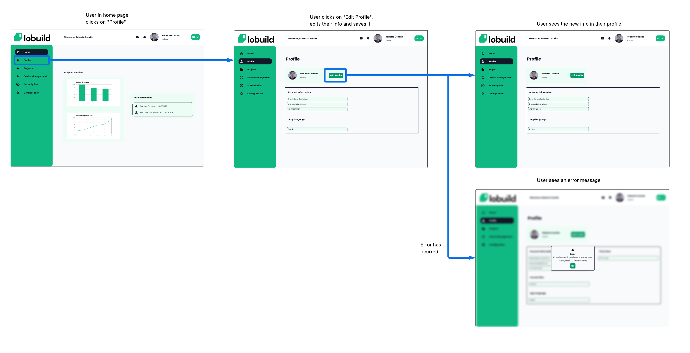

**2. Project Management**
**User Goal:** Como ingeniero, quiero ver, editar y añadir projects en los que estoy trabajando.
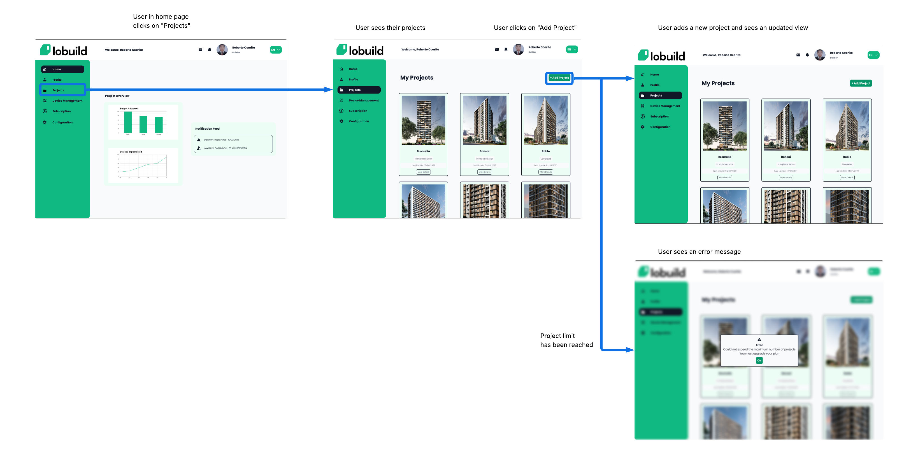

**3. Client Management**
**User Goal:** Como ingeniero, quiero monitorear los dispositivos de los projectos en los que estoy trabajando.
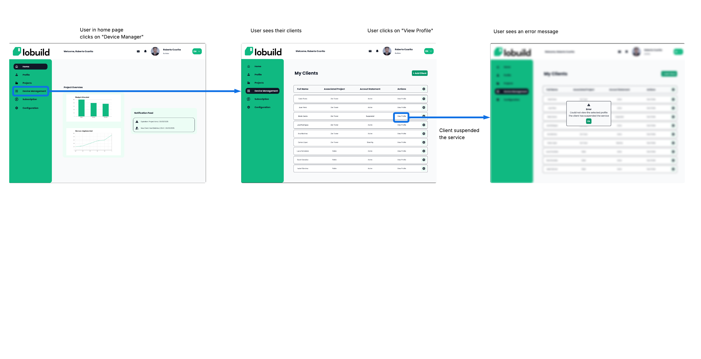

**4. Configuration**
**User Goal:** Como ingeniero, quiero personalizar la configuración de la plataforma.
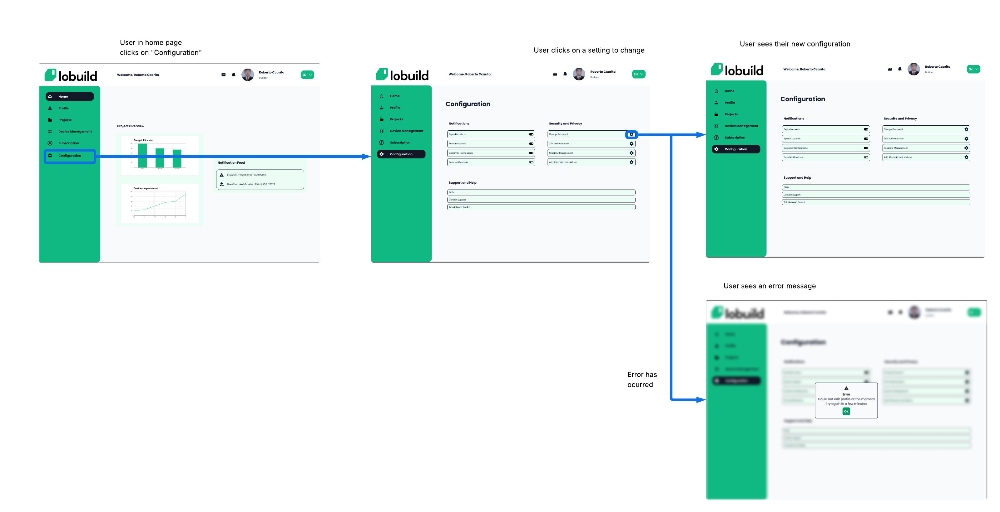

#### Segmento Objetivo #2: Dueños de apartamentos

**1. Profile**
**User Goal:** Como propietario, quiero ver y editar mi infomación.
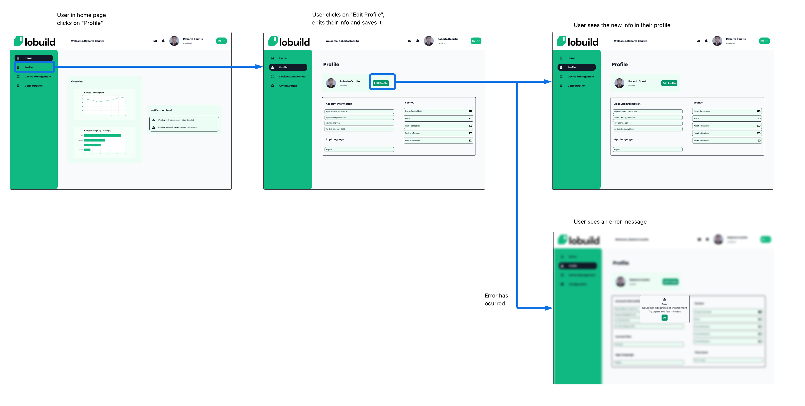

**2. Device Management**
**User Goal:** Como propietario, quiero monitorear y configurar mis dispositivos.
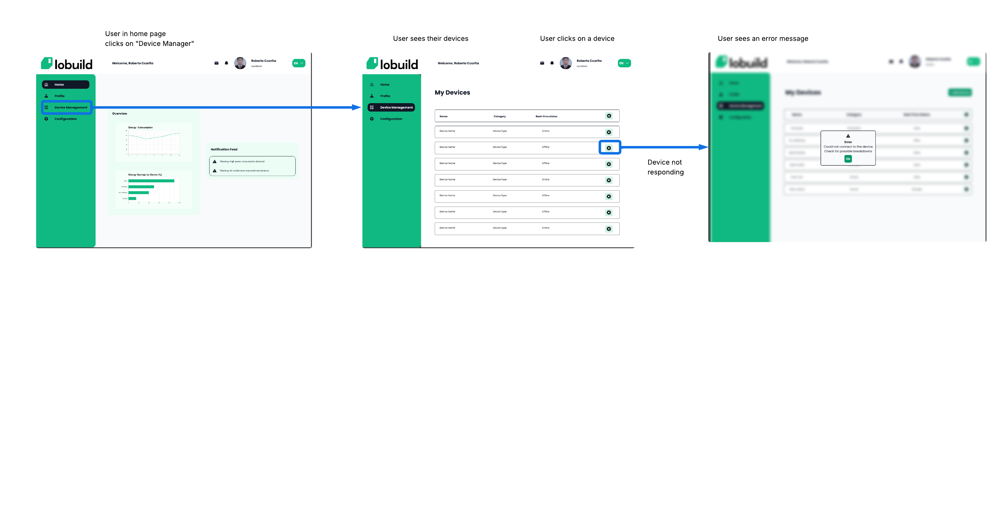

**3. Configuration**
**User Goal:** Como propietario, quiero personalizar la configuración de la plataforma.
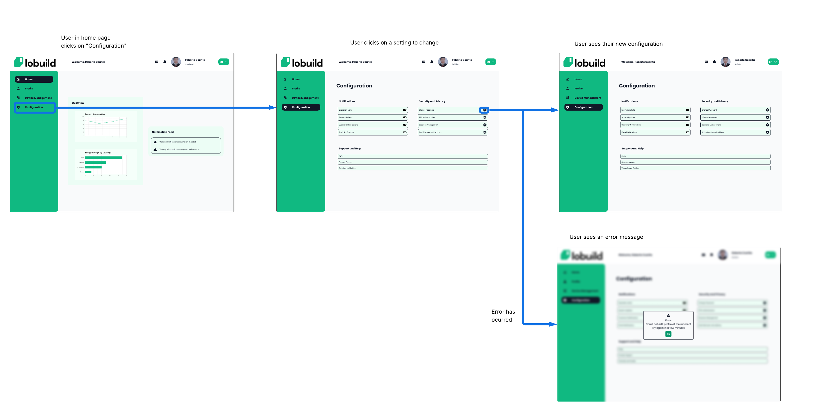

## 4.7. Web Applications Prototyping
En esta etapa se presentan los prototipos de la aplicación web IoBuild, diseñados para navegadores de escritorio. El enfoque está en simular los flujos principales de cada segmento objetivo, garantizando una experiencia clara y funcional en pantallas grandes.

**Segmento constructoras**
<br>
Los ingenieros usan la plataforma para gestionar proyectos residenciales, centralizar información de clientes, monitorear dispositivos IoT y configurar opciones de administración.

- Desde el menú Home, acceden al Dashboard con datos de sus proyectos.

- La barra lateral incluye cinco menús principales: Home, Profile, Project, Device Management y Configuration.

- En Device Management se despliega la lista de clientes con datos como nombre, proyecto, estado de cuenta y opciones de gestión.

- Al seleccionar un cliente, pueden visualizar el estado de los dispositivos IoT relacionados; si hay restricciones o errores, el sistema muestra un aviso.

**Segmento Dueños de Departamentos**<br>
Los propietarios buscan controlar de forma remota sus dispositivos y conocer su rendimiento.

- El recorrido inicia en Home, donde se muestra un Dashboard con información general de los dispositivos.

- En este caso, el menú lateral incluye cuatro opciones: Home, Profile, Device Management y Configuration.

- En Device Management aparece la lista de aparatos conectados al departamento, con datos como nombre, categoría y estado.

- El usuario puede ingresar al detalle de cada dispositivo o recibir un mensaje de error en caso de restricciones.

Con estos flujos, los prototipos evidencian cómo cada tipo de usuario interactúa con la aplicación, asegurando una navegación coherente y ajustada a sus necesidades.

A continuación se presenta el video con los prototipos navegables de ambos segmentos: https://goo.su/Cor4Q

## 4.8. Domain-Driven Software Architecture
### 4.8.1. Software Architecture Context Diagram
El diagrama de contexto muestra la vista más general de IoBuild, destacando a sus actores principales y cómo se relacionan con la plataforma. En este nivel aparecen dos roles clave: las Constructoras, que usan IoBuild para agregar funciones inteligentes a sus proyectos y darles un valor diferencial; y los Propietarios, que ingresan al sistema para personalizar su hogar o espacio de trabajo de forma fácil y sin necesidad de conocimientos técnicos.

Aunque sus objetivos son distintos, ambos se conectan a la misma plataforma, que hace posible que los edificios y viviendas se conviertan en entornos más cómodos, accesibles y personalizables.

Este modelo refuerza la misión de IoBuild: acercar la tecnología de los espacios inteligentes a constructoras y propietarios con herramientas prácticas, simples y útiles. Además, gracias a su diseño modular, la plataforma puede adaptarse a diferentes mercados y necesidades sin perder su esencia.

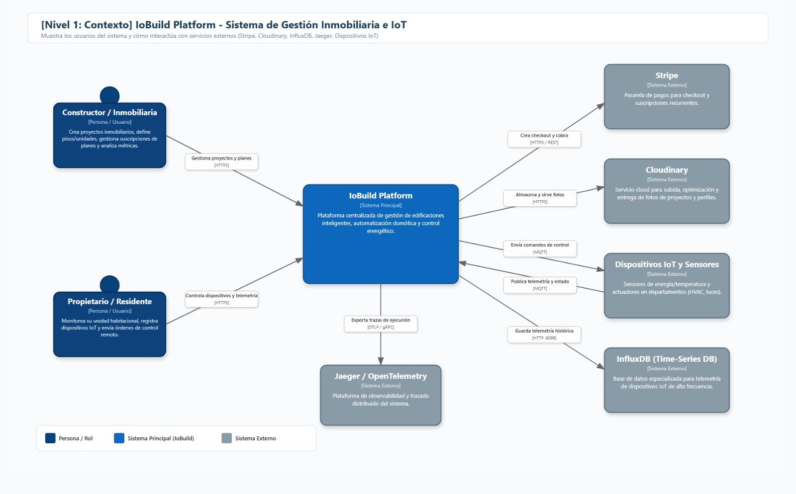

### 4.8.2. Software Architecture Container Diagrams

El diagrama de contenedores profundiza en la estructura interna del sistema y muestra cómo está organizado IoBuild en términos de sus principales componentes de ejecución. La aplicación se compone de tres contenedores principales: la Landing Page, la Web App en SPA y el API Backend. Cada uno cumple un rol específico dentro del modelo de negocio.

La Landing Page funciona como el punto de entrada, mostrando la propuesta de valor de IoBuild y diferenciando la experiencia según el tipo de usuario, ya sea una constructora o un propietario. Desde allí, los usuarios acceden a la Web App, una interfaz de una sola página (SPA) que reúne las funcionalidades principales: configuración de espacios inteligentes, personalización de ambientes, gestión de dispositivos y administración de perfiles.

Esta SPA se conecta con un API Backend central, encargado de coordinar las operaciones entre los distintos módulos de la plataforma, como la gestión de proyectos, la administración de dispositivos y la configuración de automatizaciones.

Gracias a este diseño modular, IoBuild mantiene una separación clara entre la experiencia de usuario y la lógica de negocio, lo que permite escalar sus funciones y reducir el tiempo de despliegue de nuevas capacidades.

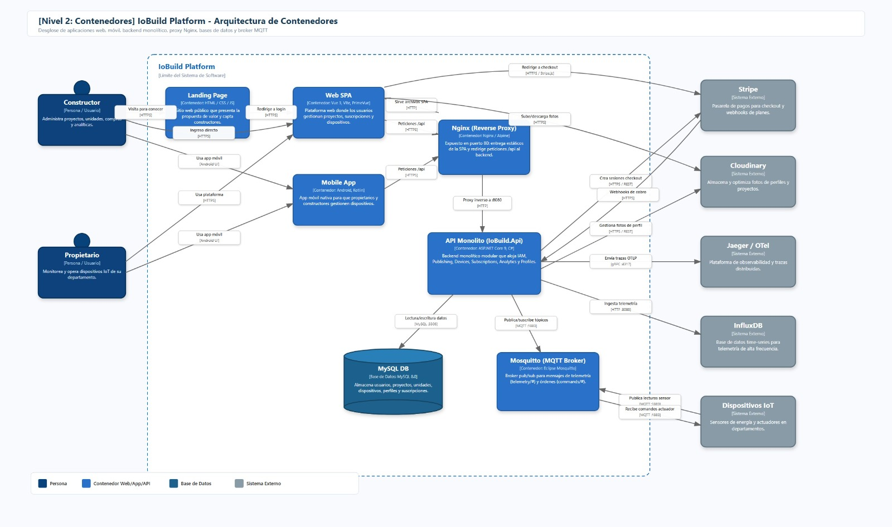

### 4.8.3. Software Architecture Components Diagrams

El diagrama de componentes muestra la estructura interna de la **IoBuild Platform API Application**, destacando cómo sus capacidades principales se organizan en **bounded contexts**, cada uno implementado como un componente independiente en ASP.NET Core.

Dentro de la aplicación API, el dominio está dividido en los siguientes componentes:

- **IAM**  
  Gestiona la autenticación, autorización e identidades mediante JWT y BCrypt.

- **Devices**  
  Administra dispositivos IoT, sus configuraciones y operaciones relacionadas.

- **Projects**  
  Maneja la creación, administración y ciclo de vida de proyectos, incluyendo gestión de medios con **Cloudinary**.

- **Profiles**  
  Gestiona la información y los datos de perfil de los usuarios.

- **Clients**  
  Administra la información de clientes y sus relaciones.

- **Subscriptions**  
  Gestiona planes de suscripción, ciclos de facturación y se integra con **Stripe** para pagos.

- **Analytics**  
  Procesa y provee datos analíticos sobre dispositivos, proyectos y clientes.

- **Shared**  
  Contiene funcionalidades compartidas, como repositorios base, patrones de mediación, utilidades y abstracciones comunes.

En conjunto, este diagrama muestra cómo la aplicación API está modularizada, cómo colaboran los diferentes componentes y cómo se conectan tanto con servicios externos como con la base de datos central.

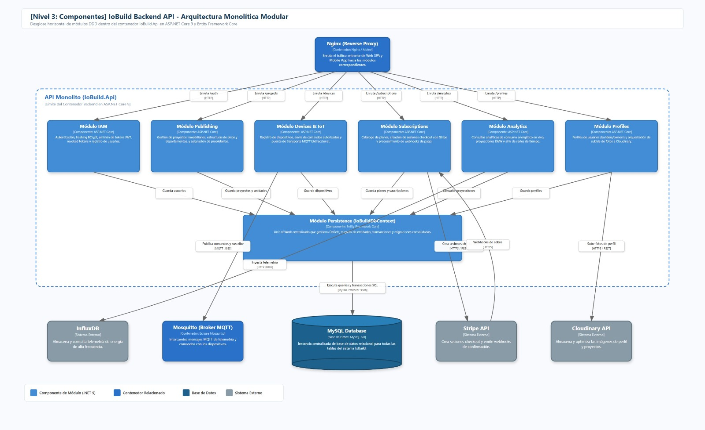

## 4.9. Software Object-Oriented Design
### 4.9.1. Class Diagrams

**Identity and Access Management**

El bounded context de Identity and Access Management (IAM) se encarga de gestionar la autenticación, autorización y administración de usuarios dentro de la plataforma IoBuild. Este contexto define las entidades principales como User (usuario) y Role (rol), estableciendo la base para controlar quién tiene acceso al sistema y qué permisos posee. Además, implementa servicios de hashing de contraseñas mediante BCryptPasswordHasher y generación de tokens JWT a través de JwtTokenService, asegurando la seguridad en cada interacción. Los repositorios y servicios de comandos/consultas facilitan la creación, actualización y consulta de usuarios, mientras que las políticas de autorización protegen los recursos críticos del sistema.

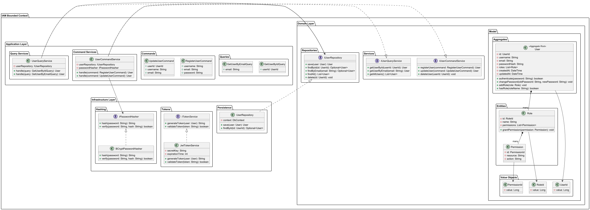

**Subscriptions and Payments Management**

El diagrama de clases de Subscriptions representa la estructura del modelo de negocio de suscripciones siguiendo Domain-Driven Design (DDD). Los agregados principales son Subscription (que vincula un builder con un plan específico, controlando estado y vigencia) y Plan (que define características, precio y límites de cada nivel de servicio). El diagrama muestra la separación clara entre capas: Domain (agregados, commands, queries, servicios e interfaces de repositorios), Application (implementación de servicios de comandos y consultas, además del ACL SubscriptionsContextFacade que expone funcionalidades a otros bounded contexts), e Infrastructure (repositorios concretos con Entity Framework y servicios de pago con Stripe). Los commands y queries implementan el patrón CQRS, separando operaciones de escritura (crear/actualizar) de las de lectura (consultas). Este diseño facilita la evolución independiente del contexto, manteniendo bajo acoplamiento con otros módulos del sistema.

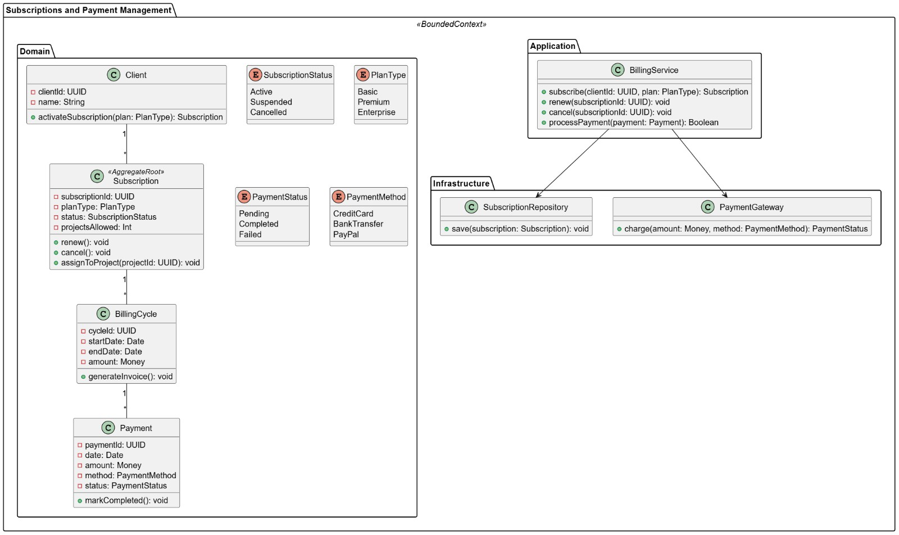

**Projects Management**

El bounded context de Projects Management gestiona el ciclo de vida de los proyectos de construcción inteligentes dentro de IoBuild. El agregado principal Project encapsula información como nombre, descripción, ubicación, estado y unidades asociadas, permitiendo que arquitectos e ingenieros organicen y supervisen sus desarrollos inmobiliarios. Las entidades Unit representan los espacios individuales (apartamentos, oficinas) dentro de cada proyecto, incluyendo detalles como número de unidad, piso, área y estado de ocupación. Este contexto también define servicios de comandos y consultas que permiten crear, actualizar, listar y eliminar proyectos, manteniendo una separación clara entre la lógica de dominio y la infraestructura de persistencia.

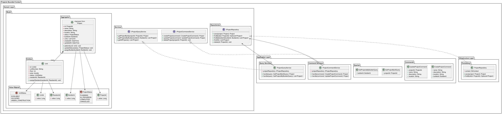

**Profile and Preferences Management**

El bounded context de Profiles Management administra la información personal y las preferencias de los usuarios dentro de la plataforma IoBuild. El agregado Profile encapsula datos como nombre, teléfono, dirección y configuraciones de usuario, vinculándose directamente con el User del contexto IAM. Las entidades UserPreferences y NotificationSettings permiten personalizar aspectos como idioma, zona horaria y canales de notificación (correo, push, SMS), adaptando la experiencia a las necesidades individuales de cada propietario o ingeniero. Los servicios de comandos y consultas facilitan la creación, actualización y consulta de perfiles, asegurando que la información del usuario esté siempre disponible y actualizada.

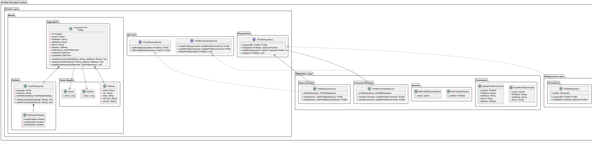

**Devices Management**

El bounded context de Devices Management se enfoca en la administración y monitoreo de dispositivos IoT dentro de los espacios inteligentes. El agregado raíz Device representa cada dispositivo físico conectado (luces, termostatos, cámaras, cerraduras, sensores), almacenando su tipo, ubicación, estado operativo y configuración. Las entidades TelemetryData permiten registrar métricas en tiempo real, mientras que DeviceConfiguration facilita la personalización de parámetros específicos de cada equipo. Los servicios de comandos y consultas posibilitan el registro, actualización, eliminación y búsqueda de dispositivos, garantizando que propietarios e ingenieros puedan gestionar su infraestructura inteligente de forma centralizada y eficiente.

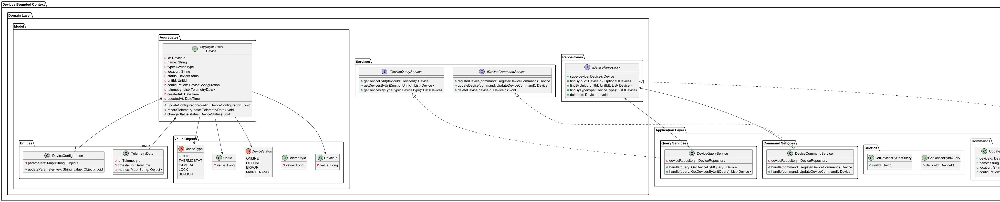

**Analytics**

El bounded context de Analytics se especializa en la recopilación, procesamiento y visualización de métricas operativas dentro de IoBuild. Los agregados principales EnergyConsumption y OccupancyRecord registran datos clave como el consumo energético por dispositivo/unidad y los niveles de ocupación en diferentes períodos de tiempo. Estos datos permiten a ingenieros y propietarios tomar decisiones informadas sobre eficiencia energética, planificación de recursos y optimización de espacios. Los servicios de consulta y repositorios asociados facilitan la extracción de información histórica y la generación de reportes personalizados, contribuyendo al objetivo de crear edificios inteligentes, sostenibles y eficientes.

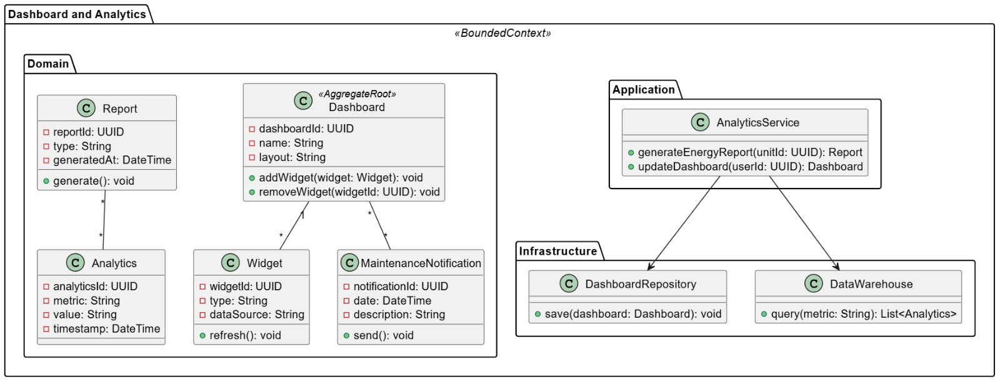

## 4.10. Database Design
### 4.10.1. Database Diagram

**Identity and Access Management**

El diagrama de base de datos de Identity and Access Management (IAM) modela la estructura para gestionar usuarios, roles y permisos dentro de la plataforma IoBuild. La tabla users almacena la información básica de autenticación (nombre de usuario, email y hash de contraseña). Los roles (roles) definen conjuntos de permisos que pueden ser asignados a usuarios mediante la tabla intermedia user_roles. Los permisos específicos (permissions) detallan qué acciones están permitidas sobre qué recursos, y se vinculan a roles mediante role_permissions. Este diseño permite una gestión flexible y escalable de la seguridad, facilitando la asignación dinámica de permisos según el contexto y las necesidades del negocio.


**Subscriptions and Payments Management**

El diagrama de base de datos de Subscriptions modela la persistencia del sistema de suscripciones y facturación. La tabla plans almacena los diferentes niveles de servicio disponibles (Basic, Pro, Enterprise), incluyendo precio, descripción, características (en formato texto delimitado), límites de dispositivos y administradores, nivel de soporte, y acceso a API/analytics. La tabla subscriptions vincula cada builder con un plan específico, registrando el estado (active, cancelled, expired), fechas de inicio y fin, facilitando el control de vigencia y renovaciones. Las transacciones financieras se registran en payments, que incluye integración con Stripe mediante el campo stripe_payment_intent_id, almacenando monto, moneda, método de pago y estado. Finalmente, invoices documenta las facturas generadas por cada pago, con número de factura único, montos totales e impuestos, y fechas de emisión, vencimiento y pago. Los índices estratégicos optimizan consultas por builder, plan, estado de suscripción y transacciones de Stripe.

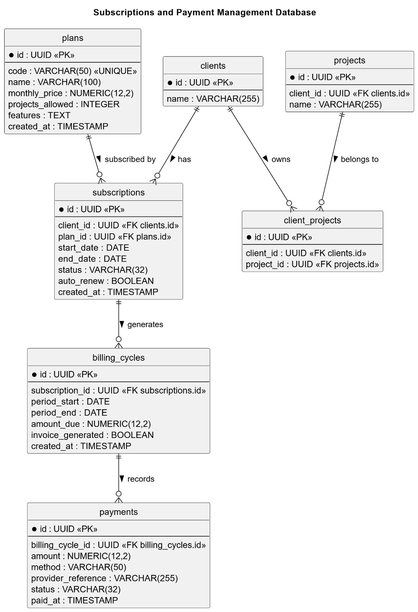

**Profile and Preferences Management**

El diagrama de Profile and Preferences Management modela la información personal y preferencias de los usuarios dentro de IoBuild. La tabla profiles contiene datos como nombre completo, teléfono y dirección completa (calle, ciudad, estado, código postal y país), vinculándose directamente con los usuarios del sistema. Las preferencias del usuario se almacenan en user_preferences, incluyendo idioma, zona horaria y configuraciones de notificaciones (email, push y SMS). Este modelo permite personalizar la experiencia de cada usuario, adaptando el sistema a sus necesidades individuales y facilitando la gestión de su información personal de forma centralizada.

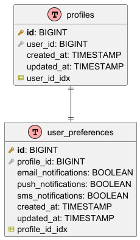

**Devices Management**

El diagrama de Devices Management representa la gestión y monitoreo de dispositivos IoT dentro de la plataforma. La tabla devices almacena información esencial de cada dispositivo (nombre, tipo, ubicación, estado y configuración en formato JSON). Los datos de telemetría se registran en telemetry_data, capturando métricas en tiempo real con sus timestamps correspondientes. La tabla device_configurations mantiene un historial versionado de las configuraciones aplicadas a cada dispositivo, incluyendo parámetros en JSON y fecha de aplicación. Este diseño permite un control granular sobre el estado operativo de los dispositivos, facilita el análisis histórico de su comportamiento y soporta la toma de decisiones basada en datos para optimización energética y mantenimiento predictivo.

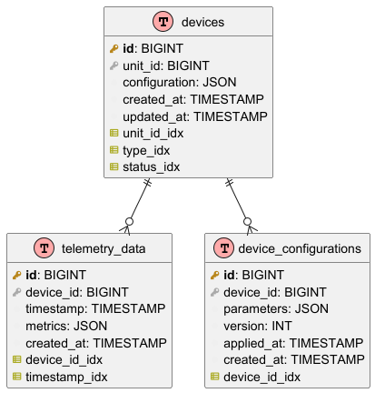


**Projects Management**

El diagrama de Projects Management describe la estructura para gestionar proyectos de construcción inteligentes y las unidades asociadas. La tabla projects almacena información clave como nombre, descripción, ubicación, estado actual y el constructor responsable (referenciado por builder_id). Cada proyecto puede contener múltiples unidades (units), que representan espacios individuales (apartamentos, oficinas) con detalles como número de unidad, piso, área y estado de ocupación. La relación con builders permite identificar al responsable del proyecto, mientras que residents vincula a los ocupantes de cada unidad. Este diseño facilita la administración centralizada de proyectos inmobiliarios y sus componentes.

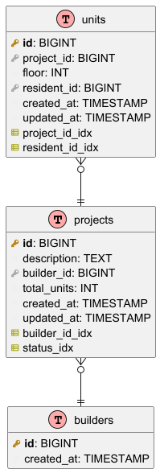


**Analytics**

El diagrama de Dashboard and Analytics modela la captura y análisis de métricas operativas en IoBuild. La tabla energy_consumption registra el consumo energético de cada dispositivo y unidad, incluyendo timestamp, valor, unidad de medida y metadatos adicionales en formato JSON. Los registros de ocupación (occupancy_records) capturan porcentajes de ocupación y número de dispositivos activos por unidad en momentos específicos. Finalmente, analytics_reports almacena reportes generados bajo demanda, especificando tipo de reporte, período analizado, proyecto asociado y datos completos en formato JSON. Este modelo permite a ingenieros y propietarios tomar decisiones informadas sobre eficiencia energética, planificación de recursos y optimización de espacios, contribuyendo al objetivo de crear edificios inteligentes y sostenibles.

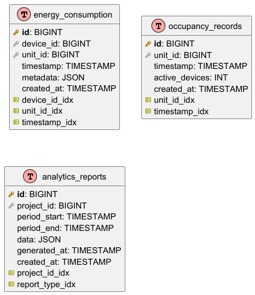

<div style="page-break-before: always;"></div>

# Capítulo V: Product Implementation

## 5.1. Software Configuration Management

La gestion de configuracion de software del proyecto IoBuild define y controla el conjunto de herramientas, servicios y convenciones necesarios para asegurar un desarrollo movil consistente, trazable y reproducible.  
En esta seccion se documentan los componentes del entorno de desarrollo, su proposito dentro del proyecto y su aporte a la calidad del producto final.

### 5.1.1. Software Development Environment Configuration

Para la implementacion de la solucion, se configuro un entorno de desarrollo orientado a aplicaciones moviles Android, integracion con servicios backend y soporte para diseno UX/UI, documentacion y colaboracion del equipo.

| Producto/Herramienta | Categoria | Ruta de Descarga/Acceso | Proposito en el Proyecto |
|---|---|---|---|
| OpenJDK | Desarrollo Backend | https://openjdk.org/ | Entorno de ejecucion para aplicaciones Java |
| Apache Maven | Desarrollo Backend | https://maven.apache.org/ | Gestion de dependencias y construccion del proyecto |
| Spring Boot | Desarrollo Backend | https://spring.io/projects/spring-boot | Framework para desarrollo de APIs RESTful |
| Android Studio | Desarrollo Movil | https://developer.android.com/studio | IDE para desarrollo de aplicaciones Android nativas |
| Kotlin | Desarrollo Movil | Incluido en Android Studio | Lenguaje de programacion para aplicacion movil |
| Render PostgreSQL | Base de Datos | https://render.com/docs/postgresql | Base de datos relacional en la nube |
| Material Design 3 | Diseno UX/UI | https://m3.material.io/ | Sistema de diseno para interfaces consistentes |
| Jira | Gestion de Proyectos | https://www.atlassian.com/es/software/jira | Gestion de backlog y sprints |
| UXPressia | Gestion de Requisitos | https://uxpressia.com/ | Creacion de User Personas, Journey Maps e Impact Mapping |
| PlantUML | Documentacion | https://plantuml.com/ | Creacion de diagramas de arquitectura y flujos |
| Postman | Testing APIs | https://www.postman.com/ | Pruebas de endpoints RESTful |
| Git | Control de Versiones | https://git-scm.com/ | Control de versiones del codigo fuente |
| GitHub | Repositorio | https://github.com/ | Almacenamiento y colaboracion en codigo |
| Render | Despliegue Backend | https://render.com/ | Plataforma de despliegue para aplicaciones Spring Boot |
| Firebase Cloud Messaging | Notificaciones Push | https://firebase.google.com/ | Servicio de notificaciones push para dispositivos moviles |

### 5.1.2. Source Code Management

La gestion del codigo fuente de IoBuild se realiza con Git y GitHub, siguiendo practicas estandar para asegurar trazabilidad, colaboracion efectiva y control de cambios durante todo el ciclo de desarrollo.

**Gestion de Repositorios**

El proyecto utiliza GitHub como plataforma centralizada de control de versiones. La organizacion del codigo se separa por componente para facilitar mantenimiento independiente y evolucion controlada del sistema.

| Producto | URL del Repositorio | Descripcion |
|---|---|---|
| Landing Page | https://github.com/CcaritaTech-upc/ccarita-tech.website | Sitio web de presentacion del producto |
| Web Application | https://github.com/CcaritaTech-upc/ccarita-tech.webapp | Aplicación web hecha en Vue.js |
| Mobile Application Kotlin | https://github.com/CcaritaTech-upc/ccarita-tech.mobileapp | Aplicacion movil nativa Android |
| Project Report | https://github.com/CcaritaTech-upc/ccarita-tech.report | Reporte tecnico y documentacion del proyecto |

**Implementacion de GitFlow**

Se adopta GitFlow como estrategia de branching para estructurar el trabajo del equipo. Este modelo define ramas principales para produccion e integracion, junto con ramas de soporte para nuevas funcionalidades, releases y hotfixes. Con ello se mantiene la estabilidad del codigo y se ordena el flujo de trabajo entre desarrollo, validacion y entrega.

**Convenciones de Nomenclatura**

Para mantener consistencia en el repositorio, se establecen convenciones de nombres para ramas:

- `feature/<modulo>-<descripcion-corta>`
- `release/v<major>.<minor>.<patch>`
- `hotfix/v<major>.<minor>.<patch>`
- `bugfix/<modulo>-<descripcion-corta>`

Estas convenciones permiten identificar rapidamente el proposito de cada rama y mejoran la coordinacion entre integrantes.

**Versionado Semantico**

El proyecto sigue Semantic Versioning (`MAJOR.MINOR.PATCH`):

- `MAJOR`: cambios incompatibles con versiones anteriores.
- `MINOR`: nuevas funcionalidades compatibles.
- `PATCH`: correcciones de errores sin romper compatibilidad.

Este esquema comunica claramente el impacto de cada version y facilita la planificacion de despliegues.

**Conventional Commits**

Se utiliza la especificacion Conventional Commits para estandarizar los mensajes de commit y mejorar la trazabilidad del historial. Formato base:

`<type>(<scope>): <description>`

Tipos de commit mas usados:

- `feat`: nueva funcionalidad.
- `fix`: correccion de error.
- `docs`: cambios en documentacion.
- `refactor`: mejora interna sin cambiar comportamiento funcional.
- `test`: incorporacion o ajuste de pruebas.
- `chore`: tareas de mantenimiento o configuracion.

Esta convencion facilita auditoria de cambios y futura generacion automatica de changelogs.

### 5.1.3. Source Code Style Guide & Conventions

El proyecto **IoBuild** define una guia de estilo comun para mantener consistencia, legibilidad y mantenibilidad en sus componentes de backend, aplicacion movil, landing page y documentacion tecnica.

**1. Estandares de Nomenclatura y Estilo**

Se adopta nomenclatura en ingles para elementos de codigo (clases, metodos, variables, paquetes y ramas). Esta decision reduce ambiguedades, facilita la colaboracion y mantiene alineacion con la documentacion oficial de las tecnologias utilizadas.

Reglas generales aplicadas:

- Nombres descriptivos y orientados a responsabilidad.
- Una sola convencion por tipo de elemento en todo el proyecto.
- Evitar abreviaciones no estandar.
- Mantener consistencia entre codigo, pruebas y documentacion.

**2. Convenciones para Backend y APIs**

Para backend con Java y Spring Boot se toma como base **Google Java Style Guide** y buenas practicas del ecosistema Spring:

- Clases en `PascalCase` y metodos/atributos en `camelCase`.
- Paquetes en minusculas, organizados por dominio o responsabilidad.
- Controladores REST con rutas claras, recursos en plural y uso correcto de verbos HTTP.
- Separacion por capas: `controller`, `application/service`, `domain`, `infrastructure`.
- DTOs para requests/responses y validaciones en capa de entrada.

Esto permite una API consistente, facil de mantener y alineada con arquitectura limpia y DDD definido en el proyecto.

**3. Estandares para Desarrollo Movil**

Para la aplicacion Android en Kotlin se siguen las convenciones oficiales de Kotlin y Android:

- Clases y composables en `PascalCase`.
- Funciones, propiedades y variables en `camelCase`.
- Constantes en `UPPER_SNAKE_CASE`.
- Estructura por features/pantallas para mejorar escalabilidad.
- Uso consistente de componentes Material Design 3 para UI.

Estas reglas aseguran codigo idiomatico, legible y coherente con las practicas actuales de desarrollo movil nativo.

**4. Convenciones para Pruebas y Especificaciones**

Las pruebas unitarias y de integracion usan nombres descriptivos que explican escenario y resultado esperado.

Convenciones aplicadas:

- Nombre de test orientado a comportamiento: `shouldExpectedResultWhenCondition`.
- Estructura `Arrange - Act - Assert`.
- Separacion de pruebas por capa o feature.
- En pruebas de aceptacion con Gherkin, uso de escenarios claros bajo `Given - When - Then`.

Con este enfoque, las pruebas funcionan como evidencia tecnica y documentacion viva de los requisitos.

**5. Guias para Frontend y Documentacion**

Para la landing page (HTML/CSS/JS) se aplican buenas practicas de estilo inspiradas en guias de Google y estandares web:

- HTML semantico y jerarquia clara de encabezados.
- Clases CSS con nombres descriptivos y consistentes.
- Separacion de estructura, estilos y comportamiento.
- Diseno responsive para desktop y mobile.

Para la documentacion (`README`, diagramas y evidencias), se mantiene formato uniforme:

- Titulos y secciones con numeracion consistente.
- Tablas para configuraciones, herramientas y trazabilidad.
- Lenguaje tecnico claro y directo.
- Actualizacion continua de evidencias por sprint.

Estas convenciones fortalecen la calidad del codigo y facilitan el trabajo colaborativo durante todo el ciclo de vida del producto.

### 5.1.4. Software Deployment Configuration

El proyecto IoBuild implementa una estrategia de despliegue diferenciada por componente, utilizando servicios en la nube y canales de distribucion acordes al tipo de aplicacion. Esta aproximacion permite optimizar recursos y mantener una entrega continua para landing page, backend y aplicacion movil.

**1. Landing Page**

- **Tipo de aplicacion:** Sitio estatico (HTML, CSS, JavaScript)
- **Plataforma de despliegue:** GitHub Pages (o Netlify, segun definicion del equipo)
- **Fuente de despliegue:** Rama `main` del repositorio de Landing Page
- **Estrategia:** Despliegue automatico por cada push/merge a `main`
- **Objetivo:** Publicar una pagina informativa del producto con acceso web para stakeholders y usuarios objetivo

**2. Backend (Web Service)**

- **Tipo de servicio:** Web Service
- **Plataforma:** Render
- **Runtime:** Java (Spring Boot)
- **Fuente de despliegue:** Rama `main` del repositorio backend
- **Base de datos:** Render PostgreSQL
- **Variables de entorno referenciales:** `DATABASE_URL`, `JWT_SECRET`, `FCM_SERVICE_ACCOUNT`
- **Health checks:** Endpoint de verificacion de estado habilitado para monitoreo
- **Objetivo:** Exponer APIs para autenticacion, gestion de proyectos/dispositivos y soporte a la aplicacion movil

**3. Base de Datos**

- **Tipo de servicio:** Database as a Service
- **Plataforma:** Render PostgreSQL
- **Caracteristicas:** backup automatico, conexiones SSL y monitoreo basico
- **Objetivo:** Persistencia centralizada y segura para los datos del sistema

**4. Mobile Application Kotlin (Android)**

- **Tipo de aplicacion:** Aplicacion movil nativa Android (Kotlin)
- **Entorno de build:** Android Studio + Gradle
- **Artefacto generado:** APK (debug/release) o AAB
- **Estrategia de distribucion actual:** Instalacion manual en dispositivos de prueba y emuladores
- **Canal de publicacion:** No productivo (fase academica/prototipo)
- **Objetivo:** Validar funcionalidades, flujo de navegacion y experiencia de usuario en entorno real de uso

**5. Consideraciones de Configuracion**

- Control de versiones con GitHub
- Convenciones de ramas y commits definidas en `4.1.2`
- Versionado incremental del aplicativo movil para control de entregas de sprint
- Evidencias de despliegue y ejecucion registradas por sprint en la seccion 4.2

**Deploy Diagram**

El diagrama de despliegue de esta etapa representa:
- Repositorio GitHub (Landing Page) -> Plataforma de hosting estatico -> Navegador web del usuario
- Repositorio Backend -> Render Web Service -> Render PostgreSQL
- Codigo Kotlin en repositorio -> Android Studio/Gradle -> APK/AAB -> Dispositivo Android (emulador o fisico)


## 5.2. Product Implementation & Deployment

### 5.2.1. Sprint Backlogs

#### 5.2.1.1. Sprint Backlog 1

| Story ID | ID Task | Titulo | Descripción | Estimación (Horas) | Assigned To | Status |
|---|---|---|---|---|---|---|
| US01 | TK01 | Sección Sobre Nosotros | Como visitante del sitio, quiero conocer la historia y valores de la aplicación, para tener mayor conexión y confianza con la empresa. | 2 | Fabrizio Martin Panta Castro | Done |
| US02 | TK02 | Sección testimonios del cliente | Como visitante del sitio, quiero consultar testimonios de otros clientes, para generar confianza en la propuesta de valor de la start up. | 5 | Jhosep Jamil Argomedo Camacho | Done |
| US03 | TK03 | Acceso a información de contacto | Como visitante del sitio, quiero acceder fácilmente a la información de contacto de IoBuild, para comunicarme en caso de dudas. | 5 | Axel Randall Ordonez Ricaldi | Done |
| US04 | TK04 | Visualización de servicios principales | Como visitante del sitio, quiero conocer los servicios que ofrece IoBuild, para entender su propuesta de valor. | 3 | Brayan Roberto Ccarita Cruz | Done |
| US05 | TK05 | Opción de registro | Como visitante del sitio, quiero registrarme en la aplicación, para tener acceso a las funcionalidades de la aplicación. | 3 | Axel Randall Ordonez Ricaldi | Done |
| US06 | TK06 | Preguntas frecuentes | Como visitante del sitio, quiero consultar una sección de preguntas frecuentes, para resolver dudas comunes sin necesidad de contactar a la start up. | 5 | Mateo Italo Loechle Arias | Done |
| US07 | TK07 | Internacionalización de la landing page | Como visitante del sitio, quiero poder encontrar más de un idioma disponible, para poder elegir el idioma de mi preferencia. | 3 | Axel Randall Ordonez Ricaldi | Done |
| US38 | TK08 | Registrarse en la plataforma | Como usuario, quiero crear una cuenta nueva proporcionando mis datos básicos y seleccionando mi rol, para poder acceder a las funcionalidades de la plataforma. | 5 | Axel Randall Ordonez Ricaldi | Done |
| US39 | TK09 | Iniciar Sesión (Login) | Como usuario, quiero iniciar sesión con mis credenciales, para acceder de forma segura a las funcionalidades de la plataforma. | 4 | Axel Randall Ordonez Ricaldi | Done |
| US40 | TK10 | Cerrar Sesión (Logout) | Como usuario, quiero cerrar sesión en la aplicación, para proteger mi cuenta cuando termine de utilizar la plataforma. | 3 | Mateo Italo Loechle Arias | Done |
| TS21 | TK11 | Registrar nuevo usuario | Como desarrollador, quiero enviar los datos de registro (nombre, email, password, rol) a la API, para crear una nueva identidad en el sistema y permitir el acceso futuro. | 5 | Jhosep Jamil Argomedo Camacho | Done |
| TS22 | TK12 | Validar token de sesión | Como desarrollador, quiero que la API valide que el token enviado en los headers es legítimo y no ha expirado, para proteger las rutas privadas. | 3 | Mateo Italo Loechle Arias | Done |
| TS15 | TK13 | Crear ruta segura y mostrar datos específicos | Como desarrollador, quiero proteger el dashboard de fabricantes para que solo los fabricantes puedan visualizarlo. | 4 | Brayan Roberto Ccarita Cruz | Done |
| US09 | TK14 | Acceso a proyectos activos | Como ingeniero, quiero tener acceso a los proyectos que se encuentran activos, para poder realizar un seguimiento de su progreso y gestionar los recursos necesarios. | 5 | Jhosep Jamil Argomedo Camacho | Done |
| US20 | TK15 | Lista de proyectos | Como ingeniero, quiero ver una lista de todos mis proyectos para poder conocer el estado y detalles de cada uno. | 5 | Fabrizio Martin Panta Castro | Done |
| US21 | TK16 | Agregar nuevo proyecto | Como arquitecto, quiero agregar un nuevo proyecto para poder registrar nuevos desarrollos inmobiliarios. | 8 | Jhosep Jamil Argomedo Camacho | Done |
| US22 | TK17 | Detalles de un proyecto | Como arquitecto, quiero ver los detalles de un proyecto específico para poder revisar su información completa. | 5 | Mateo Italo Loechle Arias | Done |
| TS01 | TK18 | Listar proyectos por constructor | Como desarrollador, quiero solicitar a la API que liste todos los proyectos asociados a un constructor específico, para poder mostrar la vista principal de Proyectos. | 5 | Fabrizio Martin Panta Castro | Done |
| TS02 | TK19 | Crear un proyecto | Como desarrollador, quiero añadir un nuevo proyecto a través de la API para poder implementar la funcionalidad de registro de nuevos desarrollos. | 2 | Jhosep Jamil Argomedo Camacho | Done |
| TS03 | TK20 | Recuperar proyecto por ID | Como desarrollador, quiero solicitar un proyecto por su {id} para poder mostrar la vista de detalles del proyecto. | 5 | Mateo Italo Loechle Arias | Done |
| TS12 | TK21 | Actualizar información de un proyecto | Como desarrollador, quiero solicitar a la API que actualice la información de un proyecto (nombre, ubicación y descripción) para mantener los datos actualizados en la vista de gestión de proyectos. | 6 | Fabrizio Martin Panta Castro | Done |

---

#### 5.2.1.2. Sprint Backlog 2

| Story ID | ID Task | Titulo | Descripción | Estimación (Horas) | Assigned To | Status |
|---|---|---|---|---|---|---|
| US23 | TK01 | Lista de clientes | Como Arquitecto, quiero ver una lista de todos los clientes para poder gestionar sus proyectos asociados y el estado de su cuenta. | 5 | Brayan Roberto Ccarita Cruz | Done |
| US24 | TK02 | Buscar y ordenar clientes | Como Ingeniero, quiero poder ordenar la lista de clientes por columnas (Nombre Completo, Proyecto Asociado, Estado de Cuenta) para poder encontrar u organizar clientes rápidamente según criterios específicos. | 5 | Axel Randall Ordonez Ricaldi | Done |
| US25 | TK03 | Agregar un Nuevo Cliente | Como arquitecto o ingeniero, quiero agregar un nuevo cliente, para registrar su información y asociarlo a los proyectos correspondientes. | 4 | Jhosep Jamil Argomedo Camacho | Done |
| US26 | TK04 | Perfil del cliente | Como Ingeniero, quiero ver el perfil detallado de un cliente para poder acceder a toda su información y opciones de gestión. | 8 | Fabrizio Martin Panta Castro | Done |
| US27 | TK05 | Acceder a la Configuración del Cliente | Como Arquitecto, quiero acceder a la configuración específica de un cliente para poder realizar acciones de gestión como editar o gestionar el estado de su cuenta. | 4 | Jhosep Jamil Argomedo Camacho | Done |
| TS04 | TK06 | Actualizar información de un cliente | Como desarrollador, quiero enviar a la API una solicitud para modificar los datos de un cliente existente, para poder implementar la edición de su perfil y la gestión de su estado de cuenta. | 8 | Brayan Roberto Ccarita Cruz | Done |
| TS05 | TK07 | Eliminar un cliente | Como desarrollador, quiero solicitar a la API la eliminación de un cliente por su {id}, para poder implementar la funcionalidad de dar de baja clientes que ya no se utilizarán. | 5 | Axel Randall Ordonez Ricaldi | Done |
| TS06 | TK08 | Soportar ordenación de clientes | Como desarrollador, quiero poder enviar parámetros de ordenación a la API (nombre de columna y dirección), para poder implementar las funcionalidades de Buscar/Ordenar Clientes. | 8 | Fabrizio Martin Panta Castro | Done |
| TS07 | TK09 | Listar clientes | Como desarrollador, quiero solicitar a la API que liste los clientes, opcionalmente filtrados por estado o nombre, para poder mostrar la vista de la lista de clientes. | 5 | Jhosep Jamil Argomedo Camacho | Done |
| TS08 | TK10 | Crear un cliente | Como desarrollador, quiero añadir un nuevo cliente a través de la API para poder implementar la funcionalidad de creación de clientes. | 8 | Mateo Italo Loechle Arias | Done |
| TS09 | TK11 | Recuperar cliente por ID | Como desarrollador, quiero solicitar un recurso de cliente por su {id} para poder implementar la vista detallada del perfil. | 5 | Brayan Roberto Ccarita Cruz | Done |
| US10 | TK12 | Acceso a dispositivos conectados | Como usuario, quiero tener acceso a los dispositivos conectados, para poder monitorear su estado y uso. | 5 | Mateo Italo Loechle Arias | Done |
| US15 | TK13 | Visualizar los dispositivos y su distribución por tipo | Como ingeniero, quiero ver cuáles son los dispositivos y cómo están distribuidos por tipo, para realizar un análisis más detallado de los recursos disponibles. | 6 | Fabrizio Martin Panta Castro | Done |
| US33 | TK14 | Ver Lista de Dispositivos | Como propietario, quiero ver una lista de todos los dispositivos registrados para poder monitorear su estado y ubicacion. | 3 | Jhosep Jamil Argomedo Camacho | Done |
| US34 | TK15 | Agregar un Nuevo Dispositivo | Como propietario, quiero agregar un nuevo dispositivo al sistema para expandir la cobertura de monitoreo y control. | 3 | Brayan Roberto Ccarita Cruz | Done |
| US35 | TK16 | Editar/Configurar Ajustes de Dispositivo | Como propietario, quiero acceder a la configuracion especifica de un dispositivo para modificar sus parametros o revisar su informacion detallada. | 4 | Axel Randall Ordonez Ricaldi | Done |
| US36 | TK17 | Eliminar un Dispositivo | Como propietario, quiero poder eliminar un dispositivo que ya no esta en uso o esta defectuoso, para mantener la lista limpia y precisa. | 5 | Fabrizio Martin Panta Castro | Done |
| TS10 | TK18 | Listar dispositivos | Como desarrollador, quiero solicitar a la API que liste todos los dispositivos, filtrados por ubicación o estado, para poder mostrar la lista de Gestión de Dispositivos. | 5 | Brayan Roberto Ccarita Cruz | Done |
| TS11 | TK19 | Eliminar un dispositivo por id | Como desarrollador, quiero solicitar a la API que elimine un dispositivo por su {id} para poder retirar hardware que ya no se utiliza del sistema. | 4 | Mateo Italo Loechle Arias | Done |
| TS13 | TK20 | Actualizar información de un dispositivo | Como desarrollador, quiero solicitar a la API que actualice la información de un dispositivo (nombre y ubicación) para reflejar los cambios en la gestión de dispositivos. | 5 | Jhosep Jamil Argomedo Camacho | Done |
| TS14 | TK21 | Crear un nuevo dispositivo | Como desarrollador, quiero solicitar a la API que cree un nuevo dispositivo especificando su nombre, tipo y ubicación, para registrar nuevos equipos en el sistema. | 6 | Axel Randall Ordonez Ricaldi | Done |

---

#### 5.2.1.3. Sprint Backlog 3

| Story ID | ID Task | Titulo | Descripción | Estimación (Horas) | Assigned To | Status |
|---|---|---|---|---|---|---|
| US16 | TK01 | Acceder al perfil del usuario | Como usuario, quiero tener acceso a mi perfil, para ver datos como mi nombre, email, numero de telefono y mi direccion. | 5 | Brayan Roberto Ccarita Cruz | Done |
| US17 | TK02 | Edicion de Informacion del Perfil | Como usuario, quiero poder editar alguna parte de mi informacion, como mi email, numero de telefono o direccion, para mantener mis datos actualizados. | 6 | Axel Randall Ordonez Ricaldi | Done |
| US18 | TK03 | Ver Imagen que Representa al Usuario | Como usuario, quiero poder ver una imagen que me represente, para tener una experiencia mas personalizada. | 4 | Fabrizio Martin Panta Castro | Done |
| US19 | TK04 | Visualización del rol de la cuenta | Como usuario, quiero poder ver el rol de mi cuenta, para entender qué permisos tengo dentro de la aplicación. | 5 | Axel Randall Ordonez Ricaldi | Done |
| US19 | TK05 | Ver el Rol de la Cuenta | Como usuario, quiero poder ver el rol de mi cuenta, para entender que permisos tengo dentro de la aplicacion. | 4 | Mateo Italo Loechle Arias | Done |
| US08 | TK06 | Visualizar dashboard de analíticas y métricas según el rol | Como usuario de la plataforma (constructor o propietario), quiero acceder a un dashboard centralizado con métricas clave y datos en tiempo real de mis proyectos y dispositivos, para supervisar el rendimiento, ocupación y consumo energético de mis espacios. | 5 | Fabrizio Martin Panta Castro | Done |
| US11 | TK07 | Capacidad de ocupación por proyecto | Como ingeniero, quiero tener acceso a la capacidad de ocupación de cada proyecto, para poder analizar el uso de los recursos y planificar de manera eficiente. | 5 | Brayan Roberto Ccarita Cruz | Done |
| US12 | TK08 | Gráfico de consumo de energía por hora | Como ingeniero, quiero ver un gráfico sobre la energía que se consume por hora, para poder evaluar el rendimiento energético de los proyectos en tiempo real. | 8 | Fabrizio Martin Panta Castro | Done |
| US13 | TK09 | Gráfico de registro de ocupación | Como ingeniero, quiero ver un gráfico sobre el registro de ocupación, para poder analizar la evolución de la ocupación a lo largo del tiempo. | 5 | Jhosep Jamil Argomedo Camacho | Done |
| US14 | TK10 | Resumen del proyecto | Como ingeniero, quiero ver un resumen sobre cada proyecto, para saber si está activo, su ubicación y cuántos departamentos están ocupados. | 5 | Mateo Italo Loechle Arias | Done |
| US28 | TK11 | Plan de suscripción actual | Como ingeniero, quiero ver mi plan de suscripción actual y su estado para confirmar los beneficios que tengo y el costo mensual. | 8 | Fabrizio Martin Panta Castro | Done |
| US29 | TK12 | Planes de suscripción alternativos | Como ingeniero, quiero ver planes de suscripción alternativos (Professional y Starter) para poder comparar sus precios y beneficios con mi plan actual. | 5 | Jhosep Jamil Argomedo Camacho | Done |
| US30 | TK13 | Cambio de plan | Como arquitecto, quiero iniciar el proceso de cambio de plan para poder seleccionar un nivel de servicio diferente que se ajuste mejor a mis necesidades. | 2 | Mateo Italo Loechle Arias | Done |
| US31 | TK14 | Renovar plan activo | Como arquitecto, quiero renovar mi plan actual para asegurar la continuidad del servicio si estoy cerca de la fecha de expiración o si mi plan no está configurado para renovación automática. | 5 | Brayan Roberto Ccarita Cruz | Done |
| US32 | TK15 | Cancelar plan actual | Como ingeniero, quiero cancelar mi plan actual para finalizar mi suscripción al término del ciclo de facturación. | 8 | Axel Randall Ordonez Ricaldi | Done |
| TS16 | TK16 | Obtener suscripción actual | Como desarrollador, quiero solicitar la información de la suscripción activa del usuario actual, para mostrar el plan, costo y beneficios en la vista principal de suscripciones. | 3 | Axel Randall Ordonez Ricaldi | Done |
| TS17 | TK17 | Listar catálogo de planes | Como desarrollador, quiero solicitar la lista de todos los planes de suscripción disponibles en el sistema, para mostrarlos como alternativas en la interfaz de comparación. | 3 | Fabrizio Martin Panta Castro | Done |
| TS18 | TK18 | Cambiar plan de suscripción | Como desarrollador, quiero enviar una solicitud para actualizar el plan de suscripción del usuario, para hacer efectivo el cambio de nivel de servicio seleccionado en la interfaz. | 5 | Jhosep Jamil Argomedo Camacho | Done |
| TS19 | TK19 | Renovar suscripción | Como desarrollador, quiero solicitar la renovación de la suscripción actual, para extender la vigencia del servicio cuando el usuario confirma la acción. | 3 | Mateo Italo Loechle Arias | Done |
| TS20 | TK20 | Cancelar suscripción | Como desarrollador, quiero solicitar la cancelación de la suscripción activa, para detener la renovación automática y finalizar el servicio al terminar el ciclo. | 3 | Brayan Roberto Ccarita Cruz | Done |
| US37 | TK21 | Acceder a Ayuda y Soporte | Como usuario, quiero acceder a una sección de ayuda y soporte, para resolver dudas o problemas relacionados con el uso de la aplicación. | 5 | Jhosep Jamil Argomedo Camacho | Done |

### 5.2.2. Implemented Landing Page Evidence

La landing page fue implementada y posteriormente desplegada mediante GitHub Pages, permitiendo publicar la aplicación web y verificar su funcionamiento en un entorno accesible desde Internet. En esta sección se presenta la evidencia correspondiente al proceso de configuración, despliegue y visualización final de la página.

#### Configuración de GitHub Pages
Como primer paso, se configuró el repositorio del proyecto en GitHub y se habilitó el servicio GitHub Pages desde la configuración del repositorio. Para ello, se accedió a la sección Settings > Pages, donde se estableció la fuente de despliegue correspondiente a la rama y carpeta que contienen los archivos de la aplicación.

**Repositorio - Landing Page**

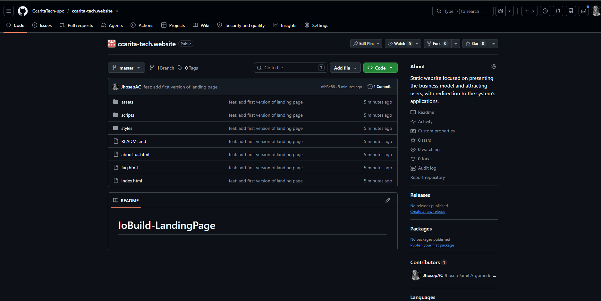

**Configuración para despliegue - Landing Page**

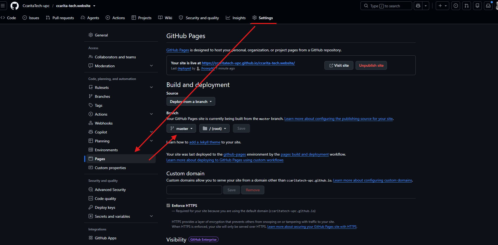

#### Proceso de despliegue
Una vez configurada la fuente de publicación, se realizó el despliegue de la aplicación. GitHub Pages procesó los archivos del repositorio y generó la versión publicada de la landing page. El estado de despliegue permitió comprobar que la aplicación fue publicada correctamente y que se encontraba disponible mediante la URL proporcionada por GitHub Pages.

**Enlace:** https://ccaritatech-upc.github.io/ccarita-tech.website/

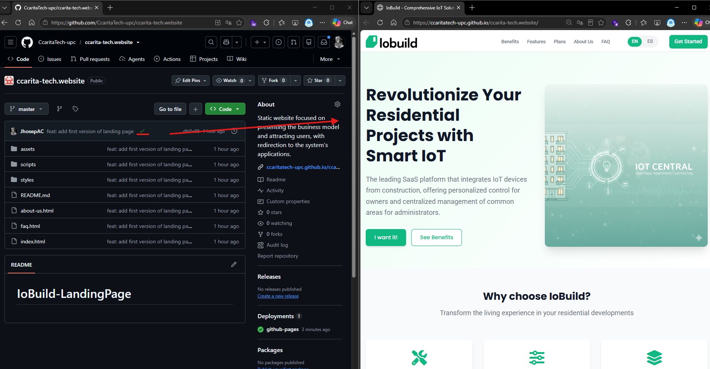

#### Visualización de la landing page
Finalmente, se accedió a la URL pública generada por GitHub Pages para verificar la implementación de la landing page. La página presenta la estructura, estilos, componentes y contenido definidos durante la etapa de desarrollo.

##### Hero - Inicio


##### Benefits  - Beneficios


##### Features - Características


##### Social Proof - Testimonios


##### Pricing - Precio


##### CTA - Llamado a la acción


##### Footer - Pie de Página


##### About Us - Sobre Nostros


##### FAQ - Preguntas frecuentes


En conjunto, estas evidencias permiten verificar que la landing page fue correctamente configurada, desplegada y publicada mediante GitHub Pages, así como comprobar visualmente que la versión disponible en línea corresponde con la implementación desarrollada para el proyecto.

### 5.2.3. Implemented Frontend-Web Application Evidence

### 0.1 Deploy


Aqui podemos observar la app deployada con render , en este caso se utilizo esta plataforma por su mayor cantidad de recursos gratuitos 

### 1. Pantalla de Inicio de Sesión

Formulario principal de acceso a la plataforma. Permite ingresar con credenciales de correo y contraseña, o seleccionar el tipo de registro: **Constructor** o **Propietario**.

---

### 2. Registro como Constructor - Paso 1

Primera etapa del flujo de registro para constructores, donde se solicitan las credenciales principales de la cuenta (correo electrónico y contraseña).

---

### 3. Registro como Propietario - Paso 1

Primera etapa del formulario de registro para propietarios de inmuebles, enfocada en la creación de las credenciales de acceso a la cuenta.

---

### 4. Registro como Propietario - Paso 2

Segunda etapa del registro de propietario donde se capturan los datos personales y de perfil (nombre, dirección, teléfono y foto de perfil).

---

### 5. Panel de Control del Propietario

Dashboard principal del propietario ("Mi Panel de Unidad"), con resumen de dispositivos, estado del hogar inteligente y gráficas de consumo energético, temperatura y agua.

---

### 6. Telemetría y Monitoreo en Tiempo Real

Módulo de monitoreo en vivo ("Live Energy") que muestra datos de consumo de dispositivos seleccionados en los últimos minutos o 24 horas.

---

### 7. Estado del Sistema y Unidades

Sección de diagnóstico que presenta el estado de salud de los dispositivos IoT conectados y el resumen general de las unidades inmobiliarias asignadas.

---

### 8. Perfil de Usuario

Vista de administración de cuenta donde el usuario puede consultar y actualizar su información personal, datos de contacto e idioma de la aplicación.

---

### 9. Vinculación de Dispositivos

Modal para la adición de nuevos dispositivos IoT ("Add Device"), permitiendo seleccionar el tipo de equipo, asignarle un nombre y vincularlo a una unidad específica.

---

### 10. Gestión de Suscripciones

Módulo de planes de suscripción para empresas o constructores (Starter, Professional y Enterprise), donde se administran las funcionalidades de infraestructura IoT e integración de proyectos.


### 5.2.4. Acuerdo de Servicio - SaaS

El presente acuerdo describe las condiciones de prestación de IoBuild como Software as a Service (SaaS). Se considera un acuerdo académico/propuesto para el producto, construido a partir de las funcionalidades y configuraciones que actualmente aparecen en la aplicación web. El proveedor del servicio es CcaritaTech mediante la plataforma IoBuild y el cliente objetivo es una empresa constructora o administradora de proyectos residenciales que necesita centralizar sus dispositivos IoT, unidades inmobiliarias y métricas operativas.

#### Objeto y alcance del servicio

IoBuild ofrece acceso web a una plataforma para gestionar proyectos residenciales inteligentes. El servicio comprende:

- Gestión de proyectos, unidades inmobiliarias y clientes asociados.
- Registro, consulta, actualización y eliminación de dispositivos IoT.
- Visualización de dashboards, métricas de energía, estado de dispositivos e insights históricos.
- Administración de perfiles, usuarios y sesiones autenticadas.
- Catálogo de planes, suscripciones, cancelación y consulta de comprobantes.
- Integración opcional con telemetría mediante MQTT e InfluxDB.
- Integración de pagos mediante Stripe, incluyendo checkout, confirmación de sesión y webhook de eventos.

El cliente utiliza el servicio desde un navegador web. En la versión actual, el frontend se implementa como una SPA en Vue 3/Vite y consume la API mediante la ruta relativa `/api/v1`. El backend se ejecuta como un monolito modular ASP.NET Core 9 y persiste la información en una única base MySQL.

#### Planes comerciales configurados

Los siguientes planes se encuentran definidos en el seed de la aplicación. Los precios son valores referenciales del prototipo y se muestran en dólares estadounidenses en el flujo de facturación.

| Plan | Precio mensual | Capacidad y beneficios principales |
|---|---:|---|
| Starter | USD 299 | Hasta 50 dispositivos IoT, dashboard básico, soporte por correo, actualizaciones incluidas, 1 administrador y reportes mensuales. |
| Professional | USD 799 | Hasta 200 dispositivos IoT, dashboard avanzado, soporte prioritario 24/7, actualizaciones y nuevas funcionalidades, 3 administradores, reportes en tiempo real, API personalizada y capacitación incluida. |
| Enterprise | USD 1,299 | Dispositivos IoT ilimitados, dashboard empresarial, soporte dedicado 24/7, desarrollo de funcionalidades personalizadas, administradores ilimitados, analítica avanzada, API completa, consultoría especializada y SLA garantizado. |

Estos valores y características proceden de [DataSeeder.cs](https://github.com/CcaritaTech-upc/ccarita-tech.webapp/blob/main/backend/src/IoBuild.Api/Persistence/DataSeeder.cs). El alcance comercial, la moneda definitiva, los impuestos y las condiciones de renovación deberán confirmarse antes de una puesta en producción.

#### Aprovisionamiento, pago y ciclo de suscripción

El ciclo operativo definido en la aplicación es el siguiente:

1. El usuario autenticado consulta los planes disponibles mediante `GET /api/v1/plans`.
2. Selecciona un plan desde la vista de suscripciones del frontend.
3. El backend crea una sesión de checkout mediante `POST /api/v1/subscriptions/payments/sessions`.
4. Stripe procesa el pago o se utiliza el modo simulado configurado para pruebas.
5. Al retornar al frontend, la sesión se confirma mediante `PATCH /api/v1/subscriptions/payments/sessions/{sessionId}`.
6. La suscripción activa se registra en MySQL; el cliente puede consultar, renovar o cancelar su plan.
7. Las facturas se consultan mediante `GET /api/v1/subscriptions/payments/invoices`.
8. Los eventos de Stripe pueden recibirse en `POST /api/v1/webhooks/stripe`, donde se valida la firma y se procesa el evento.

La implementación de este flujo está documentada principalmente en [SubscriptionsEndpoints.cs](https://github.com/CcaritaTech-upc/ccarita-tech.webapp/blob/main/backend/src/IoBuild.Api/Subscriptions/Interfaces/REST/SubscriptionsEndpoints.cs), [StripeHttpPaymentProvider.cs](https://github.com/CcaritaTech-upc/ccarita-tech.webapp/blob/main/backend/src/IoBuild.Api/Subscriptions/Infrastructure/Stripe/StripeHttpPaymentProvider.cs) y [my-subscription.vue](https://github.com/CcaritaTech-upc/ccarita-tech.webapp/blob/main/frontend/src/subscriptions/presentation/views/my-subscription.vue).

#### Compromisos del proveedor y del cliente

| Parte | Compromisos |
|---|---|
| Proveedor/CcaritaTech | Mantener la aplicación disponible en el entorno de despliegue, conservar la información de suscripciones, procesar las operaciones soportadas por la API, incluir actualizaciones según el plan y proteger las credenciales secretas de Stripe en el backend. |
| Cliente | Proporcionar datos válidos de sus proyectos y dispositivos, proteger sus credenciales, utilizar el sistema conforme a su finalidad, mantener actualizado el medio de pago y respetar los límites del plan contratado. |
| Terceros | Stripe, el proveedor de hosting, la red del cliente y los dispositivos IoT pueden afectar el resultado del servicio. Sus fallas o indisponibilidad no son controladas directamente por IoBuild. |

#### Disponibilidad, soporte y limitaciones del prototipo

La aplicación incorpora mecanismos técnicos de operación como `/health`, readiness de migraciones, healthchecks de Docker Compose, proxy Nginx y servicios opcionales de observabilidad con OpenTelemetry/Jaeger. Estos mecanismos facilitan el monitoreo y la recuperación, pero no constituyen por sí mismos una garantía contractual de disponibilidad.

El plan Enterprise muestra la característica “Guaranteed SLA” en el catálogo, pero la versión actual no define todavía un porcentaje de uptime, tiempos máximos de respuesta, ventanas de mantenimiento, compensaciones ni un proceso formal de escalamiento. Por ello, esos parámetros deben completarse en el contrato comercial antes de ofrecer el servicio como SLA legalmente vinculante.


### 5.2.5. Implemented Native-Mobile Application Evidence 


1. Login
La pantalla presenta una interfaz de inicio de sesión minimalista. El diseño incluye dos campos de entrada de texto: uno ara el correo electrónico (Email) y otro para la contraseña (Password). Debajo de estos campos, destaca un botón principal de color verde con el texto "Sign In" para acceder al sistema, seguido de una opción de registro en la parte inferior que dice "Don’t have an account? Register".


2. Dashboard
El "Builder Dashboard" muestra métricas clave como proyectos activos, dispositivos conectados y ocupación. Incluye un gráfico circular de "Device Distribution" (temperatura, agua, energía y control de acceso), un gráfico de líneas sobre la tasa de ocupación mensual y una sección de "Project Overview" con detalles específicos del proyecto "Torres del Pacífico".


3. Profile
La pantalla muestra el perfil de usuario de "Juan Pérez", identificado con el cargo de "Builder". Incluye una sección con datos personales como nombre completo, nombre de usuario, teléfono, dirección en San Isidro, Lima, y edad. En la parte inferior, destaca un botón verde con la opción "Edit Profile".


Esta interfaz corresponde a la edición del perfil de "Juan Pérez", bajo el rol de "Builder". Presenta cinco campos de texto editables con la información del usuario: nombre completo, nombre de usuario, teléfono, dirección y edad. En la parte inferior, se incluyen dos opciones principales: un botón verde para "Save Changes" (Guardar cambios) y un enlace de texto para "Cancel" (Cancelar).


4. Projects
La interfaz muestra una lista de proyectos de "IoBuild" organizados en tarjetas cuadrículas. Cada tarjeta presenta el nombre del edificio, como "Torres del Pacífico" o "Torre Ccarita", su ubicación o descripción breve, y una barra de progreso que indica el estado de las unidades ocupadas (por ejemplo, 68/80 o 90/90 unidades). Además, la pantalla incluye un botón flotante en la esquina inferior derecha con el símbolo "+" para añadir nuevos elementos.


### 5.2.6. Implemented RESTful API and/or Serverless Backend Evidence 

### 1. Vista General y Endpoints de Analytics

* **Descripción:** Interfaz principal de Swagger UI para la API de IoBuild ("All Bounded Contexts v1"). Muestra los endpoints de consulta (`GET`) para el módulo **Analytics**, permitiendo la obtención de métricas, consumo energético e insights tanto de constructores (*builders*) como de propietarios (*owners*).

---

### 2. Gestión de Clientes (Clients)

* **Descripción:** Módulos y endpoints correspondientes a la entidad **Clients**. Ofrece una arquitectura CRUD estándar (`GET`, `POST`, `PUT`, `DELETE`) para el registro, edición, consulta y eliminación de datos de los clientes.

---

### 3. Administración e Interacción con Dispositivos (Devices)

* **Descripción:** Conjunto de endpoints del contexto de **Devices**. Incluye soporte para la gestión de dispositivos y sus tipos, comandos en tiempo real, recepción de telemetría (`/telemetry`), retransmisión de datos (`/replay`), así como la consulta de estado y métricas de energía por dispositivo.

---

### 4. Gestión de Identidad y Acceso (IAM)

* **Descripción:** Endpoints para el módulo **IAM** (*Identity and Access Management*). Permite el registro de usuarios (`sign-up`), inicio y cierre de sesión (`sign-in`, `sign-out`), gestión de invitaciones y administración de sesiones activas.

---

### 5. Health Check, Contratos, Planes y Perfiles

* **Descripción:** Documentación de los contextos **IoBuild.Api** (verificación de estado `/health` y contratos), **Plans** (gestión de planes de suscripción) y **Profiles** (actualización e inspección de perfiles de usuario, incluyendo la foto de perfil vía `PATCH`).

---

### 6. Gestión de Proyectos y Subscripciones (Projects & Subscriptions)

* **Descripción:** Endpoints de los contextos **Projects** y **Subscriptions**. Permite la administración de proyectos y sus estructuras, el manejo del ciclo de vida de suscripciones, sesiones de pago, historial de facturas e integración mediante webhooks con Stripe.

---

### 7. Transiciones de Sistema y Unidades (System & Cutover / Units)

* **Descripción:** Endpoints correspondientes a **System & Cutover** (control de estado, congelamiento y estabilización del sistema durante despliegues) y **Units** (administración de unidades/inmuebles y asignación de propietarios).

### 5.2.7. RESTful API documentation 

La API de IoBuild v2 expone recursos REST utilizando Minimal APIs de ASP.NET Core 9. Todos los recursos funcionales se agrupan bajo la versión `/api/v1`, intercambian información en JSON y se organizan por bounded contexts dentro del monolito modular. La implementación se compone desde [Program.cs](https://github.com/CcaritaTech-upc/ccarita-tech.webapp/blob/main/backend/src/IoBuild.Api/Program.cs), que registra los módulos y configura Swagger/OpenAPI.

#### Acceso a la documentación OpenAPI

La interfaz Swagger se habilita automáticamente con `UseSwagger()` y `UseSwaggerUI()`. En el stack Docker local puede accederse desde:

- UI interactiva: `http://localhost:80/swagger`
- API directa: `http://localhost:8080/swagger`
- Especificación general: `/swagger/v1/swagger.json`

El backend publica documentos separados para `v1`, `publishing`, `devices`, `iam`, `subscriptions`, `profiles` y `analytics`. La configuración también define el esquema de seguridad Bearer para las operaciones que requieren autenticación.

#### Convenciones REST y respuestas

- `GET`: consulta recursos o colecciones.
- `POST`: crea recursos o ejecuta operaciones de dominio.
- `PUT`: reemplaza o actualiza información de un recurso.
- `PATCH`: aplica cambios parciales.
- `DELETE`: elimina un recurso o cierra una sesión.
- `200 OK`: operación exitosa con contenido.
- `201 Created`: creación exitosa de un recurso o sesión.
- `204 No Content`: operación exitosa sin cuerpo de respuesta.
- `400 Bad Request`: error de validación.
- `401 Unauthorized`: autenticación requerida.
- `403 Forbidden`: acceso no permitido.
- `404 Not Found`: recurso inexistente.
- `503 Service Unavailable`: dependencia no disponible.

#### API transversal

| Método | Ruta | Descripción | Acceso |
|---|---|---|---|
| GET | `/health` | Verifica la disponibilidad y readiness de la aplicación. | Público |
| GET | `/api/v1/contracts` | Devuelve el catálogo de contratos de compatibilidad de la API. | Público |
| GET | `/` | Redirige al usuario hacia Swagger UI. | Público |

#### Bounded Context: IAM

| Método | Ruta | Descripción | Acceso |
|---|---|---|---|
| POST | `/api/v1/users` | Registra un usuario. | Público |
| POST | `/api/v1/authentication/sign-up` | Registra un usuario. | Público |
| GET | `/api/v1/authentication/invitation?email={email}` | Consulta el estado de invitación de un correo. | Público |
| POST | `/api/v1/sessions` | Inicia sesión y devuelve un token. | Público |
| POST | `/api/v1/authentication/sign-in` | Inicia sesión. | Público |
| DELETE | `/api/v1/sessions/current` | Revoca la sesión actual. | Bearer |
| POST | `/api/v1/authentication/sign-out` | Cierra la sesión actual. | Bearer |
| GET | `/api/v1/users` | Lista usuarios del sistema. | Bearer |

#### Bounded Context: Publishing

| Método | Ruta | Descripción | Acceso |
|---|---|---|---|
| GET, POST | `/api/v1/projects` | Lista o crea proyectos. | Bearer |
| GET, PUT, DELETE | `/api/v1/projects/{id}` | Consulta, actualiza o elimina un proyecto. | Bearer |
| POST | `/api/v1/projects/{id}/structure` | Genera o actualiza la estructura de un proyecto. | Bearer |
| GET | `/api/v1/units?projectId={id}&ownerId={id}` | Lista unidades filtradas. | Bearer |
| GET | `/api/v1/units/{id}` | Obtiene una unidad. | Bearer |
| POST | `/api/v1/units` | Crea una unidad. | Bearer |
| PATCH | `/api/v1/units/{id}` | Actualiza una unidad. | Bearer |
| PATCH | `/api/v1/units/{id}/assign-owner` | Asigna el propietario de una unidad. | Bearer |
| GET, POST | `/api/v1/clients` | Consulta o crea clientes. | Bearer |
| GET, PUT, DELETE | `/api/v1/clients/{id}` | Consulta, actualiza o elimina un cliente. | Bearer |

#### Bounded Context: Profiles

| Método | Ruta | Descripción | Acceso |
|---|---|---|---|
| GET | `/api/v1/profiles?userId={id}` | Lista o filtra perfiles. | Bearer |
| GET, PUT | `/api/v1/profiles/{id}` | Consulta o actualiza un perfil. | Bearer |
| POST | `/api/v1/profiles` | Crea un perfil. | Bearer |
| PATCH | `/api/v1/profiles/{userId}/photo` | Reemplaza la foto de perfil. | Bearer |

#### Bounded Context: Devices

| Método | Ruta | Descripción | Acceso |
|---|---|---|---|
| GET | `/api/v1/devices/types` | Consulta tipos de dispositivos. | Público |
| GET, POST | `/api/v1/devices` | Lista o registra dispositivos IoT. | Bearer |
| GET, PUT, DELETE | `/api/v1/devices/{id}` | Consulta, actualiza o elimina un dispositivo. | Bearer |
| POST | `/api/v1/devices/{id}/commands` | Envía un comando autorizado. | Bearer |
| POST | `/api/v1/devices/telemetry` | Ingresa telemetría. | Público/Integración |
| POST | `/api/v1/devices/telemetry/replay` | Reproduce telemetría desde InfluxDB. | Bearer |
| GET | `/api/v1/devices/{id}/energy` | Consulta energía. | Bearer |
| GET | `/api/v1/devices/{id}/status` | Consulta el estado actual. | Bearer |

#### Bounded Context: Analytics

| Método | Ruta | Descripción |
|---|---|---|
| GET | `/api/v1/analytics/builders/{userId}/metrics` | Métricas del dashboard del constructor. |
| GET | `/api/v1/analytics/owners/{userId}/metrics` | Métricas del dashboard del propietario. |
| GET | `/api/v1/analytics/builders/{userId}/energy` | Energía reciente del constructor. |
| GET | `/api/v1/analytics/owners/{userId}/energy` | Energía reciente del propietario. |
| GET | `/api/v1/analytics/insights` | Consulta datos históricos por proyecto y métrica. |

#### Bounded Context: Subscriptions, Plans & Payments

| Método | Ruta | Descripción |
|---|---|---|
| GET | `/api/v1/plans` y `/api/v1/plans/{id}` | Lista planes o consulta un plan. |
| POST, PUT | `/api/v1/plans` y `/api/v1/plans/{id}` | Administra el catálogo de planes. |
| GET | `/api/v1/subscriptions` y `/api/v1/subscriptions/{id}` | Consulta suscripciones. |
| POST | `/api/v1/subscriptions` | Crea una suscripción. |
| PUT | `/api/v1/subscriptions/{id}` | Actualiza una suscripción. |
| POST | `/api/v1/subscriptions/{id}/cancel` | Cancela una suscripción. |
| POST | `/api/v1/subscriptions/payments/sessions` | Crea una sesión de checkout Stripe. |
| PATCH | `/api/v1/subscriptions/payments/sessions/{sessionId}` | Confirma la sesión pagada. |
| GET | `/api/v1/subscriptions/payments/invoices?builderId={id}` | Consulta facturas. |
| POST | `/api/v1/webhooks/stripe` | Recibe eventos de Stripe. |

#### Ejemplo de interacción

Solicitud de inicio de sesión:

```http
POST /api/v1/authentication/sign-in
Content-Type: application/json

{
  "email": "user@demo.com",
  "password": "secret"
}
```

Respuesta exitosa:

```json
{
  "id": 1,
  "email": "user@demo.com",
  "role": "builder",
  "token": "eyJhbGciOiJIUzI1NiIsInR5cCI6IkpXVCJ9..."
}
```

Consulta autenticada de dispositivos:

```http
GET /api/v1/devices?projectId=1
Authorization: Bearer {token}
```

Respuesta esperada:

```json
[
  {
    "id": 1,
    "name": "Sensor de Temperatura - Torre A",
    "type": "SmartMeter",
    "location": "Torre A - Piso 5",
    "projectId": 1,
    "status": "Online"
  }
]
```

La documentación se deriva de los archivos de endpoints del repositorio actual:

- [IAM](https://github.com/CcaritaTech-upc/ccarita-tech.webapp/blob/main/backend/src/IoBuild.Api/IAM/Interfaces/REST/IamEndpoints.cs)
- [Publishing](https://github.com/CcaritaTech-upc/ccarita-tech.webapp/blob/main/backend/src/IoBuild.Api/Publishing/Interfaces/REST/PublishingEndpoints.cs)
- [Profiles](https://github.com/CcaritaTech-upc/ccarita-tech.webapp/blob/main/backend/src/IoBuild.Api/Profiles/Interfaces/REST/ProfilesEndpoints.cs)
- [Devices](https://github.com/CcaritaTech-upc/ccarita-tech.webapp/blob/main/backend/src/IoBuild.Api/Devices/Interfaces/REST/DevicesEndpoints.cs)
- [Analytics](https://github.com/CcaritaTech-upc/ccarita-tech.webapp/blob/main/backend/src/IoBuild.Api/Analytics/Interfaces/REST/AnalyticsEndpoints.cs)
- [Subscriptions](https://github.com/CcaritaTech-upc/ccarita-tech.webapp/blob/main/backend/src/IoBuild.Api/Subscriptions/Interfaces/REST/SubscriptionsEndpoints.cs)

<div style="page-break-after: always;"></div>

# **Capítulo VI: Product Verification & Validation**

## **6.1. Testing suites & validation**

### **6.1.1. Core Entities Unit Tests**

Los Core Entities Unit Tests son fundamentales para garantizar la calidad y el correcto funcionamiento de las entidades principales y las reglas de negocio que conforman el dominio de la aplicación. Estas pruebas permiten detectar errores de manera temprana, reducir el riesgo de regresiones ante futuros cambios y facilitar el mantenimiento y evolución del código. De esta forma, contribuyen a construir un sistema más estable, confiable y consistente con las reglas definidas para el negocio.

#### Unit Entity Test:


#### Plan Entity Test:


#### Client Entity Test:


### **6.1.2. Core Integration Tests**

Las Core Integration Tests son esenciales para verificar que los controladores y endpoints de la API funcionen correctamente en conjunto con los demás componentes del sistema, como los servicios de aplicación y las bases de datos. Estas pruebas permiten validar tanto escenarios exitosos como situaciones de error, asegurando que la aplicación gestione adecuadamente comportamientos inesperados y devuelva los códigos de estado HTTP correspondientes. De esta manera, contribuyen a mejorar la experiencia del usuario, facilitar la identificación y corrección de errores y garantizar el desarrollo de un software más confiable, estable y de calidad.

#### IAM Login Controller / API Tests:


#### Project Structure Controller / API Tests:


#### Device Control Controller / API Tests:


#### Subscriptions Payment Controller / API Tests:


### **6.1.3. Core Behavior-Driven Development**

En esta sección se definen y validan los escenarios de aceptación de las historias de usuario desde la perspectiva del comportamiento esperado del sistema, aplicando la metodología BDD (Behavior-Driven Development) mediante la herramienta Cucumber y la especificación en lenguaje Gherkin (`.feature`).

#### Estructura de Features del Proyecto:


#### US05: Agregar un nuevo proyecto


#### US10: Iniciar Sesión (Login)


### **6.1.4. Core System Tests**

Las pruebas de sistema (System / End-to-End Tests) permiten validar el flujo integral de la aplicación directamente sobre la interfaz de usuario en el entorno web desplegado, simulando el comportamiento real de los usuarios y verificando que cada historia de usuario se cumpla de inicio a fin. Para la automatización y registro de estas suites se utilizó **Selenium IDE**.

#### US01: Visualizar los dispositivos y su distribución por tipo
**Como** ingeniero, **quiero** ver cuáles son los dispositivos y cómo están distribuidos por tipo, **para** realizar un análisis más detallado de los recursos disponibles.


#### US02: Acceder al perfil del usuario
**Como** usuario, **quiero** tener acceso a mi perfil, **para** ver datos como mi nombre, email, número de teléfono y mi dirección.


#### US03: Edición de Información del Perfil
**Como** usuario, **quiero** poder editar alguna parte de mi información, como mi email, número de teléfono o dirección, **para** mantener mis datos actualizados.


#### US04: Ver lista de proyectos
**Como** ingeniero, **quiero** ver una lista de todos mis proyectos, **para** poder conocer el estado y detalles de cada uno.


#### US05: Agregar un nuevo proyecto
**Como** arquitecto, **quiero** agregar un nuevo proyecto, **para** poder registrar nuevos desarrollos inmobiliarios e integrar funcionalidades inteligentes.


#### US06: Ver detalles de un proyecto
**Como** arquitecto, **quiero** ver los detalles de un proyecto específico, **para** poder revisar su información completa.


#### US07: Ver Lista de Clientes
**Como** arquitecto, **quiero** ver una lista de todos los clientes, **para** poder gestionar sus proyectos asociados y el estado de su cuenta.


#### US08: Agregar un Nuevo Cliente
**Como** arquitecto, **quiero** poder agregar un nuevo cliente, **para** poder registrarlo en el sistema.


#### US09: Ver Plan de Suscripción Actual
**Como** ingeniero, **quiero** ver mi plan de suscripción actual y su estado, **para** confirmar los beneficios que tengo y el costo mensual.


#### US10: Iniciar Sesión (Login)
**Como** usuario, **quiero** ingresar mis credenciales (correo y contraseña), **para** acceder a mi cuenta y utilizar las funciones protegidas.


## **6.2. Static Testing & Verification**

La revisión abarcó la aplicación web IoBuild v2, con un frontend en Vue 3 y un backend en ASP.NET Core. Se ejecutaron controles locales sobre el frontend y se inspeccionaron en el código los flujos de sesión, dispositivos y telemetría. La referencia del análisis es la rama `main`, en el [commit `3c7bcfd`](https://github.com/CcaritaTech-upc/ccarita-tech.webapp/commit/3c7bcfd2bdaec9ac54f1f64f0e9e3d7bf331e5c6).

### **6.2.1. Static Code Analysis**

#### **6.2.1.1. Coding Standards & Code Conventions**

Se contrastaron las convenciones de la sección 5.1.3 con el código del repositorio. En los módulos revisados se observan identificadores en inglés y `camelCase` para funciones JavaScript, `PascalCase` para clases y nombres de archivo en `kebab-case` en la mayoría de componentes Vue. Hay excepciones de nomenclatura dentro de un mismo módulo. [Componente `device-control-panel.vue`](https://github.com/CcaritaTech-upc/ccarita-tech.webapp/blob/3c7bcfd2bdaec9ac54f1f64f0e9e3d7bf331e5c6/frontend/src/devices/presentation/components/device-control-panel.vue), [componente `AddCustomDeviceDialog.vue`](https://github.com/CcaritaTech-upc/ccarita-tech.webapp/blob/3c7bcfd2bdaec9ac54f1f64f0e9e3d7bf331e5c6/frontend/src/devices/presentation/components/AddCustomDeviceDialog.vue).

Para la verificación se usaron ESLint 9.39.5 y `eslint-plugin-vue` 10.12.0 en una configuración de revisión separada del repositorio. Se aplicaron `@eslint/js` recomendado, Vue `flat/essential`, los globales del navegador y una advertencia para complejidad ciclomática superior a 15. Se revisaron **117 archivos `.js` y `.vue` de `frontend/src`**. Hubo **49 errores de reglas y 17 advertencias** en **38 archivos**. [Configuración base de Vue para ESLint](https://eslint.vuejs.org/user-guide/).

| Regla | Hallazgos | Acción propuesta |
|---|---:|---|
| `no-unused-vars` | 38 errores | Quitar declaraciones sin uso verificando sus llamadas. En `App.vue`, revisar la variable `t` declarada en el script. [Código](https://github.com/CcaritaTech-upc/ccarita-tech.webapp/blob/3c7bcfd2bdaec9ac54f1f64f0e9e3d7bf331e5c6/frontend/src/App.vue#L1-L15) |
| `no-empty` | 6 errores | Revisar la intención de los bloques vacíos y manejar o documentar los casos esperados. [Ejemplo en el registro de constructor](https://github.com/CcaritaTech-upc/ccarita-tech.webapp/blob/3c7bcfd2bdaec9ac54f1f64f0e9e3d7bf331e5c6/frontend/src/iam/presentation/views/register-builder.vue#L343-L403) |
| `vue/multi-word-component-names` | 2 errores | Alinear nombres como `login` y `layout` con la convención de componentes Vue. |
| `vue/no-mutating-props` y `vue/no-ref-as-operand` | 3 errores | Revisar el flujo de datos de `DeviceControlPanel` y leer `projectsLoaded.value` en el conteo de proyectos. [Control de dispositivos](https://github.com/CcaritaTech-upc/ccarita-tech.webapp/blob/3c7bcfd2bdaec9ac54f1f64f0e9e3d7bf331e5c6/frontend/src/devices/presentation/components/device-control-panel.vue#L128-L192), [conteo de proyectos](https://github.com/CcaritaTech-upc/ccarita-tech.webapp/blob/3c7bcfd2bdaec9ac54f1f64f0e9e3d7bf331e5c6/frontend/src/projects/application/project.store.js#L23-L28) |
| `complexity` | 17 advertencias | Priorizar los flujos con más ramificaciones y probar sus casos de error al refactorizarlos. |

#### **6.2.1.2. Code Quality & Code Security**

**Calidad.** Las funciones `handleRegister` de propietario y constructor registraron complejidades de **42 y 38**, respectivamente, frente al umbral de **15** usado en la revisión. Ambas concentran validación de campos, registro, inicio de sesión y creación del perfil. La revisión manual también identificó la repetición de validaciones de correo y contraseña en ambos formularios. Se propone reutilizar esas validaciones y conservar por separado las reglas propias de cada rol, como la asignación previa de una unidad al propietario. [Registro de propietario](https://github.com/CcaritaTech-upc/ccarita-tech.webapp/blob/3c7bcfd2bdaec9ac54f1f64f0e9e3d7bf331e5c6/frontend/src/iam/presentation/views/register-owner.vue#L423-L576), [registro de constructor](https://github.com/CcaritaTech-upc/ccarita-tech.webapp/blob/3c7bcfd2bdaec9ac54f1f64f0e9e3d7bf331e5c6/frontend/src/iam/presentation/views/register-builder.vue#L361-L523).

**Seguridad de dependencias.** Se ejecutaron estos comandos desde `frontend` con npm 11.19.1 el 7 de noviembre de 2026. Ambos devolvieron código de salida `1` por los avisos detectados en el archivo de versiones fijadas.

```bash
npm audit --package-lock-only --json
npm audit --omit=dev --package-lock-only --json
```

| Alcance | Críticos | Altos | Moderados | Total |
|---|---:|---:|---:|---:|
| Árbol completo | 1 | 18 | 8 | 27 |
| Árbol sin dependencias de desarrollo | 0 | 11 | 1 | 12 |

El aviso crítico se asoció a `proxy-addr` 2.0.7, dependencia de desarrollo que llega a través de `json-server` y Express. En el árbol sin dependencias de desarrollo, `axios`, `vue` y `vue-i18n` figuraron entre los paquetes directos con alertas altas. Estos resultados describen el árbol de dependencias analizado. Para priorizar la corrección se debe comprobar qué código afectado se usa en la aplicación, actualizar las versiones compatibles, ejecutar las pruebas correspondientes y repetir la auditoría. [Versiones fijadas](https://github.com/CcaritaTech-upc/ccarita-tech.webapp/blob/3c7bcfd2bdaec9ac54f1f64f0e9e3d7bf331e5c6/frontend/package-lock.json), [aviso de `proxy-addr`](https://github.com/advisories/GHSA-jqcg-44mw-7w3h), [documentación de `npm audit`](https://docs.npmjs.com/cli/v11/commands/npm-audit/).

Se consultó también la ejecución de CI asociada al commit. GitHub Actions muestra como completados correctamente los trabajos de CodeQL y auditoría de dependencias. El resultado local de npm corresponde a la consulta indicada arriba. El análisis del backend en esta revisión se apoyó en la inspección de código y en el estado de CI. [CodeQL](https://github.com/CcaritaTech-upc/ccarita-tech.webapp/actions/runs/37359763317/job/111931121093), [auditoría de dependencias](https://github.com/CcaritaTech-upc/ccarita-tech.webapp/actions/runs/37359763317/job/111931120953).

### **6.2.2. Reviews**

Se realizó una revisión estática del código de los recorridos críticos. Para cada caso se dejó la referencia al código, el efecto esperado del defecto y una comprobación que permite cerrar el hallazgo.

| ID y prioridad | Hallazgo y efecto | Corrección propuesta y verificación | Estado |
|---|---|---|---|
| RV-01 · Alta | **Origen de la telemetría.** La API admite telemetría HTTP sin autenticar al emisor. El servicio actualiza el estado y guarda las lecturas cuando el dispositivo existe. Esto permite que mediciones de origen no verificado afecten el panel. [Ruta](https://github.com/CcaritaTech-upc/ccarita-tech.webapp/blob/3c7bcfd2bdaec9ac54f1f64f0e9e3d7bf331e5c6/backend/src/IoBuild.Api/Devices/Interfaces/REST/DevicesEndpoints.cs#L121-L126), [servicio](https://github.com/CcaritaTech-upc/ccarita-tech.webapp/blob/3c7bcfd2bdaec9ac54f1f64f0e9e3d7bf331e5c6/backend/src/IoBuild.Api/Devices/Application/Internal/CommandServices/DeviceTelemetryService.cs#L50-L79) | Autenticar al emisor de la integración y comprobar su autorización sobre el dispositivo. Probar que un mensaje sin credenciales se rechaza sin alterar el estado ni guardar lecturas. | Pendiente |
| RV-02 · Alta | **Proyecto al editar un dispositivo.** La API verifica acceso al dispositivo antes de editarlo. Luego toma `ProjectId` de la solicitud sin comprobar el acceso al proyecto de destino, lo que puede dejar el dispositivo asociado a un proyecto ajeno. [Autorización](https://github.com/CcaritaTech-upc/ccarita-tech.webapp/blob/3c7bcfd2bdaec9ac54f1f64f0e9e3d7bf331e5c6/backend/src/IoBuild.Api/Devices/Interfaces/REST/DevicesEndpoints.cs#L14-L31), [edición](https://github.com/CcaritaTech-upc/ccarita-tech.webapp/blob/3c7bcfd2bdaec9ac54f1f64f0e9e3d7bf331e5c6/backend/src/IoBuild.Api/Devices/Interfaces/REST/DevicesEndpoints.cs#L118) | Validar en el servidor el acceso al proyecto de destino y la consistencia con la unidad asignada. Probar con dos cuentas constructoras que el dispositivo conserva su proyecto ante una solicitud de reasignación a un proyecto ajeno. | Pendiente |
| RV-03 · Media | **Recuperación de sesión.** El enrutador convierte el perfil guardado en el navegador con `JSON.parse` sin manejar errores en el control principal. Si el token sigue presente y el perfil guardado está dañado, la navegación puede quedar interrumpida. [Control de navegación](https://github.com/CcaritaTech-upc/ccarita-tech.webapp/blob/3c7bcfd2bdaec9ac54f1f64f0e9e3d7bf331e5c6/frontend/src/router.js#L91-L131) | Reutilizar una lectura segura de la sesión y redirigir al inicio de sesión cuando los datos sean inválidos. Probar la recarga con un token presente y un perfil guardado en un formato inválido. | Pendiente |

## **6.3. Validation Interviews**

### **6.3.1. Diseño de Entrevistas**

Las sesiones buscan comprobar si las personas de cada segmento entienden la propuesta de la página de presentación y pueden realizar tareas de su rol en la aplicación web. Se propone una muestra de **tres arquitectos o ingenieros civiles y tres propietarios de departamentos**, con 15 a 20 minutos por sesión. El entorno de prueba debe tener una cuenta de constructor con suscripción activa y proyectos de ejemplo, y una cuenta de propietario con una unidad asignada, dispositivos simulados y datos de consumo. Para una prueba de registro, se prepara además un correo de prueba con una invitación válida. [Página de presentación](https://ccaritatech-upc.github.io/ccarita-tech.website/).

En cada sesión, el moderador solicita permiso para grabar, presenta el objetivo de la tarea e invita a pensar en voz alta. Registra el tiempo de cada tarea, si se completó de forma autónoma, con ayuda o quedó pendiente, y el punto donde surgió la dificultad. Las tareas de planes terminan en la comparación y las de dispositivos se realizan en la unidad de prueba.

| Segmento | Tarea para el participante | Qué se observa | Pregunta de seguimiento |
|---|---|---|---|
| Ambos | Explora la página inicial y explica qué podrías hacer con IoBuild. Encuentra dónde iniciar el acceso a la plataforma. | Identifica el beneficio para su rol y el punto de entrada. | ¿Qué información te faltó para decidir si lo usarías? |
| Arquitectos e ingenieros | Ubica el proyecto de prueba, identifica su estado y encuentra la información de sus unidades. | Localiza el proyecto y distingue su estado del nivel de ocupación. | ¿Qué dato te ayudaría a detectar que el proyecto requiere atención? |
| Arquitectos e ingenieros | Busca al cliente de prueba, comprueba su proyecto asociado y compara los planes Starter y Professional. | Encuentra el cliente, confirma la asociación y explica qué diferencia entre los planes influye en su decisión. | ¿En qué momento necesitarías conocer la cantidad de dispositivos que admite el plan? |
| Propietarios | Completa el registro con el correo de prueba asignado a tu departamento e identifica tu unidad al ingresar. | Entiende la relación entre la invitación y su unidad. Si prueba un correo sin asignación, interpreta el mensaje y sabe cómo continuar. | ¿A quién contactarías si la aplicación indica que tu correo todavía no tiene una unidad asignada? |
| Propietarios | Entra a tu unidad de prueba, añade una luz inteligente de ejemplo y comprueba que aparezca en la lista. | Selecciona el tipo y la unidad correctos y reconoce la confirmación del registro. | ¿Cómo distinguirías que la luz está registrada de que ya se encuentra en línea? |
| Propietarios | Abre el panel, elige un dispositivo con datos y consulta su consumo de las últimas 24 horas. | Identifica el dispositivo, el rango y el significado de las unidades. | ¿Qué información te ayudaría a distinguir un consumo de cero de una falta de lecturas? |

El cierre recoge tres preguntas comunes. ¿Qué tarea te resultó más fácil? ¿En qué momento dudaste sobre cómo continuar? ¿Qué tendría que quedar más claro para que usaras IoBuild en tu proyecto o departamento?

### **6.3.2. Registro de Entrevistas**


#### Segmento 1 · Arquitectos e ingenieros civiles

**SIM-B01 · Daniela Paredes Salvatierra, 34 años, Jesús María.** Arquitecta que coordina el diseño de edificios multifamiliares. En el escenario, identifica en la página inicial que IoBuild centraliza la gestión de proyectos y dispositivos. Abre el proyecto de prueba, pero duda si el porcentaje de la tarjeta indica avance de obra u ocupación. Pregunta «¿Este porcentaje me dice cuántos departamentos están ocupados o cuánto ha avanzado el proyecto?» y «¿Dónde verifico qué unidades se incluyeron en el proyecto?». En una sesión real se observaría si puede distinguir ambos indicadores sin ayuda.

[Enlace simulado SIM-B01](https://iobuild-entrevistas.sharepoint.com/sites/IoBuild/Shared%20Documents/Entrevistas/SIM-B01.mp4)

**SIM-B02 · Luis Huamán Valdivia, 42 años, Santiago de Surco.** Ingeniero civil encargado de la entrega de unidades. En el escenario, busca un cliente de prueba y confirma el proyecto asociado desde la lista. Al encontrar el estado de cuenta, pregunta «¿El estado activo se refiere al cliente o al proyecto?» y «¿Cómo compruebo a qué departamento pertenece antes de cerrar una entrega?». En una sesión real se observaría qué columna usa primero y si necesita abrir el detalle para confirmar la asociación.

[Enlace simulado SIM-B02](https://iobuild-entrevistas.sharepoint.com/sites/IoBuild/Shared%20Documents/Entrevistas/SIM-B02.mp4)

**SIM-B03 · Camila Rojas Mendieta, 29 años, San Miguel.** Arquitecta que evalúa herramientas para una constructora pequeña. En el escenario, localiza los planes desde la página de presentación y abre el comparador en la aplicación. Pregunta «Si mi proyecto tendrá 80 dispositivos, ¿en qué plan entro?» y «¿Dónde reviso qué cambia si paso de Starter a Professional?». En una sesión real se observaría si encuentra el límite de dispositivos y puede justificar su elección.

[Enlace simulado SIM-B03](https://iobuild-entrevistas.sharepoint.com/sites/IoBuild/Shared%20Documents/Entrevistas/SIM-B03.mp4)

#### Segmento 2 · Propietarios de departamentos

**SIM-P01 · Valeria Núñez Carrasco, 31 años, Pueblo Libre.** Propietaria que quiere incorporar una luz inteligente. En el escenario, entra a la unidad de prueba, elige el tipo de dispositivo y lo guarda con un nombre que reconoce. Pregunta «¿Cómo sé que la luz quedó vinculada a mi departamento?» y «Si aparece fuera de línea después de guardarla, ¿ya quedó registrada o tengo que volver a añadirla?». En una sesión real se observaría si distingue el registro del dispositivo de su conectividad.

[Enlace simulado SIM-P01](https://iobuild-entrevistas.sharepoint.com/sites/IoBuild/Shared%20Documents/Entrevistas/SIM-P01.mp4)

**SIM-P02 · Sergio Meza Calderón, 38 años, Magdalena del Mar.** Propietario interesado en entender el consumo del aire acondicionado. En el escenario, abre el panel, elige el dispositivo y alterna entre la lectura reciente y el historial de 24 horas. Pregunta «¿El dato en kWh es de este equipo o de todo el departamento?» y «Si no veo puntos en el gráfico, ¿el consumo fue cero o todavía no hay lecturas?». En una sesión real se observaría si el dispositivo seleccionado, la unidad de medida y el período son visibles durante toda la consulta.

[Enlace simulado SIM-P02](https://iobuild-entrevistas.sharepoint.com/sites/IoBuild/Shared%20Documents/Entrevistas/SIM-P02.mp4)

**SIM-P03 · Mónica Salcedo Villanueva, 46 años, Lince.** Propietaria que recibió acceso a su unidad por parte de la constructora. En el escenario, intenta iniciar el registro con un correo de prueba sin asignación y luego usa el correo invitado. Pregunta «¿Por qué no puedo continuar con mi otro correo?» y «¿Dónde confirmo que la unidad que aparece es la mía?». En una sesión real se observaría si el mensaje de registro le permite identificar a quién pedir ayuda y si reconoce la unidad al ingresar.

[Enlace simulado SIM-P03](https://iobuild-entrevistas.sharepoint.com/sites/IoBuild/Shared%20Documents/Entrevistas/SIM-P03.mp4)

#### Formato para el registro de campo

Al realizar las sesiones, se completará una fila por participante y se resumirán las tareas, dificultades y preguntas observadas. El video consolidado se compartirá mediante un enlace privado de Microsoft Stream, con un cuadro representativo y el minuto de inicio de cada entrevista.

| Código | Nombres y apellidos | Edad y distrito | Segmento | Tareas y resultado | Resumen de observaciones | Captura | Enlace de Stream | Inicio y duración |
|---|---|---|---|---|---|---|---|---|
| V-01 a V-06 | Por registrar | Por registrar | Por registrar | Por registrar | Por registrar | Pendiente | Pendiente | Pendiente |

### **6.3.3. Evaluaciones según heurísticas**

Esta sección documenta la evaluación heurística de usabilidad de IoBuild, realizada con las **10 heurísticas de Nielsen** sobre las interfaces implementadas. Su propósito es detectar problemas de usabilidad antes de ejecutar los experimentos del Capítulo VIII, de modo que las diferencias que se midan después se deban a las variantes experimentales y no a fricciones evitables de la interfaz.

| Aspecto | Detalle |
|---|---|
| **Producto evaluado** | IoBuild: aplicación web (Vue 3) desplegada en `iobuild-remix.arroz.dev` y aplicación móvil (Flutter). |
| **Evidencia revisada** | (1) Capturas de implementación de las secciones 5.2.3 (web) y 5.2.5 (móvil). (2) Revisión del código fuente del repositorio `ccarita-tech.webapp`. (3) Recorrido en vivo de la web desplegada con una cuenta de prueba de Constructor, en escritorio (1366 px) y en móvil (375 px), con medición de contraste sobre los colores calculados. |
| **Flujos evaluados** | (1) Inicio de sesión. (2) Registro de Constructor y de Propietario. (3) Panel del propietario y telemetría. (4) Vinculación de un dispositivo. (5) Consulta y contratación de suscripción (constructor). (6) Navegación y teclado. (7) Builder Dashboard móvil. |
| **Alcance y limitación** | No fue posible recorrer en vivo las pantallas del Propietario: el registro de propietario exige que un constructor con suscripción activa le haya asignado antes una unidad a su correo, y la suscripción requiere un pago. Esas pantallas se evaluaron con las capturas del informe y con el código fuente, y así se indica en cada hallazgo. |
| **Marco de referencia** | 10 heurísticas de usabilidad de Jakob Nielsen. |
| **Evaluador** | Brayan Ccarita Cruz (Ccarita Tech). |

**Escala de severidad**

| Nivel | Descripción |
|:---:|---|
| 1 | **Cosmético.** Se supera con facilidad o ocurre rara vez. Se corrige solo si hay tiempo disponible. |
| 2 | **Menor.** Genera molestia o demora, pero el usuario completa la tarea. Prioridad baja. |
| 3 | **Mayor.** Impide o dificulta una tarea importante, o afecta la confianza del usuario. Prioridad alta. |
| 4 | **Catastrófico.** Impide usar el producto. Debe corregirse antes del lanzamiento. |

**Aspectos positivos**

- La pantalla de inicio de sesión es clara: etiquetas con ícono, botón principal destacado y opción de mostrar u ocultar la contraseña. Ante credenciales incorrectas muestra un mensaje visible ("Invalid email or password.").
- El registro se divide por rol (Constructor y Propietario) y por pasos, con un indicador de progreso y campos obligatorios marcados con asterisco. Los mensajes de validación son específicos (por ejemplo, "Password must be at least 8 characters." y "Enter a valid phone number (7 to 15 digits).").
- La pantalla de suscripciones está traducida al español, incluidas las características de cada plan, y presenta una jerarquía clara entre planes con la etiqueta del plan recomendado.
- El panel del propietario resume el estado del hogar en tarjetas y gráficas fáciles de leer, y el selector de idioma está siempre visible.
- Los modales ofrecen salidas claras (botón de cierre y "Cancel").
- En móvil (375 px), el login, el registro y las suscripciones no presentan desplazamiento horizontal.
- Todos los controles principales del login se alcanzan con la tecla Tab en un orden lógico.

<p align="center">
  
  
</p>

**Checklist de las 10 heurísticas de Nielsen**

| N° | Heurística | Qué se verificó | Cumple | Hallazgos y notas |
|:---:|---|---|:---:|---|
| 1 | Visibilidad del estado del sistema | Feedback de carga, estado de datos y estados vacíos. | Parcial | Indicadores que se contradicen (P1). Estados vacíos sin explicación (P4). Registro de propietario bloqueado sin guía (P11). Restricciones de acceso sin aviso (P12). |
| 2 | Relación entre el sistema y el mundo real | Lenguaje, idioma y unidades. | No | Mezcla de inglés y español, e idioma por defecto en inglés (P2). Precios sin moneda ni impuestos (P9). |
| 3 | Control y libertad del usuario | Salidas, cancelar, deshacer. | Parcial | Los modales tienen cierre y "Cancel", y el registro tiene "Back". No hay recuperación de contraseña (P5). El menú lateral no se cierra con Escape (P13). |
| 4 | Consistencia y estándares | Uso uniforme de idioma y componentes. | No | Idioma inconsistente y `lang` fijo (P2). Botones de registro que parecen deshabilitados (P6). Título con la errata "IoBuilt" (P10). |
| 5 | Prevención de errores | Validaciones y campos obligatorios. | Parcial | Validación clara en el registro. El modal "Add Device" no se deshabilita cuando no hay unidades (P3). |
| 6 | Reconocer antes que recordar | Opciones visibles. | Parcial | La navegación principal queda oculta tras el ícono de menú en escritorio (P7). |
| 7 | Flexibilidad y eficiencia de uso | Atajos y filtros. | Parcial | Hay selector de rango (Last Hour / Last 24h) y, según la implementación, búsqueda y orden en clientes. No hay atajos ni acciones rápidas. |
| 8 | Diseño estético y minimalista | Ruido visual y legibilidad. | Parcial | Diseño limpio y con buena jerarquía. Algunos textos secundarios no alcanzan el contraste mínimo (P8). |
| 9 | Ayudar a reconocer, diagnosticar y recuperarse de errores | Mensajes claros y con solución. | No | El aviso "No units found…" es pequeño, está en inglés y no indica cómo continuar (P3). La página "no encontrada" no está traducida y no ofrece regreso (P14). |
| 10 | Ayuda y documentación | Ayuda contextual y guía. | No | No existe una sección de Ayuda y Soporte ni ayuda contextual en las pantallas complejas (P4, P11). |

**Resumen de hallazgos**

| N° | Problema | Pantalla | Severidad | Heurística | Verificación |
|:---:|---|---|:---:|:---:|---|
| P1 | Datos que se contradicen entre sí y estado de dispositivo asignado al azar | Panel del propietario / Builder Dashboard móvil | 3 | 1 | Captura y código |
| P2 | Mezcla de inglés y español; idioma por defecto en inglés | Web y móvil | 3 | 2, 4 | En vivo y código |
| P3 | "Add Device" no ofrece salida cuando no hay unidades | Vinculación de dispositivos | 3 | 5, 9 | Captura y código |
| P4 | Estados vacíos sin explicación ni acción siguiente | Telemetría, Estado del sistema, Unidades | 2 | 1, 10 | Captura y código |
| P5 | No existe recuperación de contraseña | Inicio de sesión | 3 | 3, 9 | En vivo y código |
| P6 | Botones de registro por rol con apariencia de deshabilitados | Inicio de sesión | 2 | 4, 6 | En vivo |
| P7 | Navegación principal oculta tras el menú en escritorio | Encabezado de la web | 2 | 6 | En vivo y código |
| P8 | Texto secundario con contraste insuficiente | Login y suscripciones | 2 | 8 | En vivo (medido) |
| P9 | Precios sin moneda ni impuestos | Gestión de suscripciones | 3 | 2 | En vivo y código |
| P10 | Detalles menores (errata "IoBuilt", scroll en el registro, ícono faltante) | Título, registro y panel | 1 | 4, 8 | En vivo y captura |
| P11 | Registro de propietario por invitación sin explicación del proceso | Registro de Propietario | 2 | 1, 5, 10 | En vivo |
| P12 | Constructor sin suscripción: rutas restringidas sin explicación | Proyectos, Clientes, Dashboard | 2 | 1, 9 | En vivo |
| P13 | El menú lateral no se cierra con Escape y el foco de los campos es poco visible | Navegación y formularios | 2 | 3, 4 | En vivo |
| P14 | Página "no encontrada" sin traducir y sin enlace de regreso | Ruta inexistente | 2 | 9, 4 | En vivo |
| P15 | Detalles menores en formularios y consola | Registro y login | 1 | 9 | En vivo |

#### Descripción de los problemas

**P1. Datos que se contradicen entre sí y estado de dispositivo asignado al azar**

| | |
|---|---|
| **Severidad** | 3 (Mayor) |
| **Heurística** | 1. Visibilidad del estado del sistema |
| **Verificación** | Captura del panel del propietario y revisión del código. En vivo solo se verificó el endpoint del constructor, que para una cuenta nueva devuelve ceros y listas vacías. |
| **Descripción** | En el panel del propietario, "Mis Unidades" y "Mis Dispositivos" muestran 0, pero a la vez aparecen 142.5 kWh de energía, 23.5 °C de temperatura promedio y gráficas con curvas muy regulares. En el Builder Dashboard móvil, "Energy Efficiency" indica 0 % y "Energy Consumption" indica "No hay datos disponibles" mientras se informan 4/4 dispositivos conectados. No se pudo confirmar el origen de esos valores: la tarjeta de energía solo se muestra cuando `energyThisMonth > 0`, es decir, el valor llega del backend. |
| **Evidencia en el código** | En `device.assembler.js`, cuando un dispositivo llega sin estado, el frontend le asigna al azar "online" u "offline" (`Math.random()`), de modo que el estado mostrado puede no corresponder al real. |
| **Impacto** | El usuario no puede saber si los valores son reales. Esto afecta la confianza en un producto cuya propuesta de valor es la telemetría confiable. |
| **Recomendación** | Mantener coherentes los indicadores entre sí y mostrar un estado vacío cuando no hay dispositivos. Si se muestran datos de demostración, etiquetarlos ("Datos de ejemplo"). Mostrar "Estado desconocido" en lugar de asignar un estado aleatorio. |


**P2. Mezcla de inglés y español; idioma por defecto en inglés**

| | |
|---|---|
| **Severidad** | 3 (Mayor) |
| **Heurística** | 2. Relación entre el sistema y el mundo real · 4. Consistencia y estándares |
| **Verificación** | En vivo (cuenta de Constructor), código y captura. Las pantallas del Propietario se evaluaron con captura y código. |
| **Descripción** | El idioma por defecto al abrir la web es el inglés (sin preferencia guardada, la aplicación usa "en"). Con el idioma ES seleccionado, siguen apareciendo en inglés el módulo "Live Energy — Last 10 min", "Auto-refreshes every 30s", "No telemetry data yet", "My Unit Devices", el modal completo "Add Device" y los nombres de plan "Starter", "Professional" y "Enterprise". Las características de los planes sí están traducidas. La aplicación móvil está íntegramente en inglés. |
| **Evidencia en el código** | Estos textos están escritos directamente en los componentes, sin pasar por `vue-i18n`: `AddCustomDeviceDialog.vue` ("Add Device", "Device Type", "Device Name", "Assign to Unit", "No units found…"), `my-unit-devices.vue` ("My Unit Devices"), `live-energy-chart.component.vue` ("No telemetry data yet") y los dashboards ("Live Energy — Last … min", "Auto-refreshes every 30s"). Además, `index.html` declara `lang="en"` y este atributo no cambia al elegir español (verificado en vivo). |
| **Impacto** | Rompe la uniformidad y dificulta la comprensión del usuario hispanohablante, que es el segmento objetivo. El selector de idioma pierde credibilidad, y los lectores de pantalla y la traducción automática reciben un idioma incorrecto. |
| **Recomendación** | Externalizar todas las cadenas en archivos de traducción (es / en), usar el español como idioma por defecto o detectar el idioma del navegador, y actualizar `document.documentElement.lang` al cambiar de idioma. Aplicar el idioma de la sesión también en la app móvil. |

<p align="center">
  
  
</p>

**P3. "Add Device" no ofrece salida cuando no hay unidades**

| | |
|---|---|
| **Severidad** | 3 (Mayor) |
| **Heurística** | 5. Prevención de errores · 9. Recuperación de errores |
| **Verificación** | Captura y código. |
| **Descripción** | El modal permite completar el tipo y el nombre, pero el campo obligatorio "Assign to Unit" queda vacío cuando no hay unidades. Solo aparece un texto pequeño y en naranja: "No units found. Make sure your owner dashboard has loaded." No hay un enlace ni una acción para resolverlo. En el código, el botón "Add Device" solo se deshabilita mientras carga el catálogo, no por falta de unidades. |
| **Contexto** | Como todo propietario tiene al menos una unidad asignada por un constructor (ver P11), este mensaje no debería aparecer en uso normal: indica que las unidades no cargaron o que la unidad fue liberada, y debe tratarse como un error recuperable. Aun así, el equipo lo encontró en una cuenta de pruebas. |
| **Impacto** | Bloquea el evento de activación del propietario (vincular el primer dispositivo), justamente el comportamiento que mide el experimento EC-02. |
| **Recomendación** | Deshabilitar el botón con una explicación en español y ofrecer una acción (reintentar la carga o contactar al constructor). Probar el flujo con cuentas sin unidades. |


**P4. Estados vacíos sin explicación ni acción siguiente**

| | |
|---|---|
| **Severidad** | 2 (Menor) |
| **Heurística** | 1. Visibilidad del estado · 10. Ayuda y documentación |
| **Verificación** | Captura y código (cada estado vacío es un párrafo `no-data` sin botón ni enlace). |
| **Descripción** | Las secciones de telemetría, "Estado de Salud de Dispositivos" y "Resumen de Mis Unidades" muestran un texto gris corto ("No hay datos…") sin explicar la causa ni sugerir qué hacer. En el panel, "Mis Dispositivos: 0" no incluye una invitación a vincular el primer dispositivo. |
| **Impacto** | Un propietario nuevo ve un panel vacío y no sabe cómo avanzar. Esto afecta la activación y aumenta las consultas a soporte (experimentos EC-02 y EC-04). |
| **Recomendación** | Reemplazar los textos por estados vacíos con una explicación breve y un botón de acción ("Vincular mi primer dispositivo"). |


**P5. No existe recuperación de contraseña**

| | |
|---|---|
| **Severidad** | 3 (Mayor) |
| **Heurística** | 3. Control y libertad del usuario · 9. Recuperación de errores |
| **Verificación** | En vivo y código. |
| **Descripción** | La pantalla de inicio de sesión solo tiene correo, contraseña, "Sign In" y los enlaces de registro. No existe un enlace de "¿Olvidaste tu contraseña?" ni un flujo equivalente: no aparece en la web desplegada ni en el código. |
| **Impacto** | El usuario que olvida su contraseña queda sin acceso a su cuenta y a su suscripción de pago, y solo podría resolverlo contactando a alguien del equipo, ya que tampoco hay un canal de soporte (P4). |
| **Recomendación** | Agregar un flujo de recuperación por correo electrónico. |

**P6. Botones de registro por rol con apariencia de deshabilitados**

| | |
|---|---|
| **Severidad** | 2 (Menor) |
| **Heurística** | 4. Consistencia y estándares · 6. Reconocer antes que recordar |
| **Verificación** | En vivo (medido). |
| **Descripción** | "Register as Builder" y "Register as Owner" usan un estilo secundario con borde muy tenue. Son clicables, pero parecen inactivos. El contraste de su texto es de 4.31:1 (gris azulado sobre fondo claro), por debajo del mínimo de 4.5:1 de WCAG 2.1 AA. En móvil, además, cada texto se parte en dos líneas. |
| **Impacto** | Los usuarios nuevos pueden no reconocerlos como acciones y abandonar el flujo antes de registrarse. |
| **Recomendación** | Usar un estilo de botón secundario con contraste suficiente y un texto guía ("Crea tu cuenta como…"). |

**P7. Navegación principal oculta tras el menú en escritorio**

| | |
|---|---|
| **Severidad** | 2 (Menor) |
| **Heurística** | 6. Reconocer antes que recordar |
| **Verificación** | En vivo (1366 px) y código. |
| **Descripción** | En escritorio, la navegación está cerrada por defecto y solo hay un ícono de menú, sin etiquetas visibles. Al abrirla, un constructor sin suscripción ve únicamente "Profile", "Subscription" y "Log Out". |
| **Impacto** | El usuario debe recordar dónde está cada módulo (telemetría, estado del sistema, suscripciones). Reduce el descubrimiento de funcionalidades. |
| **Recomendación** | Mostrar una barra lateral con íconos y etiquetas en escritorio y reservar el menú hamburguesa para móvil. |

**P8. Texto secundario con contraste insuficiente**

| | |
|---|---|
| **Severidad** | 2 (Menor) |
| **Heurística** | 8. Diseño estético y minimalista (legibilidad) |
| **Verificación** | En vivo (ratios calculados con los colores computados; no se ejecutó Lighthouse). |
| **Descripción** | No alcanzan el mínimo de 4.5:1 de WCAG 2.1 AA: la nota "Ciclo de facturación mensual" (2.56:1, texto de 11.5 px), el subtítulo del login (4.37:1), el texto "Don't have an account?" (4.37:1) y los botones "Register as…" (4.31:1). Sí cumplen los placeholders (4.76:1), el texto de los pasos del registro (4.76:1), el subtítulo de Suscripciones (4.55:1) y las características de los planes (10.35:1). |
| **Impacto** | Dificulta la lectura a usuarios con baja visión o en pantallas con poco brillo. |
| **Recomendación** | Oscurecer los colores secundarios que fallan y aumentar el tamaño mínimo del texto. Ejecutar Lighthouse como verificación final. |


**P9. Precios sin moneda ni impuestos**

| | |
|---|---|
| **Severidad** | 3 (Mayor) |
| **Heurística** | 2. Relación entre el sistema y el mundo real |
| **Verificación** | En vivo y código. |
| **Descripción** | Los planes muestran "$ 299 / mes", "$ 799" y "$ 1299" sin indicar si la moneda es dólares estadounidenses o soles, y sin mencionar impuestos (no aparecen "US$", "S/", "USD", "PEN", "IGV" ni "VAT"). En `plan-card.vue` el símbolo "$" está escrito directamente en la plantilla. Al elegir un plan, el sistema redirige a un pago externo sin un resumen previo de plan, moneda e impuestos. |
| **Impacto** | Es una decisión de pago recurrente de 299 a 1299 al mes. La falta de moneda genera dudas y desconfianza, y afecta la conversión de constructores (experimento EC-01). |
| **Recomendación** | Indicar la moneda (por ejemplo, "US$"), si el precio incluye impuestos, y mostrar un resumen de confirmación antes de redirigir al pago. |

**P10. Detalles menores**

| | |
|---|---|
| **Severidad** | 1 (Cosmético) |
| **Heurística** | 4. Consistencia y estándares · 8. Diseño estético y minimalista |
| **Verificación** | Título: en vivo. Scroll del registro e ícono: solo captura. |
| **Descripción** | (a) El HTML inicial, la meta descripción y el texto "IoBuilt Dashboard" escriben el nombre como "IoBuilt" (con "t" final); el título de la pestaña cambia a "IoBuild - …" según la ruta. (b) En la captura del paso 2 del registro de propietario aparece una barra de desplazamiento horizontal bajo el indicador de pasos; no pudo reproducirse en vivo porque ese paso no era accesible. (c) En la captura del panel, la tarjeta "Temperatura Promedio" no muestra su ícono. |
| **Impacto** | Transmiten una imagen de producto inacabado, sin impedir las tareas. |
| **Recomendación** | Corregir el nombre en `index.html` y en las cadenas de idioma, revisar el contenedor del indicador de pasos y restituir el ícono faltante. |


**P11. Registro de propietario por invitación sin explicación del proceso**

| | |
|---|---|
| **Severidad** | 2 (Menor) |
| **Heurística** | 1. Visibilidad del estado · 5. Prevención de errores · 10. Ayuda y documentación |
| **Verificación** | En vivo. |
| **Descripción** | Por diseño del producto, el orden es siempre el mismo: primero el constructor asigna una unidad y solo entonces el propietario puede registrarse y usar la plataforma. El problema no es esta regla, sino que la interfaz no la explica. Un propietario solo puede registrarse si un constructor le asignó una unidad a su correo. Si no, el registro muestra "The builder must assign a unit to your email before you can register as an owner." y el botón "Next" queda deshabilitado. El mensaje aparece dos veces (bajo el campo de correo y en un banner) y no ofrece contacto ni ayuda. A su vez, el constructor necesita una suscripción activa de pago para usar Proyectos y Clientes, que es donde se asignan las unidades. |
| **Impacto** | Un propietario que llega por su cuenta no puede crear su cuenta ni sabe qué hacer. Además, define quién puede ser "propietario nuevo" en los experimentos: solo quien fue invitado por un constructor. |
| **Recomendación** | Explicar el proceso en la pantalla ("Tu constructora debe invitarte"), ofrecer un canal de contacto, mostrar el mensaje una sola vez y evaluar una vista de demostración. |

**P12. Constructor sin suscripción: rutas restringidas sin explicación**

| | |
|---|---|
| **Severidad** | 2 (Menor) |
| **Heurística** | 1. Visibilidad del estado · 9. Recuperación de errores |
| **Verificación** | En vivo. |
| **Descripción** | Un constructor sin suscripción activa que entra a `/projects`, `/clients` o al dashboard de analítica es redirigido a Mi Suscripción sin ningún aviso del motivo; el dashboard muestra brevemente "Cargando información de suscripción…". El menú lateral solo muestra "Profile", "Subscription" y "Log Out", sin indicar que las demás opciones están bloqueadas. No existe prueba gratuita ni plan gratuito: hay que pagar antes de ver cualquier funcionalidad. |
| **Impacto** | El constructor no entiende por qué no puede acceder y no puede evaluar el producto antes de pagar. Afecta la conversión que mide el experimento EC-01. |
| **Recomendación** | Mostrar un aviso ("Necesitas una suscripción para acceder a Proyectos") y presentar las opciones bloqueadas con un candado. Habilitar la prueba de 14 días que propone EC-01. |

**P13. El menú lateral no se cierra con Escape y el foco es poco visible**

| | |
|---|---|
| **Severidad** | 2 (Menor) |
| **Heurística** | 3. Control y libertad del usuario · 4. Consistencia y estándares |
| **Verificación** | En vivo. |
| **Descripción** | Al abrir el menú lateral, la tecla Escape no lo cierra: el panel y la sombra siguen visibles y el foco queda en "Close navigation". En el login, los campos de texto no muestran un contorno de foco (su `outline-color` es transparente) y los botones "Register…" solo muestran un halo muy tenue. No se pudo verificar el cierre de los modales con Escape. |
| **Impacto** | Dificulta el uso con teclado y lectores de pantalla. |
| **Recomendación** | Cerrar el menú y los modales con Escape y definir un estilo de foco visible y consistente. |

**P14. Página "no encontrada" sin traducir y sin enlace de regreso**

| | |
|---|---|
| **Severidad** | 2 (Menor) |
| **Heurística** | 9. Recuperación de errores · 4. Consistencia y estándares |
| **Verificación** | En vivo. |
| **Descripción** | Una ruta inexistente muestra "page not found" en minúsculas, sin traducir al español y sin un enlace para volver al inicio. |
| **Impacto** | El usuario queda sin una salida clara tras equivocarse de enlace. |
| **Recomendación** | Traducir el mensaje y agregar un botón "Volver al inicio". |

**P15. Detalles menores en formularios y consola**

| | |
|---|---|
| **Severidad** | 1 (Cosmético) |
| **Heurística** | 9. Recuperación de errores |
| **Verificación** | En vivo. |
| **Descripción** | (a) En "Years in business", un texto como "abc" produce "Years in business is required." en lugar de indicar que debe ser un número. (b) Tras registrar un constructor, la consola muestra la advertencia "iam.store: could not fetch profile immediately after sign in", que sugiere una condición de carrera entre la sesión y la carga del perfil. (c) El banner de error del login no mueve el foco y no se verificó que se anuncie a lectores de pantalla. |
| **Impacto** | Fricciones menores que no impiden completar las tareas. |
| **Recomendación** | Mensaje de formato numérico, corregir la secuencia sesión/perfil y marcar los banners con `role="alert"`. |

**Conclusiones de la evaluación**

- Se identificaron **15 problemas**: 5 de severidad mayor (P1, P2, P3, P5, P9), 8 de severidad menor (P4, P6, P7, P8, P11, P12, P13, P14) y 2 cosméticos (P10, P15). No se encontraron problemas catastróficos.
- Se verificaron en vivo o en el código P2, P5, P6, P7, P8, P9, P11, P12, P13, P14 y P15. Los problemas P1, P3 y P4 y los detalles visuales de P10 se basan en las capturas del informe y el código, porque las pantallas del Propietario no pudieron recorrerse en vivo.
- Los problemas P1, P3, P4 y P11 afectan la **activación del propietario**, por lo que conviene corregirlos antes de ejecutar los experimentos EC-02 y EC-04; de lo contrario, la fricción actual podría confundirse con el efecto de las variantes.
- Los problemas P9 y P12 afectan la conversión de constructores y deben resolverse antes de ejecutar el experimento EC-01.
- La prioridad de corrección sugerida es: P2 → P5 → P3 → P9 → P1 → P11 → P12 → P4 → P7 → P6 → P8 → P13 → P14 → P10 → P15.

<div style="page-break-after: always;"></div>

# **Capítulo VII: DevOps Practices**

## **7.1. Continuous Integration**

### **7.1.1. Tools and Practices**

IoBuild implementa una estrategia de Integración Continua (CI) estructurada para garantizar que cada contribución al código fuente sea verificada de manera automática y sistemática. El objetivo principal de esta fase es detectar problemas de integración de forma temprana, mantener la integridad de la base de código y asegurar que los nuevos desarrollos cumplan con los estándares de calidad antes de avanzar a la etapa de despliegue.

Para lograr esta automatización y estandarización, el equipo hace uso de las siguientes herramientas fundamentales:

| HERRAMIENTA | DESCRIPCIÓN | LOGO |
|--|--| -- |
| GitHub (Control de Versiones y Colaboración) | Actúa como el repositorio central y la fuente única de verdad para el código fuente, gestionando el historial de cambios a través de Git y facilitando la revisión asíncrona de código. |  |
| GitHub Actions (Orquestador de Pipelines) | Es el motor principal de la integración continua. Se encarga de ejecutar _workflows_ definidos en archivos YAML cada vez que se detecta un evento clave, como la creación de un _Pull Request_ o un _Push_ hacia las ramas principales. |  |
| SonarCloud (Inspección Continua) | Herramienta de análisis de código estático integrada en el pipeline para detectar vulnerabilidades de seguridad, _bugs_ y _code smells_, garantizando que la deuda técnica se mantenga bajo control. |  |
| ESLint y Prettier (Linters y Formateadores) | Herramientas de análisis a nivel de sintaxis que aseguran el cumplimiento de las convenciones de codificación del equipo, estandarizando el estilo y previniendo errores comunes en el código base (como TypeScript o JavaScript). |  |
| Jest (Framework de Testing) | Tecnologías empleadas para ejecutar la suite de pruebas unitarias y de integración durante el pipeline, validando que los componentes y la lógica de negocio funcionen como se espera. |  |

El uso de estas herramientas está sustentado por una serie de prácticas metodológicas de DevOps diseñadas para fomentar la colaboración segura y el _feedback_ rápido:

-   **Estrategia de Ramas (Branching Strategy):** Se utiliza un modelo basado en _Feature Branching_ (como GitHub Flow o GitFlow). Todo nuevo desarrollo, corrección de errores o refactorización se realiza en una rama aislada (ej. feature/nombre-de-tarea) y nunca directamente sobre la rama de producción (main o master).
-   **Políticas Estrictas de Pull Request (PR):** Las ramas principales están protegidas. Para que un cambio sea integrado, debe enviarse mediante un _Pull Request_ que requiere la aprobación obligatoria de al menos un revisor par (Code Review) y la ejecución exitosa de todos los _checks_ de integración en GitHub Actions.
-   **Pipeline de Ejecución Secuencial (Fail-Fast):** Los _workflows_ están diseñados para fallar rápido. El pipeline ejecuta primero las tareas más rápidas (instalación de dependencias, _linting_ y formateo de código). Si estas fallan, el proceso se detiene inmediatamente sin consumir recursos en la ejecución de pruebas unitarias o análisis en SonarCloud, notificando al desarrollador al instante.
-   **Cobertura de Código (Code Coverage):** Dentro de las prácticas de calidad, se establece un umbral mínimo de cobertura de pruebas (ej. 70% u 80%). Si el nuevo código introducido reduce el porcentaje general de cobertura por debajo del límite permitido, el pipeline marca el estado como fallido.

<br>

### **7.1.2. Build & Test Suite Pipeline Components**

El pipeline de Integración Continua (CI) del repositorio está estructurado en una serie de _jobs_ (trabajos) y _steps_ (pasos) secuenciales, orquestados principalmente a través de GitHub Actions. Este flujo de trabajo automatizado garantiza que cada incremento de código sea compilado y evaluado rigurosamente antes de considerarse válido para su fusión.

A continuación, se detallan los componentes y etapas principales que conforman el Build & Test Suite Pipeline de la aplicación:

**1. Triggers (Desencadenadores del Pipeline)**

-   **Eventos de Pull Request:** El pipeline se activa automáticamente cada vez que se abre, actualiza o reabre un _Pull Request_ hacia las ramas protegidas (main o develop).
-   **Eventos de Push:** Se ejecuta tras la integración de código (merge) en las ramas principales, actuando como una validación final antes de iniciar cualquier proceso de despliegue.

**2. Environment Setup (Configuración del Entorno de Ejecución)**

-   **Contenedor de Ejecución:** Los _workflows_ operan sobre entornos limpios y estandarizados (típicamente ubuntu-latest), garantizando la consistencia entre ejecuciones.
-   **Aprovisionamiento del Runtime:** Uso de acciones predefinidas (ej. actions/setup-node) para instalar y configurar la versión específica de Node.js requerida por el ecosistema de la aplicación.
-   **Estrategia de Caché:** Implementación de mecanismos de caché para la carpeta de dependencias (node_modules o la ruta de caché del gestor de paquetes). Esto evita descargas redundantes desde los registros, reduciendo drásticamente los tiempos de ejecución del pipeline.

**3. Dependency Installation (Gestión de Dependencias)**

-   Ejecución de instalaciones limpias y deterministas (mediante comandos como npm ci o equivalentes en yarn/pnpm). Este componente asegura que el pipeline utilice las versiones exactas especificadas en el archivo de bloqueo (lockfile), evitando discrepancias ocasionadas por actualizaciones de dependencias de terceros.

**4. Code Quality & Linting (Validación de Sintaxis y Formato)**

-   **Análisis Estático Básico:** Ejecución de ESLint para escanear todo el código fuente. Identifica de forma proactiva errores de sintaxis, variables no utilizadas y violaciones a los estándares de codificación del equipo.
-   **Verificación de Formato:** Evaluación del estilo del código utilizando Prettier (o herramientas análogas) para asegurar que la estructura visual (indentación, espaciado, uso de comillas) sea uniforme. Los fallos en esta etapa detienen la ejecución (_fail-fast_).

**5. Test Suite (Ejecución de Pruebas Unitarias y de Integración)**

-   **Ejecución del Framework:** Lanzamiento de las suites de pruebas automatizadas (mediante Jest o Vitest) para verificar la correcta funcionalidad de la lógica de negocio, los componentes de interfaz y los servicios internos de la aplicación web.
-   **Generación de Reportes de Cobertura:** Configuración del framework para emitir métricas detalladas de cobertura de código (_Code Coverage_) en formatos estandarizados (como lcov), cuantificando el porcentaje de líneas, funciones y ramas evaluadas.

**6. Static Code Analysis (Inspección Avanzada y Quality Gates)**

-   **Escaneo de Seguridad y Mantenibilidad:** Transmisión de los reportes de cobertura generados a plataformas de análisis profundo (como SonarCloud o SonarQube).
-   **Quality Gates:** Evaluación automática del código contra umbrales predefinidos. Si se detectan vulnerabilidades de seguridad críticas, _code smells_ excesivos, o si la cobertura cae por debajo del límite mínimo aceptable, el componente marca el _job_ como fallido y bloquea la integración.

**7. Build Configuration (Compilación y Empaquetado)**

-   **Proceso de Transpilación:** Ejecución del comando de construcción (ej. npm run build) que compila el código TypeScript/JavaScript moderno y procesa los activos.
-   **Validación de Integridad:** Este paso asegura que el proyecto pueda empaquetarse correctamente (vía Vite, Webpack, etc.) sin errores de compilación ni dependencias circulares, generando la carpeta de activos estáticos optimizados (dist o build) listos para producción.

**8. Artifact Upload (Gestión de Resultados)**

-   **Almacenamiento de Artefactos:** Uso de acciones como actions/upload-artifact para preservar temporalmente los elementos críticos generados durante el pipeline. Esto incluye el empaquetado de la carpeta construida y los reportes detallados de pruebas, haciéndolos descargables para inspección manual o preparándolos para ser consumidos por un pipeline secundario de _Continuous Deployment_ (CD).

<br><br>

## **7.2. Continuous Delivery**
### **7.2.1. Tools and Practices**

El proceso de Entrega Continua (CD) abarca los repositorios ccarita-tech.webapp y ccarita-tech.mobileapp, garantizando que los incrementos de código validados en la fase de integración (CI) sean empaquetados y desplegados de manera automática, segura y predecible. Esta estrategia cubre tanto la distribución web como la entrega de versiones de prueba y producción para el ecosistema móvil.

Basado en las directrices de calidad y monitoreo de la arquitectura de referencia, el equipo emplea las siguientes herramientas para la automatización del despliegue:

| HERRAMIENTA | DESCRIPCIÓN | LOGO |
|--|--| -- |
| GitHub Actions (Orquestador de CD) | Actúa como el puente entre la integración y la entrega. Configura flujos de trabajo de despliegue que se activan al fusionar código en ramas protegidas o al generar nuevas etiquetas (tags) de versión, gestionando de forma segura los secretos y credenciales de producción. |  |
| Plataformas de Cloud Hosting (ej. Vercel, Render o AWS) | Utilizadas para el alojamiento de la aplicación web (ccarita-tech.webapp). Facilitan el despliegue automatizado y ofrecen entornos de _Preview_ o _Staging_ dinámicos, garantizando un despliegue sin tiempo de inactividad (Zero Downtime Deployment) para los usuarios. |  |
| Firebase App Distribution | Herramienta central para el pipeline del cliente móvil (ccarita-tech.mobileapp). Permite automatizar la distribución de los compilados (como APKs para Android o IPAs para iOS) directamente al equipo de QA y _testers_ autorizados, agilizando las pruebas antes de la publicación final en las tiendas de aplicaciones (App Store / Google Play). |  |
| Sentry (Monitoreo y Observabilidad) | Integrado en las aplicaciones web y móvil para capturar errores no controlados, excepciones y _crashes_ en tiempo real. Proporciona visibilidad inmediata sobre la salud del _release_ en los entornos de _Staging_ y Producción. |  |

Para respaldar el uso de estas herramientas, se aplican las siguientes prácticas de Entrega Continua:

-   **Despliegue Basado en Entornos (Environment-based Promotion):** Se mantiene una separación rigurosa entre entornos (_Development_, _Staging_, _Production_). Los despliegues a _Staging_ ocurren de manera automática tras la validación en la rama develop, sirviendo como filtro final de Pruebas de Aceptación del Usuario (UAT).
-   **Versionado Semántico (SemVer) y Release Tagging:** Cada paso a producción o empaquetado móvil está respaldado por la creación de un _Release_ y una etiqueta en Git (ej. v1.0.3). Esto asegura la trazabilidad exacta de qué iteración del código está activa, facilitando la auditoría y simplificando los _rollbacks_.
-   **Distribución Móvil Automatizada:** Los flujos de trabajo de la aplicación móvil incluyen pasos de compilación nativa. Si la compilación es exitosa, GitHub Actions sube el artefacto a Firebase App Distribution, el cual notifica automáticamente a los _testers_ por correo electrónico para que descarguen y evalúen la nueva versión.
-   **Estrategia de Rollback y Health Checks:** Los despliegues web incluyen validaciones de disponibilidad post-despliegue. Si se detecta una degradación severa del servicio o un aumento anormal de errores en Sentry inmediatamente después de un lanzamiento, el equipo cuenta con protocolos para revertir la aplicación a la etiqueta de versión estable anterior con un solo clic o comando.

<br>

### **7.2.2. Stages Deployment Pipeline Components**

El pipeline de Entrega Continua (CD) para los ecosistemas de la aplicación y móvil está compuesto por una serie de etapas secuenciales diseñadas para transformar el código fuente validado en versiones empaquetadas, distribuidas y monitoreadas de forma automática.

A continuación se detallan los componentes principales que conforman estas etapas de despliegue:

**1. Desencadenadores de Entrega (Deployment Triggers)**
-   **Fusión en Ramas de Producción:** El pipeline se activa automáticamente tras un _merge_ exitoso hacia la rama main o master.
-   **Release Tagging:** La creación de etiquetas de versión semántica (ej. v1.2.0) en el repositorio desencadena flujos de trabajo específicos para empaquetado de producción o envíos a tiendas.

**2. Aprovisionamiento y Gestión de Secretos (Environment & Secrets Management)**
-   **Inyección de Credenciales:** Extracción segura de tokens, claves de API y configuraciones de base de datos almacenadas en GitHub Secrets.
-   **Configuración por Entorno:** Asignación dinámica de variables de entorno (ej. .env.production o .env.staging) según el entorno objetivo del despliegue, asegurando el aislamiento de los datos.

**3. Compilación de Producción (Production Build)**
-   **Web (ccarita-tech.webapp):** Ejecución de herramientas de _bundling_ (como Vite o Webpack) para minificar el código, optimizar recursos estáticos (imágenes, fuentes) y generar el directorio final (ej. dist) listo para ser servido.
-   **Mobile (ccarita-tech.mobileapp):** Preparación del SDK correspondiente (Flutter, React Native, o nativo) y compilación de los binarios ejecutables para ambas plataformas: archivos APK/AAB para Android y archivos IPA para iOS.

**4. Despliegue y Distribución de Artefactos (Deployment & Distribution)**
-   **Actualización de Infraestructura Web:** Transferencia automática de los artefactos compilados del frontend web hacia la plataforma de _cloud hosting_ (ej. Vercel, Render o AWS), invalidando cachés (CDN) y enrutando el tráfico hacia la nueva versión mediante un proceso _zero-downtime_.
-   **Distribución Móvil en Firebase (App Distribution):** Subida de los binarios móviles (APK/IPA) a Firebase App Distribution. Esta etapa asigna las notas de la versión (_release notes_) generadas a partir de los _commits_ y notifica automáticamente por correo al grupo de _testers_ predefinido.

**5. Sincronización de Monitoreo (Release Tracking)**
-   **Integración con Sentry:** El pipeline notifica a la plataforma de monitoreo de errores (Sentry) sobre la nueva versión desplegada, adjuntando los mapas de código (_source maps_) de la web o los símbolos de depuración móvil. Esto permite rastrear excepciones en producción con referencias exactas al código fuente original.

**6. Verificación Post-Despliegue (Post-Deployment Verification)**
-   **Smoke Tests & Health Checks:** Ejecución de pruebas automatizadas ligeras o pings a los _endpoints_ principales y rutas críticas de la aplicación web recién desplegada para confirmar que el sistema responde con códigos HTTP 200 y está operativo.

**7. Notificaciones del Pipeline (Pipeline Alerts)**
-   **Alertas de Estado:** Envío automático de notificaciones a los canales de comunicación del equipo de desarrollo y operaciones informando sobre el resultado del pipeline de despliegue (éxito, fallo o degradación), incluyendo enlaces directos a los registros de GitHub Actions para auditoría rápida.

<br><br>


## **7.3. Continuous deployment**
### **7.3.1. Tools and Practices**

El Despliegue Continuo (Continuous Deployment) lleva la automatización un paso más allá de la Entrega Continua, eliminando la intervención manual en el proceso de lanzamiento. En el ecosistema de la aplicación web y aplicación móvil, cualquier cambio que supere exitosamente las pruebas automatizadas (CI) y los criterios de aceptación en entornos previos se despliega directamente en los entornos de producción o se envía a las tiendas de aplicaciones.

Para ejecutar esta automatización de extremo a extremo de forma segura y eficiente, se emplean las siguientes herramientas:

| HERRAMIENTA | DESCRIPCIÓN | LOGO |
|--|--| -- |
| GitHub Actions | Orquestador principal que automatiza el flujo completo de publicación al detectar cambios validados en la rama main o al generar un nuevo _release tag_ semántico. |  |
| Vercel / Render / AWS | Plataformas de alojamiento web que soportan integración directa de despliegue continuo para la aplicación web, garantizando implementaciones inmediatas en el borde (edge) sin interrupción del servicio. |  |
| Fastlane | Herramienta de automatización fundamental para la aplicación móvil. Gestiona la firma de certificados, la captura de metadatos y la publicación directa de los binarios (AAB e IPA) en Google Play Console y Apple App Store Connect. |  |
| Sentry | Sistema de monitoreo de errores y rendimiento que observa la estabilidad del entorno de producción en tiempo real, vital para detectar fallas críticas en los primeros minutos de un despliegue automatizado. |  |
| Feature Flags (ej. LaunchDarkly / Configuración interna) | Herramientas de gestión de banderas de características que permiten desplegar código en producción manteniendo nuevas funcionalidades ocultas o limitadas a un segmento de usuarios hasta que estén completamente listas. |  |

Las prácticas metodológicas que respaldan este enfoque técnico incluyen:

-   **Zero-Downtime Deployments:** Actualizaciones de la infraestructura web sin tiempo de inactividad, enrutando el tráfico a la nueva versión solo cuando el contenedor o los activos estáticos están 100% listos.
-   **Feature Toggling (Desacoplamiento del Lanzamiento):** Separación del despliegue del código de la liberación de la característica. El código llega a producción de forma continua, pero las funcionalidades se activan de forma remota según la estrategia de negocio.
-   **Monitoreo Proactivo y Rollback Inmediato:** Al no haber validación manual humana de último momento antes del paso a producción de la web, el equipo confía en métricas de salud automatizadas (latencia, tasa de errores). Si ocurre una anomalía, se ejecuta un _rollback_ a la versión anterior estable con un solo comando.
-   **Gestión Automatizada de Certificados Móviles:** Uso de herramientas criptográficas compartidas (como match en Fastlane) para sincronizar credenciales, perfiles de aprovisionamiento y claves de firma del proyecto móvil de forma segura en la nube, previniendo fallos manuales de publicación.

<br>

### **7.3.2. Production Deployment Pipeline Components**

El pipeline de Despliegue Continuo hacia entornos de producción está diseñado para ser altamente resiliente, seguro y completamente auditable. Los componentes que estructuran este flujo definitivo son:

**1. Production Triggers (Desencadenadores de Producción)**
-   El flujo se inicia exclusivamente tras la aprobación y fusión de un _Pull Request_ hacia la rama de producción principal o mediante la creación de un _Release_ oficial (etiqueta de Git) que ha superado previamente y de forma exitosa los Quality Gates de CI.

**2. Secrets & Environment Injection (Inyección de Entorno Seguro)**
-   Recuperación de variables de entorno de producción (claves de bases de datos de producción, tokens de APIs externas, pasarelas de pago) desde el gestor de secretos del repositorio. Estos valores se inyectan en el proceso de compilación de forma cifrada para evitar filtraciones.

**3. Optimized Production Build (Construcción Optimizada)**
-   **Web (ccarita-tech.webapp):** Ejecución del proceso de compilación final con minificación estricta, eliminación de código no utilizado (_tree shaking_) y compresión de activos (ej. Gzip/Brotli) para maximizar el rendimiento y los Core Web Vitals.
-   **Mobile (ccarita-tech.mobileapp):** Compilación de artefactos de lanzamiento definitivos (Android App Bundles .aab, iOS App Store Packages .ipa) utilizando las firmas criptográficas de producción y los perfiles de distribución comercial asociados a la cuenta de desarrollador de la organización.

**4. Automated Store & Edge Deployment (Despliegue a Producción)**
-   **Despliegue Web:** Publicación automática de los activos de la aplicación web en la plataforma de _cloud hosting_. Se actualizan de forma transparente las reglas de enrutamiento y se invalida la caché de la Red de Entrega de Contenido (CDN) a nivel global.
-   **Distribución a Tiendas Móviles:** Ejecución de secuencias de comandos de Fastlane para transferir los binarios a los canales de revisión (_tracks_ de producción o _rollouts_ por fases) en Google Play Console y App Store Connect, incluyendo la actualización programática de _changelogs_ y metadatos.

**5. Telemetry & Source Map Publishing (Sincronización de Depuración)**
-   Subida de los mapas de código fuente (_Source Maps_) de la aplicación web y los archivos de símbolos de depuración nativos (dSYMs para iOS, ProGuard para Android) a la plataforma Sentry. Este componente desofusca automáticamente las trazas de pila (_stack traces_) de los errores de producción, mapeándolos a líneas de código legibles.

**6. Post-Deployment Smoke Testing (Pruebas de Humo en Producción)**
-   Ejecución de un conjunto muy específico y reducido de pruebas sintéticas o _scripts_ automatizados que validan la salud de la aplicación recién desplegada consultando rutas críticas reales (ej. comprobación de carga del _dashboard_ principal y resolución del _login_) sin alterar datos transaccionales.

**7. Production Notification System (Notificaciones de Lanzamiento)**
-   Emisión de alertas automatizadas a los canales de comunicación del equipo técnico resumiendo el resultado del despliegue, la versión exacta publicada, los _commits_ incorporados en la actualización y enlaces de auditoría para monitorear el comportamiento inicial en vivo.

<br><br>

## **7.4. Continuous monitoring**
### **7.4.1. Tools and Practices**

Para asegurar que la aplicación web y móvil mantengan un rendimiento óptimo, alta disponibilidad y una experiencia de usuario fluida en producción, se implementa una estrategia de monitoreo continuo utilizando las siguientes herramientas y prácticas:

| HERRAMIENTA | DESCRIPCIÓN | LOGO |
|--|--| -- |
| Sentry - Monitoreo de Errores y Rendimiento (APM) | Es la herramienta principal para la captura de excepciones y el monitoreo de rendimiento de aplicaciones (APM) en tiempo real. Se integra tanto en el entorno web como en el móvil para rastrear cuellos de botella, latencia en las llamadas a la API y _crashes_ no controlados, proporcionando trazas de pila exactas gracias a los _source maps_ subidos durante el despliegue. |  |
| Analytics - Monitoreo de Experiencia del Usuario | Para comprender cómo interactúan los usuarios con las plataformas, se emplea **Google Analytics** (para la web) y **Firebase Analytics** (para la aplicación móvil). Estas herramientas recopilan métricas de uso, flujos de navegación, retención y tiempos de pantalla, permitiendo al equipo de producto tomar decisiones basadas en datos para mejorar la usabilidad. |  |
| Google Lighthouse - Auditorías de Calidad y Core Web Vitals | Se utiliza de forma automatizada y manual para auditar la aplicación web. Evalúa el rendimiento (tiempos de carga, LCP, CLS), accesibilidad, mejores prácticas y SEO, garantizando que el frontend cumpla con los estándares modernos de calidad y no degrade la experiencia en dispositivos de bajos recursos. |  |
| Supervisión de Disponibilidad (Uptime & Synthetic Monitoring) | Herramientas como **UptimeRobot** o **Checkly** realizan _pings_ constantes y pruebas sintéticas sobre los _endpoints_ principales y las URLs de producción de la web. Esto asegura que los servicios estén activos globalmente y responden dentro de los tiempos esperados (ej. < 500ms). |  |

<br>

### **7.4.2. Monitoring Pipeline Components**

El pipeline de monitoreo opera de forma paralela y continua una vez que la aplicación está en producción. Sus componentes se encargan de recopilar, procesar y visualizar el estado del sistema sin impactar el rendimiento del usuario final.

-   **Ingesta de Telemetría (Data Collection):** En la aplicación web y móvil, los SDKs de Sentry y Firebase capturan eventos de forma asíncrona. Esto incluye tiempos de carga de la interfaz, solicitudes HTTP fallidas, información del dispositivo (modelo, versión de SO, memoria disponible) y acciones clave del usuario.
-   **Análisis Continuo de Calidad (Lighthouse CI):** Se integra un componente de ejecución programada (mediante GitHub Actions o servicios externos) que lanza pruebas de Lighthouse contra el entorno de producción y _staging_. Este componente almacena un historial de las puntuaciones de rendimiento para detectar regresiones visuales o de velocidad introducidas por nuevos despliegues.
-   **Paneles de Visualización (Dashboards):** Los datos recopilados se consolidan en interfaces visuales. En Sentry, se configuran paneles para visualizar la tasa de errores (_crash-free sessions_). En Google Analytics/Firebase, se observan los embudos de conversión y el comportamiento del tráfico. Esto permite a los desarrolladores y equipos de negocio tener una única fuente de verdad sobre la salud del sistema.

<br>

### **7.4.3. Alerting Pipeline Components**

El componente de alertas es el encargado de evaluar en tiempo real los datos recopilados por el pipeline de monitoreo y determinar si el comportamiento del sistema cruza umbrales críticos que requieran intervención humana.

-   **Gestión de Reglas y Umbrales:** En Sentry y herramientas de Uptime, se configuran reglas específicas basadas en la severidad. Por ejemplo, se define una alerta crítica si la tasa de errores de la API supera el 5% en un periodo de 5 minutos, si ocurre un _crash_ en la aplicación móvil que afecta a más de 100 usuarios únicos, o si el tiempo de respuesta del servidor web supera los 2 segundos.
-   **Evaluación de Anomalías:** Además de los umbrales estáticos, el sistema utiliza detección de anomalías para identificar picos inusuales de tráfico o errores que no superan un límite fijo pero representan una desviación significativa del comportamiento normal de la aplicación.
-   **Enrutamiento de Alertas (Routing):** Una vez que se dispara una condición, el sistema clasifica la alerta según el entorno (ej. _Staging_ vs _Production_) y el tipo de error (ej. Frontend vs Backend). Esto evita la fatiga de alertas, asegurando que las notificaciones críticas se prioricen sobre las advertencias menores.

<br>

### **7.4.4. Notification Pipeline Components**

El pipeline de notificaciones es el último eslabón de la observabilidad. Se encarga de distribuir la información generada por el CI/CD y los sistemas de alertas hacia los canales de comunicación del equipo, garantizando una respuesta oportuna.

-   **Integración de Webhooks:** El sistema utiliza _webhooks_ para conectar las plataformas de orquestación y monitoreo (GitHub Actions, Sentry, UptimeRobot) directamente con las herramientas de mensajería del equipo, como **Slack**, **Discord** o **Microsoft Teams**.
-   **Notificaciones de Despliegue (Pipeline Status):** GitHub Actions envía notificaciones estructuradas al finalizar cada ejecución del pipeline. Si un despliegue falla en CI o CD, se notifica inmediatamente al canal de desarrollo indicando el _commit_ causante, el autor y un enlace directo a los _logs_. Si el despliegue a producción es exitoso, se envía un resumen de la versión liberada.
-   **Notificaciones de Incidentes:** Cuando el componente de alertas detecta una falla en producción (ej. caída del servicio o excepción crítica en la app móvil), el sistema de notificaciones envía un mensaje de alta prioridad al canal de operaciones. Este mensaje incluye el contexto del error, la cantidad de usuarios afectados, las etiquetas de la versión y accesos directos para asignar y gestionar la resolución del incidente.

<div style="page-break-before: always;"></div>

# **Capítulo VIII: Experiment-Driven Development**

El presente capítulo aplica el enfoque Experiment-Driven Product Development (XDPD) sobre la plataforma IoBuild. Partiendo del estado actual del producto (As-Is), el equipo recopila la materia prima de incertidumbre (suposiciones, brechas de conocimiento, ideas y afirmaciones), la transforma en preguntas listas para experimentar, las prioriza en un Question Backlog y las traduce en Experiment Cards y en hipótesis formales, falsificables y medibles. El objetivo no es asumir que las funcionalidades implementadas aportan valor, sino someter a prueba las hipótesis de valor del negocio definidas en el proceso Lean UX (sección 1.2.2) y generar aprendizaje continuo a partir de la evidencia.

## **8.1. Experiment Planning**

### **8.1.1. As-Is Summary**

Al cierre del Sprint 3, IoBuild cuenta con los siguientes entregables en producción:

| Componente | Estado actual (As-Is) |
|---|---|
| **Landing Page** | Publicada en GitHub Pages, con secciones de Hero, Beneficios, Características, Testimonios, Precios, CTA, Sobre Nosotros y FAQ, además de soporte multilenguaje. |
| **Aplicación Web** | Desplegada en Render. Incluye inicio de sesión, registro diferenciado por rol (Constructor y Propietario, este último en dos pasos), panel de control del propietario con gráficas de consumo de energía, temperatura y agua, telemetría en tiempo real (Live Energy), estado del sistema y unidades, perfil de usuario, vinculación de dispositivos IoT y gestión de suscripciones (Starter, Professional y Enterprise). Para el segmento constructor se implementaron la gestión de proyectos, la gestión de clientes (listado, búsqueda, ordenamiento, alta y edición) y la visualización de dispositivos y su distribución por tipo. |
| **Aplicación Móvil** | Desarrollada en Flutter, con login, Builder Dashboard (proyectos activos, dispositivos conectados, distribución de dispositivos y tasa de ocupación), perfil editable y listado de proyectos. |
| **RESTful API** | Backend desplegado con documentación OpenAPI/Swagger y organizado en los bounded contexts IAM, Publishing, Profiles, Devices, Analytics y Subscriptions, Plans & Payments. |
| **Calidad y DevOps** | Pruebas unitarias, de integración, BDD y de sistema (Capítulo VI); pipelines de integración, entrega y despliegue continuo con GitHub Actions, y monitoreo con Sentry, Google Analytics y Firebase Analytics (Capítulo VII). |

El producto ya materializa la propuesta de valor central de IoBuild: una única plataforma que centraliza la gestión de proyectos inmobiliarios inteligentes para constructoras y el control de los dispositivos del hogar para los propietarios. Sin embargo, la confianza en que estas funcionalidades generan el comportamiento esperado se apoya hasta ahora en las entrevistas realizadas (sección 2.2), en los supuestos Lean UX y en la experiencia del equipo, no en evidencia experimental.

Actualmente el equipo no dispone de datos de uso recolectados de forma sistemática que confirmen, por ejemplo, que los propietarios logran vincular su primer dispositivo sin asistencia, que regresan a la plataforma de forma recurrente, o que los constructores están dispuestos a pagar una suscripción después de conocer el producto. Además, varias funcionalidades planteadas en los Feature Assumptions —alertas personalizables, escenas o ambientes, pruebas de concepto gratuitas— aún no se han construido. Este resumen constituye el punto de partida del trabajo de experimentación, cuyo foco no es proponer nuevas soluciones por sí mismas, sino formular preguntas que reduzcan la incertidumbre sobre el valor real que IoBuild entrega a sus usuarios y al negocio.

### **8.1.2. Raw Material: Assumptions, Knowledge Gaps, Ideas, Claims**

A continuación se recopila la materia prima que inspira las preguntas de experimentación. Esta proviene de los Lean UX Assumptions y Hypothesis Statements (sección 1.2.2), del análisis de entrevistas (sección 2.2.3) y de la experiencia del equipo durante la implementación.

**Assumptions (Suposiciones)**

| ID | Suposición | Origen |
|---|---|---|
| A-01 | Los propietarios pueden vincular y configurar sus dispositivos IoT por sí mismos, sin conocimientos técnicos ni asistencia de soporte. | User Assumption (80 % desea personalizar su entorno sin conocimientos técnicos) |
| A-02 | Los propietarios adoptarán el panel de control unificado como su herramienta principal de gestión diaria del hogar. | Feature Assumption (80 % lo usará como herramienta principal) |
| A-03 | Ofrecer una prueba gratuita a constructoras y arquitectos permitirá convertir al menos al 25 % de ellos en clientes de pago. | Business Assumption (prueba de concepto gratuita) |
| A-04 | Los propietarios están dispuestos a configurar alertas sobre el consumo y la seguridad de su vivienda, y estas los harán volver a la plataforma. | Feature Assumption (50 % configurará al menos 3 alertas en 30 días) |
| A-05 | Una interfaz de autogestión clara reducirá la dependencia del soporte técnico. | Business Outcome Assumption (reducción del 30 % en costos de soporte) |

**Knowledge Gaps (Brechas de conocimiento)**

| ID | Brecha |
|---|---|
| G-01 | Se desconoce qué porcentaje real de propietarios nuevos vincula al menos un dispositivo durante su primera semana. |
| G-02 | Se desconoce en qué paso del flujo registro (2 pasos) → vinculación de dispositivo → uso del panel se produce el mayor abandono. |
| G-03 | Se desconoce qué módulos del panel (energía, temperatura, agua, Live Energy, estado del sistema) son los más consultados y cuáles no aportan valor percibido. |
| G-04 | Se desconoce la tasa actual de conversión de constructores registrados a una suscripción de pago y qué plan eligen al convertirse. |
| G-05 | Se desconoce el impacto real de las notificaciones y alertas sobre la frecuencia con la que los propietarios regresan a la plataforma. |

**Ideas**

| ID | Idea |
|---|---|
| I-01 | Incorporar un asistente guiado (wizard) que acompañe al propietario en la vinculación de su primer dispositivo inmediatamente después del registro. |
| I-02 | Habilitar alertas personalizables de consumo energético y de estado de dispositivos, enviadas como notificación push mediante Firebase Cloud Messaging. |
| I-03 | Ofrecer una prueba gratuita de 14 días del plan Professional a los constructores recién registrados. |
| I-04 | Añadir ayuda contextual (tooltips, guías paso a paso y acceso directo al centro de ayuda) en las pantallas con mayor complejidad. |
| I-05 | Ofrecer plantillas de escenas predefinidas (por ejemplo, "Modo noche" o "Modo ahorro") que el propietario pueda activar con un solo toque. |

**Claims (Afirmaciones)**

| ID | Afirmación |
|---|---|
| C-01 | "Centralizar el control en una única plataforma accesible elimina la fragmentación tecnológica y lleva a una retención de licencias B2C del 75 % en el primer año" (Hypothesis Statement 1). |
| C-02 | "Una interfaz de autogestión intuitiva y un centro de ayuda integrado reducen las solicitudes de soporte técnico en un 30 %" (Hypothesis Statement 2). |
| C-03 | "La creación de escenas y rutinas personalizadas sin código aumenta la satisfacción del usuario en un 25 % en NPS" (Hypothesis Statement 3). |
| C-04 | "Una prueba de concepto digital reduce el riesgo percibido y logra que el 25 % de los proyectos piloto se conviertan en contratos" (Hypothesis Statement B2B). |

### **8.1.3. Experiment-Ready Questions**

A partir de la materia prima se redactan preguntas listas para experimentar, distinguiendo entre preguntas impulsadas por creencias (Belief-led), que ponen a prueba una premisa concreta, y preguntas exploratorias, que recopilan conocimiento donde aún no existe una creencia previa.

**Preguntas Belief-led (prueban una creencia o premisa)**

- **Q-01:** ¿Un asistente guiado de vinculación del primer dispositivo, mostrado tras el registro, incrementa el porcentaje de propietarios nuevos que vinculan al menos un dispositivo durante su primera semana? *(deriva de A-01, G-01, I-01)*
- **Q-02:** ¿Las alertas personalizables de consumo y estado de dispositivos incrementan la tasa de retorno semanal de los propietarios a la plataforma? *(deriva de A-02, A-04, G-05, I-02, C-01)*
- **Q-03:** ¿Ofrecer una prueba gratuita de 14 días del plan Professional incrementa el porcentaje de constructores registrados que contratan una suscripción de pago dentro de sus primeros 30 días? *(deriva de A-03, G-04, I-03, C-04)*
- **Q-04:** ¿Ofrecer plantillas de escenas predefinidas incrementa el porcentaje de propietarios que activan al menos una escena durante su primer mes de uso? *(deriva de I-05, C-03)*
- **Q-05:** ¿La ayuda contextual en las pantallas de vinculación de dispositivos y suscripciones reduce el porcentaje de usuarios que abren una solicitud de soporte durante sus primeros 14 días? *(deriva de A-05, I-04, C-02)*

**Preguntas exploratorias (recopilan conocimiento donde no hay creencia previa)**

- **Q-06:** ¿En qué paso concreto del flujo registro → creación de perfil → vinculación de dispositivo → primer uso del panel se produce el mayor abandono de los propietarios? *(deriva de G-02)*
- **Q-07:** ¿Qué módulos del panel de control (energía, temperatura, agua, Live Energy, estado del sistema) son los más consultados por cada segmento y con qué frecuencia? *(deriva de G-03)*

**Técnica de apoyo (5 W + 1 H)**

Para descubrir premisas ocultas y asegurar que cada pregunta sea concreta y medible, el equipo interrogó cada pregunta con la técnica 5 W + 1 H. A continuación se muestra su aplicación sobre las preguntas de mayor prioridad:

| Dimensión | Q-01 (Vinculación del primer dispositivo) | Q-03 (Prueba gratuita Professional) |
|---|---|---|
| **Who** (¿qué segmento?) | Propietarios recién registrados. | Constructores, arquitectos e ingenieros recién registrados. |
| **What** (¿qué comportamiento?) | Vincular al menos un dispositivo IoT. | Contratar una suscripción de pago. |
| **Where** (¿en qué pantalla o flujo?) | Al finalizar el paso 2 del registro de propietario y en el modal "Add Device". | Módulo de Gestión de Suscripciones. |
| **When** (¿en qué momento del ciclo de uso?) | Durante los primeros 7 días desde el registro. | Durante los primeros 30 días desde el registro. |
| **Why** (¿por qué importa al negocio?) | Sin un dispositivo vinculado el propietario no recibe valor del panel y es probable que abandone. | La conversión B2B es la principal fuente de ingresos esperada (70 % según los Business Assumptions). |
| **How** (¿cómo lo mediremos?) | Evento `device_linked` registrado en Firebase/Google Analytics y en el bounded context Devices. | Evento `subscription_purchased` registrado en el bounded context Subscriptions, Plans & Payments. |

### **8.1.4. Question Backlog**

El Question Backlog es una lista priorizada de preguntas, no de funcionalidades. Cada pregunta se evalúa con cuatro criterios en una escala de 1 a 5:

- **Confianza:** qué tan seguros estamos hoy de la respuesta. Una menor confianza eleva la prioridad.
- **Riesgo:** cuánto perdemos si estamos equivocados.
- **Impacto:** cuánto afecta al negocio si acertamos.
- **Interés:** relevancia de la pregunta para los stakeholders.

> **Criterio de puntuación:** la Confianza se invierte para el cálculo (5 − Confianza), ya que mientras menos seguros estamos de la respuesta, más vale la pena experimentar.
>
> **Prioridad = (5 − Confianza) + Riesgo + Impacto + Interés.** En caso de empate, se prioriza la pregunta con mayor Riesgo.

| Orden | Pregunta | Tipo | Por qué (motivación) | Confianza | Riesgo | Impacto | Interés | Prioridad |
|---|---|---|---|:---:|:---:|:---:|:---:|:---:|
| 1 | Q-03 — Prueba gratuita y conversión B2B | Belief-led | La venta de licencias a constructoras sostiene el modelo de negocio; si la prueba no convierte, la estrategia de adquisición debe replantearse. | 2 | 5 | 5 | 5 | **18** |
| 2 | Q-01 — Vinculación del primer dispositivo | Belief-led | La vinculación de un dispositivo es el evento de activación del propietario; sin ella el panel no entrega valor. | 2 | 5 | 5 | 4 | **17** |
| 3 | Q-02 — Alertas y retorno semanal | Belief-led | El retorno recurrente es la base de la meta de retención B2C del 75 %; valida el motor de engagement antes de invertir en más funcionalidades. | 2 | 4 | 5 | 4 | **16** |
| 4 | Q-06 — Punto de abandono en el onboarding | Exploratoria | Identificar la fricción del flujo de registro y vinculación tiene retorno inmediato y bajo costo de ejecución. | 2 | 3 | 4 | 3 | **13** |
| 5 | Q-05 — Ayuda contextual y soporte | Belief-led | Reducir las solicitudes de soporte impacta directamente en los costos operativos y en la autonomía del usuario. | 3 | 3 | 4 | 3 | **12** |
| 6 | Q-04 — Plantillas de escenas | Belief-led | Las escenas son un diferenciador de confort frente a soluciones fragmentadas, pero aún no forman parte del producto implementado. | 3 | 2 | 3 | 4 | **11** |
| 7 | Q-07 — Módulos del panel más consultados | Exploratoria | Orienta el roadmap del dashboard y de la analítica, pero no es urgente para la viabilidad del producto. | 3 | 2 | 3 | 3 | **10** |

El backlog combina preguntas amplias (*broad*: Q-06 y Q-07), que abren el espacio de conocimiento sobre el comportamiento de los usuarios, con preguntas profundas (*deep*: Q-01, Q-02, Q-03, Q-04 y Q-05), que profundizan en una creencia concreta del negocio. Las tres primeras preguntas se abordan en el siguiente ciclo de experimentación por estar directamente ligadas a la activación, la retención y la generación de ingresos de IoBuild.

### **8.1.5. Experiment Cards**

Cada Experiment Card captura la información esencial de un experimento antes de su ejecución. El **lado frontal** registra la Pregunta, el Por qué, la Hipótesis y el Qué (*Simplest Useful Thing*, la versión más simple de la solución que permite responder la pregunta); el **lado posterior** detalla las Medidas, las Condiciones y la Escala. Se elaboró una tarjeta por cada pregunta Belief-led del Question Backlog, siguiendo su orden de prioridad.

Para todos los experimentos la escala se calculó para una prueba de diferencia de dos proporciones con nivel de significancia α = 5 %, potencia estadística de 80 % y el efecto mínimo detectable (MDE) indicado en cada tarjeta. Las líneas base son estimaciones iniciales del equipo y serán recalibradas con los primeros datos de Google Analytics y Firebase Analytics.

#### Experiment Card EC-01 — Prueba gratuita del plan Professional (Q-03)

| Lado Frontal | Contenido |
|---|---|
| **Pregunta** | ¿Ofrecer una prueba gratuita de 14 días del plan Professional incrementa el porcentaje de constructores registrados que contratan una suscripción de pago dentro de sus primeros 30 días? |
| **Por qué** | El 70 % de los ingresos esperados proviene de licencias B2B. Si los constructores no convierten tras conocer el producto, el modelo de adquisición y la viabilidad financiera de IoBuild quedan en riesgo. |
| **Hipótesis** | Los constructores que reciben una prueba gratuita de 14 días del plan Professional contratan una suscripción de pago en mayor proporción que quienes acceden directamente al catálogo de planes. Objetivo cuantificable: elevar la conversión a pago en 30 días del 10 % al 18 % (+8 pp). |
| **Qué (Simplest Useful Thing)** | Activar, mediante un feature flag, un banner en el módulo de Gestión de Suscripciones que habilita el plan Professional durante 14 días sin cobro para el grupo de tratamiento, sin construir aún un flujo completo de pruebas de concepto. |

| Lado Posterior | Contenido |
|---|---|
| **Medidas** | Tasa de conversión a pago = % de constructores que contratan un plan de pago en sus primeros 30 días. Como medidas secundarias: plan contratado (Starter, Professional o Enterprise) y número de proyectos creados durante la prueba. |
| **Condiciones** | Experimental: constructores con acceso a la prueba gratuita de 14 días. Control: constructores con el flujo actual de suscripción. Asignación aleatoria 50/50 al momento del registro. |
| **Escala** | α = 5 %, potencia = 80 %, MDE = +8 pp sobre una línea base estimada de 10 %. Tamaño ≈ 295 constructores por grupo. Dado que el segmento B2B es reducido, se prevé una duración extendida del experimento hasta alcanzar la muestra. |

#### Experiment Card EC-02 — Asistente guiado de vinculación del primer dispositivo (Q-01)

| Lado Frontal | Contenido |
|---|---|
| **Pregunta** | ¿Un asistente guiado de vinculación del primer dispositivo, mostrado tras el registro, incrementa el porcentaje de propietarios nuevos que vinculan al menos un dispositivo durante su primera semana? |
| **Por qué** | Vincular un dispositivo es el evento de activación del propietario: sin él, el panel de control, la telemetría y las gráficas de consumo no muestran información útil y el usuario no percibe la propuesta de valor. |
| **Hipótesis** | Los propietarios nuevos que pasan por el asistente guiado vinculan al menos un dispositivo en su primera semana en mayor proporción que quienes siguen el flujo estándar. Objetivo cuantificable: elevar la tasa de activación del 45 % al 57 % (+12 pp) en 7 días. |
| **Qué (Simplest Useful Thing)** | Al finalizar el paso 2 del registro, mostrar al grupo de tratamiento una pantalla de tres pasos (elegir tipo de dispositivo, asignar nombre y unidad, confirmar conexión) que reutiliza el modal "Add Device" existente. |

| Lado Posterior | Contenido |
|---|---|
| **Medidas** | Tasa de activación = % de propietarios nuevos que vinculan ≥ 1 dispositivo en 7 días. Como medida secundaria: tiempo transcurrido entre el registro y la primera vinculación. |
| **Condiciones** | Experimental: propietarios que ven el asistente guiado. Control: propietarios con el flujo actual (acceso directo al panel). Asignación aleatoria 50/50 a usuarios nuevos con rol Propietario. |
| **Escala** | α = 5 %, potencia = 80 %, MDE = +12 pp sobre una línea base estimada de 45 %. Tamaño ≈ 272 propietarios por grupo. |

#### Experiment Card EC-03 — Alertas personalizables y retorno semanal (Q-02)

| Lado Frontal | Contenido |
|---|---|
| **Pregunta** | ¿Las alertas personalizables de consumo y estado de dispositivos incrementan la tasa de retorno semanal de los propietarios a la plataforma? |
| **Por qué** | La meta de retención B2C del 75 % en el primer año depende de que los propietarios regresen con frecuencia. Si las alertas no influyen en el retorno, el riesgo de abandono compromete los ingresos recurrentes. |
| **Hipótesis** | Los propietarios que pueden configurar alertas y reciben notificaciones push presentan una tasa de retorno semanal mayor que quienes no las reciben. Objetivo cuantificable: elevar el retorno a 7 días del 40 % al 48 % (+8 pp). |
| **Qué (Simplest Useful Thing)** | Habilitar, mediante feature flag, una sección de alertas con dos tipos predefinidos (consumo energético por encima de un umbral y dispositivo desconectado), enviadas mediante Firebase Cloud Messaging, sin construir aún un motor de reglas completo. |

| Lado Posterior | Contenido |
|---|---|
| **Medidas** | Tasa de retorno a 7 días (W1 return rate) = % de propietarios que inician al menos una sesión entre los días 1 y 7 posteriores a la activación. Como medidas secundarias: número de sesiones por usuario a la semana y número de alertas configuradas. |
| **Condiciones** | Experimental: propietarios con la funcionalidad de alertas activada. Control: propietarios sin alertas. Asignación aleatoria 50/50 entre propietarios con al menos un dispositivo vinculado. |
| **Escala** | α = 5 %, potencia = 80 %, MDE = +8 pp sobre una línea base estimada de 40 %. Tamaño ≈ 604 propietarios por grupo. |

#### Experiment Card EC-04 — Ayuda contextual y solicitudes de soporte (Q-05)

| Lado Frontal | Contenido |
|---|---|
| **Pregunta** | ¿La ayuda contextual en las pantallas de vinculación de dispositivos y suscripciones reduce el porcentaje de usuarios que abren una solicitud de soporte durante sus primeros 14 días? |
| **Por qué** | Los costos de soporte impactan directamente en la rentabilidad operativa, y la dependencia del soporte contradice la promesa de una plataforma sin barreras técnicas. |
| **Hipótesis** | Los usuarios que ven ayuda contextual abren solicitudes de soporte en sus primeros 14 días en menor proporción que quienes no la ven. Objetivo cuantificable: reducir la tasa de solicitudes de soporte del 20 % al 14 % (−6 pp, equivalente a una reducción relativa del 30 %). |
| **Qué (Simplest Useful Thing)** | Mostrar al grupo de tratamiento tooltips y una guía breve de tres pasos en las pantallas "Add Device" y "Gestión de Suscripciones", junto con un acceso directo a la sección de Ayuda y Soporte ya implementada. |

| Lado Posterior | Contenido |
|---|---|
| **Medidas** | Tasa de solicitudes de soporte = % de usuarios que abren ≥ 1 solicitud de soporte en sus primeros 14 días. Como medida secundaria: tasa de finalización de las tareas de vinculación y cambio de plan. |
| **Condiciones** | Experimental: usuarios con ayuda contextual activada. Control: usuarios con la interfaz actual. Asignación aleatoria 50/50 a usuarios nuevos de ambos segmentos. |
| **Escala** | α = 5 %, potencia = 80 %, MDE = −6 pp sobre una línea base estimada de 20 %. Tamaño ≈ 615 usuarios por grupo. |

#### Experiment Card EC-05 — Plantillas de escenas predefinidas (Q-04)

| Lado Frontal | Contenido |
|---|---|
| **Pregunta** | ¿Ofrecer plantillas de escenas predefinidas incrementa el porcentaje de propietarios que activan al menos una escena durante su primer mes de uso? |
| **Por qué** | Las escenas representan el valor de confort y personalización que diferencia a IoBuild de los dispositivos aislados del mercado; validar su adopción antes de construir un editor completo evita invertir en una funcionalidad que los usuarios no utilicen. |
| **Hipótesis** | Los propietarios a quienes se ofrecen plantillas de escenas predefinidas activan al menos una escena en su primer mes en mayor proporción que quienes deben crearlas desde cero. Objetivo cuantificable: elevar la tasa de adopción de escenas del 25 % al 37 % (+12 pp) en 30 días. |
| **Qué (Simplest Useful Thing)** | Añadir en el panel del propietario una sección "Escenas" con tres plantillas ("Modo noche", "Modo ahorro" y "Salir de casa") que se activan con un solo toque sobre los dispositivos ya vinculados. El grupo de control ve la sección con un formulario básico de creación manual. |

| Lado Posterior | Contenido |
|---|---|
| **Medidas** | Tasa de adopción de escenas = % de propietarios que activan ≥ 1 escena en 30 días. Como medida secundaria: puntuación NPS obtenida mediante una encuesta in-app al día 30. |
| **Condiciones** | Experimental: propietarios con plantillas de escenas predefinidas. Control: propietarios con creación manual de escenas. Asignación aleatoria 50/50 entre propietarios con al menos dos dispositivos vinculados. |
| **Escala** | α = 5 %, potencia = 80 %, MDE = +12 pp sobre una línea base estimada de 25 %. Tamaño ≈ 232 propietarios por grupo. |

## **8.2. Experiment Design**

### **8.2.1. Hypotheses**

Para cada pregunta Belief-led se redacta una hipótesis falsificable, testeable y medible. Cada hipótesis alternativa (H1) se acompaña de su Hipótesis Nula (H0), que afirma que el cambio introducido no produce efecto o que cualquier diferencia observada se debe al azar, y de un objetivo cuantificable (valor de línea base → valor meta) que la hace medible. El propósito es poner a prueba la hipótesis con evidencia y decidir si se rechaza H0, no "validarla" como una verdad absoluta. En todos los casos, *p_tratamiento* y *p_control* representan la proporción observada de la métrica principal en cada grupo.

| Experimento | Hipótesis alternativa (H1) | Hipótesis nula (H0) | Objetivo cuantificable | Meta Lean UX relacionada |
|---|---|---|---|---|
| **Experimento 1 (EC-01 / Q-03) — Prueba gratuita del plan Professional** | La tasa de conversión a pago en 30 días de los constructores con prueba gratuita es mayor que la del grupo de control (p_tratamiento > p_control). | No existe diferencia en la tasa de conversión a pago entre ambos grupos (p_tratamiento = p_control). | Elevar la conversión a pago del 10 % al 18 % (+8 pp) en los primeros 30 días. | 25 % de los proyectos piloto convertidos en contratos anuales. |
| **Experimento 2 (EC-02 / Q-01) — Asistente guiado de vinculación** | La tasa de activación (vinculación de ≥ 1 dispositivo en 7 días) del grupo con asistente guiado es mayor que la del grupo de control (p_tratamiento > p_control). | No existe diferencia en la tasa de activación entre ambos grupos (p_tratamiento = p_control). | Elevar la tasa de activación del 45 % al 57 % (+12 pp) en los primeros 7 días. | 70 % de los clientes B2C conectando sus dispositivos en su primera semana de activación. |
| **Experimento 3 (EC-03 / Q-02) — Alertas personalizables** | La tasa de retorno a 7 días del grupo con alertas es mayor que la del grupo sin alertas (p_tratamiento > p_control). | No existe diferencia en la tasa de retorno a 7 días entre ambos grupos (p_tratamiento = p_control). | Elevar el retorno a 7 días del 40 % al 48 % (+8 pp). | Retención de licencias B2C del 75 % en el primer año y 50 % de usuarios con al menos 3 alertas en 30 días. |
| **Experimento 4 (EC-04 / Q-05) — Ayuda contextual** | La tasa de solicitudes de soporte en 14 días del grupo con ayuda contextual es menor que la del grupo de control (p_tratamiento < p_control). | No existe diferencia en la tasa de solicitudes de soporte entre ambos grupos (p_tratamiento = p_control). | Reducir la tasa de solicitudes de soporte del 20 % al 14 % (−6 pp; −30 % relativo) en los primeros 14 días. | Disminución del 30 % en las solicitudes de soporte técnico. |
| **Experimento 5 (EC-05 / Q-04) — Plantillas de escenas** | La tasa de adopción de escenas en 30 días del grupo con plantillas predefinidas es mayor que la del grupo de control (p_tratamiento > p_control). | No existe diferencia en la tasa de adopción de escenas entre ambos grupos (p_tratamiento = p_control). | Elevar la adopción de escenas del 25 % al 37 % (+12 pp) en los primeros 30 días. | 60 % de propietarios con al menos una escena en el primer mes y aumento del 25 % en NPS. |

Si al finalizar cada experimento el valor p de la prueba resulta menor que α = 0.05, se rechazará la hipótesis nula y se considerará que existe evidencia estadística a favor de H1. En caso contrario, no se rechazará H0 y el resultado se documentará igualmente como aprendizaje, ya que permite descartar o replantear la solución antes de invertir en su desarrollo completo.


### **8.2.2. Domain Business Metrics**

Esta sección define las métricas de negocio del dominio de IoBuild que se usarán para evaluar los experimentos. Todas las Experiment Cards (8.1.5) y las medidas de 8.2.3 solo pueden referirse a las métricas aquí definidas: no se admiten métricas ad hoc ni métricas de vanidad. Cada métrica indica su fórmula, la técnica de recolección y la meta, alineada con las hipótesis de 8.2.1 y con las metas del proceso Lean UX (sección 1.2.2). Las líneas base son estimaciones iniciales del equipo y se recalibrarán con los primeros datos reales.

**Métricas principales (una por experimento)**

| ID | Métrica | Fórmula | Técnica de recolección | Meta del experimento (línea base → meta) | Meta de negocio (Lean UX) | Experimento |
|:---:|---|---|---|---|---|:---:|
| M-01 | Tasa de conversión a pago (30 días) | (Constructores que contratan un plan de pago en sus primeros 30 días) ÷ (Constructores registrados en la cohorte) × 100 | Evento `subscription_purchased` en el bounded context Subscriptions, Plans & Payments y en Google Analytics | 10 % → 18 % | 25 % de proyectos piloto convertidos en contratos | EC-01 |
| M-02 | Tasa de activación de propietarios (7 días) | (Propietarios nuevos que vinculan ≥ 1 dispositivo en 7 días) ÷ (Propietarios nuevos) × 100 | Evento `device_linked` en Google Analytics y en el bounded context Devices | 45 % → 57 % | 70 % de clientes B2C con dispositivos conectados en su primera semana | EC-02 |
| M-03 | Tasa de retorno a 7 días (W1) | (Propietarios que inician ≥ 1 sesión entre los días 1 y 7 posteriores a su activación) ÷ (Propietarios activados de la cohorte) × 100 | Evento `session_start` en Google Analytics y Firebase Analytics | 40 % → 48 % | Retención de licencias B2C del 75 % en el primer año | EC-03 |
| M-04 | Tasa de solicitudes de soporte (14 días) | (Usuarios que abren ≥ 1 solicitud de soporte en sus primeros 14 días) ÷ (Usuarios nuevos de la cohorte) × 100 | Evento `support_ticket_created` en Google Analytics y registro del módulo de Ayuda y Soporte | 20 % → 14 % (−6 pp) | Reducción del 30 % en solicitudes de soporte técnico | EC-04 |
| M-05 | Tasa de adopción de escenas (30 días) | (Propietarios que activan ≥ 1 escena en sus primeros 30 días) ÷ (Propietarios elegibles de la cohorte) × 100 | Evento `scene_activated` en Google Analytics y Firebase Analytics | 25 % → 37 % | 60 % de propietarios con ≥ 1 escena en el primer mes | EC-05 |

**Métricas secundarias**

| ID | Métrica | Fórmula | Técnica de recolección | Meta | Experimento |
|:---:|---|---|---|---|:---:|
| M-06 | Puntuación NPS (día 30) | % de promotores (9–10) − % de detractores (0–6) sobre las respuestas de la encuesta in-app | Evento `nps_survey_answered` | +25 % relativo respecto de la línea base | EC-05 |
| M-07 | Tiempo hasta la primera vinculación | Mediana de (fecha de `device_linked` − fecha de `sign_up_completed`) en horas | Eventos `sign_up_completed` y `device_linked` | Tendencia decreciente | EC-02 |
| M-08 | Sesiones por usuario por semana | (Sesiones iniciadas en la semana) ÷ (Usuarios activos en la semana) | Evento `session_start` | Tendencia creciente | EC-03 |
| M-09 | Propietarios con ≥ 3 alertas en 30 días | (Propietarios con ≥ 3 alertas creadas en 30 días) ÷ (Propietarios con la funcionalidad activada) × 100 | Evento `alert_configured` | ≥ 50 % | EC-03 |
| M-10 | Tasa de finalización de tareas clave | (Intentos de vincular dispositivo o cambiar de plan completados con éxito) ÷ (Intentos iniciados) × 100 | Eventos `task_started` y `task_completed` | Tendencia creciente | EC-04 |
| M-11 | Proyectos creados por constructor durante la prueba | (Proyectos creados durante la prueba) ÷ (Constructores en la prueba) | Evento `project_created` | Tendencia creciente | EC-01 |
| M-12 | Distribución del plan contratado | % de contrataciones por plan (Starter, Professional, Enterprise) | Evento `subscription_purchased` (parámetro `plan_id`) | Informativa (cierra la brecha G-04) | EC-01 |
| M-24 | Tasa de finalización del asistente | (Propietarios que completan los tres pasos del asistente) ÷ (Propietarios que lo ven) × 100 | Eventos `onboarding_wizard_shown` y `onboarding_wizard_step` | Tendencia creciente | EC-02 |
| M-25 | Tiempo entre etapas del onboarding | Mediana de horas entre etapas consecutivas | Eventos `funnel_step` | Informativa | Q-06 |
| M-26 | Duración media por módulo | Promedio de segundos de interacción por módulo | Evento `screen_view` y tiempo de interacción de GA4 / Firebase | Informativa | Q-07 |

**Métricas de protección (guardrails)**

Los guardrails verifican que una variante no mejore la métrica principal a costa de dañar otra parte de la experiencia.

| ID | Métrica | Fórmula | Técnica de recolección | Umbral | Experimento |
|:---:|---|---|---|---|:---:|
| M-13 | Tasa de abandono del registro | (Registros iniciados y no completados) ÷ (Registros iniciados) × 100 | Eventos `funnel_step` | No debe empeorar respecto del control | EC-02 |
| M-14 | Tasa de cancelación en los primeros 60 días | (Suscripciones canceladas en 60 días) ÷ (Suscripciones contratadas) × 100 | Evento `subscription_cancelled` y bounded context Subscriptions, Plans & Payments | No debe superar la del control | EC-01 |
| M-15 | Ingreso medio por cuenta | (Ingresos por suscripciones del grupo) ÷ (Cuentas de constructor del grupo) | Evento `subscription_purchased` (parámetro `price`) | No debe ser menor que el del control | EC-01 |
| M-16 | Errores de vinculación en Sentry | (Errores de vinculación registrados en Sentry) ÷ (Intentos de vinculación iniciados) × 100 | Sentry y evento `device_link_started` | No debe superar el del control | EC-02 |
| M-17 | Tasa de desactivación de notificaciones | (Usuarios que desactivan las notificaciones) ÷ (Usuarios con alertas activadas) × 100 | Evento `notification_permission_changed` | No debe superar la del control | EC-03 |
| M-18 | Desinstalaciones de la app móvil | (Desinstalaciones en la ventana) ÷ (Usuarios con la app instalada) × 100 | Evento `app_remove` (Firebase Analytics) | No debe superar la del control | EC-03 |
| M-19 | Tiempo promedio en las pantallas intervenidas | Promedio de segundos de interacción en "Add Device" y "Gestión de Suscripciones" | Evento `screen_view` y tiempo de interacción de GA4 / Firebase | No debe aumentar respecto del control | EC-04 |
| M-20 | Errores de ejecución de escenas | (Ejecuciones de escena con error) ÷ (Escenas activadas) × 100 | Eventos `scene_execution_failed` y `scene_activated`, y Sentry | No debe superar el del control | EC-05 |
| M-21 | Dispositivos desvinculados | (Dispositivos desvinculados en la ventana) ÷ (Dispositivos vinculados) × 100 | Evento `device_unlinked` | No debe superar el del control | EC-05 |

**Métricas exploratorias**

Estas métricas no tienen meta ni grupo de control. Su propósito es recopilar conocimiento donde aún no existe una creencia previa (Q-06 y Q-07).

| ID | Métrica | Fórmula | Técnica de recolección | Pregunta |
|:---:|---|---|---|:---:|
| M-22 | Tasa de paso entre etapas del onboarding | (Usuarios que completan la etapa *n+1*) ÷ (Usuarios que completan la etapa *n*) × 100, para las etapas registro → perfil → vinculación → primer uso del panel | Eventos `funnel_step` | Q-06 |
| M-23 | Frecuencia de uso por módulo | (Vistas del módulo) ÷ (Usuarios activos), por segmento y por semana | Evento `screen_view` (con `module_name`) | Q-07 |

### **8.2.3. Measures**

Las Medidas son los criterios elegidos para recopilar la evidencia que responde la pregunta de cada experimento. Se seleccionan solo las necesarias y durante el tiempo justo, para mantener un rastreo eficiente y focalizado. Cada experimento tiene una **medida principal** (decide si se rechaza H0), una o más **medidas secundarias** (aportan contexto) y uno o más **guardrails** (protegen otras partes de la experiencia). Las medidas principales y secundarias coinciden con las de las Experiment Cards de 8.1.5, y todas remiten a las métricas definidas en 8.2.2.

| Experimento | Medida principal (primary) | Medidas secundarias | Guardrail (protección) | Ventana de medición |
|---|---|---|---|---|
| **EC-01 — Prueba gratuita del plan Professional** (Q-03) | M-01 Tasa de conversión a pago | M-12 Plan contratado · M-11 Proyectos creados durante la prueba | M-14 Cancelación en 60 días · M-15 Ingreso medio por cuenta | 30 días desde el registro |
| **EC-02 — Asistente guiado de vinculación** (Q-01) | M-02 Tasa de activación (7 días) | M-07 Tiempo hasta la primera vinculación · M-24 Finalización del asistente | M-13 Abandono del registro · M-16 Errores de vinculación en Sentry | 7 días desde el registro |
| **EC-03 — Alertas personalizables** (Q-02) | M-03 Tasa de retorno a 7 días | M-08 Sesiones por usuario por semana · M-09 Propietarios con ≥ 3 alertas | M-17 Desactivación de notificaciones · M-18 Desinstalaciones de la app móvil | 7 días desde la activación |
| **EC-04 — Ayuda contextual** (Q-05) | M-04 Tasa de solicitudes de soporte | M-10 Finalización de tareas clave | M-19 Tiempo promedio en las pantallas intervenidas | 14 días desde el registro |
| **EC-05 — Plantillas de escenas** (Q-04) | M-05 Tasa de adopción de escenas | M-06 Puntuación NPS | M-20 Errores de ejecución de escenas · M-21 Dispositivos desvinculados | 30 días desde el registro |
| **Q-06 — Abandono en el onboarding** (exploratoria) | M-22 Tasa de paso entre etapas | M-25 Tiempo entre etapas | — | Primeros 14 días desde el registro |
| **Q-07 — Módulos más consultados** (exploratoria) | M-23 Frecuencia de uso por módulo | M-26 Duración media por módulo | — | 30 días de uso |

**Criterios de uso**

- Una medida principal **no se reemplaza** una vez iniciado el experimento. Cambiarla después de ver los datos invalida la prueba de hipótesis.
- Las medidas secundarias y los guardrails se reportan siempre, aunque la medida principal no muestre diferencia, porque forman parte del aprendizaje.
- Si un guardrail empeora de forma significativa respecto del control, el experimento se detiene y se documenta el motivo, aun cuando la medida principal mejore.

### **8.2.4. Conditions**

Las Condiciones identifican el motivo subyacente de una respuesta. Para las preguntas Belief-led se definen dos estados: la **condición experimental**, que busca evidencia a favor de la hipótesis alternativa (H1), y la **condición de control**, que opera bajo el supuesto de que la hipótesis nula (H0) es correcta. Las condiciones coinciden con las de las Experiment Cards de 8.1.5.

| Experimento | Población elegible | Condición experimental | Condición de control | Asignación |
|---|---|---|---|---|
| **EC-01 — Prueba gratuita Professional** | Constructores, arquitectos e ingenieros recién registrados. | Acceso al plan Professional durante 14 días sin cobro mediante un banner en Gestión de Suscripciones. | Flujo actual de suscripción (catálogo de planes sin prueba). | Aleatoria 50/50 al registrarse. |
| **EC-02 — Asistente guiado** | Propietarios nuevos (registrados tras recibir una unidad asignada por un constructor). | Pantalla de tres pasos tras el paso 2 del registro (tipo de dispositivo, nombre y unidad, confirmación). | Flujo actual: acceso directo al panel. | Aleatoria 50/50 al finalizar el registro. |
| **EC-03 — Alertas personalizables** | Propietarios con ≥ 1 dispositivo vinculado. | Sección de alertas (consumo sobre un umbral y dispositivo desconectado) con notificaciones push. | Sin sección de alertas. | Aleatoria 50/50 tras la primera vinculación. |
| **EC-04 — Ayuda contextual** | Usuarios nuevos de ambos segmentos. | Tooltips y guía de tres pasos en "Add Device" y "Gestión de Suscripciones", con acceso directo a Ayuda y Soporte. | Interfaz actual, sin ayuda contextual. | Aleatoria 50/50 al registrarse. |
| **EC-05 — Plantillas de escenas** | Propietarios con ≥ 2 dispositivos vinculados. | Sección "Escenas" con tres plantillas ("Modo noche", "Modo ahorro", "Salir de casa") activables con un toque. | Sección "Escenas" con formulario básico de creación manual. | Aleatoria 50/50 al cumplir el criterio de elegibilidad. |

**Restricciones del producto actual que condicionan los experimentos**

La verificación de la web desplegada (sección 6.3.3) mostró dos reglas que afectan quién puede participar:

- **Registro de propietarios por invitación (regla de diseño del producto).** El constructor asigna primero y el propietario solo puede usar la plataforma después. Un propietario solo puede crear su cuenta si un constructor le asignó antes una unidad a su correo. Por eso, la población de EC-02, EC-03 y EC-05 está formada únicamente por propietarios invitados por un constructor, y el tamaño de muestra depende de cuántos constructores activos asignen unidades.
- **Suscripción obligatoria para el constructor.** Un constructor sin suscripción activa no puede usar Proyectos ni Clientes, y hoy no existe ninguna prueba gratuita. En EC-01, la condición experimental debe desbloquear esas secciones durante los 14 días de prueba; de lo contrario, el constructor no podría evaluar el producto.

**Condiciones para las preguntas exploratorias**

Las preguntas Q-06 y Q-07 no tienen condición experimental ni de control, ya que no se manipula ninguna variable. Solo se delimita el grupo observado:

| Pregunta | Grupo observado | Período |
|---|---|---|
| **Q-06** — ¿En qué paso del onboarding se abandona más? | Propietarios nuevos que inician el registro. | Primeros 14 días desde el registro. |
| **Q-07** — ¿Qué módulos del panel se consultan más? | Propietarios con ≥ 1 dispositivo vinculado, analizados por segmento. | 30 días de uso. |

**Reglas de ejecución**

1. **Exclusividad.** Un usuario participa en un solo experimento por flujo a la vez. Siguiendo la regla de no superposición de la sección 8.2.6, no se ejecutan en paralelo los pares EC-02 / EC-04 (ambos actúan sobre la pantalla "Add Device" con usuarios nuevos), EC-01 / EC-04 (ambos modifican Gestión de Suscripciones) ni EC-03 / EC-05 (ambos buscan aumentar el engagement). Los experimentos se organizan en las tres oleadas definidas en esa sección.
2. **Aleatorización y persistencia.** La asignación es aleatoria y persistente: un usuario mantiene su variante durante todo el experimento, y el evento `experiment_assigned` se registra la primera vez que se evalúa el feature flag del usuario, al asignarle su variante.
3. **Sin daño al usuario.** Ninguna variante degrada funcionalidades esenciales ni oculta información necesaria. Las notificaciones push se pueden desactivar en cualquier momento (Student Outcome 4).
4. **Cierre.** Al terminar, el grupo de control puede recibir la variante si H1 no se rechaza, y el resultado se documenta como aprendizaje en cualquier caso.

### **8.2.5. Scale Calculations and Decisions**

La escala determina cuánta evidencia se necesita para que el resultado de un experimento sea confiable. En IoBuild se define a partir de dos dimensiones:

- **Certeza:** la probabilidad de error que el equipo está dispuesto a aceptar. Se controla con dos parámetros:
  - **Nivel de significancia (α):** probabilidad de cometer un **error Tipo I** (falso positivo), es decir, concluir que la solución funciona cuando en realidad no lo hace. Se fija en **α = 5 %**.
  - **Poder estadístico (1 − β):** probabilidad de detectar un efecto que sí existe, evitando el **error Tipo II** (falso negativo), es decir, descartar una solución que en realidad funciona. Se fija en **80 %** (β = 20 %).
- **Precisión:** la granularidad del cambio que se quiere detectar, representada por el **Efecto Mínimo Detectable (MDE)**. El MDE no es el efecto que se espera obtener, sino la menor diferencia que tendría valor para el negocio. Una diferencia menor al MDE, aunque exista, no justificaría el costo de construir la funcionalidad completa.

**Criterios para fijar los parámetros**

| Parámetro | Valor | Justificación |
|---|---|---|
| α (significancia) | 5 % | Estándar en experimentos de producto. Un falso positivo llevaría a invertir sprints completos en una funcionalidad sin valor real, por lo que no se acepta un α mayor. |
| 1 − β (poder) | 80 % | Equilibrio entre certeza y tamaño de muestra. Subir el poder a 90 % aumentaría la muestra en ~33 %, algo que el volumen actual de usuarios de IoBuild no puede sostener. |
| Tipo de prueba | Bilateral | Aunque las hipótesis son direccionales, se usa una prueba de dos colas para detectar también efectos negativos (por ejemplo, que el asistente guiado aumente el abandono) y para mantener un criterio conservador. |
| MDE | +8 pp a +12 pp (−6 pp en EC-04) | Se fijó en función del valor de negocio de cada métrica: debe ser suficiente para acercarse de forma visible a la meta Lean UX relacionada (sección 8.2.1). |
| Línea base | Estimación del equipo | Ante la falta de datos históricos, se usan estimaciones basadas en benchmarks de productos SaaS e IoT y en las entrevistas. Se recalibrarán con las dos primeras semanas de datos de Google Analytics y Firebase Analytics. |

**Fórmula utilizada**

Todas las métricas principales son proporciones (usuario convierte / no convierte), por lo que se aplica la fórmula del tamaño de muestra para la diferencia de dos proporciones independientes:

```text
n por grupo = [ Z(1−α/2) · √(2 · p̄ · (1 − p̄)) + Z(1−β) · √(p1 · (1 − p1) + p2 · (1 − p2)) ]² / (p2 − p1)²

donde:  p1 = línea base (control)      p2 = p1 + MDE (tratamiento)
        p̄  = (p1 + p2) / 2              Z(1−α/2) = 1.96   Z(1−β) = 0.84
```

**Cálculo de escala por experimento**

| Experimento | Métrica principal | Línea base (p1) | MDE | Meta (p2) | Cambio relativo | n por grupo | n total |
|---|---|:---:|:---:|:---:|:---:|:---:|:---:|
| EC-01 — Prueba gratuita Professional | Conversión a pago en 30 días | 10 % | +8 pp | 18 % | +80 % | 295 | 590 |
| EC-02 — Asistente guiado de vinculación | Activación en 7 días | 45 % | +12 pp | 57 % | +26.7 % | 272 | 544 |
| EC-03 — Alertas personalizables | Retorno a 7 días | 40 % | +8 pp | 48 % | +20 % | 604 | 1 208 |
| EC-04 — Ayuda contextual | Solicitudes de soporte en 14 días | 20 % | −6 pp | 14 % | −30 % | 615 | 1 230 |
| EC-05 — Plantillas de escenas | Adopción de escenas en 30 días | 25 % | +12 pp | 37 % | +48 % | 232 | 464 |

**Estimación de duración**

La duración se obtiene dividiendo la muestra total entre el flujo semanal de usuarios elegibles y sumando la ventana de observación de la métrica. Los flujos son supuestos iniciales del equipo, que se reemplazarán por el tráfico real medido.

| Experimento | Población elegible | Flujo semanal estimado | Semanas de captación | Ventana de observación | Duración estimada |
|---|---|:---:|:---:|:---:|:---:|
| EC-01 | Constructores recién registrados | ~30 | ~20 | 30 días | ~24 semanas |
| EC-02 | Propietarios recién registrados | ~120 | ~5 | 7 días | ~6 semanas |
| EC-03 | Propietarios con ≥ 1 dispositivo vinculado (base actual + nuevos) | ~250 | ~5 | 7 días | ~6 semanas |
| EC-04 | Usuarios nuevos de ambos segmentos | ~150 | ~8 | 14 días | ~10 semanas |
| EC-05 | Propietarios con ≥ 2 dispositivos vinculados | ~120 | ~4 | 30 días | ~8 semanas |

**Decisiones de escala**

1. **Se mantienen α = 5 % y poder = 80 % en todos los experimentos.** Si falta tráfico, se ajusta el MDE o la duración, nunca la certeza, para no aumentar el riesgo de tomar decisiones de producto con falsos positivos.
2. **EC-01 tiene una regla de contingencia.** El segmento B2B es pequeño y la duración estimada supera los cinco meses. Si al cabo de 8 semanas el ritmo de captación proyecta más de 16 semanas, el MDE se elevará a **+10 pp (10 % → 20 %)**, lo que reduce la muestra a **199 constructores por grupo (398 en total)**. Esta decisión es aceptable para el negocio, porque una prueba gratuita que mejore la conversión en menos de 10 pp no compensaría el costo de los 14 días de licencia cedidos.
3. **No se detienen los experimentos antes de alcanzar la muestra calculada** (*no peeking*). Revisar el valor p cada día y detener la prueba en cuanto sea significativo infla la tasa de falsos positivos. Durante la ejecución solo se monitorean métricas de salud (errores, caídas, quejas) y se detiene el experimento únicamente si alguna de ellas indica daño al usuario.
4. **Las líneas base se recalibran una sola vez**, con los datos de las dos primeras semanas y antes de que inicie la asignación aleatoria. Si la línea base real difiere en más de 5 pp de la estimada, se recalcula el tamaño de muestra con la misma fórmula.
5. **La asignación es 50/50.** Maximiza el poder estadístico para un tamaño total dado, y ninguna de las variantes de tratamiento implica un riesgo que justifique exponer a menos usuarios.

### **8.2.6. Methods Selection**

La selección de métodos define **cómo** se responderá cada pregunta. El equipo distingue entre el **objeto de investigación** (la pregunta o la hipótesis que se quiere probar, definida en las secciones 8.1.3 y 8.2.1) y el **método** (la técnica con la que se obtiene la evidencia, por ejemplo una prueba A/B o un análisis de embudo). Una misma pregunta podría responderse con varios métodos; el criterio de elección es el **Simplest Useful Thing**: el método más simple que permite alcanzar la escala calculada en la sección 8.2.5 y cumplir las condiciones definidas para cada experimento, con el menor costo de desarrollo posible.

**Métodos considerados**

| Método | Descripción | Cuándo se usa en IoBuild |
|---|---|---|
| **Prueba A/B controlada** | Asignación aleatoria de usuarios a una variante de control y una de tratamiento, comparando una métrica principal con una prueba estadística. | Preguntas Belief-led con hipótesis causal y volumen suficiente para alcanzar la muestra. |
| **Feature flag con Firebase Remote Config** | Mecanismo que activa la variante de tratamiento sin publicar una nueva versión de la app web o móvil. | Soporte técnico de todas las pruebas A/B, para asignar usuarios y revertir el cambio de inmediato si aparece un problema. |
| **Análisis de embudo (funnel analysis)** | Medición de la proporción de usuarios que avanza entre pasos consecutivos de un flujo, a partir de eventos ya registrados. | Preguntas exploratorias sobre abandono, sin necesidad de construir variantes. |
| **Analítica descriptiva de uso** | Conteo y frecuencia de eventos por módulo, segmento y periodo. | Preguntas exploratorias sobre qué partes del producto se usan. |
| **Pruebas de usabilidad moderadas** | Sesiones de 5 a 8 usuarios realizando tareas mientras verbalizan lo que piensan. | Complemento cualitativo para explicar el *por qué* de lo que muestran los datos cuantitativos. |

**Método seleccionado por pregunta**

| Pregunta / Experimento | Método seleccionado | Simplest Useful Thing | Métodos descartados y motivo |
|---|---|---|---|
| Q-03 / EC-01 — Prueba gratuita | Prueba A/B con feature flag en el módulo de Gestión de Suscripciones. | Un banner que habilita el plan Professional durante 14 días sin cobro, reutilizando el modelo de planes existente. | *Fake door* (botón "Prueba gratis" sin funcionalidad real): mide intención, pero no conversión a pago, que es lo que se quiere saber. Construir el flujo completo de pruebas de concepto: demasiado costoso antes de validar la hipótesis. |
| Q-01 / EC-02 — Asistente guiado | Prueba A/B con feature flag al finalizar el registro del propietario. | Una pantalla de tres pasos que reutiliza el modal "Add Device" ya implementado. | Pruebas de usabilidad aisladas: explican la fricción, pero no permiten medir el efecto sobre la tasa de activación con significancia estadística. |
| Q-02 / EC-03 — Alertas | Prueba A/B con feature flag y notificaciones push mediante Firebase Cloud Messaging. | Dos alertas predefinidas (consumo sobre umbral y dispositivo desconectado), sin motor de reglas. | Motor de reglas configurable: se construirá solo si la hipótesis se confirma. Encuesta de intención de uso: lo que el usuario declara no predice su comportamiento de retorno. |
| Q-05 / EC-04 — Ayuda contextual | Prueba A/B con feature flag en las pantallas "Add Device" y "Gestión de Suscripciones". | Tooltips y una guía breve de tres pasos, enlazados a la sección de Ayuda y Soporte existente. | Centro de ayuda completo con buscador: alto costo de contenido y desarrollo para una primera validación. |
| Q-04 / EC-05 — Plantillas de escenas | Prueba A/B con feature flag en el panel del propietario. | Tres plantillas fijas que se activan con un toque sobre los dispositivos ya vinculados. | Editor visual de escenas y rutinas: es la solución final, no la más simple para validar la adopción. |
| Q-06 — Punto de abandono | Análisis de embudo en Google Analytics / Firebase Analytics, complementado con 5 pruebas de usabilidad moderadas. | Configurar el embudo registro → perfil → vinculación → primer uso del panel con eventos ya instrumentados. | Prueba A/B: no hay una hipótesis previa que comparar; primero se necesita localizar el problema. |
| Q-07 — Módulos más consultados | Analítica descriptiva de eventos de visualización por módulo y segmento. | Un reporte semanal en Google Analytics con el conteo de vistas por módulo. | Encuestas de preferencia: lo que el usuario declara no siempre coincide con lo que usa. |

**Regla de no superposición de experimentos**

No se ejecutan al mismo tiempo dos o más experimentos sobre el **mismo tema** que puedan exponer a un mismo usuario a ambos, porque sus efectos se mezclarían y no sería posible atribuir el resultado a una sola causa. A partir de las poblaciones y pantallas de cada experimento se identificaron los siguientes conflictos:

| Par de experimentos | Conflicto | Decisión |
|---|---|---|
| EC-02 y EC-04 | Ambos actúan sobre usuarios nuevos en la pantalla "Add Device" y ambos buscan facilitar la vinculación del primer dispositivo. | No se ejecutan en paralelo. |
| EC-01 y EC-04 | Ambos modifican el módulo de Gestión de Suscripciones para constructores nuevos. | No se ejecutan en paralelo. |
| EC-03 y EC-05 | Ambos buscan aumentar el engagement de propietarios con dispositivos vinculados; las escenas también pueden influir en el retorno semanal. | No se ejecutan en paralelo. |
| EC-01 y EC-02 | Poblaciones disjuntas (constructores y propietarios) y pantallas distintas. | Pueden ejecutarse en paralelo. |
| EC-04 y EC-05 | Temas distintos (soporte y personalización) y pantallas distintas. | Pueden ejecutarse en paralelo. |

Con base en esta matriz, los experimentos se organizan en tres oleadas:

| Oleada | Experimentos | Comentario |
|---|---|---|
| **Oleada 1** | EC-01 (constructores) + EC-02 (propietarios nuevos) | Atiende las dos preguntas de mayor prioridad del Question Backlog. EC-01 continúa durante las siguientes oleadas por su mayor duración. |
| **Oleada 2** | EC-03 | Inicia al cerrar EC-02. La asignación se estratifica según el grupo que tuvo cada usuario en EC-02 para neutralizar efectos residuales. |
| **Oleada 3** | EC-04 + EC-05 | EC-04 inicia solo cuando EC-01 haya terminado, para no compartir la pantalla de suscripciones. |

Las preguntas exploratorias Q-06 y Q-07 se responden con datos pasivos que no alteran la experiencia del usuario, por lo que se analizan de forma continua desde la oleada 1 sin generar conflicto con ninguna prueba A/B.

**Consideraciones éticas**

El principio rector es **no causar daño** a ningún participante, sea del grupo de control o del de tratamiento:

- **El grupo de control nunca recibe menos que el producto actual.** Las variantes solo agregan ayudas o funcionalidades; no se retira nada de lo que los usuarios ya tienen.
- **No se ocultan alertas críticas de seguridad.** En EC-03 solo se experimenta con alertas de conveniencia (consumo y desconexión). Cualquier alerta asociada a la seguridad física de la vivienda se mostraría a todos los usuarios por igual.
- **Sin cobros sorpresa.** En EC-01, la prueba gratuita no se convierte automáticamente en un plan de pago: el constructor debe confirmar la contratación de forma explícita al terminar los 14 días.
- **Transparencia y privacidad.** Los términos de uso y la política de privacidad informan que IoBuild realiza mejoras continuas con datos de uso anonimizados. Los eventos se registran con identificadores seudónimos, sin datos personales, y se tratan conforme a la Ley N.° 29733 de Protección de Datos Personales del Perú.
- **Reversibilidad.** Gracias a los feature flags, cualquier variante puede apagarse en minutos si las métricas de salud (errores en Sentry, tickets de soporte, desinstalaciones) muestran un deterioro.

### **8.2.7. Data Analytics: Goals, KPIs and Metrics Selection**

La preparación analítica asegura que los datos recolectados sirvan para tomar decisiones. Se aplica el principio de **economía en el rastreo de datos**: solo se instrumentan los eventos necesarios para calcular las métricas seleccionadas, y cada métrica debe ser lo bastante sensible para detectar el MDE definido en la sección 8.2.5. Rastrear "todo por si acaso" aumenta el costo de implementación, el ruido en los análisis y la exposición de datos de los usuarios.

La selección sigue una jerarquía de tres niveles, de lo estratégico a lo operativo:

- **Meta (Goal):** el resultado de negocio que se busca, alineado con los Business Outcomes de Lean UX (sección 1.2.2).
- **KPI:** el indicador que resume el avance hacia esa meta y que se reporta a los stakeholders.
- **Métrica:** el valor concreto y medible en cada experimento, calculado a partir de eventos específicos y con un periodo de observación definido.

**Metas y KPIs**

| Meta de negocio | KPI | Valor meta Lean UX | Experimentos que aportan |
|---|---|---|---|
| **G1 — Aumentar los ingresos B2B** | Tasa de conversión de constructores a suscripción de pago | 25 % de proyectos piloto convertidos en contratos | EC-01 |
| **G2 — Activar a los propietarios desde el primer día** | Tasa de activación B2C (≥ 1 dispositivo vinculado en la primera semana) | 70 % de clientes B2C conectando dispositivos en su primera semana | EC-02, Q-06 |
| **G3 — Retener a los propietarios** | Tasa de retención B2C | 75 % de retención de licencias B2C en el primer año | EC-03, EC-05, Q-07 |
| **G4 — Reducir los costos de soporte** | Tasa de solicitudes de soporte por usuario nuevo | −30 % de solicitudes de soporte técnico | EC-04 |
| **G5 — Aumentar la satisfacción** | Net Promoter Score (NPS) | +25 % en NPS | EC-05 |

**Selección de métricas por experimento**

Para cada experimento se elige **una sola métrica principal**, que decide el resultado de la hipótesis, acompañada de métricas secundarias, que ayudan a interpretarlo, y de métricas de control (*guardrail*), que vigilan que la variante no cause daño en otra parte del producto.

| Experimento | Métrica principal (decisión) | Fórmula | Métricas secundarias | Métricas guardrail |
|---|---|---|---|---|
| EC-01 | Conversión a pago en 30 días | Constructores con `subscription_purchased` en ≤ 30 días / constructores asignados | Plan contratado; proyectos creados durante la prueba | Tasa de cancelación en los primeros 60 días; ingreso medio por cuenta |
| EC-02 | Activación en 7 días | Propietarios con `device_linked` en ≤ 7 días / propietarios asignados | Tiempo hasta la primera vinculación; tasa de finalización del asistente | Tasa de abandono del registro; errores de vinculación en Sentry |
| EC-03 | Retorno a 7 días | Propietarios con ≥ 1 `session_start` entre los días 1 y 7 / propietarios asignados | Sesiones por usuario a la semana; alertas configuradas | Tasa de desactivación de notificaciones; desinstalaciones de la app móvil |
| EC-04 | Solicitudes de soporte en 14 días | Usuarios con ≥ 1 `support_ticket_created` en ≤ 14 días / usuarios asignados | Tasa de finalización de las tareas de vinculación y cambio de plan | Tiempo promedio en las pantallas intervenidas |
| EC-05 | Adopción de escenas en 30 días | Propietarios con ≥ 1 `scene_activated` en ≤ 30 días / propietarios asignados | NPS al día 30 | Errores de ejecución de escenas; dispositivos desvinculados |
| Q-06 | Tasa de paso entre etapas del onboarding | Usuarios que completan la etapa n+1 / usuarios que completan la etapa n | Tiempo entre etapas | — |
| Q-07 | Frecuencia de uso por módulo | Vistas por módulo / usuarios activos, por segmento y por semana | Duración media por módulo | — |

**Criterios de selección de las métricas**

Las métricas anteriores se eligieron porque cumplen los siguientes criterios:

1. **Sensibilidad:** cada métrica principal responde directamente al cambio introducido. Por ejemplo, en EC-02 se mide la activación en 7 días y no la retención anual, porque el efecto del asistente se manifiesta de inmediato y una métrica tan lejana diluiría la diferencia, que no podría detectarse con la muestra disponible.
2. **Precisión y ventana fija:** todas las métricas principales son proporciones con un periodo de observación fijo (7, 14 o 30 días desde la asignación). Esto permite comparar grupos de manera justa y aplicar la fórmula de la sección 8.2.5.
3. **Una métrica de decisión por experimento:** evaluar varias métricas principales a la vez aumenta la probabilidad de encontrar un resultado significativo por azar. Las métricas secundarias solo se usan para interpretar los resultados, no para decidir.
4. **Accionabilidad:** cada métrica conduce a una decisión clara (escalar la funcionalidad, iterarla o descartarla) y está vinculada a un KPI de negocio.
5. **Economía de rastreo:** las cinco métricas principales y sus secundarias se calculan con **un conjunto reducido de eventos**, varios de ellos ya disponibles en Google Analytics, Firebase Analytics y en los bounded contexts de la RESTful API (Devices, Subscriptions, Plans & Payments, IAM).

**Eventos mínimos requeridos**

| Evento | Fuente | Métricas que alimenta |
|---|---|---|
| `experiment_assigned` (con `experiment_id` y `variant`) | Firebase Remote Config | Denominador de todas las métricas principales |
| `sign_up_completed` | IAM / Firebase Analytics | Q-06, EC-02, EC-04 |
| `device_linked` | Devices / Firebase Analytics | EC-02, Q-06 |
| `session_start` | Firebase Analytics (automático) | EC-03 |
| `alert_configured`, `alert_received` | Firebase Cloud Messaging / Analytics | EC-03 (secundarias) |
| `subscription_purchased`, `subscription_cancelled` | Subscriptions, Plans & Payments | EC-01 |
| `support_ticket_created` | Módulo de Ayuda y Soporte | EC-04 |
| `scene_activated` | Firebase Analytics | EC-05 |
| `screen_view` (con `module_name`) | Google Analytics / Firebase Analytics (automático) | Q-06, Q-07 |

Con estos nueve eventos el equipo cubre las preguntas del ciclo de experimentación sin instrumentar interacciones irrelevantes. El detalle de las propiedades de cada evento y su implementación en la aplicación web y móvil se documenta en el Web and Mobile Tracking Plan (sección 8.2.8).


### **8.2.8. Web and Mobile Tracking Plan**

El Tracking Plan especifica los eventos que se deben instrumentar para alimentar las métricas de 8.2.2. Conecta las prácticas de monitoreo (sección 7.4) con el análisis de los experimentos. Se instrumenta la aplicación web con **Google Analytics (GA4)**, la aplicación móvil con **Firebase Analytics**, y los eventos de negocio críticos (conversión y vinculación) también se registran en el **backend** para que no dependan del cliente. Se aplica el principio de rastreo eficiente y focalizado: solo se registran los eventos necesarios para las métricas definidas.

**Estado actual de la instrumentación**

Al revisar el código y el paquete desplegado de la aplicación web (`ccarita-tech.webapp`), no se encontró ningún SDK de analítica (Google Analytics, Firebase, Sentry, PostHog u otro) ni llamadas de seguimiento de eventos. En ejecución solo se detectó el script de Cloudflare Web Analytics, inyectado en el borde, que mide visitas pero no eventos del producto. Los dominios de terceros que se contactan son Google Fonts, el servicio de imágenes del login, Cloudinary (subida de fotos) y Stripe (pagos). Por lo tanto, los eventos de este plan son **eventos por implementar**: deben instrumentarse antes de iniciar cualquiera de los experimentos, y su correcta recepción se verifica con los criterios de calidad que se indican al final de esta sección.

**Relación con los eventos mínimos de la sección 8.2.7.** Los eventos mínimos de la 8.2.7 (`experiment_assigned`, `sign_up_completed`, `device_linked`, `session_start`, `alert_configured`, `alert_received`, `subscription_purchased`, `subscription_cancelled`, `support_ticket_created`, `scene_activated` y `screen_view`) son la base obligatoria y conservan sus nombres. Los demás eventos de este plan son complementarios: alimentan las métricas secundarias, los guardrails y los embudos de 8.2.2, y se implementan después de los mínimos.

**Parámetros comunes a todos los eventos**

| Parámetro | Descripción |
|---|---|
| `user_id` | Identificador seudonimizado del usuario (no se envía correo, nombre ni teléfono). |
| `role` | `constructor` o `propietario`. |
| `platform` | `web` o `mobile`. |
| `app_version` | Versión de la aplicación que emite el evento. |
| `experiment_id` | Identificador del experimento activo (`EC-01` … `EC-05`), si aplica. |
| `variant` | `control` o `treatment`, según el feature flag del experimento. Permite segmentar cada métrica por condición. |

**Eventos de adquisición y onboarding**

| Evento | Disparador | Parámetros específicos | Plataforma | Métrica / Experimento |
|---|---|---|---|---|
| `sign_up_completed` | Registro completado con éxito. | `method` | Web, Mobile | M-07, M-13 · EC-02, EC-04 |
| `funnel_step` | Avance o abandono en un paso del flujo registro → perfil → vinculación → primer uso del panel. | `step_name` (`register_account`, `register_profile`, `device_link_started`, `device_linked`, `first_dashboard_view`), `completed` (booleano) | Web, Mobile | M-13, M-22, M-25 · Q-06 |
| `experiment_assigned` | Se asigna una variante al usuario la primera vez que se evalúa el feature flag del experimento (Firebase Remote Config). | `experiment_id`, `variant` | Web, Mobile | Todos los experimentos |
| `onboarding_wizard_shown` | Se muestra el asistente guiado tras el registro. | `step_total` | Web | EC-02 |
| `onboarding_wizard_step` | El usuario completa u omite un paso del asistente. | `step_index`, `action` (`completed`, `skipped`) | Web | EC-02 |

**Eventos de vinculación de dispositivos**

| Evento | Disparador | Parámetros específicos | Plataforma | Métrica / Experimento |
|---|---|---|---|---|
| `device_link_started` | El usuario abre el asistente o el modal "Add Device". | `entry_point` (`wizard`, `add_device_modal`, `empty_state`) | Web | M-02, M-10, M-16 · EC-02 |
| `device_linked` | Un dispositivo se vincula con éxito (también se registra en el backend). | `device_type`, `unit_id`, `source` (`wizard`, `modal`), `hours_since_signup` | Web, Backend | M-02, M-07 · EC-02 |
| `device_unlinked` | Un dispositivo se desvincula de una unidad. | `device_type`, `unit_id`, `days_since_linked` | Web, Backend | M-21 · EC-05 |

**Eventos de uso del panel y retención**

| Evento | Disparador | Parámetros específicos | Plataforma | Métrica / Experimento |
|---|---|---|---|---|
| `session_start` | Inicio de sesión de uso (evento automático de GA4 y Firebase). | `session_id` | Web, Mobile | M-03, M-08 · EC-03 |
| `screen_view` | El usuario consulta un módulo del panel (evento automático de GA4 y Firebase, enriquecido con `module_name`). | `module_name` (`energy`, `temperature`, `water`, `live_energy`, `system_status`, `units`) | Web, Mobile | M-19, M-23 · EC-04, Q-07 |
| `alert_settings_opened` | El usuario abre la sección de alertas. | `source` | Web, Mobile | EC-03 |
| `alert_configured` | El usuario crea una alerta. | `alert_type` (`energy_threshold`, `device_offline`) | Web, Mobile | M-09 · EC-03 |
| `alert_received` | La aplicación móvil recibe una notificación push (FCM). | `notification_type` | Mobile | EC-03 |
| `alert_opened` | El usuario abre una notificación de alerta. | `notification_type` | Mobile | EC-03 |
| `notification_permission_changed` | El usuario concede o revoca el permiso de notificaciones. | `granted` (booleano) | Mobile | M-17 · EC-03 |
| `app_remove` | La app móvil se desinstala (evento automático de Firebase Analytics en Android). | — | Mobile | M-18 · EC-03 |

**Eventos de suscripción y conversión (segmento constructor)**

| Evento | Disparador | Parámetros específicos | Plataforma | Métrica / Experimento |
|---|---|---|---|---|
| `plans_viewed` | El constructor abre Gestión de Suscripciones. | `has_active_plan` (booleano) | Web | M-01 · EC-01 |
| `free_trial_started` | Se activa la prueba gratuita del plan Professional. | `plan_id`, `trial_days` | Web, Backend | EC-01 |
| `subscription_purchased` | El constructor contrata un plan de pago (también se registra en el backend). | `plan_id`, `price`, `currency`, `billing_cycle`, `days_since_signup` | Web, Backend | M-01, M-12, M-15 · EC-01 |
| `subscription_cancelled` | El constructor cancela su suscripción. | `plan_id`, `days_since_purchase` | Web, Backend | M-14 · EC-01 |
| `project_created` | El constructor crea un proyecto. | `project_id`, `in_trial` (booleano) | Web, Mobile | M-11 · EC-01 |

**Eventos de ayuda y soporte**

| Evento | Disparador | Parámetros específicos | Plataforma | Métrica / Experimento |
|---|---|---|---|---|
| `help_tooltip_viewed` | Se muestra un tooltip o la guía contextual. | `screen` (`add_device`, `subscriptions`) | Web | EC-04 |
| `help_center_opened` | El usuario abre la sección de Ayuda y Soporte. | `origin_screen` | Web, Mobile | EC-04 |
| `support_ticket_created` | El usuario abre una solicitud de soporte. | `origin_screen`, `category`, `days_since_signup` | Web, Mobile | M-04 · EC-04 |
| `task_started` | Inicia una tarea clave. | `task` (`link_device`, `change_plan`) | Web | M-10 · EC-04 |
| `task_completed` | Finaliza una tarea clave. | `task`, `success` (booleano), `duration_s` | Web | M-10 · EC-04 |

**Eventos de escenas y satisfacción**

| Evento | Disparador | Parámetros específicos | Plataforma | Métrica / Experimento |
|---|---|---|---|---|
| `scene_template_viewed` | Se muestra la sección "Escenas". | `template_count` | Web, Mobile | EC-05 |
| `scene_activated` | El usuario activa una escena. | `scene_id` (`night`, `saving`, `away`, `custom`), `source` (`template`, `manual`) | Web, Mobile | M-05 · EC-05 |
| `scene_execution_failed` | Falla la ejecución de una escena (también se captura en Sentry). | `scene_id`, `error_code` | Web, Mobile | M-20 · EC-05 |
| `nps_survey_answered` | El usuario responde la encuesta in-app del día 30. | `score` (0–10) | Web, Mobile | M-06 · EC-05 |

**Criterios de calidad del tracking**

- **Validación previa.** Antes de iniciar un experimento se verifica en un entorno de pruebas que cada evento llega con sus parámetros (DebugView de Firebase y GA4 DebugView) y que `variant` se registra en todos los eventos del experimento.
- **Un evento, una fuente de verdad.** Los eventos de conversión (`device_linked`, `subscription_purchased`) se contrastan contra los registros del backend para detectar pérdidas por bloqueadores o conectividad.
- **Privacidad.** No se envían datos personales en los parámetros de los eventos. Los experimentos respetan el consentimiento de analítica del usuario, y los datos se usan únicamente para evaluar las hipótesis.
- **Monitoreo.** Los errores de instrumentación se observan junto con el monitoreo continuo de la sección 7.4 (Sentry y Google Analytics / Firebase Analytics).

## **8.3. Experimentation**

Esta sección traduce el diseño experimental (sección 8.2) en trabajo concreto para el equipo de desarrollo. Cada elemento To-Be representa la versión **Simplest Useful Thing** de la solución definida en las Experiment Cards (sección 8.1.5): lo mínimo que hay que construir para ejecutar el experimento con la escala calculada, no la funcionalidad final.

Todas las historias se implementan detrás de **feature flags** gestionados con Firebase Remote Config. De este modo, la variante de tratamiento solo se muestra al grupo asignado y puede apagarse de inmediato. El destino de cada historia depende del resultado del experimento:

- **Se rechaza H0:** la funcionalidad se libera para todos los usuarios y su versión completa se incorpora al Product Backlog.
- **No se rechaza H0:** la funcionalidad se retira y el aprendizaje se documenta para replantear la solución.

### **8.3.1. To-Be User Stories**

Para agrupar las nuevas historias se agregan cuatro épicas a las definidas en la sección 3.2. Las plantillas de escenas se asocian a la épica existente EP04 (Personalización de espacios inteligentes).

| Epic ID | Título | Descripción |
|---|---|---|
| EP12 | Experimentación y analítica de producto | Como equipo de producto, queremos asignar variantes y medir el comportamiento de los usuarios, para tomar decisiones basadas en evidencia. |
| EP13 | Onboarding y autoservicio | Como usuario nuevo, quiero que la plataforma me guíe en mis primeros pasos, para obtener valor sin depender del soporte técnico. |
| EP14 | Alertas y notificaciones | Como propietario, quiero recibir alertas sobre el consumo y el estado de mis dispositivos, para reaccionar a tiempo sin revisar el panel constantemente. |
| EP15 | Suscripciones y prueba gratuita | Como constructor, quiero probar las funcionalidades avanzadas antes de pagar, para decidir con confianza qué plan contratar. |

Las historias se identifican a partir de US11 y TS06, continuando la numeración de las User Stories (US01–US10) y Technical Stories (TS01–TS05) definidas en la sección 3.2. En cada historia se indica el experimento al que da soporte.

#### User Stories

<table>
    <tr><th>Story ID</th><th>User</th><th>Priority</th><th>Epic</th></tr>
    <tr><td>US11</td><td>constructor</td><td>Alta</td><td>EP15</td></tr>
    <tr><th>Title</th><td colspan="3">Activar prueba gratuita del plan Professional</td></tr>
    <tr><th>Experiment</th><td colspan="3">EC-01 (Q-03) — grupo de tratamiento</td></tr>
    <tr><th colspan="4">Description</th></tr>
    <tr><td colspan="4">Como constructor recién registrado, quiero activar una prueba gratuita de 14 días del plan Professional, para evaluar sus funcionalidades antes de contratar una suscripción de pago.</td></tr>
    <tr><th colspan="4">Acceptance Criteria</th></tr>
    <tr><td colspan="4"><strong>Escenario 1: Visualiza el banner de prueba</strong><br>Dado que el constructor pertenece al grupo de tratamiento de EC-01 y no tiene una suscripción de pago,<br>Cuando ingresa al módulo de Gestión de Suscripciones,<br>Entonces verá un banner que ofrece 14 días gratis del plan Professional.<br><br><strong>Escenario 2: Activa la prueba</strong><br>Dado que el constructor visualiza el banner de prueba gratuita,<br>Cuando presiona "Activar prueba gratuita",<br>Entonces el plan Professional se habilita sin solicitar datos de pago y se muestra la fecha de vencimiento de la prueba.<br><br><strong>Escenario 3: Usuario del grupo de control</strong><br>Dado que el constructor pertenece al grupo de control de EC-01,<br>Cuando ingresa al módulo de Gestión de Suscripciones,<br>Entonces verá el catálogo de planes actual sin el banner de prueba.</td></tr>
</table>

---

<table>
    <tr><th>Story ID</th><th>User</th><th>Priority</th><th>Epic</th></tr>
    <tr><td>US12</td><td>constructor</td><td>Alta</td><td>EP15</td></tr>
    <tr><th>Title</th><td colspan="3">Recibir aviso de fin de prueba y confirmar contratación</td></tr>
    <tr><th>Experiment</th><td colspan="3">EC-01 (Q-03) — grupo de tratamiento</td></tr>
    <tr><th colspan="4">Description</th></tr>
    <tr><td colspan="4">Como constructor con una prueba gratuita activa, quiero recibir un aviso antes de que termine la prueba y confirmar explícitamente si deseo contratar un plan, para evitar cobros que no autoricé.</td></tr>
    <tr><th colspan="4">Acceptance Criteria</th></tr>
    <tr><td colspan="4"><strong>Escenario 1: Aviso previo al vencimiento</strong><br>Dado que al constructor le quedan 3 días de prueba gratuita,<br>Cuando inicia sesión en la plataforma,<br>Entonces verá un aviso con los días restantes y un acceso directo para elegir un plan.<br><br><strong>Escenario 2: Fin de la prueba sin confirmación</strong><br>Dado que la prueba gratuita del constructor llegó al día 14,<br>Cuando el constructor no ha confirmado la contratación de un plan,<br>Entonces su cuenta vuelve a su estado anterior sin realizar ningún cobro y sus proyectos se conservan.<br><br><strong>Escenario 3: Confirma la contratación</strong><br>Dado que el constructor está en el periodo de prueba o acaba de terminarlo,<br>Cuando selecciona un plan y confirma el pago,<br>Entonces la suscripción se activa y se registra el evento subscription_purchased.</td></tr>
</table>

---

<table>
    <tr><th>Story ID</th><th>User</th><th>Priority</th><th>Epic</th></tr>
    <tr><td>US13</td><td>propietario</td><td>Alta</td><td>EP13</td></tr>
    <tr><th>Title</th><td colspan="3">Vincular el primer dispositivo con un asistente guiado</td></tr>
    <tr><th>Experiment</th><td colspan="3">EC-02 (Q-01) — grupo de tratamiento</td></tr>
    <tr><th colspan="4">Description</th></tr>
    <tr><td colspan="4">Como propietario recién registrado, quiero que un asistente me guíe paso a paso en la vinculación de mi primer dispositivo, para empezar a usar el panel de control sin conocimientos técnicos.</td></tr>
    <tr><th colspan="4">Acceptance Criteria</th></tr>
    <tr><td colspan="4"><strong>Escenario 1: Inicio del asistente</strong><br>Dado que el propietario pertenece al grupo de tratamiento de EC-02,<br>Cuando finaliza el paso 2 del registro,<br>Entonces verá un asistente de tres pasos: elegir tipo de dispositivo, asignar nombre y unidad, y confirmar la conexión.<br><br><strong>Escenario 2: Vinculación exitosa</strong><br>Dado que el propietario completó los tres pasos del asistente,<br>Cuando el dispositivo responde a la conexión,<br>Entonces se muestra un mensaje de éxito, se registra el evento device_linked y se redirige al panel con el dispositivo visible.<br><br><strong>Escenario 3: Error de conexión</strong><br>Dado que el propietario está en el paso de confirmación,<br>Cuando el dispositivo no responde,<br>Entonces se muestra un mensaje con posibles causas y la opción de reintentar sin perder los datos ingresados.</td></tr>
</table>

---

<table>
    <tr><th>Story ID</th><th>User</th><th>Priority</th><th>Epic</th></tr>
    <tr><td>US14</td><td>propietario</td><td>Media</td><td>EP13</td></tr>
    <tr><th>Title</th><td colspan="3">Omitir y retomar el asistente de vinculación</td></tr>
    <tr><th>Experiment</th><td colspan="3">EC-02 (Q-01) — grupo de tratamiento</td></tr>
    <tr><th colspan="4">Description</th></tr>
    <tr><td colspan="4">Como propietario, quiero poder omitir el asistente de vinculación y retomarlo después, para configurar mis dispositivos cuando tenga tiempo.</td></tr>
    <tr><th colspan="4">Acceptance Criteria</th></tr>
    <tr><td colspan="4"><strong>Escenario 1: Omite el asistente</strong><br>Dado que el propietario visualiza el asistente de vinculación,<br>Cuando presiona "Hacerlo más tarde",<br>Entonces accede al panel de control y se registra el evento wizard_skipped.<br><br><strong>Escenario 2: Retoma el asistente</strong><br>Dado que el propietario omitió el asistente y no tiene dispositivos vinculados,<br>Cuando ingresa al panel de control,<br>Entonces verá una tarjeta "Vincula tu primer dispositivo" que abre nuevamente el asistente.</td></tr>
</table>

---

<table>
    <tr><th>Story ID</th><th>User</th><th>Priority</th><th>Epic</th></tr>
    <tr><td>US15</td><td>propietario</td><td>Alta</td><td>EP14</td></tr>
    <tr><th>Title</th><td colspan="3">Configurar alertas predefinidas</td></tr>
    <tr><th>Experiment</th><td colspan="3">EC-03 (Q-02) — grupo de tratamiento</td></tr>
    <tr><th colspan="4">Description</th></tr>
    <tr><td colspan="4">Como propietario, quiero activar alertas de consumo energético elevado y de dispositivo desconectado, para enterarme de situaciones relevantes en mi vivienda sin revisar el panel constantemente.</td></tr>
    <tr><th colspan="4">Acceptance Criteria</th></tr>
    <tr><td colspan="4"><strong>Escenario 1: Visualiza la sección de alertas</strong><br>Dado que el propietario pertenece al grupo de tratamiento de EC-03 y tiene al menos un dispositivo vinculado,<br>Cuando ingresa a la sección Alertas,<br>Entonces verá dos alertas disponibles: consumo sobre umbral y dispositivo desconectado.<br><br><strong>Escenario 2: Configura el umbral de consumo</strong><br>Dado que el propietario activa la alerta de consumo,<br>Cuando ingresa un umbral en kWh y guarda,<br>Entonces la alerta queda activa con el umbral indicado y se registra el evento alert_configured.<br><br><strong>Escenario 3: Umbral inválido</strong><br>Dado que el propietario configura la alerta de consumo,<br>Cuando ingresa un valor vacío, negativo o no numérico,<br>Entonces se muestra un mensaje de validación y la alerta no se guarda.</td></tr>
</table>

---

<table>
    <tr><th>Story ID</th><th>User</th><th>Priority</th><th>Epic</th></tr>
    <tr><td>US16</td><td>propietario</td><td>Alta</td><td>EP14</td></tr>
    <tr><th>Title</th><td colspan="3">Recibir notificaciones push de alertas</td></tr>
    <tr><th>Experiment</th><td colspan="3">EC-03 (Q-02) — grupo de tratamiento</td></tr>
    <tr><th colspan="4">Description</th></tr>
    <tr><td colspan="4">Como propietario, quiero recibir una notificación push cuando se cumpla una de mis alertas, para reaccionar a tiempo ante un consumo elevado o un dispositivo desconectado.</td></tr>
    <tr><th colspan="4">Acceptance Criteria</th></tr>
    <tr><td colspan="4"><strong>Escenario 1: Se supera el umbral</strong><br>Dado que el propietario tiene activa la alerta de consumo,<br>Cuando el consumo registrado supera el umbral configurado,<br>Entonces recibe una notificación push con el valor alcanzado y se registra el evento alert_received.<br><br><strong>Escenario 2: Abre la notificación</strong><br>Dado que el propietario recibió una notificación de alerta,<br>Cuando toca la notificación,<br>Entonces la aplicación abre el detalle del dispositivo o del consumo correspondiente.<br><br><strong>Escenario 3: Desactiva las notificaciones</strong><br>Dado que el propietario no desea recibir más alertas,<br>Cuando desactiva las notificaciones desde la sección Alertas,<br>Entonces deja de recibir notificaciones push y se registra el cambio como métrica guardrail.</td></tr>
</table>

---

<table>
    <tr><th>Story ID</th><th>User</th><th>Priority</th><th>Epic</th></tr>
    <tr><td>US17</td><td>usuario</td><td>Media</td><td>EP13</td></tr>
    <tr><th>Title</th><td colspan="3">Consultar ayuda contextual en pantallas complejas</td></tr>
    <tr><th>Experiment</th><td colspan="3">EC-04 (Q-05) — grupo de tratamiento</td></tr>
    <tr><th colspan="4">Description</th></tr>
    <tr><td colspan="4">Como usuario nuevo, quiero ver tooltips y una guía breve en las pantallas de vinculación de dispositivos y de suscripciones, para completar esas tareas sin abrir una solicitud de soporte.</td></tr>
    <tr><th colspan="4">Acceptance Criteria</th></tr>
    <tr><td colspan="4"><strong>Escenario 1: Guía en el primer ingreso</strong><br>Dado que el usuario pertenece al grupo de tratamiento de EC-04,<br>Cuando ingresa por primera vez a "Add Device" o a "Gestión de Suscripciones",<br>Entonces verá una guía breve de tres pasos que puede cerrar en cualquier momento.<br><br><strong>Escenario 2: Consulta un tooltip</strong><br>Dado que el usuario está en una de las pantallas intervenidas,<br>Cuando pasa el cursor o toca el ícono de ayuda junto a un campo,<br>Entonces verá una explicación corta del campo y un enlace a la sección de Ayuda y Soporte.<br><br><strong>Escenario 3: Usuario del grupo de control</strong><br>Dado que el usuario pertenece al grupo de control de EC-04,<br>Cuando ingresa a las mismas pantallas,<br>Entonces verá la interfaz actual sin tooltips ni guía.</td></tr>
</table>

---

<table>
    <tr><th>Story ID</th><th>User</th><th>Priority</th><th>Epic</th></tr>
    <tr><td>US18</td><td>propietario</td><td>Media</td><td>EP04</td></tr>
    <tr><th>Title</th><td colspan="3">Activar una plantilla de escena predefinida</td></tr>
    <tr><th>Experiment</th><td colspan="3">EC-05 (Q-04) — grupo de tratamiento</td></tr>
    <tr><th colspan="4">Description</th></tr>
    <tr><td colspan="4">Como propietario, quiero activar con un solo toque escenas predefinidas como "Modo noche", "Modo ahorro" o "Salir de casa", para ajustar varios dispositivos a la vez sin configurarlos uno por uno.</td></tr>
    <tr><th colspan="4">Acceptance Criteria</th></tr>
    <tr><td colspan="4"><strong>Escenario 1: Visualiza las plantillas</strong><br>Dado que el propietario pertenece al grupo de tratamiento de EC-05 y tiene al menos dos dispositivos vinculados,<br>Cuando ingresa a la sección Escenas,<br>Entonces verá las tres plantillas disponibles con la lista de dispositivos que modifica cada una.<br><br><strong>Escenario 2: Activa una escena</strong><br>Dado que el propietario visualiza las plantillas,<br>Cuando toca una de ellas,<br>Entonces los dispositivos asociados cambian a su estado predefinido y se registra el evento scene_activated.<br><br><strong>Escenario 3: Falla un dispositivo</strong><br>Dado que el propietario activó una escena,<br>Cuando uno de los dispositivos no responde,<br>Entonces se muestra cuál dispositivo no pudo ajustarse y el resto de la escena se aplica normalmente.</td></tr>
</table>

---

<table>
    <tr><th>Story ID</th><th>User</th><th>Priority</th><th>Epic</th></tr>
    <tr><td>US19</td><td>propietario</td><td>Baja</td><td>EP12</td></tr>
    <tr><th>Title</th><td colspan="3">Responder una encuesta NPS dentro de la aplicación</td></tr>
    <tr><th>Experiment</th><td colspan="3">EC-05 (Q-04) — métrica secundaria</td></tr>
    <tr><th colspan="4">Description</th></tr>
    <tr><td colspan="4">Como propietario, quiero responder una encuesta breve sobre mi probabilidad de recomendar IoBuild, para compartir mi nivel de satisfacción con la plataforma.</td></tr>
    <tr><th colspan="4">Acceptance Criteria</th></tr>
    <tr><td colspan="4"><strong>Escenario 1: Se muestra la encuesta</strong><br>Dado que el propietario cumple 30 días desde su asignación al experimento,<br>Cuando inicia sesión,<br>Entonces verá una encuesta de una pregunta con una escala de 0 a 10 y un campo opcional de comentario.<br><br><strong>Escenario 2: Responde u omite</strong><br>Dado que el propietario visualiza la encuesta,<br>Cuando envía su respuesta o la cierra,<br>Entonces la encuesta no vuelve a mostrarse en ese ciclo y, si respondió, se registra la puntuación.</td></tr>
</table>

---

<table>
    <tr><th>Story ID</th><th>User</th><th>Priority</th><th>Epic</th></tr>
    <tr><td>US20</td><td>miembro del equipo de producto</td><td>Media</td><td>EP12</td></tr>
    <tr><th>Title</th><td colspan="3">Consultar el panel de resultados de experimentos</td></tr>
    <tr><th>Experiment</th><td colspan="3">Todos los experimentos; Q-06 y Q-07</td></tr>
    <tr><th colspan="4">Description</th></tr>
    <tr><td colspan="4">Como miembro del equipo de producto, quiero consultar en un panel el avance y las métricas de cada experimento, junto con el embudo de onboarding y el uso por módulo, para decidir con evidencia cuándo cerrar un experimento y qué hacer con su resultado.</td></tr>
    <tr><th colspan="4">Acceptance Criteria</th></tr>
    <tr><td colspan="4"><strong>Escenario 1: Consulta el avance de un experimento</strong><br>Dado que existe un experimento en ejecución,<br>Cuando el miembro del equipo abre el panel de resultados,<br>Entonces verá el tamaño de muestra alcanzado frente al requerido, la métrica principal por variante y las métricas guardrail.<br><br><strong>Escenario 2: Consulta el embudo de onboarding</strong><br>Dado que existen eventos de registro, perfil, vinculación y primer uso del panel,<br>Cuando selecciona el reporte de embudo,<br>Entonces verá la tasa de paso entre etapas para cada segmento.<br><br><strong>Escenario 3: Muestra incompleta</strong><br>Dado que el experimento aún no alcanza la muestra calculada,<br>Cuando el miembro del equipo consulta el resultado,<br>Entonces el panel indica que el resultado aún no es concluyente y no muestra el valor p.</td></tr>
</table>

---

#### Technical Stories

<table>
    <tr><th>Story ID</th><th>User</th><th>Priority</th><th>Epic</th></tr>
    <tr><td>TS06</td><td>desarrollador</td><td>Alta</td><td>EP12</td></tr>
    <tr><th>Title</th><td colspan="3">Asignar variantes de experimento con feature flags</td></tr>
    <tr><th>Experiment</th><td colspan="3">Todos los experimentos</td></tr>
    <tr><th colspan="4">Description</th></tr>
    <tr><td colspan="4">Como desarrollador, quiero asignar a cada usuario elegible una variante (control o tratamiento) mediante Firebase Remote Config, para ejecutar las pruebas A/B de forma aleatoria, estable y reversible.</td></tr>
    <tr><th colspan="4">Acceptance Criteria</th></tr>
    <tr><td colspan="4"><strong>Escenario 1: Asignación aleatoria</strong><br>Dado que un usuario cumple los criterios de elegibilidad de un experimento activo,<br>Cuando se evalúa el feature flag por primera vez,<br>Entonces se le asigna una variante con probabilidad 50/50 y se registra el evento experiment_assigned con experiment_id y variant.<br><br><strong>Escenario 2: Asignación estable</strong><br>Dado que un usuario ya tiene una variante asignada,<br>Cuando vuelve a iniciar sesión desde la web o la app móvil,<br>Entonces recibe la misma variante que se le asignó la primera vez.<br><br><strong>Escenario 3: Exclusión entre experimentos</strong><br>Dado que un usuario está asignado a un experimento incompatible según la matriz de la sección 8.2.6,<br>Cuando se evalúa su elegibilidad para otro experimento,<br>Entonces no se le asigna al segundo experimento.<br><br><strong>Escenario 4: Apagado de emergencia</strong><br>Dado que el equipo desactiva el flag de un experimento,<br>Cuando un usuario del grupo de tratamiento abre la aplicación,<br>Entonces verá la experiencia de control sin necesidad de publicar una nueva versión.</td></tr>
</table>

---

<table>
    <tr><th>Story ID</th><th>User</th><th>Priority</th><th>Epic</th></tr>
    <tr><td>TS07</td><td>desarrollador</td><td>Alta</td><td>EP12</td></tr>
    <tr><th>Title</th><td colspan="3">Registrar los eventos mínimos de experimentación</td></tr>
    <tr><th>Experiment</th><td colspan="3">Todos los experimentos</td></tr>
    <tr><th colspan="4">Description</th></tr>
    <tr><td colspan="4">Como desarrollador, quiero enviar a Google Analytics y Firebase Analytics los eventos definidos en la sección 8.2.7, para calcular las métricas principales, secundarias y guardrail de cada experimento.</td></tr>
    <tr><th colspan="4">Acceptance Criteria</th></tr>
    <tr><td colspan="4"><strong>Escenario 1: Envío de evento</strong><br>Dado que ocurre una acción instrumentada (por ejemplo, device_linked o subscription_purchased),<br>Cuando la acción se completa con éxito,<br>Entonces se envía el evento con un identificador seudónimo del usuario, el rol, la plataforma y la variante asignada.<br><br><strong>Escenario 2: Sin datos personales</strong><br>Dado que se construye el payload de un evento,<br>Cuando se revisan sus propiedades,<br>Entonces el evento no contiene nombre, correo, teléfono ni dirección del usuario.</td></tr>
</table>

---

<table>
    <tr><th>Story ID</th><th>User</th><th>Priority</th><th>Epic</th></tr>
    <tr><td>TS08</td><td>desarrollador</td><td>Alta</td><td>EP15</td></tr>
    <tr><th>Title</th><td colspan="3">Gestionar el ciclo de vida de la prueba gratuita</td></tr>
    <tr><th>Experiment</th><td colspan="3">EC-01 (Q-03)</td></tr>
    <tr><th colspan="4">Description</th></tr>
    <tr><td colspan="4">Como desarrollador, quiero exponer en el bounded context Subscriptions, Plans & Payments un endpoint para iniciar una prueba gratuita y un proceso que la finalice automáticamente, para soportar el flujo de prueba sin cobros automáticos.</td></tr>
    <tr><th colspan="4">Acceptance Criteria</th></tr>
    <tr><td colspan="4"><strong>Escenario 1: Inicia la prueba</strong><br>Dado que se recibe una solicitud POST de inicio de prueba de un constructor elegible sin pruebas previas,<br>Cuando la API procesa la solicitud,<br>Entonces responde con 201 Created y una suscripción en estado TRIAL con fecha de vencimiento a 14 días.<br><br><strong>Escenario 2: Prueba duplicada</strong><br>Dado que el constructor ya utilizó una prueba gratuita,<br>Cuando se recibe una nueva solicitud de inicio,<br>Entonces la API responde con 409 Conflict.<br><br><strong>Escenario 3: Vencimiento</strong><br>Dado que una suscripción en estado TRIAL alcanza su fecha de vencimiento sin confirmación de pago,<br>Cuando se ejecuta el proceso programado diario,<br>Entonces la suscripción pasa a estado EXPIRED sin generar ningún cargo.</td></tr>
</table>

---

<table>
    <tr><th>Story ID</th><th>User</th><th>Priority</th><th>Epic</th></tr>
    <tr><td>TS09</td><td>desarrollador</td><td>Alta</td><td>EP14</td></tr>
    <tr><th>Title</th><td colspan="3">Evaluar alertas y enviar notificaciones push</td></tr>
    <tr><th>Experiment</th><td colspan="3">EC-03 (Q-02)</td></tr>
    <tr><th colspan="4">Description</th></tr>
    <tr><td colspan="4">Como desarrollador, quiero evaluar periódicamente las alertas configuradas contra la telemetría de los dispositivos y enviar notificaciones mediante Firebase Cloud Messaging, para entregar las alertas a los propietarios del grupo de tratamiento.</td></tr>
    <tr><th colspan="4">Acceptance Criteria</th></tr>
    <tr><td colspan="4"><strong>Escenario 1: Condición cumplida</strong><br>Dado que un propietario tiene una alerta activa,<br>Cuando la telemetría cumple la condición de la alerta (consumo sobre umbral o dispositivo sin señal por más de 10 minutos),<br>Entonces se envía una notificación push al token FCM registrado del usuario.<br><br><strong>Escenario 2: Evita notificaciones repetidas</strong><br>Dado que ya se envió una notificación por la misma condición,<br>Cuando la condición se mantiene en las siguientes evaluaciones,<br>Entonces no se envía otra notificación hasta que la condición se normalice y vuelva a cumplirse.</td></tr>
</table>

---

<table>
    <tr><th>Story ID</th><th>User</th><th>Priority</th><th>Epic</th></tr>
    <tr><td>TS10</td><td>desarrollador</td><td>Media</td><td>EP04</td></tr>
    <tr><th>Title</th><td colspan="3">Ejecutar plantillas de escenas sobre los dispositivos</td></tr>
    <tr><th>Experiment</th><td colspan="3">EC-05 (Q-04)</td></tr>
    <tr><th colspan="4">Description</th></tr>
    <tr><td colspan="4">Como desarrollador, quiero exponer en el bounded context Devices un endpoint que aplique una plantilla de escena sobre los dispositivos vinculados de un propietario, para soportar la activación de escenas con un solo toque.</td></tr>
    <tr><th colspan="4">Acceptance Criteria</th></tr>
    <tr><td colspan="4"><strong>Escenario 1: Aplica la escena</strong><br>Dado que se recibe una solicitud POST de activación de escena con un templateId válido,<br>Cuando la API aplica el estado predefinido a los dispositivos compatibles del propietario,<br>Entonces responde con 200 OK y el resultado por dispositivo (aplicado o fallido).<br><br><strong>Escenario 2: Plantilla inexistente</strong><br>Dado que se recibe una solicitud con un templateId que no existe,<br>Cuando la API valida la solicitud,<br>Entonces responde con 404 Not Found.</td></tr>
</table>

### **8.3.2. To-Be Product Backlog**

El To-Be Product Backlog reúne las historias de la sección 8.3.1, ordenadas según las oleadas definidas en la sección 8.2.6. Primero se ubican las historias técnicas de infraestructura de experimentación (TS06 y TS07), sin las cuales ningún experimento puede asignar usuarios ni medir resultados. Luego siguen las historias de cada oleada, respetando el orden del Question Backlog (sección 8.1.4).

Se usa la misma escala de story points de la sección 3.3 (1/2/3/5/8). Los sprints continúan la numeración del proyecto a partir del Sprint 4.

| #Orden | User Story ID | Título | Experimento | Oleada | Sprint | Story Points (1/2/3/5/8) |
|--------|---------------|--------|-------------|--------|--------|--------------------------|
| 1 | TS06 | Asignar variantes de experimento con feature flags | Todos | Base | 4 | 8 |
| 2 | TS07 | Registrar los eventos mínimos de experimentación | Todos | Base | 4 | 5 |
| 3 | TS08 | Gestionar el ciclo de vida de la prueba gratuita | EC-01 | 1 | 4 | 5 |
| 4 | US11 | Activar prueba gratuita del plan Professional | EC-01 | 1 | 4 | 3 |
| 5 | US12 | Recibir aviso de fin de prueba y confirmar contratación | EC-01 | 1 | 4 | 3 |
| 6 | US13 | Vincular el primer dispositivo con un asistente guiado | EC-02 | 1 | 4 | 5 |
| 7 | US14 | Omitir y retomar el asistente de vinculación | EC-02 | 1 | 4 | 2 |
| 8 | US20 | Consultar el panel de resultados de experimentos | Todos / Q-06 / Q-07 | 1 | 4 | 5 |
| 9 | TS09 | Evaluar alertas y enviar notificaciones push | EC-03 | 2 | 5 | 8 |
| 10 | US15 | Configurar alertas predefinidas | EC-03 | 2 | 5 | 5 |
| 11 | US16 | Recibir notificaciones push de alertas | EC-03 | 2 | 5 | 3 |
| 12 | US17 | Consultar ayuda contextual en pantallas complejas | EC-04 | 3 | 6 | 3 |
| 13 | TS10 | Ejecutar plantillas de escenas sobre los dispositivos | EC-05 | 3 | 6 | 5 |
| 14 | US18 | Activar una plantilla de escena predefinida | EC-05 | 3 | 6 | 5 |
| 15 | US19 | Responder una encuesta NPS dentro de la aplicación | EC-05 | 3 | 6 | 2 |

**Resumen por sprint**

| Sprint | Oleada | Elementos | Story Points |
|---|---|---|:---:|
| Sprint 4 | Base + Oleada 1 (EC-01, EC-02) | TS06, TS07, TS08, US11, US12, US13, US14, US20 | 36 |
| Sprint 5 | Oleada 2 (EC-03) | TS09, US15, US16 | 16 |
| Sprint 6 | Oleada 3 (EC-04, EC-05) | US17, TS10, US18, US19 | 15 |
| **Total** | | **15 elementos** | **67** |

**Reglas de gestión del backlog**

1. **Las historias de una oleada se priorizan sobre las de la siguiente**, aunque el sprint anterior haya terminado antes de lo previsto. Así se respeta la regla de no superposición de experimentos.
2. **Al cerrar cada experimento, el backlog se actualiza según su resultado.** Si se rechaza H0, se agregan las historias de la versión completa (por ejemplo, un motor de reglas de alertas o un editor de escenas). Si no se rechaza H0, se agregan historias para retirar la funcionalidad y limpiar sus feature flags.
3. **Las métricas guardrail pueden reordenar el backlog.** Si alguna muestra un deterioro (por ejemplo, más errores de vinculación en Sentry o un aumento en la desactivación de notificaciones), la corrección correspondiente pasa al primer lugar del sprint en curso.
4. **Construir no es lanzar.** Que una historia se complete en un sprint no significa que su experimento comience: el feature flag permanece apagado hasta que inicie su oleada. Por ejemplo, US17 se construye en el Sprint 6, pero EC-04 se lanza solo cuando EC-01 haya terminado.
5. **El resultado de Q-06 y Q-07 alimenta el backlog.** Los puntos de abandono y los módulos poco usados que se identifiquen se convierten en nuevas preguntas para el Question Backlog o en historias de mejora.
